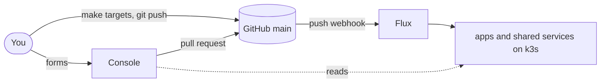

# Swhurl Platform

A small app platform on one k3s node at home. You start an app from a template, connect it to other apps, and promote it from staging to production. A web console shows everything that runs and turns each change into a pull request. Flux applies whatever is on `main`.

The cluster is live. [Current state](docs/current-state.md) records what has been verified on it and when. [The plan](docs/plan.md), section 0, lists what is left to build.

## What the platform consists of

| Part | What it gives you | More |
| --- | --- | --- |
| Console | A signed-in web page at `console.homelab.swhurl.com`. It lists every app, team and Flux unit, starts new apps, connects apps and promotes them to production. | [Console](#console) |
| Apps | One GitHub repository per app, made from a TypeScript or Kotlin template, with a staging and a production instance. The app's `swhurl.yaml` says what the image needs (port, database, telemetry, secret names) and what it offers (its API, events and feature flags); its team, access, calls and subscriptions are granted on the platform. | [Apps](#apps) |
| Shared services | Google sign-in, logs, metrics and traces in ClickStack, events and feature flags on NATS, notifications to phones through ntfy, and restarts when a Secret changes. | [Shared services](#shared-services) |
| Delivery | Git is the only way in. Flux applies `main`, image automation deploys each new staging build, and the console and Renovate open pull requests. | [Delivery](#delivery) |
| Cluster and host | k3s with cert-manager, Let's Encrypt, Traefik and retained local storage, plus host timers for dynamic DNS, backups and a heartbeat. | [Cluster and host](#cluster-and-host) |



## Console

The console is where you see the platform and change it without a terminal. Sign in with the Google account that every other signed-in host accepts.

| Page | Use it to |
| --- | --- |
| Overview | See one verdict for the whole platform, what needs attention and what is changing now |
| Apps/Services | See every app with its team, language and what runs in staging and production. **Map** draws who calls whom and who receives which event. |
| An app's page | See its address, connections, feature flags, image and environment. Override a flag, change who can reach it, connect it to another app, scale it, promote it or uninstall it. |
| Catalogue | Read the APIs and events each app offers, with routes, payload fields and a code sample, and add an app as a user of one |
| Teams | Create, rename and delete teams and give each a notification channel |
| Platform | See every live check and Flux unit. Reconcile, suspend or resume a unit. |
| New app | Create the app's repository from a template, wait for its first image and open the pull request that adds it to staging |
| Activity | Follow each change from pull request through merge to the cluster running it |

Reconcile, suspend, resume and feature flag overrides take effect at once. Every other button opens a pull request against this repository, and the ones that are easy to undo merge themselves once checks pass. Outside this repository the console creates one thing, a new app's GitHub repository.

Details: [pages and buttons](docs/console.md#use-it), [stages of a change](docs/console.md#stages-of-a-change), [auto-merge](docs/console.md#auto-merge), [how the console deploys itself](docs/console.md#deploy-a-new-console), [how it is protected](docs/console.md#how-it-is-protected).

## Apps

Four [demo apps](docs/apps.md#the-demo-apps) run all the time and show the pieces working together. `demo-shopper` buys from `demo-shop`, which calls `demo-orders`, which publishes an event that `demo-notifier` receives.

An app's life:

1. [Start it](docs/apps.md#start-a-new-app) from the console's **New app** or `make app-repo`. Its repository and staging instance exist a few minutes later.
2. [Push to the app's repository](docs/apps.md#deploy-a-new-image). Each build deploys to staging.
3. [Promote it](docs/apps.md#promote-to-production) with **Review promotion** or `make app-promote`.
4. [Operate](docs/apps.md#operate-an-instance) or [remove](docs/apps.md#remove-an-app) it.

What an app can declare, and what the platform builds from each declaration, is in [how apps work together](docs/architecture.md#how-apps-work-together). Each capability has its own section: [teams and isolation](docs/apps.md#teams-and-isolation), [calling another app](docs/apps.md#calling-another-app), [events](docs/apps.md#events), [feature flags](docs/apps.md#feature-flags), [what an app offers](docs/apps.md#what-an-app-offers), [notifications](docs/apps.md#notifications), [secrets](docs/apps.md#secrets), [telemetry](docs/apps.md#telemetry).

## Shared services

| Service | Does | More |
| --- | --- | --- |
| Sign-in | oauth2-proxy with Google. An app gets it by being `authenticated-web`. | [Sign-in](docs/services.md#sign-in) |
| ClickStack and OTel | Collects every pod's logs, node and cluster metrics, and apps' OTLP traces. HyperDX shows them, with one dashboard and default alerts per app. | [ClickStack and OTel](docs/services.md#clickstack-and-otel), [dashboards](docs/apps.md#dashboards) |
| NATS JetStream | Carries the events apps declare and holds feature flag overrides, with one NATS user per app instance limited to its own events and flags | [NATS](docs/services.md#nats) |
| Notifications | Flux alerts, a once-a-minute health checker and the notify service send messages to ntfy, to the operator and to each team's channel | [Alerts](docs/services.md#alerts) |
| Reloader | Restarts a workload when a Secret it uses changes | [Reloader](docs/services.md#reloader) |

The full list, with namespaces, hosts and charts: [services](docs/services.md).

## Delivery

Every change is a commit on `main`, and Flux applies it within seconds of a push.

### Make a change

From a terminal:

```bash
make check                       # offline checks, the same as CI
git commit -am "..." && git push
make flux-reconcile              # optional: waits until every unit is Ready at your commit (the push webhook already started it)
make verify-platform             # expect "Validation passed."
```

`make check` needs a few pinned tools ([contributing](docs/contributing.md#validation)). There is no whole-platform teardown or reinstall. `make destroy-data` is the only command that deletes data ([lifecycle](docs/operations.md#lifecycle)).

The other writers to `main` (console and Renovate pull requests, the console's own image pin, staging image updates) and the few commands that write to the cluster directly are in [how changes reach the cluster](docs/architecture.md#how-changes-reach-the-cluster). Flux units and their dependencies are in [architecture](docs/architecture.md#flux-units).

## Cluster and host

One machine runs k3s. cert-manager gets certificates from Let's Encrypt, the packaged Traefik routes HTTPS, and app data sits on volumes that outlive their pods. Host timers keep the Route 53 records pointing at the node, back up ClickStack's MongoDB and every app's SQLite database to S3 each night, and send a heartbeat for the notification checker.

[Bootstrap](docs/bootstrap.md) builds it from a bare host. [Operations](docs/operations.md) covers health, Secrets, backups and troubleshooting.

## Find a page

| I want to… | Read |
| --- | --- |
| Look up a `make` target | [Commands](docs/commands.md) |
| Check health, rotate a Secret, restore a backup or troubleshoot | [Operations](docs/operations.md) |
| Review a Renovate chart update | [Chart updates](docs/operations.md#chart-updates) |
| Understand a shared service, its settings or Secrets | [Services](docs/services.md) |
| See how the pieces depend on and own each other | [Architecture](docs/architecture.md) |
| Change this repository safely (tests, fixtures, docs) | [Contributing](docs/contributing.md) |
| Learn what app, environment, instance and unit mean | [Glossary](GLOSSARY.md) |

<details>
<summary>Repository layout</summary>

| Path | Contents |
| --- | --- |
| `clusters/home/` | Flux entrypoint: sources, settings and one Flux unit per capability or app instance |
| `infra/` | Namespaces, storage classes, cert-manager, issuers, Traefik settings |
| `platform/` | Sign-in, ClickStack and its operators, OTel collectors, Reloader, NATS and the feature flag buckets, alerts, the notify service, the console and the Flux webhooks, with their encrypted Secrets |
| `apps/<app>/<env>/` | Generated app instances. Each app's code lives in its own repository, made from a [stack template](docs/apps.md#stacks-and-features). |
| `images/` | Container images built from this repo (the console) |
| `tools/swhurl/` | Python operator tooling behind every `make` target, and the console's code |
| `host/` | Host systemd timers for dynamic DNS, backups and the heartbeat |
| `tests/` | Offline tests and fixtures |

</details>
