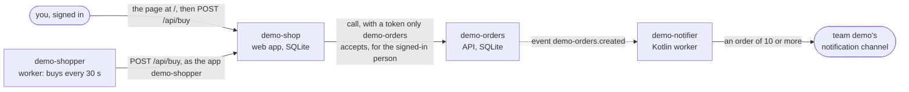
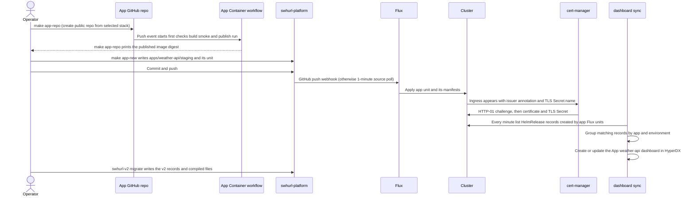
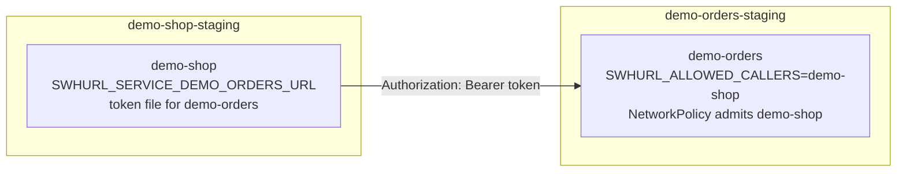
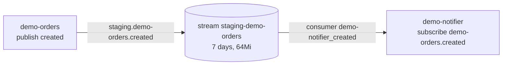
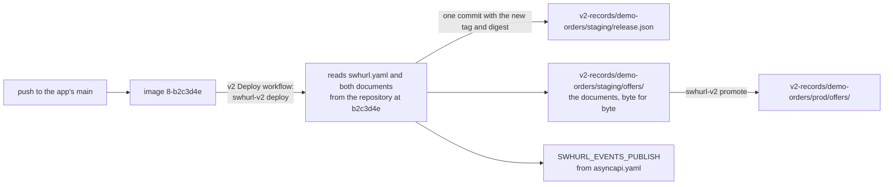
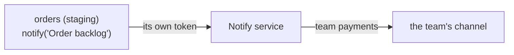
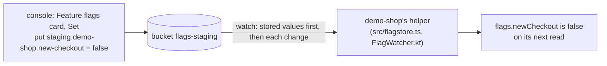
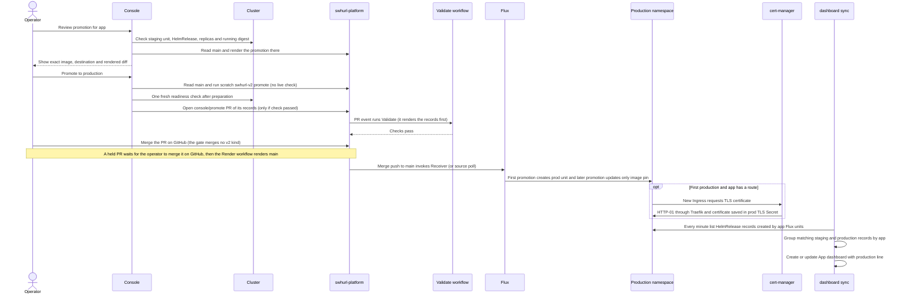
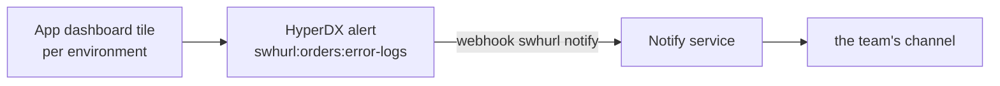

# Apps

An **app instance** is one app in one environment: namespace `<app>-<env>`, a HelmRelease of the pinned [bjw-s app-template](https://bjw-s-labs.github.io/helm-charts/docs/app-template/) chart (5.2.1), an optional encrypted Secret, and its own Flux unit `app-<app>-<env>`. Instances wait only for `infra-base` and what they use: `platform-oauth2-proxy` when signed-in, `platform-image-automation` in staging and `platform-nats` when they declare events; a broken instance never blocks another, and an observability outage never blocks an app.

An app's life, and where each step is described. Every app comes from a stack template, and every change is a Git edit (by hand, a `make` command or a console pull request) that Flux applies ([how changes reach the cluster](architecture.md#how-changes-reach-the-cluster)):

| Stage | Console | Command | Section |
| --- | --- | --- | --- |
| Start a new app: code, repository and staging | **New app** (it points here) | `make app-repo`, then `make app-new`, then `swhurl-v2 migrate` | [Start a new app](#start-a-new-app) |
| Ship a new version | — | push to the app's repository | [Deploy a new image](#deploy-a-new-image) |
| Promote to production | **Promote to production** | `swhurl-v2 promote` (the console runs it) | [Promote to production](#promote-to-production) |
| Choose who can reach it | **Change access** | `swhurl-v2 edit --set exposure=…` | [Who can reach it](#who-can-reach-it) |
| Give it secrets | — | not modelled by v2 ([secrets](#secrets)) | [Secrets](#secrets) |
| Keep dependencies current | — | Renovate pull requests in the app's repository | [Dependency updates](#dependency-updates-in-app-repositories) |
| Watch, resize, fix | the app page, **Scale**, **Reconcile** | `make app-status`, `app-logs`, `app-reconcile`; `swhurl-v2 edit --set replicas=…` | [Operate an instance](#operate-an-instance) |
| Remove | **Uninstall** | `swhurl-v2 remove` | [Remove an app](#remove-an-app) |

## The demo apps

Four small apps, owned by team `demo`, show how apps on the platform work together. They run all the time, and a little traffic flows through them, so every page that describes an app (the console, a dashboard, a trace) has something real to show. Each repository's README says what it demonstrates and where in its code.



| App | Stack | Where | What it shows | Read about it |
| --- | --- | --- | --- | --- |
| [`demo-orders`](https://github.com/samclement/demo-orders) | TypeScript, API | staging, prod | An API only other apps may use; its API and its event described in its own repository; a database the platform keeps and backs up | [Calling another app](#calling-another-app), [what an app offers](#what-an-app-offers), [backups](operations.md#backups-and-recovery) |
| [`demo-shop`](https://github.com/samclement/demo-shop) | TypeScript, web app | staging, prod | A page people use, calling its own `/api/*`; calling another app with a platform-issued token, for the signed-in person; telling a person from an app; its own SQLite for what only it uses (the purchases made through it) | [App types](#app-types), [calling another app](#calling-another-app), [who can reach it](#who-can-reach-it) |
| [`demo-shopper`](https://github.com/samclement/demo-shopper) | TypeScript, worker | staging | A worker; an app calling another as itself; the steady traffic | [Stacks and features](#stacks-and-features) |
| [`demo-notifier`](https://github.com/samclement/demo-notifier) | Kotlin, worker | staging | Receiving another app's event; a message to the team; the second stack | [Events](#events), [notifications](#notifications) |

All web addresses require sign-in: `https://staging-demo-shop.homelab.swhurl.com`, `https://demo-shop.homelab.swhurl.com`, `https://staging-demo-orders.homelab.swhurl.com` and `https://demo-orders.homelab.swhurl.com`. Staging is a separate rollout and failure boundary, not a separate trust boundary.

**See it work.** Each step is something you can open:

| To see | Do this |
| --- | --- |
| The apps and how they are connected | Console → **Deployments** → **Map**: two solid lines (calls) and one dashed (the event) |
| What each offers, and its routes or payload | Console → **Catalogue** → team `demo`; open `created` under `demo-orders` for its fields and an example (demo-shop's API serves its page, so it is not listed) |
| A purchase | Open `https://staging-demo-shop.homelab.swhurl.com/`: **Latest orders** shows what `demo-shopper` bought seconds ago; buy something and it appears under **Your recent purchases** |
| That only apps may place orders | Signed in, `POST https://staging-demo-orders.homelab.swhurl.com/orders` answers 401: you are a person, not `demo-shop` |
| One request through every app | Console → `demo-shop/staging` → **Logs and traces**: one trace runs `demo-shopper` → `demo-shop` → `demo-orders` → `demo-notifier` |
| Traffic and errors over time | Console → any demo app → **Dashboard** |
| A team notification | On the shop's page, buy 12 of something: ten or more makes `demo-notifier` tell the team's channel |
| A promotion | Console → `demo-shop/staging` → **Review promotion** (it needs `demo-orders` in production, which it has) |

**The traffic.** `demo-shopper` visits the shop every half minute (`POST /api/buy`, then `GET /api/shop`): about four requests a minute through `demo-shop` and `demo-orders` and two events, with quantities of one to three so nobody is notified. `demo-orders` keeps the latest 1000 orders. To pause it, Scale `demo-shopper/staging` to zero in the console (or `swhurl-v2 edit --records v2-records --app demo-shopper --env staging --set replicas=0 --profile v2/testdata/profile.json --out .`), commit and push.

**Use them as a pattern.** To call `demo-orders` or receive its event from your own app, use the Catalogue's **Add an app**; to start an app like one of them, choose the same type and stack with `make app-repo` and copy what its README points at.

## Start a new app

From nothing to a running staging app in a few minutes (about two for TypeScript; a little longer for Kotlin, whose build also compiles and tests): `make app-repo` creates the app's GitHub repository from a template and waits for its first image, `make app-new` adds it to staging, and `swhurl-v2 migrate` makes v2 own the instance. Every push to the app's `main` then deploys to staging on its own.

**In the console:** `/new` no longer creates anything. It names this route — `make app-repo`, `make app-new`, `swhurl-v2 migrate`, then delete the v1 records and unit ([console](console.md#new-apps-disabled)). A new app has no production path today: v2 promotes into an environment that already exists and does not create one, so a first production waits for that capability ([not yet modelled](v2-status.md#progress-towards-the-goals)).

### What happens, and when

For example, starting `weather-api` from the TypeScript template creates `samclement/weather-api`, waits for its first published image, and adds `weather-api/staging` to this platform repository. The timeline is:



The command creates a **public** app repository because the cluster pulls its image without registry credentials. Its first commit starts the app repository's normal push workflow; this is a GitHub Actions push trigger, not a platform webhook. `make app-repo` waits for that workflow to finish and prints the image digest to use. If the first build fails it stops with the run's link: the repository stays; fix the app, push, and run the same `make app-new` line with the image that run publishes.

`make app-new` writes the app's v1 staging records and unit only after the image exists. Commit and push them, and Flux deploys the instance. Then `swhurl-v2 migrate` translates those records into `v2-records/` and `swhurl-v2 render` writes the compiled files and unit v2 owns; commit those, delete the v1 records and unit, and move the unit registration in the same change as [the cutover](v2-status.md#slice-record-the-cutover-reaches-the-cluster-a-staging-instance-then-three-then-three). From then on the console's app page writes v2's records (every v2 pull request is held for you) and `make v2-deploy` follows the app's images. Production is not created by this flow: v2 promotes into an environment that already exists, and creating one is not modelled yet ([promote to production](#promote-to-production)). An app that declares secret names cannot be migrated: v2 records no secret names yet and refuses such a release, so leave `--secret-keys` off until it does ([secrets](#secrets)). Platform PR branch pushes are filtered out by the Flux Receiver; the push to `main` is what invokes it. Without a successful webhook delivery, Flux's `GitRepository` still polls `main` every minute.

After the commit, Flux creates the app's dedicated `app-<name>-staging` unit from the newly registered unit file. It waits for `infra-base`, and also `platform-oauth2-proxy` for authenticated web exposure. The unit applies the namespace, HelmRelease and optional encrypted Secret. The chart creates the Deployment and Service for a web app; authenticated or public web exposure also creates an Ingress. Worker apps have no Service or Ingress. SQLite/database answers add a retained PVC and mount; secret answers add the SOPS Secret, and a namespace that reads one is watched by Reloader ([whose list v2 renders](services.md#reloader)). With automatic deploy enabled, the staging unit also creates this app's Flux `ImageRepository` and `ImagePolicy` in `flux-system`, whose report starts the Deploy workflow, so later published images can update the staging image pin in platform Git. These resources are app-scoped; the shared cluster services already exist.

**Certificates are requested only for a web app with a route** (`authenticated-web` or `public`). The generated Ingress names a TLS Secret and carries the selected ClusterIssuer annotation. The default is `letsencrypt-prod`, even for the staging environment; `letsencrypt-staging` and `selfsigned` can be selected. Once Flux/Helm has created the Ingress, cert-manager notices it and asynchronously performs the issuer's flow. For Let's Encrypt that is HTTP-01 through Traefik; on success cert-manager stores the certificate in the named Secret, which Traefik uses for HTTPS. The app Helm readiness does not wait for certificate issuance, so the app can become Ready while TLS is still pending. Private web apps and workers have no route and therefore request no certificate.

**The dashboard is also asynchronous.** The `console-dashboards` CronJob runs once a minute. It lists Kubernetes HelmRelease records, keeps the ones registered by an `app-<name>-<env>` Flux unit whose app name and namespace match the release, then groups staging and production records by app. As soon as Flux has created the staging HelmRelease, the job creates or updates `App: <name>` in HyperDX. It does not wait for the release or pods to become Ready. It uses ClickStack's API; no dashboard manifest or app-specific dashboard provisioning enters Git. A dashboard failure retries on the next scheduled run and does not block the app. Details and dashboard contents are in [Dashboards](#dashboards).

Once staging is deployed, later pushes to the app repository's `main` publish images. The app repository's [image webhook](services.md#image-webhook) tells Flux the moment the image is published; Flux picks the new tag and starts the Deploy workflow, which commits the tag, its digest and what the image offers to this platform repository's `main` in one commit; the push webhook then rolls out that image to staging ([deploy a new image](#deploy-a-new-image)). Production is not created by this flow.

**From a terminal**, the same in two steps (the first needs your `gh` login and SSH access to GitHub):

```bash
make app-repo NAME=weather-api TYPE=api STACK=kotlin   # DRY_RUN=true shows the plan
# [OK] Created https://github.com/samclement/weather-api from samclement/swhurl-app-template-kotlin
# [OK] First image: ghcr.io/samclement/weather-api:1-a1b2c3d@sha256:…
#   make app-new NAME=weather-api ARGS="--from-repo samclement/weather-api --env staging --team <team> --exposure private --image ghcr.io/…"
make app-new NAME=weather-api ARGS="--from-repo samclement/weather-api --env staging --team payments --exposure private --image ghcr.io/…"   # the printed line, with the team that owns it
git add apps/weather-api clusters/home && git commit -m "apps: add weather-api/staging" && git push
make app-status APP=weather-api ENV=staging    # expect "running: matches desired"
```

`make app-repo` refuses a name that already exists on GitHub. For a free name, it creates the repository **public** (the cluster pulls images without credentials), adds the [image webhook](services.md#image-webhook), waits for its first build (checks, image, smoke test, publish) and reads the image digest from GHCR as the cluster will, printing the `make app-new` line to run. If that build fails it stops with the run's link: the repository stays; fix the app, push, and run the same `make app-new` line with the image that run publishes.

**Only apps made this way are supported.** In this repository `make app-new` refuses anything else: `--from-repo` must be `samclement/<name>`, and the image must be `ghcr.io/samclement/<name>` (what that repository's workflow publishes); staging always follows its new images. There is no route for an image built elsewhere or a public image such as nginx: the app policy refuses an instance committed by hand under `apps/` that is not such an app ([the app policy](#the-app-policy)), and for a v2 record the repository and image are the review's to refuse, since v2 states them and renders whatever they say. Tests are the one exception: the throwaway live tests (`make live-test-*`) deploy nginx and BusyBox images from fixture manifests into labelled test namespaces and remove them afterwards.

### App types

A new app is created by **type**: what a team is building. The type sets every answer of the stack's template (below) and the access staging starts with; nobody picks features one by one, and the templates accept no other set of answers (each template's last question has a validator listing the types). [`APP_TYPES`](../tools/swhurl/apps/contract.py) is the one list, read by `make app-repo TYPE=` and each template's validator; `make check-templates` fails when a type no longer renders or fits the platform, or when a template accepts answers no type has.

| Type | For | Stacks | `kind` | `frontend` | `database` | `api` | Access at first |
| --- | --- | --- | --- | --- | --- | --- | --- |
| `web-app` | A site people use in a browser | TypeScript | `web` | `vite` | `sqlite` | `openapi` | signed-in |
| `api` | Data and operations other apps call | TypeScript, Kotlin | `web` | — | `sqlite` | `openapi` | private |
| `worker` | Reacting to events, or work in a steady loop | TypeScript, Kotlin | `worker` | — | `none` | `none` | private (no route) |
| `scheduled-job` | Work at a time of day: each run does its work and ends | TypeScript, Kotlin | `job` | — | `none` | `none` | private (no route); [runs on a schedule](#scheduled-jobs) |

Every type also has an events document and an example feature flag ([below](#stacks-and-features)). Only a web app or an API keeps a database: `app-new` and a `swhurl.yaml` refuse one for a worker or a job, which keep what they need in an API they call. A web app without a database (made before the types) still runs.

Data shared between apps belongs in an API; a web app's own SQLite keeps what only it uses. A browser reaches an API through a web app, which calls it for the signed-in person ([a browser calling an API](#calling-another-app)). Access changes later with **Change access** (`swhurl-v2 edit --set exposure=…`), and calls, events and scale as for any app. A type is not recorded on the app: its `.copier-answers.yml` keeps the answers it was made with. Changing a type adds its new answers to `APP_TYPES` and to each template's validator, and keeps the old answers in the validator until no app records them; an app whose answers are no type's cannot take a template update. A web app's page is served at `/` and its own API under `/api/*`, which the Catalogue does not list (`frontend`, below). A scheduled job runs as a CronJob ([scheduled jobs](#scheduled-jobs)) ([plan](plan.md#23-app-types-for-new-apps--decided-17-october-2026)).

### Stacks and features

A **stack** is a [Copier](https://copier.readthedocs.io/) template repository for one language and framework:

| Stack | Template | Runs as |
| --- | --- | --- |
| `typescript` (default) | [`swhurl-app-template-typescript`](https://github.com/samclement/swhurl-app-template-typescript) | Node 24; starts in about a second, about 60 MB of memory; the platform's default resources |
| `kotlin` | [`swhurl-app-template-kotlin`](https://github.com/samclement/swhurl-app-template-kotlin) | Kotlin on Micronaut, Java 25, about 150 MB image; about 10 s to start, about 200 MB of memory. Its `swhurl.yaml` asks for 100m CPU, 192Mi (limit 384Mi) and two minutes to start |

**Features** are the template's own questions (its `copier.yml`, read at the catalogue's pinned GitHub revision), which an [app type](#app-types) answers, and two that every app has:

| Feature | The app gets | The platform adds |
| --- | --- | --- |
| `kind` | An HTTP service answering `/healthz`, a background process that works every `WORK_INTERVAL_MS`, or a [scheduled job](#scheduled-jobs): one run of `work()` that ends with its status | A worker is private: no Service or route (the console hides **Change access**) |
| `database: sqlite` | SQLite at `DATABASE_PATH` with migrations in `migrations/` applied at startup | A retained volume, one copy running at a time, nightly backups and `make restore-sqlite` ([operations](operations.md#backups-and-recovery)). Staging and production each have their own database; a promote copies the image, not the data |
| `api: openapi` | An [OpenAPI](https://www.openapis.org) description generated from the app's routes, committed in its repository and served by the app: `openapi.json` (TypeScript, Hono with `@hono/zod-openapi`) or `src/main/resources/openapi.yaml` (Kotlin, Micronaut OpenAPI). A test fails while the file and the routes disagree | The link on the app page (`provides.api`), and the document kept beside each instance (`provides.apiFile`; [what an app offers](#what-an-app-offers)) |
| Events (every app) | An [AsyncAPI 3](https://www.asyncapi.com) document, `asyncapi.yaml`, describing each event the app publishes (name, meaning, payload schema, example), with one example event (`visited` for web, `worked` otherwise). The helper refuses to publish an event that is not in the file or a payload that does not fit its schema. An app that publishes nothing keeps the file with `channels: {}` | Its NATS key and stream at creation, and what it publishes from the document from then on ([what an app offers](#what-an-app-offers)) |
| Feature flags (every app) | [Feature flags](#feature-flags) declared in `swhurl.yaml` and read through generated typed accessors; the template declares one, `shout` (on in staging only), which the example route or work loop reads | Nothing yet: `app-new` and `make check-templates` check the declarations |
| `frontend: vite` | TypeScript web apps. A browser page in `web/`, its own npm project built with [Vite+](https://viteplus.dev): the image build runs `vp check` (formatting, lint, types) and `vp build`, and the app serves the result at `/`, with its own routes under `/api/*` (`/api/flags` gives the page its feature flags). The page calls only its own app, as the signed-in person; the app calls APIs for them ([a browser calling an API](#calling-another-app)) | Its `swhurl.yaml` does not offer its API to other apps, so the Catalogue does not list it; `openapi.json` still types the page's calls |

Either way the app listens on 8080 (web), runs as UID 65532 writing only to `/tmp` (and `/data` with a database), sends traces and metrics over OpenTelemetry, logs JSON linked to its traces, and publishes `ghcr.io/<owner>/<app>:<run>-<sha>` from `main`. Nothing in the app's repository names the cluster: its [`swhurl.yaml`](#swhurlyaml) says what it needs, and this repo writes the manifests. Each template's README is the guide on the app's side. The catalogue pins reviewed template commits in `STACK_REVISIONS` in [`contract.py`](../tools/swhurl/apps/contract.py). Questions, rendering and contract checks all use that commit. Template releases have immutable version tags; Copier records the tag when it describes the pinned commit. Deliberate catalogue updates change the pin and run `make check-templates` before release. App workflow versions are pinned to release tags and bumped by Renovate. The shared Renovate preset keeps dependency rules consistent; [template updates](#template-updates) apply generated-file changes through reviewed PRs.

**How templates are tested.** Two halves, so neither grows with the other:

- **The template's own CI** (its Template workflow) renders each [app type](#app-types) built with that stack (TypeScript 4, Kotlin 3) and, for each, type-checks, tests, builds the image and smoke-tests it; on `main` each one's image is a [seed](#first-builds-of-new-apps). Each type keeps its own image build cache. SQLite runtime checks apply migrations and write through the actual image, restart with the same data directory, then verify migration history and previous rows are preserved and new writes work. Database inspection uses a disposable copy including WAL files. Both stacks use the same conformance assertions; each retains its own compiler, tests and build.
- **This repo's `make check-templates`** (in CI on every push, not in `make check`; needs network and the v2 binary; about 15 s) clones each template at its pinned commit, renders each app type with Copier, runs the image-declaration producer over the rendered app — the same producer the image build calls — and hands the label to `swhurl-v2 declaration`, which decodes it and applies the rules a `create` would apply, with no image, no registry and no write. It also renders one set of answers no type has (a worker with a database), which the template must refuse. A `job` label is a warning: v2 does not model that kind yet, so the check names the gap instead of failing the template. It builds nothing and runs in parallel (one process per CPU). It catches a template declaring something the platform refuses before anyone creates an app from it.

Adding a feature to a type changes that type's answers in `APP_TYPES`, in each template's validator and in its Template workflow matrix.

### Template updates

Renovate's [Copier manager](https://docs.renovatebot.com/modules/manager/copier/) reads `.copier-answers.yml`, finds newer template version tags and runs Copier to update generated files with the saved answers. Template repositories publish immutable `v…` tags only after every type's checks pass. Copier updates always require manual review, even for minor releases: inspect app edits and resolve conflicts before merging. The installed Renovate GitHub App needs workflow-write permission when an update changes a workflow pin (it already writes workflow updates in the template repos). A CLI token without that scope cannot push such a branch; the ordinary reviewed SSH Git route can bootstrap it without credential changes. The app's Container workflow checks the PR and publishes an image only after merging to `main`, which deploys to staging. Promotion remains explicit.

Existing Copier apps whose answers record an untagged commit need one bootstrap update on a clean branch: `uvx copier@9.18.2 update --skip-answered --defaults --vcs-ref v0.1.0`. Review and commit the generated diff, then open a PR and wait for Container checks. Do not edit `_commit` manually. An app made before the templates used Copier has no answers file: render the template over it once (`copier copy --overwrite --vcs-ref <tag>` with its answers) and port its own code, after which Renovate proposes updates as for any other app.

Representative warm GitHub template jobs took 42–75 s for TypeScript and 28–62 s for Kotlin, including SQLite restarts. An earlier cold Kotlin app build took 6 min 31 s from console form to PR ([evidence](current-state.md)). PRs and main build each type the stack has (listed in each Template workflow); there is no separate scheduled matrix. A third stack adds its catalogue repository and pin, template/build checks and runtime conformance evidence; it adds no language build dependencies here.

### Add production

Production is created by the first [promotion](#promote-to-production) from reviewed staging settings, and that is a capability v2 does not have yet: `swhurl-v2 promote` moves a production whose records already exist, and nothing creates one. `make app-new` creates staging only (`--env prod` is refused).

### What the generator writes

`make app-new` ([`new.py`](../tools/swhurl/apps/new.py); `make app-new NAME=x ARGS=--help` lists every option) writes `apps/<app>/staging/` and `clusters/home/app-<app>-staging.yaml`, registers the unit in `clusters/home/kustomization.yaml` (files under `apps` deploy nothing until then), and checks the result against [the app policy](#the-app-policy) before exiting (a missing tool or failed render makes the command fail; `--no-policy-check` explicitly skips validation). The output is plain YAML; edit it like any manifest afterwards, then run `swhurl-v2 migrate` to make v2 own the instance.

| Option | Rules |
| --- | --- |
| `--from-repo samclement/<name>` | Required: reads `swhurl.yaml` once, at the commit the `--image` tag names (`<run>-<sha>`), through GitHub's API, with `GITHUB_TOKEN` if set; the instance's needs and what it offers both come from that one read. Its fields become the defaults and a flag you give wins (for example `--exposure public --host weather.example.com`). `@REF`, or a tag that names no commit, is refused |
| `--env` | `staging` (default); production is created by promotion |
| `--kind` | `web` (Service and probes on `--health-path`, required) or `worker` (no Service, no route) |
| `--image` | `ghcr.io/samclement/<name>:<run>-<sha>@sha256:…`, as `make app-repo` and the app's workflow print it |
| `--exposure`, `--host` | Who can reach it ([below](#who-can-reach-it)); default `private` |
| `--team` | Required: the owning team, a name in `apps/teams.yaml` ([teams and isolation](#teams-and-isolation)) |
| `--secret-keys A,B` | The secret names the app reads, without values. v2 records no secret names yet and refuses a release that declares them, so an app created with these cannot be migrated ([secrets](#secrets)) |
| `--otlp` / `--no-otlp` | The app has an OpenTelemetry SDK: points it at the cluster collector ([telemetry](#telemetry)) |
| `--database sqlite` | A retained volume (`--database-size`, default 1Gi) at `/data` on `local-path-retain`, with the database file `/data/app.db` passed to the app as `DATABASE_PATH`; backed up daily. The claim is kept on Helm uninstall and the namespace is never pruned ([remove an app](#remove-an-app)); the instance runs one replica and stops the old pod before starting the new one (policy rule `single-writer`) |
| `--uid`, `--port`, `--cpu`, `--memory`, `--memory-limit`, `--issuer` | Defaults: 65532, 8080, `10m`, `32Mi`, `128Mi`, `letsencrypt-prod` |

Every instance runs non-root with no service-account token, all capabilities dropped and a read-only root filesystem with a writable `/tmp`. Every web app gets the same start-up allowance: a startup probe gives it up to 120 s to first answer its health path before liveness checks begin. A fast app is Ready as soon as it answers; a JVM on a busy node needs most of it. The allowance is fixed rather than per app so that it stays a minute inside Helm's 3-minute wait (time to pull the image), and the templates' smoke tests wait just as long. The generator refuses to overwrite an instance, expose a worker, put a public app in the sign-in cookie domain, or ship production without a digest.

## Platform-provided interface

For example, every instance receives `SWHURL_APP` and a notify token; a SQLite instance also receives `DATABASE_PATH=/data/app.db`. An absent conditional name means that capability is not supplied, not an empty/default value. Web token-signing keys may be empty in scratch roots without a key file. NATS identity requires both its public allocation and encrypted seed availability; publications and subscriptions additionally require that identity.

This is the canonical list of platform-provided environment names, managed app metadata and token/data paths, plus optional reader overrides. An `env override` is an input accepted by a platform reader, not a variable injected into app manifests. [`interface.py`](../tools/swhurl/interface.py) owns the names, meanings and availability; `make check` checks this table, while capability renderers own when and how they are emitted. User-declared Secret keys are not platform-provided names. Recovery/test/backup labels and infrastructure-only metadata are not app capabilities. The token family uses a concrete audience (`notify` or a connected callee); the service-variable family uses the callee's app name. See [calls](#calling-another-app), [events](#events), [secrets](#secrets) and [telemetry](#telemetry) for use and policy.

<!-- app-interface -->
| Name | Surface | Meaning | Availability |
| --- | --- | --- | --- |
| `SWHURL_APP` | env | App name | Every instance |
| `SWHURL_ENV` | env | Environment name | Every instance |
| `SWHURL_NOTIFY_URL` | env | Notify service address | Every instance |
| `SWHURL_NOTIFY_TOKEN_FILE` | env override | Notify token file override; defaults to /var/run/swhurl/tokens/notify/token | Optional input to the Python notify reader; not injected |
| `SWHURL_AUTH_ISSUER` | env | Token issuer | Web instances (v1-rendered) |
| `SWHURL_AUTH_KEYS` | env | Public token-signing keys | Web instances (v1-rendered) |
| `SWHURL_AUTH_KEYS_FILE` | env | Path of the public token-signing keys, mounted from swhurl-auth | A callee (v2-rendered) |
| `SWHURL_AUTH_ISSUER_FILE` | env | Path of the token issuer, mounted from the platform's swhurl-auth ConfigMap | A callee (v2-rendered) |
| `SWHURL_ALLOWED_CALLERS` | env | Accepted callers, comma-separated | At least one connected caller (v1-rendered) |
| `SWHURL_ALLOWED_CALLERS_FILE` | env | Path of the accepted callers, comma-separated, mounted from <app>-callers | At least one connected caller (v2-rendered) |
| `SWHURL_DESCRIPTION` | env | Image description | Nonempty release description |
| `SWHURL_SERVICE_<APP>_URL` | env family | Callee URL; uppercase app name with hyphens changed to underscores | Mutually granted call to an existing web instance |
| `SWHURL_EVENTS_PUBLISH` | env | Published events, comma-separated | Keyed instance with publications |
| `SWHURL_EVENTS_SUBSCRIBE` | env | Subscriptions, comma-separated | Keyed instance with subscriptions |
| `SWHURL_EVENTS_URL` | env | NATS address | Complete NATS identity |
| `SWHURL_EVENTS_NKEY` | env | Public NATS key | Complete NATS identity |
| `SWHURL_EVENTS_SEED` | Secret env | Private NATS seed via envFrom | Complete NATS identity |
| `HOST_IP` | env | Node IP from status.hostIP | Telemetry or egress proxy |
| `OTEL_EXPORTER_OTLP_ENDPOINT` | env | Node-local OTLP HTTP endpoint | Telemetry enabled |
| `OTEL_EXPORTER_OTLP_PROTOCOL` | env | OTLP transport protocol | Telemetry enabled |
| `OTEL_SERVICE_NAME` | env | Telemetry service name | Telemetry enabled |
| `HTTP_PROXY` | env | HTTP proxy URL | Platform has egress proxy |
| `HTTPS_PROXY` | env | HTTPS proxy URL | Platform has egress proxy |
| `NO_PROXY` | env | Addresses bypassing the proxy | Platform has egress proxy |
| `NODE_USE_ENV_PROXY` | env | Enable Node environment proxy | Platform has egress proxy |
| `JAVA_TOOL_OPTIONS` | env | JVM proxy system properties | Platform has egress proxy |
| `DATABASE_PATH` | env | SQLite database filename | SQLite database |
| `/data` | path | Retained data mount | SQLite database |
| `/data/app.db` | path | SQLite database file | SQLite database |
| `/var/run/swhurl/tokens/<audience>/token` | path family | Audience-bound token; notify or connected callee | Every instance has notify; calls add audiences |
| `platform.swhurl.com/managed` | label | Platform-managed marker | Namespace and image automation |
| `platform.swhurl.com/app` | label | App name | Namespace and image automation |
| `platform.swhurl.com/environment` | label | Environment name | Namespace |
| `platform.swhurl.com/exposure` | label | Exposure grant | Namespace |
| `platform.swhurl.com/team` | label | Owning team | Namespace |
| `platform.swhurl.com/policy-exceptions` | annotation | Reviewed policy exceptions | HelmRelease when nonempty |
| `platform.swhurl.com/secrets` | annotation | Required secret names, comma-separated | HelmRelease when declared |
| `platform.swhurl.com/egress` | annotation | Outbound host:port grants | HelmRelease when nonempty and proxy exists |
| `platform.swhurl.com/offers` | annotation | Commit supplying offered documents | HelmRelease when recorded |
| `platform.swhurl.com/api-description` | annotation | Served API description path | Web HelmRelease with API path |
| `platform.swhurl.com/alerts` | annotation | Alert overrides; absent means defaults | Namespace when configured |
| `platform.swhurl.com/render` | annotation | Fingerprint of intended generated output | Every HelmRelease |
| `secret.reloader.stakater.com/reload` | annotation | Secrets whose change restarts the controller | Controller with referenced app or events Secret |
| `kustomize.toolkit.fluxcd.io/prune` | annotation | Retain namespace and its data after removal | SQLite Namespace |
<!-- /app-interface -->

## swhurl.yaml

What the app is, what its image needs and what it offers other apps, kept in the app's own repository (the templates write it from your feature answers). The name, environment, image and host belong to each instance and are never in the file. [`declaration.py`](../tools/swhurl/apps/declaration.py) is its one reader: unknown fields and other versions are refused wherever the file is read.

Each field is one of four kinds ([glossary](../GLOSSARY.md)), and the templates write them in this order under a comment for each:

- **Identity**: what the app is. `version`, `stack`, `kind`, `description`.
- **Need**: what the image needs to run. `port`, `healthPath`, `uid`, `telemetry`, `resources` (the image's minimum), `database`, `databaseSize`, `secrets` (variable names, never values).
- **Offer**: what other apps can use. `provides`, `flags`. AsyncAPI send operations define the published events; there is no second publishing list.
- **Grant**: what the platform allows the app: who owns it, who can reach it, what it may call and receive. `team`, `exposure`, `alerts`, `calls`, `events.subscribe`. A grant belongs to this repository and changes only through `swhurl-v2 edit` or the console; choose it as an `app-new` flag at creation. The file may not hold one: wherever it is read (`app-new`, the v2 Deploy workflow, the console), a grant field is refused with the setting that changes it, so a push to the app's repository cannot widen what the app may do.

**The rule.** Supported fields are read again: every new staging image brings the declaration and documents from the commit it was built from, written into its release in the same commit as the image ([deploy a new image](#deploy-a-new-image)). A removed field clears the value or restores its documented default; it never means "keep the previous image's value". Required fields cannot be removed. A change that would lose database data or break another app's declared subscription is held with a reason; nothing is written. A declared document that is missing, invalid or cannot be fetched is a failure, not an empty declaration.

What the app reads arrives in runtime configuration (for example `SWHURL_DESCRIPTION` and `SWHURL_EVENTS_PUBLISH`); what only the platform reads is an annotation on the instance's HelmRelease, not the pod template. Changing that annotation alone does not change the pod spec. These are generated views, not additional developer inputs. The app's source of truth is `swhurl.yaml` and the documents it names; the platform owns grants in its instance records.

`autoDeploy` is accepted and ignored: staging always follows new images.

```yaml
# Identity
version: 1              # required; this platform reads version 1
stack: kotlin           # which template the app came from
kind: web               # required: web, worker or job       --kind
# Needs: what the image needs to run
port: 8080              # web only (default 8080)            --port
healthPath: /healthz    # web only, required                 --health-path
uid: 65532              # default 65532                      --uid
telemetry: otlp         # otlp or none (default)             --otlp
resources: {cpu: 100m, memory: 192Mi, memoryLimit: 384Mi}   # optional, the image's minimum: --cpu, --memory, --memory-limit
database: sqlite        # optional; databaseSize: 1Gi        --database, --database-size
secrets: [API_TOKEN]    # optional: variable names           --secret-keys
# Offers: what other apps can use
provides: {api: /openapi.json}   # optional, web only: where its API description is served (no flag)
#   also apiFile: openapi.json and eventsFile: asyncapi.yaml: where the repository keeps its OpenAPI and AsyncAPI documents (what an app offers)
flags:                  # optional: feature flags, typed, with a value per environment (see Feature flags)
  new-checkout: {type: boolean, default: false, staging: true}
# Grants (team, exposure, calls, events.subscribe) are refused here. Set them on the platform: the app-new
# flags, then the app page or swhurl-v2 edit --set (team, exposure, calls, allows, subscriptions).
```

| Field | Kind | Read | After creation |
| --- | --- | --- | --- |
| `version` | identity | read again | Checked every time the file is read |
| `stack` | identity | read again | The console reads it from the repository's default branch for the language it shows (kept for an hour) |
| `kind` | identity | read again | Checked with every new staging image: web, worker or job is fixed at creation, and an image that changes it is held. A job has no `port`, `healthPath` or `database` |
| `description` | identity | read again | With every new staging image, as `SWHURL_DESCRIPTION`; a promotion carries it with the image. Templates from `v0.2.14` declare it and serve it, with `SWHURL_APP`, in their API description, so an image built for another app (a [seed](#first-builds-of-new-apps)) describes this one |
| `port` | need | read again | With every new staging image: the Service, the probes, its callers' addresses and its NetworkPolicy follow |
| `healthPath` | need | read again | With every new staging image: the readiness, liveness and startup probes |
| `uid` | need | read again | With every new staging image: the pod's user, group and `fsGroup`; held while the instance keeps a volume, whose files belong to the old user |
| `telemetry` | need | read again | With every new staging image: `otlp` adds the `OTEL_*` variables, `none` removes them |
| `resources` | need | read again | With every new staging image, as the minimum: each request and limit is the larger of it and what the instance's record sets (the platform's default, 10m, 32Mi and 128Mi, where neither says). The **Scale** form may set more, never less, and shows it. A minimum above the [quota](#teams-and-isolation) holds the image |
| `database` | need | read again | With every new staging image: a new database gets its retained volume, `DATABASE_PATH`, one replica and stop-first updates. Removing it is refused while the volume exists: a push never deletes data (`make destroy-data` does) |
| `databaseSize` | need | read again | The size a new database's volume is created with; a different size for an existing volume is refused |
| `secrets` | need | read again | With every new staging image: a new name deploys without its value, shown as **value missing** until it is set; a dropped name keeps its value, shown as unused ([secrets](#secrets)) |
| `provides` | offer | read again | The v2 Deploy workflow reads it at the commit of every new staging image, and a promotion carries the result to production ([what an app offers](#what-an-app-offers)). `apiFile` offers the API to other apps (the Catalogue lists it); `api` only gives the console a link to the served description. Removing either removes what it gave |
| `flags` | offer | read again | Built into every image: the app's build generates a typed accessor for each flag ([feature flags](#feature-flags)) |
| `team` | grant | refused | `swhurl-v2 edit --set team=…` (one change for every environment), or `--team` at creation |
| `exposure` | grant | refused | `swhurl-v2 edit --set exposure=…`, or `--exposure` at creation (default: web apps signed-in, workers private) |
| `alerts` | grant | refused | Nothing: v2 has no alert setting, and `edit --set alerts` refuses it by name |
| `calls` | grant | refused | `swhurl-v2 edit --set calls=…`, or `--calls` at creation |
| `events.subscribe` | grant | refused | `swhurl-v2 edit --set subscriptions=…`, or `--subscribe` at creation |
| `autoDeploy` | dropped | ignored | Nothing: staging always follows new images; the templates no longer write it |

| Configuration | If removed | Who reads the generated result |
| --- | --- | --- |
| `version`, `kind`, web `healthPath` | Refused: required | Declaration reader / workload and probes |
| `description`, `stack` | Empty identity metadata; the console's language lookup still reads the default branch separately | App (`SWHURL_DESCRIPTION`); platform release record |
| `port`, `uid`, `telemetry` | Defaults: 8080, 65532, no telemetry; uid changes are refused on existing database files | Kubernetes and runtime telemetry configuration |
| `resources` | No image minimum; instance capacity and platform defaults still apply | Kubernetes resource settings |
| `database`, `databaseSize` | Refused if that would remove a database or change its allocated size; omitted size defaults to 1Gi | PVC, workload and `DATABASE_PATH` |
| `secrets` | No names required by the image; stored values remain, shown as unused | Platform metadata and the app's Secret references |
| `provides.api` | No console link; does not remove the app's route or its offered API document | HelmRelease annotation `platform.swhurl.com/api-description`, read by the console |
| `provides.apiFile` | No API document in the Catalogue; does not remove the app's route or console link | `offers/`, read by the platform |
| `provides.eventsFile` | No publications; refused while subscribed to; does not erase retained messages | `SWHURL_EVENTS_PUBLISH`, NATS permissions and protected stream resources |
| `flags` | No flags in the image's declaration or console form; existing overrides are a separate runtime store | App-generated accessors and `offers/flags.json` |

The independent API fields are intentional: `provides.api` links a running description; `provides.apiFile` publishes a repository document to the Catalogue. Neither creates a route, grants access or controls where the app's business API lives (`/api/*` for a web app). A web app may serve its own API without offering it to other apps.

## Scheduled jobs

**v2 does not render the job kind yet.** An app of this type can be created by `make app-new` and runs as v1 rendered it, but `swhurl-v2 migrate` refuses it, and it has no v2 record, no edit and no promotion until v2 gains the kind. The rest of this section describes that v1 rendering.

A job (`kind: job`, the **Scheduled job** type) has no web address and no running pod between runs: Kubernetes starts one pod per run, on the schedule, from a CronJob the chart makes (`controllers.main.type: cronjob`). The run calls the app's `work()` once and ends: status 0 is a successful run, anything else a failed one. For example, a job that runs every ten minutes in staging:

```bash
# five cron fields, Etc/UTC: set at creation with --schedule; there is no v2 edit for it
make app-new NAME=nightly-report ARGS="--from-repo samclement/nightly-report --kind job --schedule '*/10 * * * *'" 
```

| Setting | Value | Why |
| --- | --- | --- |
| `schedule` | `17 3 * * *` (daily, 03:17 UTC) at creation, or `--schedule` | Per environment; there is no v2 setting for it yet, and the first promotion starts production with staging's. Five fields within minute 0–59, hour 0–23, day 1–31, month 1–12 and weekday 0–6 (ranges low to high, steps of at least 1), or `@hourly`, `@daily`, `@weekly`, `@monthly`, `@yearly`; anything else is refused before a file is written |
| `concurrencyPolicy` | `Forbid` | A run never starts while the last one is still going |
| `backoffLimit` | 0 | A failed run is not retried: the next scheduled run is the retry |
| `activeDeadlineSeconds` | 3600 | A run still going after an hour is stopped, and counts as failed |
| `startingDeadlineSeconds` | 300 | A run that cannot start within five minutes of its time is skipped |
| History | the last successful and the last failed Job | Their pods' logs stay readable with `kubectl logs`; everything else is in ClickStack |

The v1 workload renderer applies the same schedule validation to records, not just command arguments: an empty job schedule means the default above; any explicit schedule on a non-job is refused. v2 has no schedule field, so a v2 record states none.

A job keeps no database (`database` is refused in its `swhurl.yaml` and by its template: the SQLite backup runs in the app's running pod, and a job has none). It is private, takes no calls (it has no Service) and has no replicas: an edit changes only its resources. It can call other apps, publish events and read its feature flags like any app; its template waits up to 5 s for the flag overrides before the run.

**Its state** comes from its CronJob's record of its runs, not from pods (it has none between runs): **Healthy** once a run has succeeded (or while it waits for its first run), **Updating** while a run is going, **Failing** when the newest run ended without succeeding, until a later run succeeds, and **Suspended** when its schedule is. `make app-status` and the app page show the schedule, the last run and the last success; the app page's **Schedule** opens the pull request that setting would make, and its **Scale** changes only CPU and memory. The image it runs is the newest successful run's, so a promotion takes an image that has run successfully in staging. A failed run sends `<app>/<env> run failed` to the team's [notification channel](#notifications) at once, and `recovered` after the next successful run ([notification expectations](services.md#notification-expectations)). The templates' example declares a second flag, `fail-run`, off everywhere: turning it on for an environment on the app page makes the next run fail on purpose, to see how a failed run is reported.

## Who can reach it

| Exposure | Route | Host |
| --- | --- | --- |
| `private` (the default for `make app-new` and for a worker) | None; only apps [connected to call it](#calling-another-app) can connect | — |
| `authenticated-web` (the default for a web app made from a stack) | Behind Google sign-in (the shared oauth2-proxy middleware) | Under `homelab.swhurl.com`; derived as `staging-<name>.homelab.swhurl.com` (`<name>.homelab.swhurl.com` in prod) unless given |
| `public` | No sign-in | `--host` **outside** `homelab.swhurl.com`, so the shared sign-in cookie never reaches it |

Set it with `--exposure` at creation, and change it later with the app page's **Change access** form or `swhurl-v2 edit --records v2-records --app demo-shop --env staging --set exposure=public --profile v2/testdata/profile.json --out .`. The change rewrites the route, the namespace's exposure label and the unit's dependencies together, derives the host from the app and environment, and refuses a route on a worker. Staging and production may differ, for example a signed-in staging preview of a public app. `make app-status` and the app page show the exposure read from the live routes.

## Teams and isolation

Every app belongs to one **team**: a name registered in [`apps/teams.yaml`](../apps/teams.yaml), written as the `platform.swhurl.com/team` label on each of the app's namespaces. There is no default team: name one at creation (`--team`, or the console's team choice, where none is preselected), or `make app-new` refuses; change it for every environment at once with `swhurl-v2 edit --set team=<team>` (it names no environment). A team is a name, not a set of people: it says who owns an app and lets you filter by owner; it grants nobody access.

Manage teams on the console's **Teams** page or with `make team-add`, `make team-edit` and `make team-remove`. The registry and the apps that name a team change together, so no app is left naming a team that is gone (`make check-apps` rule `team` would fail):

| Change | What keeps apps from being orphaned |
| --- | --- |
| Rename a team | The same change relabels every app that belongs to it and rewrites every `team:<old>` [grant](#calling-another-app) |
| Remove a team that owns apps | Refused, unless the same change moves them to another team (`--move-apps-to`) |
| Remove a team an `allows` names | Refused, listing the instances; remove those grants first (`swhurl-v2 edit --set allows=…`) |
| An app already naming an unregistered team | Listed first on the Teams page; register the team or move the app with `swhurl-v2 edit --set team=…` |

Team changes validate all affected instances and plan their records, manifests and [notification routes](services.md#notification-channels) together before writing. Console PRs carry the registry and affected App/Settings records, not the generated labels or routes ([PR contents](console.md#removals-teams-and-channels)).

Logs and traces already stored keep the team name they were written with; only new data carries a new name.

A team can name one [notification channel](services.md#notification-channels) (`make team-edit NAME=payments ARGS="--notify payments-phone"`): it gets a copy of the deployment and health messages of every app the team owns. Choosing a team for a new app is therefore also choosing where its messages go; the chosen team's channel receives them.

Each instance carries two generated files beside its HelmRelease:

| File | What it does |
| --- | --- |
| `resourcequota.yaml` | Caps the namespace at 14 pods, 2 CPU and 2Gi of memory requested, and 4Gi of memory limits: the same for every instance. The compiler refuses replicas or sizes that would not fit beside a backup pod and a certificate solver (its `quota` refusal) |
| `networkpolicy.yaml` | Decides who may connect to the app's pods: the Traefik pods on the app's port when the instance has a route, plus the apps [connected to call it](#calling-another-app). Any other pod, in another namespace or the same one, is refused. A change to the exposure or to either side of a call renders it again |

The policy selects the app's own pods (`app.kubernetes.io/instance: <app>`), never every pod in the namespace: cert-manager's HTTP-01 solver runs there on port 8089 and must stay reachable, as must the SQLite backup pod. Outbound connections are not restricted yet: each instance is pointed at the [egress proxy](services.md#egress-proxy), which logs which hosts it reaches and whether a [grant](#reaching-outside-the-cluster) covers each. Health probes come from the node and are not affected.

## Calling another app

A call needs both sides: the caller says which apps it calls (`calls`), and the callee says who may call it (`allows`, an app's name or `team:<team>`). When both agree, the pair is **connected**: the platform gives the caller the callee's address and a credential, and tells the callee who may call it. For example, `demo-shop` (team `demo`) calling `demo-orders`:

```
# the callee's grant: any demo app in staging may call it (the console's Allow card, or)
swhurl-v2 edit --records v2-records --app demo-orders --env staging --set allows=team:demo \
  --profile v2/testdata/profile.json --out .
# the caller's declaration (the console's Connect to an app, or)
swhurl-v2 edit --records v2-records --app demo-shop --env staging --set calls=demo-orders \
  --profile v2/testdata/profile.json --out .
```

Both are kept in each instance's record:

```json
// v2-records/demo-orders/staging/instance.json   (callee)
"allows": ["team:demo"]
// v2-records/demo-shop/staging/instance.json     (caller; v2-records/demo-shop/app.json says "team": "demo")
"calls": ["demo-orders"]
```

An app's own team is never implicit; a `team:` entry must name a team registered in `apps/teams.yaml`.

| State | What renders |
| --- | --- |
| Connected: the caller calls the callee, and the callee allows the caller or its current team | Everything in the table below |
| A call to an existing web app without consent | Pending: nothing for the pair; the caller's record keeps the call, and the console says it waits for the callee to allow it |
| A grant without a call | Nothing; the grant is unused |
| A call to an app with no instance in that environment | Pending: nothing for the pair; it waits for that instance to exist |

None of these is an error. A call to a present worker or job, a self-call or a malformed declaration is an error, even without consent. A team grant follows the caller's current team: moving an app to another team (`swhurl-v2 edit --set team=…`) connects or disconnects it accordingly.



For a connected pair, rendering writes both instances:

| Side | What is written | Why |
| --- | --- | --- |
| Caller | `SWHURL_SERVICE_DEMO_ORDERS_URL` (`http://demo-orders.demo-orders-$(SWHURL_ENV).svc.cluster.local:<port>`) | The callee in the caller's own environment: staging calls staging, production calls production |
| Caller | A token file at `/var/run/swhurl/tokens/demo-orders/token` | A service-account token Kubernetes issues for the audience `demo-orders` only, valid 10 minutes and replaced by the kubelet before it expires. The Kubernetes API itself refuses it, and so does any app other than `demo-orders` |
| Callee | `SWHURL_ALLOWED_CALLERS=demo-shop` | Who it accepts |
| Callee | Its NetworkPolicy admits `demo-shop`' pods | Anything undeclared is blocked before it reaches the app |

The keys are one platform object, `swhurl-auth`, rendered for every managed namespace by `swhurl-v2 auth` (a ConfigMap cannot cross namespaces, so it is one identical object per namespace); the allow-list is the instance's own (`<app>-callers`). A v2-rendered callee gets both **only as files**, under `/var/run/swhurl/auth` and `/var/run/swhurl/callers`, which the kubelet refreshes in place, so a rotated key or a new caller takes effect in about a minute **without a restart** and changes no pod template. Its image must read the file variables (templates TypeScript `v0.2.19`, Kotlin `v0.2.18` on, through a [template update](#template-updates)); an older image finds no keys and refuses every token. The declarations themselves are fields of the instances' own records (`calls`, `allows`), and both sides of a call are rendered from them; no instance gets the values as environment variables, so no pod restarts when a caller or a key changes.

Every instance is also told who it is (`SWHURL_APP`, `SWHURL_ENV`), and every web app gets what it needs to check a token: `SWHURL_AUTH_ISSUER` and `SWHURL_AUTH_KEYS`, the cluster's public signing keys. Apps cannot fetch those keys themselves (the API server refuses anonymous requests and apps carry no API token), so they live in the profile's `auth` block, from which v2 renders `platform/auth` into every managed namespace; `make verify-platform` fails if the profile differs from the cluster's key set ([operations](operations.md#signing-keys)).

**What the app does.** The stack templates ship both halves; an app's own code only names the callee:

- **Calling:** `service("demo-orders")` reads the address and the token file (again on every call, since it is replaced) and sends `Authorization: Bearer <token>`. A call made for a signed-in person names that person: `service("demo-orders").fetch(path, { onBehalfOf: caller })` (Kotlin: `platform.call("demo-orders", path, onBehalfOf = caller)`) adds `x-swhurl-user: <email>`, the caller's own email or the person an app caller named; without `onBehalfOf` the call carries no person. Apps from templates `v0.2.13` on have it; an older callee ignores the header.
- **Being called:** a request that carries a token must carry a good one, or it gets 401: signed by a key in `SWHURL_AUTH_KEYS`, issued by `SWHURL_AUTH_ISSUER` for the audience `SWHURL_APP`, unexpired, and belonging to `system:serviceaccount:<caller>-<SWHURL_ENV>:<caller>` for a caller in `SWHURL_ALLOWED_CALLERS`. With a good token, `x-swhurl-user` names the person the app is calling for (the caller becomes `app`, with `user` set; a value that is not an email address gets 401). A request without a token is a person: signed in when it carries oauth2-proxy's `x-auth-request-email`, anonymous otherwise (a public app); it cannot name a person with `x-swhurl-user`. A route meant only for apps asks for an app caller and answers 401 to anyone else. Logs and spans carry `caller.type` (`app`, `user` or `anonymous`), `caller.id`, and `user.email` when an app named a person.

**A browser calling an API.** A web app's browser code calls only its own host; the web app's server calls the API as itself, for the signed-in person. The API stays private, and the browser needs no CORS and no token:

```
browser ─fetch('/api/orders')─▶ Traefik + oauth2-proxy ─x-auth-request-email─▶ demo-shop
                                                                                 │ Bearer token for demo-orders
                                                                                 │ x-swhurl-user: the person
                                                                                 ▼
                                                     demo-orders: caller app demo-shop, user the person
```

**Finding what exists.** The console's **Catalogue** lists every API and event of an environment with what its app says about it (its routes, or its payload's fields and an example), who uses it and what each app uses in turn, and a choice of app to use it from. The **Deployments** list shows every app with its team and connections, its **Map** view draws who calls whom, and each app page has a **Connect** part: its address, its connections one per row (the same columns for a call, an event and a [host outside the cluster](#reaching-outside-the-cluster), whichever app declared it), **Connect to an app** to pick from the web apps and events its environment has, **Allow callers** and its allowed callers (a web app), [pending Git declarations and unapplied connections](console.md#instance-changes), what another app adds to call it, and a link to its API description if it declares one (`provides: {api: /openapi.json}`; shown, not checked). A refused change reads the same in the console as from `make`, because the console runs the same commands.

**Rules.** An edit and `make app-new --calls` accept a valid absent callee as pending; a present callee must be a web app. v2's resolver decides the pairs from each caller's and callee's own record (the same facts supply the tokens, the caller lists and the NetworkPolicy); removal queries all declarations, not only connected pairs. Calls and grants are per environment, like replicas: no grant crosses environments. A first promotion copies staging's calls and its `allows` into production (the `allows` as a proposal: the first promotion is merged by a person); an absent production callee stays pending, and a production callee that allows it gains it as a caller when `main` renders the merge. A `team:` entry must name a registered team (`make check-apps` fails an app record whose team is unregistered); an app name may name an app that does not exist yet. `swhurl-v2 remove` refuses an instance while any other app in the same environment names it in its `calls`, including calls still waiting for a grant. The variables above are the platform's: v2 renders them from the records, and `make check-apps` fails when the committed files differ from what they render, templates, tokens and network access included.

## Events

An app can publish events and receive other apps' events without knowing who is on the other side. The broker is NATS JetStream ([services](services.md#nats)). For example, `demo-orders` publishing `created` and `demo-notifier` receiving it:

```
# the Catalogue's Add an app, or:
swhurl-v2 edit --records v2-records --app demo-notifier --env staging \
  --set subscriptions=demo-orders.created --profile v2/testdata/profile.json --out .
```

or, when the subscriber is created, `--subscribe demo-orders.created`. Receiving an event is a [grant](#swhurlyaml): it is set on the platform, not in the app's repository.

What `demo-orders` publishes has one source: the send operations in its `asyncapi.yaml`, named by `provides.eventsFile` in `swhurl.yaml`. The platform reads it at the image's commit and derives the publishing list, runtime variables, stream and NATS permissions. There is no publishing form or `--publish` command; `events.publish` in `swhurl.yaml` is refused with directions to the document.

| As a developer, I want to… | What I change | What the platform does |
| --- | --- | --- |
| Publish `demo-orders.cancelled` | Add its send operation, payload and example to `asyncapi.yaml`, implement the publisher, test and push | Deploy the new staging release and list the event in the Catalogue; no second list to edit |
| Receive `demo-orders.cancelled` | Implement a handler, then request the subscription through the Catalogue or an edit's `subscriptions` | Grant only that environment's subscription; the app repository cannot grant itself access |
| Replace an old event | Add the replacement, migrate consumers and remove old subscriptions, then remove the old send operation | Refuse removal while any same-environment app still subscribes; leave the existing release unchanged |
| Publish nothing | Keep a valid document without send operations (`channels: {}` is valid), or remove `provides.eventsFile` | Clear publications, subject to subscriber checks; subscriptions and the app's flags identity remain |
| Fix a typo or a missing document | Correct the declared file and push again | A failed read never clears the old configuration; the image is held |
| Promote the release | Review promotion on the platform | Carry publications with the image and check production's own subscribers |

Stopping publication does not erase retained messages. Stream deletion protection and the limits that still expire old messages are described in [NATS lifecycle](services.md#nats).



An event is named `<app>.<event>`: only its app may publish it. An edit's `subscriptions` replaces the list (an empty value clears it); the console's Connect card adds and removes names and keeps the rest. Rendering keeps these files in step:

| Where | What | Why |
| --- | --- | --- |
| The instance's HelmRelease | `SWHURL_EVENTS_PUBLISH`, `SWHURL_EVENTS_SUBSCRIBE`, `SWHURL_EVENTS_URL` and `SWHURL_EVENTS_NKEY` (the instance's public key) | What it declared, where NATS is, and who it is there |
| `events.sops.yaml` | `SWHURL_EVENTS_SEED`, the private half of that key | Created and encrypted with every instance (its [feature flag](#feature-flags) overrides use the same key); never printed. Reloader restarts the app if it changes |
| The compiled folder's `stream.json` and `consumer-*.json` | A stream for a publisher; a durable consumer for each connected subscription | The stream controller creates them in NATS when the commit is applied |
| `platform/nats/users.json` | The instance's NATS user | A publisher may publish anything under its own name (`<env>.<app>.>`), so a new image can send a new event before the platform has read its description; it may fetch and acknowledge exactly its connected subscriptions, and read the description of the streams they are in (the Java client asks for it) |
| The instance's Flux unit | Waits for `platform-nats` | The manifests need the controller's resource types |

**What the app does.** The stack templates' `events` feature ships the helper: `events.publish("created", data)` and `events.subscribe("demo-orders.created", handler)`. An event travels as a [CloudEvents](https://cloudevents.io) JSON envelope with the trace context in its headers, so the subscriber's work joins the publisher's trace. A handler that throws gets the event again, up to five times. A new subscription starts from the oldest event the stream still holds, and a subscriber that was down receives what it missed when it returns.

**When it takes effect.** After the commit is applied, NATS learns the app's user within a minute or two (the time Kubernetes takes to refresh the server's mounted configuration). An app that starts sooner is refused at first; the helper keeps trying every five seconds and logs each try.

**Rules.** A valid subscription to an absent same-environment app is pending: it emits no subscription variable, Consumer or NATS subscription permissions. Its allocated identity, flag permissions and unrelated publications may remain. When the publisher exists, the requested event must be published; a missing event is an error, not pending. Self-subscriptions and malformed declarations are errors. Removing a referenced event, its document reference or its app is refused while someone declares a subscription, including pending declarations; a publisher arriving without the requested event also refuses before writes.

Consumer object names remain `<publisher>-<event>` in the subscriber's namespace; durable identities remain `<subscriber>_<event>` on `<env>-<publisher>`. The platform refuses ambiguous object names, for example `a-b.c` and `a.b-c` in one subscriber, even if either publisher is absent. Different subscriber namespaces may reuse those names. No renaming or retention migration is performed. Production has its own key and cannot read staging's events; subscriptions are granted in production after promotion (an edit there), while publications travel with the release. Checks protect declared subscriptions, not undeclared external consumers. Streams are not a system of record: keep anything you must not lose in a database ([retention and lifecycle](services.md#nats)). `make check-apps` fails when the committed files differ from what the records render, the broker's user list included; a record's publishing list comes from the image's document, never from an edit.

### NATS identity and rotation

Each instance's identity is a pair: the public key in its `instance.json`'s `events.key` and the encrypted seed beside it in `events.sops.yaml`. A complete pair stays unchanged on a render, a release update and a settings change. One rule decides who has one: every instance when NATS exists (its NATS user carries its feature-flag permissions), and wherever an instance publishes or subscribes. A render of an instance with neither half (in a healthy tree there is none) refuses rather than inventing one; `swhurl-v2 mint` creates it.

Exactly one half present is **inconsistent**, not a request to generate a new key. The render refuses without changing files: restore the missing half from Git rather than deleting the public key to rotate it. With both halves absent, `swhurl-v2 mint` is the way to create one.

After separately confirming a real credential rotation, **run in your own terminal**:

```bash
swhurl-v2 mint --instance v2-records/demo-orders/staging/instance.json \
  --profile v2/testdata/profile.json --out . --rotate
make -s v2-render     # the compiled files and the broker's user list follow
```

This prepares one replacement pair, leaving every other complete identity unchanged. The instance must exist and already have both halves; a record whose files are not what it renders is refused. There is no bulk or console rotation. Only ciphertext reaches the planned files: seed generation and SOPS encryption happen in memory, with the destination's `.sops.yaml` rule selected by filename. Encryption, rendering or shared-file planning refusals leave the whole checkout byte-identical, including an existing seed. The filesystem writes themselves are not a crash-atomic transaction. Review the diff and follow the normal validation/commit/reconcile loop; this command alone changes no live credential.

Rotation is **one-step replacement**, not a dual-key handover: the old user leaves the generated list and Reloader restarts the app with the new seed. There may be a reconnect gap while the NATS mounted config refreshes (one to two minutes) and the app restarts. Neither zero downtime nor immediate revocation of existing connections is guaranteed. Streams, consumers, permissions, subscriptions and stored feature-flag overrides do not change.

**Test it yourself (offline, run with `!`):** `PYTHONPATH=tools:tests uv run --frozen python -m unittest test_app_allocations` exercises rotation and failed preparation on temporary checkouts using FakeRunner; it does not rotate a real identity.

## Reaching outside the cluster

Every instance reaches the internet through the [egress proxy](services.md#egress-proxy), on a port of its own. Which hosts it may reach is a grant, held on the platform per instance, never in the app's repository.

**v2 records no grant.** An instance's records say nothing about the hosts it may reach, and no command or console form
grants one: the only host granted today is the platform's backup endpoint, which the profile names for every instance
that keeps a database ([deletion plan](v2-deletion-plan.md#21-commands)). An app that needs Stripe cannot be granted it
yet. The console's **Egress** page (from **Platform**) and each app page's connections still show the grants that are
rendered ([egress proxy](services.md#egress-proxy)); they do not change them.

**Which clients follow the proxy** by themselves, and how to point Micronaut's client or an SDK with its own at it: the generated app's README, section *Reaching outside the cluster*.

**What a grant does.** The proxy refuses a request whose host and port no grant of that instance names: the client gets `403`, the line is logged `granted=-`, and the app's log shows the failed request. A grant is therefore required before an app depends on a host. In ClickStack, search service `egress` for `granted=-` to find traffic nothing covers; the platform's own backup jobs reach the backup bucket through their instance's grant ([services](services.md#egress-proxy)).

**Rules.** A grant is a host name with a port (443 when none is given); `*.stripe.com` is any name under `stripe.com` and `stripe.com` itself. IP addresses are refused: only HTTP(S) through the proxy is planned, and only host names are checked, never the path inside HTTPS. A name already inside a wildcard grant of the same port is refused, as is granting a host twice. Grants are per environment: a promotion never widens production (staging may use a sandbox host). Grants are v2's (an instance's record grants the platform's backup host; an outside host is not modelled), so `make check-apps` no longer checks their format: `make check-v2` fails when the proxy's committed configuration is not what the records and the allocation render (CI regenerates it and fails on a diff), and `make verify-platform` reports every instance's port.

## What an app offers

An app can describe what other apps may use: its HTTP API as an [OpenAPI](https://www.openapis.org) document and the events it publishes as an [AsyncAPI 3](https://www.asyncapi.com) document. Both live in the app's own repository, beside the code (the templates' `api` and `events` [features](#stacks-and-features) write them and keep them true), and its `swhurl.yaml` names them:

```yaml
provides:
  api: /openapi.json          # where the running app serves it
  apiFile: openapi.json       # where the repository keeps it
  eventsFile: asyncapi.yaml
```

The platform reads them for the image an instance runs, so staging and production each show what their own image offers:



| What | Where | Why |
| --- | --- | --- |
| The documents, as the repository has them, and where they came from | `v2-records/<app>/<env>/offers/`, beside the records, copied byte for byte into `v2-apps/instances/<app>/<env>/offers/` by the render; the release states the repository, the commit they were read at, the API path and the description. `flags.json` is the [feature flags](#feature-flags) its `swhurl.yaml` declares, for the console's form. Not Kubernetes resources: nothing is applied | The offline checks and the console read them without building or calling the app |
| Where the running app serves its API description | The annotation `platform.swhurl.com/api-description` on the instance's HelmRelease, from `provides.api` (no app reads it, so it is not a variable) | The console links it; it goes when `provides.api` goes |
| The commit they were read at | The annotation `platform.swhurl.com/offers` on the instance's HelmRelease | The console sees that the app describes itself; an annotation does not restart the app |
| The events the app publishes | `SWHURL_EVENTS_PUBLISH`, set from the channels `asyncapi.yaml` sends to (a channel's `address` is the event's name) | The AsyncAPI document is the declaration: nobody lists the events a second time. Everything that follows from the list is [as for any event](#events) |

**When it happens.** At creation (`make app-new --from-repo` reads them when `swhurl.yaml` names either file, and `swhurl-v2 migrate` carries them). With every new staging image: the [v2 Deploy workflow](../.github/workflows/deploy-v2.yml) runs `swhurl-v2 deploy`, which reads them at the new image's commit and commits them with the tag ([deploy a new image](#deploy-a-new-image)). Offers already read at an image's commit are not read again. At promotion: `swhurl-v2 promote` copies staging's documents to production and sets what production publishes; a promotion that changes what the app publishes waits for review. There is no offers command: a document reaches Git through the workflow or a migration, never by hand.

**A new event works at once.** The new image starts in the same commit that keeps its document. NATS already lets the app publish anything under its own name and its stream keeps everything under that name, so the event is stored from the first publish; the helper in the app refuses anything its own `asyncapi.yaml` does not describe. Other apps can subscribe once the workflow's commit is applied. The exception is an app's first event ever (it has no key or stream yet): the templates' `events` feature ships an example event, so an app created with the feature has both from the start.

**What is refused.** A document that is not OpenAPI 3 or AsyncAPI 3, a file `swhurl.yaml` names but the commit lacks, an event name that is not a lowercase name, and a document that no longer sends an event another app of that environment still receives: the workflow fails for that app, which keeps its image and what it had (the others still deploy), and a promotion is refused. Remove the subscription first, or keep the event. The render refuses a publication its kept document does not describe, and `make check-apps` fails when the committed documents differ from the records. Production is refused offers that were read for another image than staging runs.

**Where it shows.** The console's [Catalogue](console.md#use-it) lists what every app offers, described or not, and the Connect picker on an app page says what each choice is.

**A v2-owned instance.** An instance v2 owns ([v2 status](v2-status.md)) keeps its documents in
`v2-records/<app>/<env>/offers/`, beside its records, and v2 copies them into
`v2-apps/instances/<app>/<env>/offers/` with the manifests it compiles
(`compile --offers v2-records/<app>/<env>/offers`): declared inputs, byte for byte, never parsed. The release states
what they are — its description, the path it serves its API description on, and the commit the documents were read at
— and the compiled HelmRelease carries the same two annotations and the `SWHURL_DESCRIPTION` variable, so the app page
and the Catalogue show it exactly as they show a v1 instance. v2 **copies** the documents and never fetches them:
`swhurl-v2 migrate --offers DIR` takes the predecessor's folder, and a repository read is still planned
([the gap list](iteration-2-plan.md#6-deliberately-deferred)). A v2-owned staging instance that has followed a new
image therefore still shows the documents of the commit they were read at, and the annotation says so.

**Limits.** The repository is read anonymously, so it must be public (a private one needs `GITHUB_TOKEN`). The documents are checked for the shape the platform uses, not against the full specifications; the templates' own tests do more. Operations must be mappings with `action: send` or `action: receive` and a channel reference to an existing entry in `channels`; malformed operations are refused without writes. Channels without send operations declare no publications. An app that stops naming its documents loses `offers/` and clears publications, subject to [subscriber checks and retained-stream protection](#events).

## Notifications

An app can send a message to its team's [notification channel](services.md#notification-channels) with one call. Nothing is declared: every instance is given the notify service's address (`SWHURL_NOTIFY_URL`) and a token file for it (`/var/run/swhurl/tokens/notify/token`, valid ten minutes, replaced by the kubelet, accepted by nothing else), and the stack templates ship the helper:

```ts
await notify("Order backlog", { message: "412 orders waiting", priority: "high" });   // TypeScript
```

```kotlin
platform.notify("Order backlog", message = "412 orders waiting", priority = "high")    // Kotlin
```



| What | Rule |
| --- | --- |
| Where it goes | The channel of the team that owns the app. A team without a channel: the call succeeds and nothing is delivered |
| Who it is from | The app and environment of the token, never the request: the message arrives titled `orders/staging: Order backlog`, and an app cannot send as another |
| How many | 30 accepted messages an hour per instance; the next gets HTTP 429 |
| Failure | The helper returns false (and logs why) instead of throwing: a notification must not break the request that sent it. Outside the platform, where the address is not set, it does nothing |
| Also sent for you | [Default alerts](#alerts) on error logs and failed requests, with no code |
| Not for | The operator's platform topic, which gets the [deployment and health messages](services.md#notification-expectations) by itself, or an app's own end users |

The [request contract](services.md#notify-service) is the same one the platform's own messages use. The address and the token are the platform's: v2 renders them into every instance, and `make check-apps` fails when the committed files differ from what the records render. `notify` cannot be an app's name.

## Feature flags

An app declares its flags in its `swhurl.yaml`, each with a type, a default and, if it differs, a value for staging or production. The build turns the declaration into typed accessors, so the code reads a flag as a property and the compiler catches a wrong name or type:

```yaml
flags:
  new-checkout:
    type: boolean
    description: Use the new checkout flow
    default: false
    staging: true                 # staging runs the new flow; production keeps the default
  max-basket-items: {type: integer, min: 1, max: 100, default: 20}
  banner: {type: string, enum: [none, sale], default: none}
```

```ts
import { flags } from "./flags.js";                  // TypeScript: src/flags.ts, generated by scripts/flags.mjs
if (flags.newCheckout) { … }                         // boolean; flags.maxBasketItems is a number
```

```kotlin
if (Flags.newCheckout) { … }                         // Kotlin: generated by ./gradlew flags; maxBasketItems is an Int
```

| What | Rule |
| --- | --- |
| Name | Kebab case, each part starting with a letter, at most 40 characters; `new-checkout` becomes `newCheckout` |
| Types | `boolean`, `integer` (32 bits: `Int` in Kotlin), `number` (`Double`) and `string`. `min` and `max` bound a number; `enum` limits a string |
| Values | `default` is required; `staging` and `prod` are optional. Every value must fit the type and its bounds |
| Which value | The one for `SWHURL_ENV` if declared, otherwise the default; outside the platform (local development) the default |
| Where it is checked | The generator, in every build, type-check and test run (the app's CI fails); `make app-new` and `make check-templates`, which refuse the same declarations |

The generated file is not committed (`src/flags.ts` is ignored; Kotlin writes it under `build/`), so `swhurl.yaml` is the only place a flag is written. A changed declared value travels with the image: staging runs it after the next build, production after a [promotion](#promote-to-production).

**Overrides.** A value can be changed without a new image: on the app page's **Feature flags** card, which lists the flags the image running in that environment declares (kept with the release's offers as `flags.json` and carried by a promotion). An override is for one environment, stored on the platform's NATS in the bucket `flags-<env>` under `<env>.<app>.<flag>` as JSON (`true`, `42`, `"sale"`). The app watches its own keys over its NATS connection (every instance has a NATS key), and the next read of the flag returns the override, without a restart:



| What | Rule |
| --- | --- |
| Which value wins | The override, then the value declared for the environment, then the default |
| A restart | Keeps the override: the watch first delivers every stored value. A web app's `/healthz` reports not ready until they arrive, at most 5 seconds; after that it serves its declared values and logs why |
| A wrong override | One that does not fit the declared type or bounds, or names a flag the image does not declare, is ignored and logged (`flag overrides`) |
| Who may write | Only the console, from the app page's **Feature flags** card ([console](console.md#use-it)), which checks the value against the declaration and records each change in its audit log; an app may watch only its own keys |
| Templates | `v0.2.7` and later; an app on an older template ignores overrides |

The card marks an override older than 14 days (make the value the declared one in `swhurl.yaml`, or remove the flag, then clear it) and one for a flag the running image no longer declares, which the app ignores; neither is removed for you.

Overrides are not in Git and not backed up: if NATS loses them, every app returns to its declared values.

**Removing a flag** is the app developer's change: delete it from `swhurl.yaml` and the build no longer generates its accessor, so the compiler lists each place that still reads it.

## Secrets

**v2 does not model secrets yet.** An app lists the secret variables it reads in `swhurl.yaml` (`secrets: [API_TOKEN]`, or `--secret-keys` at creation), and an image that adds a name is what the release would state — but v2 refuses a release that declares secret names, so no v2 instance has one: `swhurl-v2 migrate` stops on such an app, and `make app-new --secret-keys` produces an instance that cannot be migrated. The platform still applies the image's declared names as `envFrom` (`optional: true`) for an instance v1 renders, and a name without a value shows as **value missing** on the app page and in `make app-status`.

**A v1 instance's value** was set with `make app-secret` — a command phase 3 deleted, so today the encrypted `apps/<app>/<env>/secret.sops.yaml` file is only restorable from Git, and nothing new writes one. Until v2 gains the capability, an app that needs a secret cannot be v2's.

**Reserved names** still hold, and the compiler enforces them: the platform sets `HOST_IP` and `OTEL_*` for telemetry, `DATABASE_PATH` for SQLite and `SWHURL_*` for [identity and calls](#calling-another-app), and a container's own `env` silently wins over `envFrom`. `app-new`, `swhurl.yaml`, the console and the compiler refuse `HOST_IP`, `DATABASE_PATH` and any name starting `OTEL_`, `SWHURL_` or `KUBERNETES_`. Each app's Secret lives in its own namespace, so two apps may use the same key names. Rules and rotation: [operations](operations.md#secrets).

## Telemetry

What reaches ClickStack depends on whether the app has an OpenTelemetry SDK:

| Your app | Do | What reaches ClickStack |
| --- | --- | --- |
| No OpenTelemetry SDK | Nothing | stdout and stderr as logs, with pod, namespace and deployment attributes |
| An SDK that should report here | `--otlp` (the console's **Sends OpenTelemetry** box) | The logs above, plus traces, metrics and structured logs under `ServiceName` = the app name |
| An SDK that should not report here, or reports to its own backend | Leave `--otlp` off; set `OTEL_SDK_DISABLED=true` or its own endpoint | Logs only. An unconfigured SDK sends to `localhost:4318`, where nothing listens in the pod, and logs export errors |

`--otlp` writes the cluster default into the container, the same in every environment (the values come from [`contract.py`](../tools/swhurl/apps/contract.py)):

```yaml
            env:
              HOST_IP:
                valueFrom:
                  fieldRef:
                    fieldPath: status.hostIP                # the node IP
              OTEL_EXPORTER_OTLP_ENDPOINT: http://$(HOST_IP):4318
              OTEL_EXPORTER_OTLP_PROTOCOL: http/protobuf
              OTEL_SERVICE_NAME: weather-api                # the app name
```

The collector DaemonSet runs on every node with host networking, so it listens on the node IP: 4318 for OTLP over HTTP, 4317 for gRPC. It adds the ingestion key and the pod, namespace and deployment, and forwards to ClickStack ([services](services.md#clickstack-and-otel)). A v2-owned instance's policy is deny-by-default and admits the collector explicitly: the profile states the address block the endpoint's host is in (`telemetry.nodeCIDR`), and the policy admits that block on the endpoint's port. Without it the exporter's `Connection refused` is what a reporting app logs, so a profile that states a collector must state the block.

**What must be true of the app** for `--otlp` to work:

- It has an OpenTelemetry SDK or auto-instrumentation. A Node app that is an ES module must register OpenTelemetry's loader hook before anything is imported, or HTTP is not traced; the template does this in `src/instrumentation.ts`.
- The SDK reads the standard `OTEL_*` environment variables; an endpoint hard-coded in the app overrides them.
- It exports OTLP over HTTP/protobuf. For gRPC, change the endpoint port to 4317 and the protocol to `grpc` by hand.
- It sends no key or auth headers; the collector adds them.

To add this to an existing instance, paste the block into each environment's HelmRelease. `make check-apps` fails (rule `otlp-host-ip`) if `$(HOST_IP)` is used without `HOST_IP` defined from `status.hostIP` before it; Kubernetes would otherwise pass the literal text to the SDK.

**Logs linked to traces:** a JSON log line that carries `trace_id` and `span_id` (32 and 16 hex characters, at the top level as pino writes them, or under `mdc` as logback writes them with the Java agent) is attached to that trace, so a trace in HyperDX shows its logs. Both templates do this already.

**Health checks are not traced:** the collector drops the spans of requests whose user agent is `kube-probe/…`, so a health path that does more (a database query) leaves child spans without a parent; keep it cheap.

In HyperDX, filter on `ServiceName`, `k8s.namespace.name` (which tells staging from production) or `swhurl.team` (every app of one [team](#teams-and-isolation): the collector copies the namespace's team label onto logs, traces and metrics). Telemetry sent in a pod's first second can lack the pod attributes while the collector's pod lookup catches up. Nothing scrapes Prometheus `/metrics` endpoints.

## Deploy a new image

An instance runs the image named by `repository`, `tag` and `digest` in its HelmRelease values. Staging changes first; production gets the same digest only when you [promote](#promote-to-production) it.

**Staging is automatic.** Push to the app repository's `main` and the new image reaches staging on its own, with what it [offers](#what-an-app-offers), in one commit:

```text
app push → its workflow checks, builds and publishes ghcr.io/<owner>/<app>:<run>-<sha>
  → image webhook → image-reflector-controller scans the registry at once
  → ImagePolicy <app>-staging picks the highest <run>; the image-dispatch Alert starts the v2 Deploy workflow here
  → swhurl-v2 deploy: the newest tag and digest from GHCR (the policy's filter); at <sha>, what swhurl.yaml needs
  → one commit to v2-records/<app>/staging with its rendered files as github-actions[bot] → push webhook → Flux applies
```

The [v2 Deploy workflow](../.github/workflows/deploy-v2.yml) also runs hourly and by hand (`gh workflow run deploy-v2.yml`), which catches a lost webhook or dispatch, and `make v2-deploy` does the same locally. A policy reports its newest image at every reconcile, so most dispatches end at the run's first step ("Staging already runs it"), before any setup. The Alert's token is in `platform/image-automation/dispatch-secret.sops.yaml` ([rotate it](operations.md#secrets)). `make verify-platform` shows, under Image Automation, each app's newest image and whether staging runs it — the digest in `v2-records/<app>/<env>/release.json` — and its webhook under Image Webhooks (`make app-hooks` adds a missing one; until then new images wait for the hourly run).

**A v2-owned staging instance** follows the same trigger: its unit carries the same `ImageRepository` and
`ImagePolicy`, and the image states what it needs in a declaration its build writes into the image's config
labels. Its producer is the internal `image-declaration` command
([`image_declaration.py`](../tools/swhurl/apps/image_declaration.py)), which prints one line from the app's
`swhurl.yaml` and the events document it names, holding the runtime, telemetry, database, publications, secret
names and minimum memory, with every absent fact left out. It states that contract and nothing else — `description`, offers and flags travel through the
release — and it states `secrets` and `memoryMiB` so v2 holds an image that adds one rather than running it
without. Beside it the build states the commit it built from,
in the standard `org.opencontainers.image.revision` label: the tag carries an abbreviation and a release states a
full commit, so v2 refuses an image whose tag does not abbreviate the revision it states. Both labels come from the
templates' shared build (TypeScript `v0.2.21`, Kotlin `v0.2.20`), and the seed a new app copies carries them too.

The [v2 Deploy workflow](../.github/workflows/deploy-v2.yml) delivers every `v2-records/<app>/staging`: Flux
starts it from the image Alert when a policy picks a newer image, and an hourly run and a manual run catch a lost
dispatch. `swhurl-v2 deploy` reads the labels with the manifest, refuses a need the instance cannot take, and
writes v2's records and files. A deploy replaces what the **image** states — runtime, telemetry, database,
publications, memory — and keeps what the **record** states: the description, the API path and the commit its
documents were read at, because the declaration label cannot carry them and no later read would recover them. Each instance is one delivery — a refused or failed one keeps its image while the
others still deploy, and the run fails after they are pushed — and the commit (`make v2-deploy`) is checked with
`make check-v2` before it is pushed, because the bot's push starts no workflows. An instance takes its allocation
only when the allocation records a grant for it, so a retained port with nothing behind it does not put the
instance behind the proxy. Production still changes only through a promotion.

**What the image needs comes with it.** The run reads `swhurl.yaml` at the image's commit and writes its [needs](#swhurlyaml) into the release with the tag. Example: the developer changes the code and `port: 9090` in one commit; staging's next release has the new image, Service port 9090, probes on 9090, and its callers' `SWHURL_SERVICE_*_URL` and its NetworkPolicy on 9090. An image already deployed is not read again; after a change to how v2 applies a need, `make v2-deploy ARGS=--refresh` (or `gh workflow run deploy-v2.yml -f refresh=true`) reads every staging image again.

**A refused image is held.** An image whose needs or offers the instance cannot take fails the run naming the problem; that app keeps its image and the others still deploy. Needs are refused when the kind changes, the minimum resources exceed the quota or the memory limit, the uid changes on an instance with a volume, or a database is removed or resized. Everything else deploys to staging and reaches production with the image's promotion; a promotion that changes production's port, database or secret names waits for a person to merge it ([promote](#promote-to-production)).

**Check it:** `make app-status APP=<app> ENV=staging` compares the main controller/container's running image with Git by digest (sidecars and other controllers keep their own images): each pod's spec names the digest it was given, and a pull by digest guarantees that content (the node's own image ID can name another digest for the same image, when two builds published identical content). It reports `running: matches desired` once the new pod is Ready, or `different image` during a rollout or when it fails ([operate an instance](#operate-an-instance)).

**Roll back** staging by reverting the commit that changed the pin; it holds until the next Deploy run (the hourly one at the latest, or the app's next image), which puts the newest image back, so fix forward in the app. Chart versions are different: Renovate opens pull requests for app-template in this repository, and one merged pull request updates every instance, staging and production together ([chart updates](operations.md#chart-updates)).

## Dependency updates in app repositories

Apps from a template update their own dependencies. The Renovate GitHub App is installed for all repositories (a config file required), so a new app's repository is registered on Renovate's next run; its `renovate.json` extends its template's shared `renovate-preset.json` (TypeScript: npm packages, OpenTelemetry grouped; Kotlin: Gradle plugins and libraries, Kotlin and Micronaut grouped). Every pull request runs the app's checks from the template's shared `app.yml`: compilation and type-checking, tests, an image build, and a smoke test that starts the image as the cluster does, from the app's `swhurl.yaml` (details in each template's README). The [compile-once build](#compiling-typescript-once) below removes repeated work. A failed compilation or test prevents image publication.

| Situation | What validates an update | What deploys |
| --- | --- | --- |
| A template's own update pull request | The template's CI, which renders every app type and runs the app checks on each | Nothing: new apps start from the updated template |
| App with tests (both templates ship some) | All checks; minor, patch and digest updates merge themselves, majors wait | Each merge publishes an image that deploys to staging; promote to production |
| App without tests | Build and smoke test only; set `"automerge": false`, so you merge | Staging after your merge; check it before promoting |

Renovate merges only when it runs, so a passing update can wait hours; tick "run again" on the repository's Dependency Dashboard issue to hurry it. The repositories keep GitHub's **Allow auto-merge** off: with no branch protection, GitHub would merge without waiting for checks, while Renovate's own automerge waits for them. A version written inside a template's `*.jinja` file is invisible to Renovate; keep versions in plain files.

### First builds of new apps

A new app's first commit goes directly to `main`. Its workflow builds and smoke-tests its own generated code, publishes the image, and the console pins that digest in the staging PR. Deployment pulls the published image; it builds nothing. Both stacks import shared registry caches written by their template's `main` builds, so a new repository can reuse dependency layers without an Actions cache of its own. An unavailable cache takes the ordinary build path. Template cache publication happens before the smoke test finishes; the app workflow still validates its own image before publication.

**A seed image for every app type** (templates `v0.2.15` on). The template's own CI publishes the image it built and smoke-tested for each [app type](#app-types) in its Template workflow on each `main` commit (`ghcr.io/samclement/swhurl-app-template-<stack>:seed-<commit>-<kind>-<database>-<api>[-<frontend>]`, the frontend for TypeScript only; before TypeScript `v0.2.18` and Kotlin `v0.2.17` the tag also carried the events and flags answers), and deletes seeds older than 30 days. A new app's first run copies the one for its answers and template revision to `<app>:0-<sha>` in its `seed` job, in seconds; the console and `make app-repo` take whichever is published first, that seed or the run's own `1-<sha>`, and open the staging PR with it. The run's own image follows through the Deploy workflow (1 sorts above 0), usually a few minutes later. The seed does not depend on the app's name: the platform gives it its name and description at runtime (`SWHURL_APP`, [`SWHURL_DESCRIPTION`](#swhurlyaml)), and its API description serves them. A template revision more than 30 days old has no seed and wait for the build. If the build then fails, staging keeps running the seed (the template's code) until a push publishes an image.

Kotlin templates from `v0.2.5` keep the trimmed Java runtime (`jlink`) in an independent Docker stage, so changed app source does not rebuild it. Shared dependency cache tags distinguish the actual kind, database and API inputs in `gradle.properties`; events change source but share dependency layers. Older kind/database tags remain importable while those tags warm up. Compilation and tests still run when the app's inputs differ. Both stacks observe container liveness every second for four seconds after a web app answers or a worker starts, and again after a SQLite restart. This catches early crashes immediately but does not cover failures after that window; live staging health checks remain necessary.

The platform PR's [merge gate](console.md#auto-merge) validates its merge result with manifest/schema and app-policy checks, without rerunning unrelated tooling, template or collector checks for an eligible app-only diff. That path is now v1's only remaining creation (the console no longer creates apps): a creation `make app-new` started. Repository creation, runner queues, image publication, platform validation, Flux/Helm rollout, application startup and certificate issuance still contribute to the time from submission to a working HTTPS route. [Measured creation timings](current-state.md#new-app-creation-speed-14-october-2026) distinguish those stages; single samples are not speed guarantees.

### Compiling TypeScript once

For example, a demo-orders PR changes an order route. The older build type-checks, compiles and tests on the runner, then compiles again in Docker to make the image. The current build compiles and type-checks once inside Docker, runs the tests against that JavaScript, and packages the tested output. A failed test stops the image build. Kotlin already runs its Gradle checks and packaging together in the image build.

TypeScript templates from `v0.2.2` provide this build. The Dockerfile's `checked-runtime` target depends on the test stage; tests, development dependencies and fixtures stay in build stages. Dependency installation is cached separately from source changes. Tests therefore need to run inside the build container, using the files copied there rather than tools installed only on the GitHub runner.

Existing TypeScript apps adopt the Dockerfile and caller's `checks-in-image: true` together through a reviewed [template update](#template-updates). A workflow-only version upgrade retains the older runner checks. This optimisation applies whenever an image needs building.

## Promote to production

Try staging, then run **in your own terminal**:

```bash
swhurl-v2 promote --records v2-records --app <app> --env prod \
  --profile v2/testdata/profile.json --expect "$(git rev-parse HEAD)" --out .
make check
git add v2-records v2-apps clusters/home && git commit -m "apps: promote <app> to prod" && git push
make flux-reconcile
make app-status APP=<app> ENV=prod
```

or **Review promotion** in the console, which runs the same command and opens a held pull request. Promotion always means staging → production, and v2 needs production's records to exist already. The command refuses a release staging does not select, a stale expectation, a user change on an instance with a volume, and anything the compiler refuses. Production runs staging's release: the image and what it declares (its needs, description, API path and offered documents). A first promotion creates production's records from staging's; a later one keeps production's own settings and capacity and renders the files again, so only what the release changes differs. Resources rise to the image's minimum where it is above production's capacity; a minimum production's quota cannot hold at its replicas is refused. Equal digests are the same image regardless of tag: no files change. Different repositories require a reviewed Git edit. An older known build is labelled a rollback; database migrations are not reversed.

v2 copies nothing but the release: production's replicas, exposure, calls, subscriptions, memory and volume stay its own, it has its own address, its own egress port and its own empty database, and staging must be what its records render (the command refuses a stale expectation).

Production gets independent, initially empty storage. Startup applies database migrations normally. Staging data, PV bindings and credential values are never copied. A public app needs a distinct production host; signed-in apps use the generated production address (`<app>.homelab.swhurl.com`). Runtime configuration changes are edits on production's own records, and the render writes what they decide.

To guard the exact image reviewed, pin the revision you reviewed: `--expect` takes the commit the command read staging at, and a tree that moved is refused rather than promoted.

It takes the release staging selects into production's record pair and files, and nothing else: production's replicas, exposure, calls, subscriptions and volume stay its own. It refuses a release staging does not select, a user change on an instance with a volume, a stale expectation, and anything the compiler refuses. v2 has no promotion gate: check staging first (`make app-status`, `swhurl-v2 observe`).

In the console, **Review promotion** shows the exact image destination and, for a later promotion, what `main` renders differently; **Promote to production** then opens a pull request that carries production's records and the files they rendered, held for you to merge. Existing promotion PRs are recovered from GitHub after a restart and reused (the PR's first line names its image); a replacement image requires explicitly closing the old PR. See [promotions](console.md#promotions).

### A commit elsewhere does not hold a promotion

Every commit to `main` leaves every app's Flux unit one revision behind for a few seconds, and "Updating" on the console meanwhile. A promotion is held only by a commit that changes staging's own files (`v2-records/<app>/staging/`, its compiled folder or its unit file `clusters/home/app-<app>-staging.json`) and is not applied yet:

| Staging's unit is | The commits it has not applied change | Promotion |
| --- | --- | --- |
| at main's newest revision | nothing | goes ahead |
| behind | another app, docs, the console | goes ahead, even while the unit waits for a dependency or re-applies |
| behind | staging's own files | refused: "a change to staging is in Git and Flux has not applied it yet" |
| behind | unknown (see below) | refused: "Flux is still applying the latest commit on main to staging" |

The console asks GitHub to compare the two commits (one request, only when the unit is behind); the CLI asks the checkout's own history. The answer is unknown, and the promotion waits as before, when GitHub cannot be read, the comparison lists 300 files or more, or the checkout does not have both commits (`git fetch`). What was reviewed is pinned by the image, not by the revision, so a commit elsewhere while the review page is open does not refuse it either.

### Console promotion: what happens, and when

For example, promoting `weather-api/staging` selects its current healthy, digest-pinned image and proposes that image for `weather-api/prod`. The console's **Review promotion** page reads live staging health and runs the promotion in a copy of GitHub `main` to show what it renders differently. Submitting **Promote to production** starts a job: it runs `main`'s own `swhurl-v2 promote` in a fresh scratch copy of `main`, then checks live staging once before any GitHub write, and opens a PR with the records and the files they rendered. The job finishing means the PR exists; it does not mean production has deployed.



The review captures the staging image, but its health check is advisory. A new promotion job checks readiness once after preparing the change and before writing any blob, commit, branch or PR to GitHub; it fails without publication if staging stopped being healthy and current, runs another image, or cannot be read. Failed preparation never reaches that check or writes to GitHub. Reusing an existing PR does not prepare or check again. It also refuses the same digest (tags may differ while the digest is the same) and refuses a changed image repository. A known older `<run>-<sha>` image is called out as a rollback; database migrations are not rolled back. After the PR is open, a newer staging build or another app/tooling change on `main` does not refuse it: the PR carries records, and `main` renders them when it is merged.

**Creating a production is not modelled by v2.** `swhurl-v2 promote` moves a production whose records already exist (its `v2-records/<app>/prod/` pair and compiled folder), and the console's **Promote to production** runs it; nothing creates the first one. A first production is still made the way all thirteen existing instances were: create it while v1 owns the app, then `swhurl-v2 migrate` it, and promote afterwards ([the cutover](v2-status.md#slice-record-the-cutover-reaches-production-four-instances-31-october-2026)). A first promotion creates production's address, credentials and settings, which a person reviews, so it is never automatic.

A promotion is always merged by a person (no v2 pull request is auto-merged). For a public app, review the chosen distinct host. An app that publishes or receives [events](#events) gets its production events key (`events.sops.yaml`), generated and already encrypted, so nothing is left to set. An app that [calls another app](#calling-another-app) already in production also changes that app's allowed callers and network policy once `main` renders it; the review page, the job log and the PR name the apps.

After merge, the platform push webhook starts Flux's fetch/reconcile chain (the `GitRepository` polls every minute if the webhook is missed). For first production, Flux creates the new `app-<app>-prod` unit, which waits for `infra-base` and `platform-oauth2-proxy` when the app is signed in. It applies the production Namespace and HelmRelease, then Helm creates the production Deployment and, for web apps, Service; routed apps also get an Ingress. The storage claim is provisioned independently when configured. A routed first production Ingress causes cert-manager to request a certificate asynchronously: the issuer is copied from staging (default `letsencrypt-prod`), HTTP-01 uses Traefik for Let's Encrypt, and the resulting TLS Secret is used by Traefik. Certificate issuance does not hold the app Helm readiness check open. Private apps/workers have no Ingress and request no certificate.

The dashboard CronJob runs each minute. It sees the production HelmRelease once the production Flux unit has created it, then creates or updates the same `App: <app>` dashboard to include production as another environment line; it does not create a second dashboard or add dashboard files to the PR. It does not wait for production pods to become Ready and is independent of the app rollout. Details are in [Dashboards](#dashboards).

On **later promotions**, production already exists, so the reviewed PR changes its image and what moves with it: the port, health path, user, telemetry, resource minimum, description, database, API path and offered documents in `v2-records/<app>/prod/offers/`. A new database gives production its own empty retained volume, nightly backups, one replica and stop-first updates, as staging got; a rollback (staging running an older image than production) that would change the database or the user is refused. Production's runtime settings, host, Secret values, existing storage, unit and Reloader registration remain as they were. No new certificate or other infrastructure is requested. The PR carries production's `release.json` and its offered documents and is held for a person. [Promotion's rule](console.md#promotions) leaves to a person a promotion that changes what the app publishes, production's port or database, or whose complete Release (repository, tag, digest and declarations) was never selected on `main`'s first-parent staging history; Flux then rolls out the pinned image. A rollback is always merged by a person: the console opens it without `auto-merge` and the gate holds it, because database migrations are not reversed. A newer staging build, another app's change or a tooling commit since the PR opened does not hold it. Promotion does not run the app repository's build workflow and does not invoke the app's image automation. The image has already been built and deployed to staging before it is selected.

## Operate an instance

```bash
make app-status APP=demo-orders ENV=prod     # state, Git revision applied?, running image matches?, replicas, who can reach it, route, TLS, failures
make app-logs APP=demo-orders ENV=prod       # FOLLOW=true, TAIL=N, PREVIOUS=true (last crashed container)
make app-reconcile APP=demo-orders ENV=prod  # fetch Git and reconcile this instance's unit now
make check-apps                              # v2's records render to the files Git holds; the app policy, offline
swhurl-v2 edit --records v2-records --app demo-shopper --env staging --set replicas=2 \
  --profile v2/testdata/profile.json --out .   # a Git edit: commit and push
```

Every instance is rendered from three records and one compiled folder, which only v2 writes; Flux never applies a record:

| File | Holds | Written by |
| --- | --- | --- |
| `v2-records/<app>/app.json` | the app's identity hash and its team, the same in every environment | creation (`swhurl-v2 migrate`), `edit --set team=…` |
| `v2-records/<app>/<env>/release.json` | the image and what it declares: kind, port, health path, uid, telemetry, resource minimum, database, description, API path, published events, the commit its offers were read at | the v2 Deploy workflow (`swhurl-v2 deploy`), promotion, creation |
| `v2-records/<app>/<env>/instance.json` | grants (exposure, calls, allows, subscriptions), the settings the record owns (replicas, memory MiB) and allocations (NATS public key, database claim) | `swhurl-v2 edit` and `remove`, promotion, creation |
| `v2-apps/instances/<app>/<env>/` | the compiled folder: HelmRelease, quota, NetworkPolicy, route, stream and consumers, the offered documents | v2's render, from those records; never by hand |

The console's app page shows what `make app-status` shows and offers **Reconcile** and **Scale**. Its forms run `swhurl-v2 edit` (one named change) or `swhurl-v2 remove`/`promote`, then `swhurl-v2 render`, in a scratch checkout; the pull request carries the records and the files they render, and every v2 pull request is held for a person. An edit refuses, without writing, a change v2 does not model — `egress` and `alerts` by name — and an instance whose committed files are not what its records render; `make check-apps` reports the same difference. Resources render as the larger of the record's value and the image's minimum (or the platform's default when the image states none), so a scale edit refuses a value below either, and the **Scale** form shows what the record states.

Each instance's egress port is kept in [`platform/egress/allocation.json`](../platform/egress/allocation.json), carried from the previous allocation, so a re-render never moves it and a new instance takes the lowest free one; the database claim's name is in the record, so an existing volume keeps its data. One render writes every instance's compiled folder and unit, the resolution, the allocation and the proxy's configuration, `platform/auth`, the broker's user list and Reloader's watch list ([v2 status](v2-status.md#slice-record-one-render-from-the-records-offline-31-october-2026)); there are no separate egress, auth, users or Reloader commands left to run.

`swhurl-v2 promote` renders production from the records the same way ([promote to production](#promote-to-production)); `swhurl-v2 remove` deletes and unregisters the instance, and does not rewrite its record.

The compiler and the resolver validate a change as they render it: a record they cannot render, a policy violation or an unresolvable call returns nonzero and writes nothing, and `make check-apps` fails when a committed file differs from what its records render. Files already written remain locally for review; fix the failure and run `make check` before committing. The console opens no pull request when a command fails.

The [notification expectations](services.md#notification-expectations) define deployment, rollback, uninstall and prolonged-health messages for each app/environment; the [current filters](services.md#current-notification-behavior) describe what is live today. When a pod fails, `make app-status` and the app page name the usual cause and the fix: out of memory (raise `--memory-limit`), an image the node cannot pull (missing tag, or a private GHCR package), a missing Secret value, a crash loop (`make app-logs APP= ENV= PREVIOUS=true` shows the crashed container's output; usually the wrong port or a write outside `/tmp`), or a failing readiness check (the app must answer its health path on its port).

An instance fails fast: if its pods are not Ready within 3 minutes of a change (`FAIL_AFTER` in [`contract.py`](../tools/swhurl/apps/contract.py): the unit's `timeout` and the HelmRelease's `timeout`), its unit turns red and `make flux-reconcile` reports it; Helm then retries once and stops. `make app-status` lists failing containers. After fixing the cause, push, or run `make app-reconcile`. An app that genuinely needs longer to start (a large image, a slow first migration) can raise both timeouts in its own files.


### Dashboards

The scheduled `console-dashboards` job gives every Flux-managed app a HyperDX dashboard named `App: <app>` (tag `swhurl-app`), with staging and production as separate lines:

| Row | Web app | Worker | Scheduled job |
| --- | --- | --- | --- |
| Traces (needs `--otlp`) | Requests per minute, errors, p95 latency of server spans | Runs per minute, errors, p95 duration of root spans | **Runs**, **Failed runs** and **Run duration p95 (s)**: its root spans named `run`, one per run |
| Second row | Error logs and log lines per minute | the same | **Last runs** (time, environment, status, seconds, reason) and error logs |
| Logs | The latest log lines, with their environment | the same | the same |

The in-cluster `console-dashboards` CronJob runs every minute. It asks Kubernetes for HelmRelease records in all namespaces, then keeps only records whose Flux labels identify an `app-<name>-<env>` unit in `flux-system` and whose release name and namespace match that app and environment. This excludes shared services and manually installed releases. It does not check readiness, so discovery starts as soon as the app Flux unit creates the HelmRelease, even while Helm is still installing it. The job groups discovered environments by app and creates or updates one HyperDX dashboard named `App: <app>`; first promotion adds a production line to the dashboard created for staging. The API call is to HyperDX; dashboards are not Kubernetes resources or Git files. Each run also records each app's dashboard id in the `console/app-dashboards` ConfigMap, which is what the console's **Dashboard ↗** links read ([console](console.md#automatic-app-dashboards)). This works for console PRs and CLI changes, including auto-merges.

Every tile selects the app's namespaces, so an app without an SDK still gets its log rows, and trace tiles stay empty until the app has traffic (health checks are not traced). Each run overwrites dashboards that differ from [`dashboards.py`](../tools/swhurl/dashboards.py) (an edit made in the HyperDX UI is lost on the next run; save a copy without the `swhurl-app` tag to keep it). When an app's last HelmRelease is gone, the next run deletes its dashboard. Removing one environment only drops its line. The job deletes narrowly: only a tagged dashboard named exactly `App: <app name>`, so a tagged copy such as `App: hello-ts (copy)` stays and is reported; and nothing when it finds no app release at all (a cluster still being restored, or the last app removed). `make clickstack-dashboards` synchronizes against this checkout instead and deletes every tagged dashboard whose app is not in Git, which covers those two cases; `DRY_RUN=true` previews it. A deleted dashboard that comes back (an app re-added, a HelmRelease recreated) gets a new id, so old links to it break. Both paths read the admin account's access key from MongoDB and never print it. Failures exit nonzero and retry on the next minute; `make verify-platform` fails if the job has not succeeded within five minutes. No app deployment waits on ClickStack.

### Alerts

Every app also gets default alerts, kept by the same job as its dashboard: nothing is declared, and they come and go with the app.

| Alert | Fires when | Recovers |
| --- | --- | --- |
| `swhurl:<app>:error-logs` | 5 or more log lines of severity `error` or `fatal` from one environment of the app in 5 minutes (the dashboard's **Error logs** tile) | When a 5-minute window stays below that |
| `swhurl:<app>:errors` | 5 or more failed requests (web) or failed runs (worker) in 5 minutes (the **Errors** tile; needs traces, so `telemetry: otlp`). A [scheduled job](#scheduled-jobs) has none: the notification checker sends `run failed` for each failed run already | The same |



A firing alert reaches the app's team's [notification channel](services.md#notification-channels) as `orders/staging alert: error logs`, high priority, with the count, the time range and a link to the dashboard; its recovery arrives as `orders/staging recovered: error logs`. A team without a channel receives nothing, so give the team one first. The operator's platform topic does not get app alerts.

The rules are in [`app_alerts.py`](../tools/swhurl/app_alerts.py). Each alert is tagged `swhurl-app` and with its app's name, so the HyperDX alerts page filters to one app by that tag. Each run of the dashboard job creates the missing ones, updates in place any that differ (an edit made in the HyperDX UI is lost, as for dashboards) and deletes those of apps that are gone; alerts not named `swhurl:...` are never touched, so add your own beside them. The same job first creates or repairs the `swhurl notify` webhook ([platform-owned destinations](services.md#clickstack-and-otel)), then uses its resolved ID for alerts in that run; no separate webhook setup command is needed. This repairs the two reserved webhook definitions even when no app is discovered, while empty cluster discovery still does not prune dashboards or alerts. Failures make the scheduled run fail and retry next minute; `make clickstack-dashboards` runs the same reconciliation by hand.

**An app's own settings are v1's.** They were written with `make app-alerts` (a command phase 3 deleted) as the `platform.swhurl.com/alerts` annotation on the app's namespaces, or at creation with `app-new --alerts` (`--alerts error-logs=20,errors=none`, or `--alerts none`; the word is `none`, not `off`, which YAML would read as false). v2 models no alert setting — `edit --set alerts` refuses it by name — so a v2 instance's namespaces carry no such annotation and the platform's defaults above apply. The dashboard job still reads the annotation wherever one exists.

## Remove an app

Removal refuses, before writing anything, while **any other instance in the same environment** names the target in its record's `calls`, whether connected or pending on an absent app or consent, or subscribes to one of its events in `subscriptions`. Remove those calls or subscriptions first. These checks read records, not generated variables: a waiting caller or a caller whose files have not rendered yet still blocks removal. Self-references and relationships in another environment do not block it; an unreadable record fails the command rather than being treated as no relationships.

`swhurl-v2 remove --records v2-records --app <app> --env <env> --profile v2/testdata/profile.json --calls v2-records/calls.json --out .` plans the removal from the records before writing: it deletes the instance's records and compiled folder, its unit file and registration, and the auth object it had; the same effect re-renders the broker's user list and Reloader's watch list, so its namespace leaves both. The app's `app.json` goes only with the last environment. Unrelated files and local data in those folders are kept. **Uninstall** in the console runs it in a scratch checkout and opens a pull request; after you merge, Flux applies the deletion. A compiled folder whose records are gone is pruned, so an instance is removed when its record is, even if old files remain. Once the rendered removal is pushed, Flux uninstalls it, and within about a minute of the last environment's HelmRelease going the dashboard job deletes `App: <app>` ([dashboards](#dashboards); after removing the only app on the cluster, run `make clickstack-dashboards`). The app's telemetry stays in ClickStack until retention, searchable by namespace. An instance with a database keeps its namespace and claim on the cluster: deleting that data is a separate, explicit `make destroy-data` ([lifecycle](operations.md#lifecycle)). Removing staging also removes its automatic deploys; the app repository and its images are untouched.

## The app policy

The platform's instances are v2's, so `make check-apps` checks v2's own tree first: it runs v2's comparison, [`render --check`](../v2/check-rendered.sh) (the one `make check-v2` runs), so every instance folder and unit, the resolution, the egress allocation and the proxy's objects, the auth folder, NATS's user list and Reloader's watch list must be exactly what `v2-records/` renders from the working tree — a record change that leaves its compiled output behind fails here, before a push. It then checks the rules no compiler can decide: every `v2-records/<app>/app.json` states a team registered in `apps/teams.yaml`, `platform/notify/routes.yaml` is what the registry generates, and the template fixtures still pass the app policy. It needs Go (`v2/check-rendered.sh` builds `swhurl-v2`).

The policy below renders an instance folder with Helm and checks its Kubernetes objects: pinned images (digest in production), non-root, no privilege escalation, CPU/memory requests and a memory limit, no service-account token, no host access, exposure (private has no Ingress; hosts under `homelab.swhurl.com` need sign-in; public hosts stay outside it), TLS on every host, a named storage class, a single writer per volume (an instance that mounts a ReadWriteOnce claim runs one replica and stops the old pod before starting the new one), `HOST_IP` defined before an OTLP endpoint uses it, a registered team, the platform quota with room for the app's replicas, the platform NetworkPolicy on the app's pods only ([teams and isolation](#teams-and-isolation)), its identity, declared calls and their tokens ([calling another app](#calling-another-app)), and the stream, consumers and NATS user that follow from its declared [events](#events). It runs on the instances under `apps/` — the one `make app-new` creates and nobody has migrated yet — and on the template fixtures under `tests/fixtures/apps`, which `check-templates` builds every app type into, so an app type is held to this contract before v2 compiles anything. A v2 instance's objects are v2's to check: its compiler renders them, `make check-v2` (and so `make check-apps`) compares them with the files Git holds, and `make verify-platform` compares them with the cluster. Where an earlier section says `make check-apps` enforces a rule on an instance, that is what enforces it for a v2 instance; the Helm policy below is what the fixture and `apps/` paths still get. Every instance under `apps/` must also be an app made from a stack template (rule `platform-image`, no exceptions): its image is `ghcr.io/samclement/<app>` and its staging has `image-automation.yaml` with its ImagePolicy. The rules are listed in [`policy.py`](../tools/swhurl/apps/policy.py); an explicit `check-apps <instance-path> ...` checks the selected instances' manifests too.

A reviewed exception goes in the instance's record, with a reason, and the render turns it into the HelmRelease's `platform.swhurl.com/policy-exceptions` annotation:

```yaml
exceptions: no-escalation=needs raw sockets for ICMP
```

## Moving a host between instances

Deploy the new instance on a temporary host and check it. Then, in one commit, remove the old route and put the host on the new instance. Expect a few seconds of Traefik's default certificate while cert-manager issues the new one.

## Limits

- A declared caller is trusted not to forge a person: a web app cannot tell oauth2-proxy's `x-auth-request-email` header from one an allowed caller sent itself, and a callee takes the person in `x-swhurl-user` on the caller's word.
- Calls and events stay inside the cluster: there is no token for a caller outside it, and NATS has no route.
- A team cannot set its own secret values or merge its own changes: there is one encryption key and one repository, and the pull request is the other team's consent to a new caller.
- The only database is SQLite, so an app with one runs a single replica.
- The app policy is checked on pull requests (`make check-apps`), not at admission: a manifest applied by hand is not checked.
- Isolation is inbound only: an app's pods accept Traefik or nobody, but may connect out to anything. There is no per-team access control: a team is a label.
- Everything under `homelab.swhurl.com` shares the sign-in cookie.
- Only apps made from a stack template are supported, and only staging updates automatically; production changes through a promote ([deploy a new image](#deploy-a-new-image)).
- App images must be public: the cluster has no registry pull credentials.
