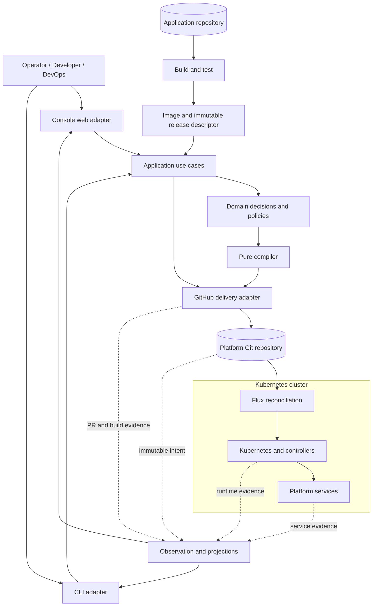
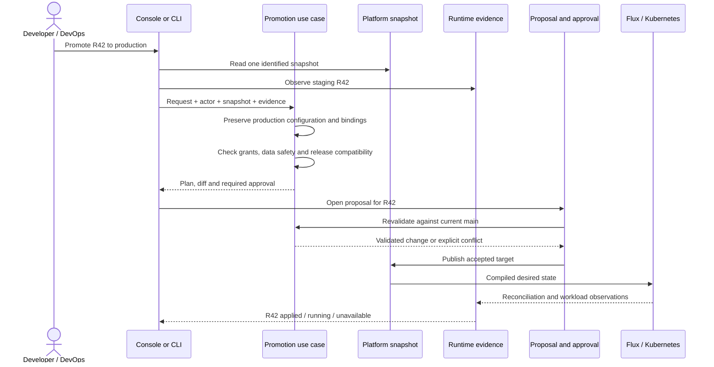

# Architecture review: contracts, boundaries and simplification

**Status: design proposal, not approved implementation work.** Saved 22 October 2026 from the architecture review of `5d076a36`, including the then-uncommitted offline fixes listed under [review scope](#review-scope). Recommendations describe a possible design, not deployed behaviour. [Architecture](architecture.md) remains the canonical description of the current system; [plan](plan.md) section 0 records approved/planned work. Saving this proposal does not approve its feature removals or an implementation.

## Starting example

`demo-orders` has build **R42** running in staging. Production runs **R41**, with its own hostname, credentials, capacity and database. “Promote” should select **R42** for production—not rebuild it, copy staging's configuration, copy its data, or silently select whichever build becomes newest while the request is waiting.

That operation involves several distinct things:

- an immutable application release;
- an environment-specific deployment specification;
- a proposed change and its approval;
- rendered Kubernetes resources;
- asynchronous reconciliation;
- evidence that the intended workload actually ran.

**Those should be separate concepts.** Much of the repository's complexity comes from joining them back together across GitHub, Git, Flux, Kubernetes and the console.

The recommendation is a **small domain model and compiler, with thin system adapters**, not a generic workflow engine or a new collection of microservices. The existing record model and pure renderer are good foundations. A clean-sheet design would sharpen their boundaries, make release identity explicit and simplify the product promises that require reconstructing historical state.

## Review scope

The review covered the working tree at `5d076a36`, including existing uncommitted offline fixes in:

- `docs/apps.md`, `docs/contributing.md`, `docs/operations.md`, `docs/plan.md`;
- `tests/test_app_model.py`, `tests/test_interface.py`, `tests/test_notifications.py`;
- `tools/swhurl/apps/model/generated.py`, `tools/swhurl/interface.py`, `tools/swhurl/notifications/notice.py`, `tools/swhurl/recovery.py`, `tools/swhurl/sqlite_backup.py`.

Those fixes were not part of the commit saving this proposal. The unrelated untracked `todo.txt` was not reviewed or changed.

Four Haiku scouts mapped the domain, delivery, console and platform boundaries. Independent inspection covered the central records, renderer, preparation pipeline, release intake, build-image reuse, promotion rules, Git publication, progress model, authentication middleware and job persistence.

This was a read-only design review, **not a fresh test run or live-cluster verification**. No credentials were inspected or decrypted. The external template repositories and application repositories were not inspected directly. Code evidence, current behaviour and proposals are distinguished below; source links refer to the repository and may move as implementation changes.

The artefacts are organised as:

1. Current architecture and complexity diagnosis.
2. Component and ownership map.
3. Proposed domain model.
4. Composable primitives and contracts.
5. Build/configuration/provenance model.
6. Promotion and creation flows.
7. State and evidence model.
8. Platform-service contracts.
9. Teams, users and authority.
10. Feature-cost ledger and simplification choices.
11. Recommended direction and verification criteria.

## 1. Current architecture and complexity diagnosis

### Foundations to retain

| Existing foundation | Why it is valuable |
| --- | --- |
| Strict `App`, `Release` and `Settings` records | Git semantics are represented directly rather than inferred from Kubernetes YAML. |
| Grants, Choices and Allocations distinguished internally | Permission, operator preference and system-assigned state are genuinely different concepts. |
| Pure instance and shared rendering | The same inputs can produce checkable, reproducible desired output without touching the cluster. |
| Preparation before writes | Relationship checks, allocation, encryption and rendering can fail before committing a partial logical change. |
| Shared relationship evaluation | Call consent and event dependencies are not independently reinvented by every interface. |
| Shared console/gate action rules | What the console proposes and what the gate admits have a common policy owner. |
| Explicit absence versus failed reads | A missing instance and an unreadable instance do not mean the same thing. |
| Retention and destructive operations separated | Uninstalling an application does not implicitly mean destroying its data. |

Implementation anchors:

- [`records.py`](../tools/swhurl/apps/model/records.py): domain records.
- [`write.py`](../tools/swhurl/apps/model/write.py): preparation (`prepare`).
- [`render.py`](../tools/swhurl/apps/model/render.py): instance compilation.
- [`relations.py`](../tools/swhurl/apps/model/relations.py): relationship resolution (`evaluate`).
- [`merge.py`](../tools/swhurl/console/merge.py): console action contracts (`Action`).

These should not be discarded simply because some surrounding modules are large.

### Principal complexity drivers

#### A release is not yet a fully independent object

Today, `Release` is a snapshot selected by an environment. Image identity, source provenance, needs and offers are assembled across several modules and files.

Release intake derives the source repository and commit from the image reference/tag, then fetches the declaration and offer documents at that commit. This works within the platform's conventions, but the relationship is partly encoded in naming conventions and orchestration rather than in one explicit release descriptor.

Evidence: [`release.py`](../tools/swhurl/apps/release.py), particularly release intake and `change_release`.

#### There are two representations of desired state in Git

The repository contains application input records and the Kubernetes/Flux files compiled from them. A records-only merge can be accepted before its rendered output reaches `main`. The cluster keeps following the older rendered state until Render publishes another commit.

This is a deliberate architecture, not automatically a defect. It creates an additional state: **accepted intent, not yet materialised for Flux**. The console must understand it, especially for manually merged PRs.

#### A change's history is reconstructed from independent clocks

Activity joins console jobs, GitHub PR state, the PR's merged tree, current `main`, the current renderer's interpretation of those trees, live Kubernetes observations and the timestamp when a browser request first observed completion.

That is a substantial feature, not just a status label. Documented first-load archive downloads demonstrate part of its cost. Historical expected hashes also depend on the running console's renderer, introducing a version-skew limitation.

Evidence: [`changes.py`](../tools/swhurl/console/changes.py), [`stages.py`](../tools/swhurl/console/stages.py) and [stages of a change](console.md#stages-of-a-change).

#### Some apparently local changes have global effects

A caller's declaration and a callee's grant affect the caller's environment and projected tokens, the callee's allowed callers and NetworkPolicy, and potentially shared infrastructure output. An event change affects shared NATS users and possibly other instances' consumers.

The true unit of compilation is not always one application folder. It is an application plus its **dependency closure and shared contributions**.

#### Repository creation crosses irreversible boundaries

“Start a new app” can render a template, create a public repository, push source, configure a webhook, wait for an image and register an instance through a platform PR.

These effects are not one transaction. Failure after repository creation cannot honestly be reported as “nothing happened.” The recovery path is meaningful functionality, not incidental bookkeeping.

Evidence: [`repo.py`](../tools/swhurl/apps/repo.py).

#### Git is not the authority for every kind of state

Git owns deployment intent, but other authorities include:

- NATS for live flag overrides;
- Kubernetes for observed reconciliation and execution;
- ConfigMaps for console/checker/outbox state;
- HyperDX/MongoDB for API-managed dashboards, alerts and webhooks;
- databases for application data;
- S3 for published backup sets.

The rule should be **one authority for each fact—not one storage system for every fact**.

#### Product promises exceed the human authority model

The console supports powerful operations, but operator, developer and DevOps engineer are not distinct authorisation roles. Its middleware requires an authenticated identity and checks request origin. Teams are ownership labels, not human access-control boundaries.

That is a coherent small trusted-operator model. It is not a multi-team self-service security model.

Evidence: `RequireIdentity` in [`server.py`](../tools/swhurl/console/server.py) and [teams and isolation](apps.md#teams-and-isolation).

## 2. Artefact A — Component and ownership map

### Separate three control loops

```text
BUILD LOOP
Application source + build recipe
    → build/test
    → immutable image + release descriptor

DESIRED-STATE LOOP
Change request + current platform intent
    → decide/approve
    → allocate/compile/validate
    → publish desired state to Git

RUNTIME LOOP
Git
    → Flux
    → Kubernetes/controllers
    → observed workload and service state
```

A fourth process observes those loops and explains them:

```text
GitHub evidence + Git intent + Kubernetes observations
    → projections
    → console, CLI status, notifications
```

The observer should not become a second deployment authority.

### Proposed logical components

These are module boundaries, not a recommendation to deploy twelve services.

| Component | Owns | Interface or output | Must not own |
| --- | --- | --- | --- |
| Application source repository | Code, dependency locks, build instructions, application declaration, API/event documents | A source revision CI can build | Production credentials, platform permissions |
| Build system | Executing a pinned build/test recipe | Image artifact, build result, provenance | Choosing production settings |
| Release intake | Validating and assembling a deployable release | Immutable `ReleaseBundle` | Allocating production resources |
| Platform repository | Versioned application/instance intent, platform policy, allocations and bindings | Immutable `PlatformSnapshot` | Claiming desired state is running |
| Application control domain | Create, select release, configure, grant, remove; transition safety | Semantic `ChangePlan` | HTTP, shell commands, GitHub API calls |
| Compiler/renderer | Translating validated intent and bindings into resources | `Compilation` and resource ownership manifest | Fetching GitHub, generating keys, reading the live cluster |
| GitHub change delivery | Branches, commits, PRs, checks, merge/push protocol | Proposal/publication receipts | Defining promotion semantics |
| Flux | Fetching compiled desired state and reconciling its units | Reconciliation observations | Building images or deciding application ownership |
| Kubernetes and native controllers | Resources, scheduling, workload execution, controller status | Runtime observations | Platform release-selection policy |
| Platform-service integrations | Concrete service lifecycle and bindings | Endpoints, credential references, health/recovery contracts | Application business semantics |
| Console and CLI | Input/output, authentication context, presenting results | Typed requests and projections | Parallel domain implementations |
| Observation and notification | Explaining current state, time-based incident policy, delivery | Status views, receipts, notices | Treating failed reads as success or absence |

### Boundary diagram



The domain can remain an ordinary Python package used by both adapters. It does not require a separately hosted “platform API.” GitHub is an adapter boundary, but source revision, release and change request are domain concepts. Avoid making the whole domain speak GitHub JSON.

## 3. Artefact B — Proposed domain model

### Central distinction

```text
Application
    has SourceRevisions
        produce ReleaseBundles

Application + Environment
    identifies an Instance

Instance
    selects a ReleaseBundle
    has EnvironmentConfiguration
    has AccessGrants
    has ResourceBindings

Those inputs
    compile into DesiredResources

DesiredResources
    are reconciled and observed
```

### Proposed primitives

These are conceptual values; not every row needs its own class, database table or file.

| Primitive | Meaning | Authority/lifetime |
| --- | --- | --- |
| AppId | Stable platform identity, distinct from incidental display text | Platform registration |
| Application | Repository binding, owning team, descriptive metadata | Platform Git |
| SourceRevision | Repository plus full immutable commit identity | Source repository |
| BuildRecipeRef | Resolved template/workflow/toolchain recipe | Build configuration |
| BuildAttempt | One execution of a recipe against source | CI |
| ImageArtifact | Registry reference, immutable digest, runtime platform | Registry |
| ReleaseBundle | Image plus runtime needs, offered contracts and provenance | Immutable accepted release |
| InstanceId | Application plus environment | Platform Git |
| InstanceSpec | Selected release plus environment-owned configuration, grants and bindings | Platform Git |
| ResourceBinding | Stable attachment to storage, credentials or a platform service | Desired binding in Git; realised resource at provider |
| ChangeRequest | Actor's requested operation against an identified target/base | PR or equivalent request record |
| ChangePlan | Semantic changes, required approvals, allocations and effects | Derived during preparation |
| Compilation | Resources produced from identified inputs and compiler version | Derived artifact |
| Observation | What a named system reported, when and against which target | Observed evidence |
| DeploymentReceipt | Evidence that a particular target reached a defined condition | Bounded observation record, if retained |

The durable core is small: applications, accepted releases, instance specifications, bindings and platform policy. Most other objects describe work or evidence.

### Release versus deployment

Illustrative release descriptor; placeholders are not valid production identifiers and this is not an existing repository schema:

```yaml
schemaVersion: 1
releaseId: <content-derived-release-id>
application: demo-orders

source:
  repository: samclement/demo-orders
  commit: <full-source-commit>

artifact:
  image: ghcr.io/samclement/demo-orders
  digest: sha256:<immutable-image-digest>
  platform: linux/amd64

runtime:
  kind: web
  port: 8080
  healthPath: /healthz
  uid: 65532
  minimumResources:
    memory: 192Mi
  database: sqlite
  secretNames:
    - PAYMENT_TOKEN

offers:
  api: <immutable-openapi-reference>
  events: <immutable-asyncapi-reference>

build:
  recipe: <resolved-build-recipe>
  evidence: <trusted-build-result-reference>
```

An instance specification selects it:

```yaml
# Proposed shape.
application: demo-orders
environment: prod
release: <release-id>

configuration:
  replicas: 1
  capacity:
    memory: 256Mi

grants:
  exposure: authenticated-web
  calls:
    - inventory

bindings:
  database: orders-prod-data
  secrets: orders-prod-secrets
```

**Changing the selected release does not implicitly replace the environment's configuration, grants, resource identities or secret values.**

For this platform, start with ordinary versioned files in Git, stored once per accepted release, with instances referring to them. This avoids a release database or bespoke artifact service. OCI-packaged descriptors could become useful later, but are not necessary for the conceptual separation.

A retention rule is required: retain every release still selected or needed for an allowed rollback. Garbage collection is not “delete everything old.”

### Split configuration by ownership

The existing Grants/Choices/Allocations distinction is worth keeping.

| Category | Example | Who may change it | Travels with promotion? |
| --- | --- | --- | --- |
| Release needs | Port, UID, required secret names | Application author, through a release | Yes |
| Environment configuration | Replicas, hostname, schedule | Environment operator | No |
| Access grants | Allowed callers, exposure, egress permission | Authorised owner/operator | No |
| Resource bindings/allocations | Volume identity, NATS identity, allocated proxy port | Platform preparation/provider | No |
| Secret values | Production payment credential | Credential operator | No |
| Live overrides | Temporary flag value | Explicit runtime authority | No |
| Observed state | Ready replicas, applied revision | Controllers/observers | Never promoted |

Do not merge these concepts merely because YAML can express all of them.

### Data is a separate lifecycle

A deployment references a database; it does not own the database's entire lifecycle.

```text
Storage binding
    → provider resource identity
    → ownership / UID assumptions
    → retention policy
    → backup policy
    → restore procedure
```

A release may require SQLite. Selecting it must not itself imply permission to erase a volume, change file ownership, copy staging data, reverse migrations, expand storage or switch database engines.

Current transition guards capture part of this distinction in [`transitions.py`](../tools/swhurl/apps/transitions.py).

## 4. Artefact C — Composable and chainable primitives

Composable should mean small operations with compatible inputs and outputs, not “everything is a configurable workflow step.”

### Minimal chain

```text
Read a snapshot
    → interpret a request
    → decide the semantic transition
    → authorise its effects
    → prepare required bindings/material
    → compile
    → validate
    → publish
    → observe
```

Illustrative signatures, not a proposal for a general result framework:

```python
read_snapshot(revision) -> PlatformSnapshot

decide(snapshot, request) -> ChangePlan | Refusal

authorize(actor, plan, policy) -> Allowed | ApprovalRequired | Denied

prepare(plan, bindings, credential_issuer) -> PreparedChange

compile(prepared, platform_profile, compiler_version) -> Compilation

validate(compilation, contracts) -> ValidationReport

propose(change, expected_base) -> ProposalReceipt

commit(approved_change, expected_head) -> CommitReceipt | Conflict

observe(target) -> ObservationSet

project(intent, observations) -> InstanceView
```

### Contracts

| Primitive | Preconditions | Result/invariant | Effects and failure |
| --- | --- | --- | --- |
| Read snapshot | Concrete revision or branch resolved once | All files belong to the same Git revision | Failed resolution never silently falls back to moving `main` |
| Decide | Valid records and typed request | Explicit semantic delta and affected subjects | Pure; invalid requests are refusals, not partial mutations |
| Resolve relationships | Complete relevant world and access policy | Connected/pending/invalid relationships | Pure; pending never grants access |
| Prepare | Valid plan and allocation requests | Stable binding identities and sealed secret material | May generate/encrypt; does not publish deployment intent |
| Compile | Complete validated inputs | Deterministic resource set and ownership | No network, clock, credential issuance or live reads |
| Validate | Compiled output and declared contracts | Structured problems tied to rules | Failure prevents publication |
| Propose | Identified base, actor, owned semantic change | Reviewable proposal | Partial external effects have explicit recovery |
| Commit | Current approval and expected base/head | One accepted Git revision | Non-force/CAS semantics; stale plans recomputed or refused |
| Observe | Identified subject/target | Evidence with provenance and time | Unavailable is not absent |
| Project | Intent plus available observations | Explanation, not another source of truth | Missing optional evidence degrades a section, not invents success |

The request-owned Git reader is an existing example of pinned snapshot semantics: [`reading.py`](../tools/swhurl/console/reading.py).

### Composition of changes

Concrete operations could include:

```text
RegisterApplication
CreateInstance
SelectRelease
SetEnvironmentConfiguration
RequestCall
GrantCaller
SubscribeToEvent
RemoveInstance
```

First production could compose:

```text
CreateInstance(prod, explicit production configuration)
    + BindStorage(independent production volume)
    + BindSecrets(production references)
    + SelectRelease(R42)
```

The planner validates the composition as one logical change. This is preferable to a special promotion function carrying many booleans for first production, preview, copied settings, key creation and registration.

Do not implement an arbitrary operation DSL. A small number of typed operations and ordinary functions is sufficient.

### Composition of rendering

The current renderer is an ordered series of mutations to `Draft`. This is understandable, but some ordering is implicit: calls contribute data that later admission rendering consumes.

A clean-sheet renderer should make contribution ownership explicit:

```text
Base workload
    + route contribution
    + credential mounts
    + resolved call bindings
    + event bindings
    + storage contribution
    + telemetry contribution
    + backup contribution
```

Rules:

1. Contributions cannot silently define conflicting values for the same variable.
2. Components cannot accidentally own the same resource.
3. Additive policy rules are combined only where union is intended.
4. Resource dependencies are explicit.
5. Unsupported combinations fail before publication.
6. Ordering affecting semantics is stated, not inferred from import order.

A plugin framework is unnecessary; explicit assembly with a few collision checks is likely enough.

### Atomicity and retries

There is no transaction spanning GitHub, GHCR, Git, Kubernetes and S3. Useful guarantees are narrower:

- Preparation refusal: no deployment intent published.
- Git publication: one atomic ref update.
- Kubernetes convergence: asynchronous, observable, potentially failing.
- Repository creation: an external effect that can survive later failure.
- Backup publication: archive first, metadata last; incomplete pairs do not count.

**Retry the operation whose contract supports retry—not the whole chain indiscriminately.** A lost Git push can trigger a fresh plan against newer `main`. It must not automatically create another repository or reinterpret an already-approved release as “latest staging.”

[`bots.py`](../tools/swhurl/bots.py)'s `push_main` is a basis for optimistic publication. The separate Validate image-pin route in [`images.py`](../tools/swhurl/images.py) remains a distinct implementation.

## 5. Artefact D — Build configuration, state and provenance

### Different configurations

| Configuration | Example | Changes require rebuilding? | Environment-specific? |
| --- | --- | --- | --- |
| Scaffolding choices | Kotlin versus TypeScript; initial app type | They generate source/build files | Usually no |
| Build recipe | Dockerfile, shared workflow, compiler version | Yes | Prefer no |
| Dependency resolution | Lock files, pinned base images | Yes | No |
| Runtime contract | Port, UID, health endpoint, required secret names | Bound to a release | Normally no |
| Environment configuration | Replicas, hostname, resource capacity | Usually no | Yes |
| Access policy | Callers, exposure, allowed outbound destinations | No image rebuild | Yes |
| Secret values | Payment API key | No image rebuild | Yes |
| Live feature overrides | Disable checkout temporarily | No | Yes |
| Build cache state | Dependency layers, retained PR image | No authoritative meaning | No |

The platform should answer “which changed, who owns it, and what must happen next?” without inferring the answer from which workflow ran.

### Build identity is not release identity

```text
BuildKey
    identifies resolved inputs for cache/reuse decisions

BuildAttemptId
    identifies one CI execution

ImageDigest
    identifies published image content

ReleaseId
    identifies image plus runtime/offer/provenance contract

DeploymentTargetId
    identifies the release in an environment configuration

CompilationId
    identifies concrete desired output and compiler context
```

These are related but not interchangeable:

- Two build attempts may produce the same image.
- The same image can use different deployment configuration.
- A metadata/contract correction can matter when image bytes are unchanged.
- A compiler upgrade can change manifests without changing the release.
- A tag supports display/discovery but should not be deployment identity.

Current build reuse fingerprints a substantial resolved input set and verifies retained OCI image/config evidence: [`build_image.py`](../tools/swhurl/apps/build_image.py). Preserve the distinction between OCI index/manifest/config identities rather than casually comparing one digest with another.

### Proposed provenance chain

```text
SourceRevision
  + resolved BuildRecipe
  + dependency/base-image inputs
       ↓
BuildAttempt
  + test evidence
       ↓
ImageArtifact
       ↓
ReleaseBundle
  + runtime declaration
  + API/event/flag contract references
       ↓
Instance selection
       ↓
Compilation
       ↓
Observed deployment
```

Guarantees:

- Offer documents come from the selected release's source, not the repository's moving default branch.
- A digest establishes content identity, not by itself who built it or what tests passed.
- Promotion does not rebuild.
- Cache misses do not change release policy.
- Cache retention is not release retention.
- External runtime secrets use references/revisions, not published plaintext hashes.

### Choose the build assurance actually required

**Option 1 — Rebuild and test on `main`.** Build merged source, test that built image, then publish it. Simpler provenance and less reuse machinery; more post-merge work. Does not promise reuse of PR-tested bytes.

**Option 2 — Publish the exact tested PR artifact.** Retain it, prove its inputs match merged source/recipe and publish those bytes. Stronger tested-artifact continuity and faster reuse; requires proof, retention, archive validation and fallback machinery.

These contracts are not equivalent. If maintenance cost matters more than avoiding a second build, Option 1 is a real feature reduction with a clear contract.

Seed images are an independent optimisation. Removing them makes creation more linear, at the cost of waiting for the application's first build.

## 6. Artefact E — Promotion and creation flows

### Promote an explicit release

```text
Promote(
    application = demo-orders,
    source_environment = staging,
    target_environment = prod,
    release = R42,
    expected_target = production-spec-revision,
    actor = alice
)
```

Freeze the release when requested.

### Distinguish staging evidence

These facts are different:

1. Selected in staging Git history.
2. Observed running and Ready in staging.
3. Accepted through application/business testing.

The current gate's historical `staged()` test compares complete Release snapshots selected on `main`'s first-parent history. The console's pre-publication readiness check adds live evidence at another point in time. Name these facts explicitly rather than calling all three “staged.”

Evidence: [`promotion.py`](../tools/swhurl/apps/promotion.py) and [`changes.py`](../tools/swhurl/console/changes.py).

### Proposed flow



The point at which live staging health is required is a policy choice: at review, immediately before publication, at merge, or through a retained trusted readiness receipt. Do not independently implement all four.

For the current product, retain an exact reviewed release and a fresh readiness check before publication. Do not require it to remain the newest staging release indefinitely while the PR waits. This is broadly consistent with existing behaviour.

If stronger evidence becomes necessary, introduce an explicit trusted receipt and expiry policy, not more implicit history scanning.

### Invariants

1. Same `ReleaseId` is selected in the target; no rebuild.
2. Target configuration remains target-owned.
3. Target grants do not widen because application source changed.
4. Target credentials/data are never copied from staging.
5. Changed target base causes revalidation or conflict, not silent overwrite.
6. Changed selected release requires renewed review.
7. First production provisioning is explicit.
8. Database rollback safety is not inferred from image age.
9. “PR opened” is not “production running.”
10. “Workload Ready” does not prove correct business behaviour.

Before:

```text
staging: R42 + staging configuration + staging data
prod:    R41 + prod configuration    + prod data
```

After:

```text
staging: R42 + staging configuration + staging data
prod:    R42 + prod configuration    + prod data
```

If R42 introduces a database need or new secret names, it produces an additional provisioning/configuration plan requiring appropriate review. It is not an image-only update.

### Creation phase receipts

If retained in the console:

```text
Requested
  → RepositoryCreated(repository)
  → SourcePublished(commit)
  → ReleaseAvailable(release)
  → RegistrationProposed(PR)
```

Each transition records the external identity created. A retry inspects the recorded repository, verifies ownership/expected source and continues from the known phase. It never blindly reruns repository creation or automatically deletes a repository to undo a later failure.

This is a small resumable process with named effects, not a general saga framework.

Simpler alternative: keep scaffolding as a CLI/GitHub operation and let the console register an existing accepted release. This removes a large long-running workflow from the web application.

## 7. Artefact F — State and evidence model

Do not replace all status models with one enum. Different questions require different projections.

### Separate questions

| Question | Relevant state |
| --- | --- |
| Did the build complete? | Build attempt |
| Was the requested change approved? | Proposal/approval |
| Has intent reached `main`? | Publication |
| Has accepted intent been compiled? | Materialisation |
| Did Flux reconcile the intended target? | Reconciliation |
| Is the workload Ready and running the intended artifact? | Workload observation |
| Can a user reach the application? | Availability: route, certificate, auth, workload |
| Should someone be notified? | Incident policy over time |
| Did a historical request ever reach its target? | Historical evidence |

The distinction between `state.verdict`, `stages.progress` and time-based notification evaluation is substantively justified, even where names and duplicated observations could improve.

Evidence: [`state.py`](../tools/swhurl/apps/state.py), [`stages.py`](../tools/swhurl/console/stages.py) and [`notifications/evaluate.py`](../tools/swhurl/notifications/evaluate.py).

### Evidence primitive

```text
Evidence<T> =
    Present(value, source, observed_at, version)
  | Absent(source, observed_at, scope)
  | Unavailable(source, reason, attempted_at)
```

Loading can remain a UI request state, not persistent domain state.

Contracts:

- `403` and timeout are not absence.
- Failed Git resolution is not permission to read a different revision.
- Missing optional catalogue data does not make a workload unhealthy.
- Missing required promotion evidence prevents promotion.
- Stale observations are not silently presented as current.

Cross-system reads are not atomic. Record the target and observation time; do not imply a global transaction between GitHub and Kubernetes.

### Compilation identity

```text
input snapshot
+ selected release
+ relevant environment configuration
+ grants and dependency closure
+ binding references
+ platform profile
+ compiler/schema version
```

An explicit identity avoids having the current console re-render historical intent with whatever compiler it happens to run.

One option is a small compilation manifest alongside generated resources, recording input revision, compiler identity, output fingerprint, affected instances and resource ownership. It is derived evidence, not another authoritative copy of application configuration.

A render fingerprint does not prove that a secret propagated into a process, an external service works, an API is behaviourally compatible or a migration is reversible.

### Simpler Activity contract

```text
Request:
    proposed / merged / closed / failed

Current target:
    compiling / reconciling / running / blocked / unavailable

Historical outcome:
    observed reached at T / not observed
```

If R42 was replaced by R43 between observations: “R42 is no longer the target; whether it ran was not observed.” Do not manufacture “never ran.”

If historical proof matters, capture a bounded receipt when an observer sees completion. Otherwise link to GitHub and Flux history instead of reconstructing every old rollout on page load. This is one of the highest-value simplification choices.

## 8. Artefact G — Platform-service contracts

Services need explicit operational contracts, not necessarily a generic service-plugin interface.

| Service | Contract supplied | Owner | Important boundary |
| --- | --- | --- | --- |
| Kubernetes | Namespaces, workloads, limits, storage attachments, observations | Cluster operator/native controllers | Resource acceptance is not application success |
| Flux | Versioned reconciliation, ordering, inventory/pruning | Platform operator | Reconcile is asynchronous; suspend has a defined scope |
| cert-manager | Certificate request → certificate or explicit failure | Platform operator/cert-manager, using Let's Encrypt (ACME) | Certificate readiness is distinct from pod readiness |
| Traefik + oauth2-proxy | Route and browser authentication policy | Platform operator | Browser auth is not app-to-app authorisation |
| Call identity | Audience-bound token, issuer keys, allowed caller identities | Platform + application verifier | Workload identity is not delegated end-user authority |
| NATS/events | Endpoint, scoped identity, stream/subscription bindings, delivery/retention semantics | Messaging owner | Durable delivery is not exactly-once business processing |
| Feature flags | Declared schema/defaults plus environment override authority | Release author + runtime operator | Overrides are a separate state plane |
| Storage | Stable binding, attachment mode, retention contract | Platform/data operator | Retain is not backup |
| Backup/restore | Verified published set, freshness policy, explicit restore | Data/platform operator | Backup success is not proven fresh-machine recovery |
| OTel/ClickStack | Signal ingestion and query experience | Observability owner | Failure should not block unrelated deployments |
| Dashboards/alerts/webhooks | Reconciled API-managed objects and recorded identifiers | Observability integration | A CronJob managing them does not make them Kubernetes resources |
| Notifications | Authenticated request, routing, bounded retries/deduplication | Notification integration | Delivery guarantees and expiry must be stated |
| Reloader | Restart consumers after referenced Secret/config change | Platform operator | A replacement checksum scheme must observe those changes |

### Separate dependency graphs

A Flux `dependsOn` is a reconciliation prerequisite, not the same as an application HTTP call, telemetry retries, credential refresh or database availability.

Keep distinct graphs for ownership, reconciliation prerequisites, runtime dependencies and permission relationships. Expressing all four through Flux dependencies creates coupling.

### Calls and subscriptions need not have identical consent

Today, calls require caller intent plus callee consent. Subscriptions to published events do not have an equivalent publisher-consent branch. This difference is implemented by [`relations.py`](../tools/swhurl/apps/model/relations.py) and consumed by event rendering.

Make it an explicit policy choice, not a hidden inconsistency behind a generic relation abstraction suggesting identical rules.

### Declare enforcement mode

Egress declarations can mean observation/reporting, proxy enforcement, NetworkPolicy enforcement or a combination. These are different security contracts. Current documentation describes an observation/grant phase without direct outbound restrictions enabled.

Expose observed versus enforced. A grant record does not itself prove enforcement.

### Avoid deceptively simple controller replacements

Replacing Reloader with “just a checksum annotation” is not automatically simpler when values are decrypted/substituted outside the renderer. Something must observe the relevant secret revision and update the pod template.

Validate's console-image deployment is not a replacement for staging app image discovery; they solve different problems.

## 9. Artefact H — Teams, users and authority

### Separate concepts

```text
Principal
    is authenticated by an identity provider

RoleBinding
    grants actions within a scope

Team
    owns applications and operational responsibility

WorkloadPrincipal
    identifies an application instance

AccessGrant
    permits a workload relationship
```

A person may be both developer and DevOps engineer. A team is not a role. An app's team membership does not prove that the signed-in person belongs to that team.

### Proposed responsibility matrix

This is not current authorisation behaviour.

| Action | Cluster operator | Developer/code author | DevOps/environment operator |
| --- | --- | --- | --- |
| Change app code/build declaration | Repository permissions | Owned repository | Repository permissions |
| Produce candidate release | Trusted CI | Trusted CI | Trusted CI |
| Request staging deployment | Yes | Own apps | Scoped apps |
| Change staging capacity/config | Yes | Optional scoped permission | Scoped |
| Request production promotion | Yes | Optional | Scoped |
| Approve production/grant expansion | Yes | Not by default | Explicit approval role |
| Change production secret values | Explicit credential role | Not by default | Explicit credential role |
| Restore/destroy data | Explicit elevated operation | No by default | Separately authorised |
| Change shared services/Flux/bootstrap | Yes | No | Not by default |
| View status/catalogue/log links | Scoped policy | Scoped policy | Scoped policy |

### Authorise semantic effects

Connecting A to B can affect several subjects. Check actor, operation, affected applications/environments, permission expansion and data/credential effects.

An allowed route or `console/*` branch is not authority to widen access. Conversely, a generated change to B's NetworkPolicy need not require new approval if B already granted the relationship; rendering that consequence is not a fresh permission decision.

### A trusted-operator profile remains valid

For a small trusted homelab, “everyone admitted to the console is an operator” is a cheaper valid policy. State it honestly.

For developer self-service, backend authorisation and identity-to-team mapping become mandatory; hiding buttons is insufficient. Prefer the existing identity provider plus a small explicit role/scope mapping before creating a platform-owned user database.

A caller-asserted end-user identity is not cryptographically delegated authority from that user. Applications retain endpoint and business-level authorisation responsibility.

## 10. Artefact I — Feature-cost ledger

Ratings are qualitative estimates, not measured savings. These are choices, not approved removals.

| Feature/promise | Complexity carried | Simplification | Capability lost |
| --- | --- | --- | --- |
| Historical Activity reconstruction | Historical downloads, compiler skew, supersession, first-seen timestamps | Current request/target plus links; bounded receipts if needed | Reconstructed historical rollout explanations |
| Seed images | Extra identity, publication/expiry, own-build replacement tracking | Wait for first app build | Faster first availability |
| In-console repository creation | Broad permissions, long jobs, recovery, pushes, webhooks | CLI/GitHub scaffolding; register existing releases | One-button onboarding |
| Automatic merge policy | Per-action rules, label/check races, latest-main merging, history checks | Human merge with validation | Unattended routine changes |
| Flux image scan → dispatch → Deploy | Controllers, webhook tokens, parsing, repair | One periodic importer or narrowly authenticated CI intake | Responsiveness or a changed trust boundary |
| Exact PR-built artifact reuse | OCI archives, provenance matching, retention, fingerprinting | Build/test/publish on main | Avoiding duplicate build work |
| Live typed flags | NATS KV, protocol/crypto, UI validation, stale overrides, audit | Git config requiring rollout | Immediate no-redeploy changes |
| Multiple stacks/app types | Template matrices, SDK parity, caches, Renovate/Copier | Fewer supported combinations | Developer choice |
| Managed events | Broker/controller lifecycle, identity, permissions, schemas, retention, SDKs | Smaller external/shared broker contract, or no events | Integrated event self-service |
| Per-app dashboards/alerts | API reconciliation, schemas, thresholds, credentials | Standard dashboards and fixed alerts | Fine-grained tuning |
| Managed egress proxy/grants | Ports, shared config, client support, enforcement phases | Explicit simpler network policy | Host-level control/visibility, depending on replacement |
| Rich observability stack | Upgrades, storage, keys, dashboards, metrics/traces/logs | Narrow product to used capabilities | Cross-signal diagnosis/features |
| Console cluster controls | Mutation permissions, jobs, waits, audit/restarts | Read-only console; operator CLI | Browser-based operations |

### Highest-leverage candidates

If maintenance cost is the priority, first examine:

1. Historical Activity guarantees.
2. Seed image optimisation.
3. Repository creation inside the console.
4. Auto-merge breadth.
5. Live flags and template combinations, based on actual use.

These remove whole state surfaces, not merely functions. Do not begin by removing backup verification, destruction guards, failed-read handling or credential separation while keeping the features that need them.

### Costs are not additive

- Removing flags does not remove NATS if events need it.
- Removing console scaffolding does not remove templates used by the CLI.
- Removing auto-merge does not remove concurrent-publication safety for remaining bots.
- Removing dashboards does not remove the need to diagnose failures.
- Removing the proxy eliminates allocations/shared fan-out only if equivalent host-level controls are no longer promised.

Select features before committing to a major rewrite.

## 11. Recommended direction

### Decision brief

**Decision:** should a rebuild optimise for a small Git-operated platform, self-service convenience or a general platform control plane?

Assumptions:

- Start from a small platform, not a proven multi-tenant enterprise service.
- GitOps remains desirable.
- Kubernetes and Flux remain the runtime substrate.
- Lower maintenance cost matters more than preserving every convenience.
- The separate [Azure capability catalogue](platform-capability-catalogue.md) is a capability menu, not evidence that every capability belongs here.

| Option | Shape | Benefits | Costs |
| --- | --- | --- | --- |
| 1. Git-first operator platform | Small domain/compiler, CLI, PRs, read-oriented console | Fewest moving parts; clearest authority/failure model | More operator involvement |
| 2. Bounded self-service | Same kernel, thin console commands, selected automation | Useful UX without duplicated domain rules | Explicit auth, resumability, approval contracts |
| 3. General platform/workflow engine | Generic operations, plugins, providers, durable orchestration | Extensibility for many teams/providers | Framework and operational cost before proven need |

**Recommendation:** make Option 1 complete, then add only the Option 2 workflows actively valued. Do not start with Option 3.

This changes with independent teams, delegated production authority, multiple clusters or cloud-resource provisioning. Those can justify stronger identity, durable execution and provider boundaries; state the requirements before paying for them.

### Kernel to build

1. Explicit immutable release bundle.
2. Instance specification separating configuration, grants and bindings.
3. Pure transition decisions and relationship resolution.
4. Preparation for allocations and sealed credentials.
5. Deterministic compiler with explicit ownership/version identity.
6. Narrow Git proposal/publication protocol.
7. Evidence-based current-state projections.
8. Small collection of concrete service integrations.

Avoid a universal component registry, generic workflow/DAG language, event sourcing everywhere, a database mirroring Git, one giant status machine or a provider interface pretending GitHub, Kubernetes, NATS and HyperDX share a lifecycle.

### Existing starting points

| Proposed boundary | Existing implementation |
| --- | --- |
| Domain values | `apps/model/records.py` |
| Relationships | `apps/model/relations.py` |
| Transition decisions | `apps/transitions.py`, `apps/promotion.py` |
| Preparation | `apps/model/write.py` |
| Compilation | `apps/model/render.py` and capability modules |
| Git publication | `bots.py`, `console/changes.py` |
| Operation policy | `console/merge.py` |
| Observations | `apps/ops.py`, `console/cluster.py` |
| Projections | `apps/state.py`, `console/stages.py` |
| External command boundary | `Runner` / `FakeRunner` |

Paths in this table are relative to [`tools/swhurl/`](../tools/swhurl).

The current implementation is closer to this kernel than “rewrite from scratch” suggests. The largest missing conceptual boundary is release construction/identity versus environment selection. The largest optional complexity surface is cross-system historical workflow tracking.

Splitting `server.py` or `changes.py` improves navigation, but does not by itself remove those costs.

## 12. Acceptance contracts for a redesign

Before implementation, turn these into verification examples:

1. Promotion changes release selection, not production grants, secrets or data.
2. A release cannot grant itself authority through application source.
3. Out-of-order builds cannot silently move staging backwards; ordering is explicit and separate from identity.
4. Concurrent unrelated changes can be revalidated without overwriting each other.
5. A stale same-instance change is recomputed equivalently or requires renewed review.
6. Preparation failure publishes no intent; prior external effects remain identifiable/recoverable.
7. Same inputs and compiler/profile produce the same resources.
8. Shared output has one owner; contributions assemble deterministically and collisions fail.
9. Unknown is never permission: failed reads cannot authorise promotion, prove deletion or report success.
10. Removal and data destruction are different operations.
11. Current health and historical success are different facts.
12. Automation can be removed without invalidating the model: people can still review/deliver valid changes through Git.

## Limits and open decision

No external template/app repositories, GitHub/GHCR APIs or live cluster were inspected during the review. No new tests were run for the review itself. Existing tests/docs are evidence, not fresh runtime proof. This is not a complete security audit or a measured maintenance-cost study.

Four Haiku workers performed scouting. The soft threshold was exceeded by in-flight work; no replacements were launched. Reported usage was approximately 1.08M input / 96K output tokens, including repeated context/tool work; no dollar cost was inferred.

**Bottom line:** do not rebuild the same feature set behind a more abstract API. Retain records → prepare → compile, clarify immutable release identity and evidence ownership, and decide which workflow guarantees are worth keeping.

The next decision is:

> A Git-first operator platform with a helpful console, or a self-service console owning long-running delivery workflows?

Both can use the same kernel. Their maintenance costs are different. No answer or implementation scope is approved by this document.
