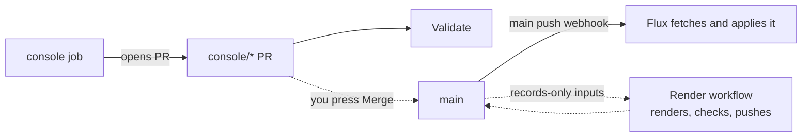

# Console

A web page at `https://console.<BASE_DOMAIN>` (`console.homelab.swhurl.com`) for looking at the platform and changing it without a terminal. Sign in with the same Google account as every other signed-in host. It changes the platform directly in only two ways: it reconciles, suspends and resumes a Flux unit, and it sets and clears [feature flag](apps.md#feature-flags) overrides in NATS. Besides that it keeps its own [job record](#jobs-and-restarts). Every other change is a **pull request** it opens against this repo, which follows the [review and merge policy](#review-and-merge).

**It changes an instance by running v2's binary.** Every instance is [v2](v2-status.md)-owned. An app page's forms run
one `swhurl-v2 change --kind …` in the console's pod: the command resolves `main` at one commit, applies the kind's own
`edit` (or `remove`, `promote` or `team`) command and the `render` it needs in a scratch copy, keeps the files the kind
owns, and opens the pull request carrying them. **Uninstall** is the `v2-remove` kind and **Promote to production** the
`v2-promote` one.
Every v2 pull request waits for a person: nothing merges a console pull request, so you review
and merge it on GitHub. v2's refusal (exit 2) is shown verbatim, and a console image without the binary refuses with
the command to run in your own terminal instead of failing a job ([deletion plan](v2-deletion-plan.md), phase 2). No
instance is v1-owned any more, and v1's forms (`app-scale`, `app-expose`, `app-calls` and the rest) are gone with
the commands behind them.

**New app creates the first instance with v2.** The form creates the app's repository from a stack template, waits for
its first image and runs one `swhurl-v2 change --kind new`: `create` states the app's records from that image, the
`edit`s state the form's choices, and `render` derives the rest. Its pull request's body names the repository and the
template it came from. It waits for your review like every v2 pull request, so nothing reaches the cluster until you
merge it ([New apps](#new-apps)).

What it still changes directly is what is not a record: a Flux unit's reconcile and suspension, and feature flag
overrides in NATS.

App change jobs run the same tool as the CLI: one `swhurl-v2 change` for an instance, a new app, a team or its channel. If it cannot run or v2 refuses the change, the job fails without opening a pull request; the command's scratch tree is discarded.

## Use it

| Page | Shows | Buttons and what they do |
| --- | --- | --- |
| **Overview** (`/`) | One verdict (everything healthy, updating, or how many things need attention), what needs attention with links (failing checks, failing units, suspended units), what is updating now, jobs running now, pull requests the console opened that are still open, and recent jobs | — |
| **Deployments** (`/apps`) | One row per app, one fact per column: its **language** (the `stack` in the app repository's `swhurl.yaml`, as on Teams), its team (click it to filter), **Staging** and **Prod** (state, the running image tag, and an arrow that opens its web address), and **Promotion** as a label: **Staging only** (grey; not in production yet), **In sync** (green; both run the same image), **Prod behind** (amber; staging runs a newer build) or **Images differ** (amber; they differ and staging is not known to be the newer, for example after a rollback or with tags that are not `<run>-<sha>`). A tag opens that environment's page. **Click a row to open it**: each environment in full (image, web address, address inside the cluster and database; what it is connected to is on its own page and on **Map**), with links to the app's logs and repository. A row opens by itself when an environment is failing, unknown or suspended, and says why. Filter by **Team**, and **Show: not healthy** keeps only the rows that need a look. **Map** draws one environment as boxes, left to right in the direction requests and events travel: a solid line is a call, a dashed line an event; each box opens its app page. Read from what runs: each instance's Flux unit, HelmRelease and namespace label | In the row: **Review promotion** (a link) wherever staging is ahead of or differs from prod, or the app is not in production yet. In the opened row, per environment: a link to its page, and **Reconcile** (or **Resume** when suspended), which starts the job and shows it there without leaving the list; **Logs and traces ↗** (HyperDX, filtered to the app), **Dashboard ↗** (the app's `App: <app>` dashboard in HyperDX, [recorded by the dashboard job](#automatic-app-dashboards); it appears within about a minute of a new app's first deploy) and **Repository ↗** |
| An app (`/apps/<app>/<env>`) | The app named once with its language, an environment tab, and a summary with one fact per column: state (Healthy, Updating, Failing, Suspended, Unknown or Stopped, with the reason under it), team, image tag, replicas, database and promotion label; failing pods. Then one card per reader. **Use**: its web address, who can reach it and its TLS certificate; who can reach it is a [grant](apps.md#swhurlyaml), set here, not in the app's repository. **Connect**: its address inside the cluster, API description if it declares one, then its connections as a table, one per row (direction, kind, the other app, what happens over it, that app's team): what it declared first (the apps it calls, the events it receives and publishes, the [hosts outside the cluster](apps.md#reaching-outside-the-cluster) it may reach), then what other apps declared about it (who calls it, who receives its events); a call or a subscription is granted from the app that calls or receives, and hosts outside the cluster are read there and not offered: they are the record's (`swhurl-v2 edit --set egress=`). **Feature flags**: each [flag](apps.md#feature-flags) the image it runs declares (read from the record's own `offers/flags.json`), one row each: name and meaning, type, the declared value for this environment, the override if there is one (amber) with when it was set, marked once it is 14 days old, and the value in effect; then a row for each stored override of a flag the image no longer declares (**not declared**, **Clear** only); at the row's end a control of the declared type (a choice for a boolean or a list, a bounded number box) with **Set**, and **Clear** when overridden. Both are `swhurl-v2 flags` run in the pod: it types the value, writes it to NATS at once and prints the card it read back, so there is no pull request and no job, and a value or name the declaration refuses comes back in v2's own words. Each write is a line in the audit log (`[AUDIT] <who> flag <app>/<env> <flag> = <value>` or `… cleared`). Without its NATS key (`console-nats`) the buttons are disabled and the card says why. **Operate**: the selected image and observed running digests, ready replicas (unknown is distinct from zero), literal applied and pinned expected revisions with Go's currentness reason, Flux unit and Helm release facts, desired database kind, namespace, and links to logs, dashboard and repository. **Environment (desired)** (collapsed) shows rendered variables from the same commit's HelmRelease, not observed container values. Secrets remain unsupported: no secret values or files are inferred. Routes, certificates and container failures show Go's evidence, with unavailable distinct from absent; there is no Python pod-fix policy or job/schedule control. **Jobs** run on it, each opening to its output. Before a new app's pull request is merged and applied, the page says **Not created yet** with its pull request and New app job, and refreshes until the app exists | At the top right of its card, each opening a form inside the card (one at a time) whose own button opens the PR: **Change access** (Use) and **Connect to an app** (Connect; one checkbox per web app it could call and per event it could receive in that environment, leaving out itself and what it has already; one PR for everything ticked); **Remove** on each grant row the app declared, asking first (a connection another app declared is removed on that app's page). Publications have no platform editing controls: change the send operations in the app's [AsyncAPI document](apps.md#events). A connection PR also changes the apps or NATS users involved, **Scale** (Operate; desired replicas and memory in MiB from the pinned instance record; Go refuses unsupported changes). **Open ↗** on Use. In Operate, each beside what it does: **Reconcile** (or **Resume**), answered in place, and **Review promotion** (staging-only apps or a different digest), then **Promote to production** on the confirmation page. **Uninstall** (a PR, asks first) is a card of its own at the bottom |
| **Catalogue** (`/catalogue`) | What the apps of one environment (staging or production) offer each other, one card per app, as on Teams: each card's heading gives its team and what it uses in turn (the APIs it calls and events it receives, each a link to that row), and under it a table with one row for its API and one per event it publishes, with what its own repository says it is and the apps that use it; apps that only use are listed last, as offering nothing; filters for kind and team. A row opens to an API's routes (method, path, summary) or an event's payload as one row per field (type, required, meaning) beside an example, with the full JSON Schema one click further; who uses it, by name and team; a code sample for calling or receiving it; and its address, served description and the commit the description was read at. A link to a row (`/catalogue?env=staging#api-demo-orders`) opens it. An app that [describes nothing](apps.md#what-an-app-offers) is still listed, as not described. The facts come from the cluster; the descriptions from `v2-records/<app>/<env>/offers/` in Git, read once per commit (a failure is retried after five minutes and the page says why) | **Add an app**: choose one of that environment's apps that does not use it yet, then **Open connection PR**; it asks first, then opens the same connection PR as that app's **Connect to an app** |
| **Teams** (`/teams`) | One card per registered team, in alphabetical order (from `v2-records/teams.json` on `main`): its name and description, the last change made to it with its pull request, then its apps as a table (from each app's namespace label): the app, its **language** (the `stack` in the `swhurl.yaml` at the head of the app's own repository, read anonymously and kept for an hour; a dash when GitHub could not be read), and what runs in **Staging** and **Prod** (state and tag, linking to that environment), with links to each app's dashboard and logs in HyperDX and to the team's apps on the Deployments list and map. Apps that name an unregistered team, or none, are listed first with how to fix them | At the top right of each card: **Edit** (one form: the description, and the name, where a team an app names is not renamed until that app names another) and **Delete** (offered for a team nothing names: one that owns apps is not deleted until each moves to another team) ([teams](apps.md#teams-and-isolation)); no team is special, so any can be renamed or, once nothing names it, deleted. **New team** is above the cards. These buttons open a form in the card, one at a time; the form's own button, with the pull-request icon, opens a PR made by `make team-*` that waits for review ([teams](apps.md#teams-and-isolation)) The card also says whether the team has a [notification channel](services.md#notification-channels), and **Channel** gives it one, gives the one it has a new address, or removes it: a team has one channel, named after it, so there is no list of channels to manage. **Generate** makes a random ntfy topic in your browser and shows its subscribe link; the address is sent once, goes to the command's standard input and is stored encrypted, and no page, job output or pull request shows it afterwards |
| **Platform** | A verdict, then what needs attention; the six checks that need only cluster reads, `swhurl-v2 verify` run with the pod's ServiceAccount (no report shows the page unavailable, never healthy; a group of one check is that check on one line; a longer group opens, and opens itself when something fails); and every Flux unit in one list, grouped by layer (cluster, infrastructure, platform services, apps), behind a summary line that says how many are healthy and the revision they have applied, and that opens when a unit is not Ready or is suspended. A unit's row shows its state and what it waits for (and its revision only when it differs from the rest); **click a row to open it** for the path it applies, its Git interval and what needs it. A failing or suspended unit is already open, with its message. The other checks, which read Secrets, run commands in pods or need your machine, are left to `make verify-platform` | In a unit's opened row, each beside a line on what it does: **Reconcile now** and **Suspend** (asks first), or **Resume** on a suspended unit. The job starts there ("reconcile started · job #3", linking to its output) and the page reads itself again until the job ends, leaving open what you opened. None on `cluster-sources` and `cluster-stack` |
| **Egress** (`/egress`, linked from Platform) | How many instances are granted a host outside the cluster; then per environment one row per instance: its team, its port on the [egress proxy](services.md#egress-proxy), the hosts it is granted ([reaching outside the cluster](apps.md#reaching-outside-the-cluster)), and a link to its requests no grant covers in HyperDX (`granted=-`). Read from the cluster | None: a grant is the record's, written by `swhurl-v2 edit --set egress=` ([reaching outside the cluster](apps.md#reaching-outside-the-cluster)); the platform's backup host is rendered with the rest of the proxy from the profile ([egress proxy](services.md#egress-proxy)) |
| A Flux unit (`/units/<unit>`) | State, the path it applies, its Git interval, what it waits for and what needs it (links), its app if it is one, and the jobs run on it | **Reconcile now**, **Suspend** / **Resume**, each explained. None on `cluster-sources` and `cluster-stack`, which `make flux-bootstrap` applies |
| **New app** (`/new`) | A form in four parts: what you are building (the app [type](apps.md#app-types), which sets the template's answers and the access staging starts with), the app (name, stack, description, owning team), who can reach it, and what it connects to. A warning says when the GitHub tokens are missing | **Create repository and open pull request** creates the public repository from the stack template, waits for its first image, then opens one pull request for the app's staging instance: `swhurl-v2 create` writes its records from the image's own declaration, an `edit` sets each further choice, and `render` writes the compiled files, the unit, its line in `clusters/home/kustomization.yaml` and the platform documents ([New apps](#new-apps), [start a new app](apps.md#start-a-new-app)). The PR waits for you |
| **Activity** | Every change started here as one row, under **In progress or waiting for you** or **Finished**: its state, what it did to what, when and who, then its [stages](#stages-of-a-change) as a labelled track that ends in a terminal stop (**Live in prod**, **Applied**, **Removed from staging**), and a sentence saying what happens next or how it ended. A row is a job ([kept across restarts](#jobs-and-restarts)) followed past its end: through its pull request's checks and merge to the instance running it. An open console pull request (`console/*` branch) whose job is no longer remembered has a row of its own. **Click a row** for its pull request, its checks and its job's output; a row whose open pull request waits for you, or failed its checks, is already open. While a job runs, the header shows **N running** | None: a row says how its pull request is merged (by you, and why it needs you first); you merge it on GitHub |

**States.** Every page uses the same six, each with its own mark so the meaning does not rest on colour: **Healthy** (✓), **Updating** (↻: waiting for a dependency, applying a change or rolling out a new image, with what it waits for), **Failing** (✕, with Flux's or Helm's message), **Suspended** (‖), **Stopped** (an app scaled to zero) and **Unknown** (something the verdict needs could not be read, with what). An app instance has one Go decision wherever it is shown: Deployments, Teams, its own page, Activity and promotion readiness consume `swhurl-v2 status` reports, not a Python judge. The request pins main once (committed HEAD in local `--dev`), shares one immutable input bundle and one bulk observation, and never caches live reports between requests. Go compares the pinned records with the unit, release, image and workload evidence and decides whether [unapplied changes matter](apps.md#a-commit-elsewhere-does-not-hold-a-promotion). A shared Flux unit's state still comes from its own Ready condition. Missing binary, failed GitHub input reads or an invalid report show unavailable and no change forms, rather than an older snapshot or a Python fallback. After every push Flux re-checks every unit and dependents wait a few seconds (`DependencyNotReady`); the console shows that as Updating, lists it under **Updating now**, and does not count it as something needing attention. Health checks are passing or not passing.

### Stages of a change

A job ends when its pull request is open; the change ends when the cluster runs it. Activity, an app page's **Changes** list and a job's own page show the whole path:

```text
Promote web/prod        ✓ Prepared ── ✓ Reviewed ── ✓ Merged ── ✓ Applied ── ↻ Running ── ◎ Live in prod
New app shop/staging    ↻ Prepared ── ○ Reviewed ── ○ Merged ── ○ Applied ── ○ Running ── ◎ Live in staging
Reconcile infra-base    ✓ Prepared ── ◉ Applied
```

| Stage | Evidence |
| --- | --- |
| **Prepared** | The job is running, failed, interrupted or succeeded. Success for a PR job means **PR opened**. Its output is one chronological log, streamed live. **Finish creating this app** reuses its recorded repository and choices. |
| **Reviewed** | The open PR's checks and merge rule: checks running or failed, automatic merge requested, or manual review needed. |
| **Merged** | GitHub reports the PR merged and names its merge commit. A closed, unmerged PR ends at **Closed without merging**; a new app's repository and image still exist. |
| **Applied** | The live HelmRelease has the target render hash and a Ready condition for its current generation. |
| **Running** | The instance is Healthy and every running pod matches the target release's digest. A scaled-to-zero instance ends with that explanation. |

v2 states no separate render hash: an instance's records and the HelmRelease they compile to land in the same commit, so the records are the target. The target comes from the PR's **merged tree**. Activity compares it with `main`'s records and the live HelmRelease's image and readiness. Unrelated commits do not hold a change. `render_targets` reads `v2-records/` and `v2-apps/`, never v1's `apps/`. When `main` changes something else for the same instance:

| Why it differs | The row |
| --- | --- |
| The records are the merge commit's | `main`'s records are this change's, including a render that changed only because another app's records changed who may call it |
| Only a newer release: the instance's configuration and the app's record are as the change left them (a staging deploy) | Follows the change to that release: a scale followed by a deploy ends **Live in staging** once the newer release runs ("runs it, with a newer image"). A promotion chooses its release, so it is never followed |
| The change was seen at its end before | Stays at its end (**Live in prod**, scaled to zero, **Removed from …**), "from <time>; a newer configuration has since replaced it" — and stays there when a later read fails, "…; a later read could not check it again" |
| Otherwise | **Superseded**: a newer configuration replaced it before Activity saw it at its end, even before Flux applies the replacement |

A change is seen at its end when Activity or its job page is read while it is there; the time is kept in the job's record. A change replaced between two reads, unseen, shows **Superseded** although it may have run.

A removal ends at **Removed from …** only when the merged tree and current `main` omit the instance and both its Flux unit and HelmRelease are gone. An uninstalling release keeps it **In progress**. Removal keeps retained storage; it does not destroy data. A team or channel change ends at **On main** when merged.

One rule, `pages.TrackOf` in [`changes.go`](../v2/pages/changes.go), decides how far a merged change has got; Activity, a job's page and an app page's **Changes** list draw its answer. It takes Git facts (each v2 instance's record pair, its settings, the release digest and the image its HelmRelease runs, read from the pinned tree) and the live row. A HelmRelease that runs the target digest, is Ready at its current generation and whose image matches completes the rollout. Records without a matching HelmRelease are **In progress**; that is not the same as an instance proven absent from a tree that was read. Progress is read again on each page request, never saved, apart from the time a change was first seen at its end. Immutable Git evidence may be cached: a whole tree by commit, a merge commit's render by commit and unit; GitHub's current PR state, newest `main` and the cluster are read fresh. A failed read is **Unknown**, never absence or success, with one exception: a change already seen at its end stays there, because a read that failed cannot undo what an earlier one found. Its sentence says it could not be checked again, and it keeps its end's stage, so it stays in **Finished** rather than returning to **In progress or waiting for you**. A merged historical job with no records for its instance goes in **Finished** as **Merged (historical)**, with an explanation that its rollout cannot be tracked; old prepared-target hashes, progress marks and endings are ignored. A failure can recover, and a previously Healthy target can show a new failure.

The row begins with **In progress**, **Waiting for you**, **Failed**, **Interrupted**, **Closed**, **Unknown**, or its terminal stop. **Finished** holds completed or closed changes; an open PR with failed checks or a failing instance stays in **In progress or waiting for you**. A stage is named for what it ends in (**Merged**), so a stage that has not happened shows its state under the name — *waiting for you*, *running now*, *failed*, *not reached* — and only a done or reached stage keeps it for screen readers alone. Marks: ✓ done, ↻ running, ‖ waiting, ✕ failed, ○ not reached, ◎ planned end, ◉ reached end.

A job page re-reads its track every 30 seconds, including after completion, so later renders and failures are visible.

**Reading a page.** Colour means one thing each: green healthy, amber needs a look (suspended, unknown, a warning), red failing or destructive, blue something you can click; an updating mark is neutral and turns. In lists a healthy row shows its mark alone, so the rows with a word next to them are the ones to read; Deployments lists anything not healthy first under a one-line count. Buttons have four weights: one filled **primary** per page, outlined for the rest, text-only for minor ones such as **Refresh**, and red-outlined for the ones that stop or remove something. Those ask first, in a dialog that says what will change (**Suspend**, **Open uninstall PR**, deleting a team); Cancel or Esc does nothing. A form behind a pull-request icon opens a PR; a dashed box with an info icon only explains. What a control will do shows before you press it: a **link** goes somewhere and changes nothing (an arrow icon means another site); a button with the **pull-request icon** opens a PR; a **plain button** changes something now (the cluster, or a label on a PR), and a red one asks first. A list keeps what a thing is on the left and what you can do to it at the right end of its row (on Teams, the top right of its card), in the same place every time; a row with more to it than fits one line (an app, a Flux unit, a job) has a › at its start and opens when clicked, and what you opened stays open while the page re-reads itself; a row that needs you is already open. Each list page starts right under its title, with the time it was read beside it; **About this page** opens what the page is for. On an app page **Use · Connect · Operate** stays at the top as you scroll (**Feature flags** is between Connect and Operate); on New app, step 4 **Connects to** is closed until you open it with **Connections**.

Overview, Deployments, Platform and Activity read the cluster again every 30 seconds while the tab is visible ("Read at 13:20, and again every 30 seconds"), except while you are typing or a dialog is open; sections you opened stay open. Other pages change only when you press **Refresh**. Team and view filters on Deployments swap the list without reloading the page. Without JavaScript every page still works: forms post normally and pages refresh when asked.

Long commit SHAs and image digests are shortened to 12 characters; hover for the full value.

Every page names an app instance `<app>/<env>` (for example `demo-shop/staging`), linking to its app page (on the Deployments list the app is named once and the tag under Staging or Prod is that link); the Flux unit's own name (`app-hello-ts-staging`) appears only on Platform and the unit's page. Each button starts a **job**. A button in a list (Reconcile, Suspend or Resume in an opened row on Deployments and Platform, Hold on Activity) answers in its row, with a link to the job, so you stay on the list; every other button goes to the job's page. That page shows the change's [stages](#stages-of-a-change), streams its chronological output live and re-reads itself in place when the job ends; without JavaScript it refreshes every 2 seconds. One job per unit or app instance can run at a time. Jobs and their event streams live in console memory, so a console restart ends them.

- **Cluster actions** make the changes `flux reconcile kustomization <unit> --with-source`, `flux suspend` and `flux resume` would, in one `swhurl-v2 unit --action …` run inside the pod against the API server (the image has no `flux` CLI, and no `kubectl` is started for them): suspend and resume set the unit's `spec.suspend`; reconcile sets the `reconcile.fluxcd.io/requestedAt` annotation on the unit's Git source and then on the unit, and resume on the unit. Each waits (up to 10 minutes) until Flux reports the request handled, then shows the revision or the unit's error. A suspended unit is not reconciled: resume it. Suspending stops Git changes reaching the unit, as `make suspend` does ([lifecycle](operations.md#lifecycle)).
- **PR actions** run one `swhurl-v2 change --kind …` in the console's pod. It downloads `main` at one commit through GitHub's API (as its own ref read; `git` is present for Copier), applies the kind's own v2 commands in a scratch tree (`create` then the form's `edit`s and `render` for a new app, `edit`/`remove`/`promote` for an instance, `team` for a team or its channel; [apps](apps.md), [commands](commands.md)), so the change follows the rules CI will check, commits only the files the kind owns to a new `console/<kind>-<name>[-<env>]-<commit>` branch (blobs, tree, commit and ref through the API; the job lists each file as `A`, `M` or `D`) and opens a PR titled `[console] …` with a `Requested-by: <email>` line. The console streams the command's output into the job and takes the job's link from its last line (`Opened <url>`). If v2 refuses (for example direct production creation), nothing is written to GitHub and the job shows its words. After merging, the push webhook has Flux apply it within seconds ([how changes reach the cluster](architecture.md#how-changes-reach-the-cluster)); `make flux-reconcile` if you want to wait for it. Set any `REPLACE_ME` Secret values with `make app-secret` on the PR branch before merging.
- **Audit:** every job logs `[AUDIT] <email> <action> <target>: started|succeeded (job N)` (with the PR's URL), or `[ERROR] … failed`; search `[AUDIT]` in ClickStack. The job list [survives a restart](#jobs-and-restarts). Old addresses `/units` and `/jobs` redirect to Platform and Activity.

Every page reads the cluster when it is opened and keeps nothing for the next one: within one page each thing is read once and independent reads run at once, three at a time, and the deployed console asks the API server itself instead of starting `kubectl` for each read ([how](contributing.md#operator-tooling)). App pages return an error when a cluster read fails (for example access denied or Kubernetes unavailable); only a successfully read absent unit means no such app. **Unknown** means required release, revision, workload or running-image evidence is missing. **Stopped** means the app is deliberately scaled to zero; it is not eligible for promotion. A suspended HelmRelease is shown as suspended even when its Flux unit is active.

**Review promotion** opens a confirmation for the exact healthy staging image and configuration, reading production existence from GitHub's `main`. First promotion shows its destination, supported staging settings, independent empty storage and production Secret setup; public apps must enter a distinct production host. Later promotion shows both image pins and preserves production settings. Known older builds are identified as image rollbacks; database migrations are not reversed. Equal digests need no promotion, even if tags differ. [The full promotion timeline](apps.md#console-promotion-what-happens-and-when) explains PR validation and merge, first-production provisioning, certificate issuance and dashboard update.

**Promote to production** submits the reviewed digest. Before accepting the submission, the console pins fresh main, prepares its immutable status inputs and asks Go for readiness with `--reviewed-digest`. Go requires currentness (applied or proved unaffected), healthy staging, that digest still selected and only that digest proved running. An unready or unavailable answer refuses the POST before any proposal job starts (400 for Go's refusal, 502 when no report could be produced); the review page also shows Go's warning and disables its submit button. An accepted submission runs one `swhurl-v2 change --kind v2-promote`, whose `promote` carries `--expect` the staging instance revision the review checked. This is not a merge-time guarantee: staging may change before a person merges the PR. The completed job means the PR was opened, not that production is Ready.

An open promotion is shown on the review page and Activity, with its checks and what it needs from you first. Repeated submissions reuse it; a different image requires explicitly closing the old PR before reviewing a replacement. These records come from GitHub and survive a console restart. This proves deployment readiness; try the staging app before promoting it.

## Jobs and restarts

A job (a reconcile, a pull request being opened, a new app) runs inside the console's pod. The pod is replaced whenever its image or its GitHub token changes, so:

- **A running job is finished first.** The pod being stopped takes no new job ("the console is restarting") and waits up to 14 minutes for its running ones; the pod has 15 (`terminationGracePeriodSeconds`), and the longest job waits 10 for an app's first build. The new pod serves pages meanwhile. A job page open at that moment reloads itself and then re-reads the job every few seconds until it ends.
- **Jobs are remembered.** Each job's record (who, what, state, chronological output, pull request and when its change was first seen at its end) is kept in the ConfigMap `console/console-jobs`, one key per job, written by the pod that runs it as it starts, as its output grows and as it ends. [Progress after the job](#stages-of-a-change) is read fresh; only that first-seen time is added to the record. The newest 30 are kept, each cut to 20 kB from the front; output is redacted as on the page. Activity shows them after a restart.
- **A job cut short is "interrupted".** If a pod goes away without finishing a job (a crash, a node restart, a job that outlasted the wait), the next pod marks it interrupted, with its output up to then and an `[ERROR] … interrupted` audit line. Nothing after that point happened.
- **A new app can be finished.** A new-app job that ended without its pull request (interrupted, or its first build failed or timed out) offers **Finish creating this app** on its page: a new job that uses the repository the first one created and the choices made then (team, access, connections; kept in the record, no secret among them), waits for the image its newest commit publishes and opens the platform pull request. It writes nothing to the app repository and creates no second one. If the repository was never created, it says so: start again from New app.

A local `make console-dev` keeps its jobs in a record of its own, `console/console-jobs-dev`: the pod's record is what Activity shows the operator, so a developer's run neither writes over it nor takes an id from it. `make verify-platform` fails if `console/console-jobs` is missing.

## Review and merge

**You merge every console pull request.** Nothing merges one automatically: the console adds no label and has no merge
path of its own, so GitHub's **Merge** button is the only way a `console/*` branch reaches `main`. Validate runs on the
pull request; the bots that push to `main` directly keep doing so ([architecture](architecture.md#how-changes-reach-the-cluster)).

| Change | Merges itself |
| --- | --- |
| Every console pull request: a new app, any v2 instance change (scale, access, connections, allowed callers, team, uninstall, promotion), a team or a channel | never: you merge it on GitHub |

One rule is still stated before the PR opens (`changes.encrypted_reason`): a changed `*.sops.yaml` needs its values set
on the branch, which a new app's own encrypted events seed does not (v2 wrote it, and holds it only on the branch). The
pull request body says it as **Merge plan**, and Activity's **Merge** stage repeats it.



### New apps

The form asks what the [type](apps.md#app-types) implies, then name, stack, description and team, then who can reach
it and what it connects to. One `swhurl-v2 app-repo` job does the rest: it reads the stack template's questions,
creates `samclement/<name>` from it (public: the cluster pulls its image without credentials), waits for its first
image, and opens the pull request that creates `v2-records/<name>/staging` — `swhurl-v2 create` reads the image's
declaration label, one `swhurl-v2 edit` sets each further choice (a connection), and `swhurl-v2 render` writes the
compiled release, the unit, its line in `clusters/home/kustomization.yaml` and the platform documents. Nothing touches the cluster until you merge it, and every push to the app's
`main` then deploys to staging.

A first production waits on v2: `create` states staging only, and `swhurl-v2 promote` moves a production whose records
already exist. A **Finish creating this app** button appears on a job page whose job ended without its pull request
(interrupted, or its first build failed or timed out): it uses the repository the first job created and the choices it
kept (team, access, connections), waits for the image its newest commit publishes and opens the same pull request. It
writes nothing to the app repository and creates no second one.

### Promotions

A v2 promotion is one `swhurl-v2 change --kind v2-promote` run, whose `promote` names production and the staging revision the review checked, and whose PR carries production's v2 records and everything `render` derives from them: its compiled files and unit, and the shared resolution, egress, auth, NATS and Reloader documents that change. The review page shows the staging image and production's current one; it does not pre-render the diff. You merge the records and rendered files with GitHub's Merge button, and Flux applies them when it fetches `main`. Two promotions of the same app conflict in Git; close the second and promote again.

A promotion PR carries only production's records and the files they rendered, and you merge it: no console pull request merges itself. The review page refuses to open one while Go's promotion readiness reports a problem for the reviewed image (`observation.promotion_problem`), and says why.

### Instance changes

The app page's forms run v2's own binary. **Scale** sets `replicas` and `memoryMiB` (CPU and memory limits are not modelled); **Change access** sets `exposure` (the address is derived, so there is no host field); **Change team** sets the app's `team` for both environments at once, whichever tab it is opened from (its `edit` names no environment), and accepts only a registered team other than the current one; **Connect to an app** and **Allow callers** write the whole `calls`, `subscriptions` or `allows` list; **Remove** on a declared connection and **Uninstall** run `remove`; **Promote to production** runs `promote`. Each job runs one `swhurl-v2 change --kind …`, whose steps are the kind's own `edit` (or `remove`/`promote`) and then `render` in its scratch tree; it refuses with v2's own message when the binary exits 2, and opens a PR carrying the records and the rendered files. It never writes an `apps/` v1 record for a v2 instance. A console image without the binary refuses with the exact command to run in your own terminal.

Every v2 instance PR waits for you: nothing merges a console pull request, whichever page opened it. The console still shows whether a change is pending: the page's connections table distinguishes waiting for the target instance, waiting for call consent, **connected in Git, not yet observed live**, and a removal in Git still observed live, from the [call/event semantics](apps.md#calling-another-app). Missing, partial, unreadable or invalid Git records say **Git relation records unavailable; showing live connections only**; a missing live variable never proves that consent is absent. The Deployments list and map remain live views. Two changes to the same instance conflict in Git; close the second and make it again.

### Removals, teams and channels

These PRs wait for a person's review like every other console pull request. Apart from a v2 uninstall, which carries its records and what `render` derives, they carry only inputs:

| Change | PR contents |
| --- | --- |
| Uninstall a v2 instance | Deletions of `v2-records/<app>/{app.json,<env>/}` and everything `swhurl-v2 remove` then `render` deletes: the compiled folder, unit, auth object and its registration; the App record only for its last environment |
| Change a team | `v2-records/teams.json`, and the notification routes and channel list `swhurl-v2 team` renders from it |
| Change a notification channel | The same, with the channel's encrypted Secret written or deleted |

A team or channel PR is made by `swhurl-v2 change --kind team-…`, whose `team` command runs in its scratch tree, and carries exactly what it wrote; the address goes to its standard input and is in no message. After GitHub's Merge button, the Render workflow renders them on the newest `main`. A v2 removal carries its rendered deletions already. Activity treats an instance's records being absent as the removal target even while old generated files remain, and waits for live absence before showing Removed. Direct CLI commands still write the complete planned tree.

### How a pull request is made

v2's kind table ([`pages.ConsoleChange`](../v2/pages/console_change.go)) owns each kind of console pull request: its
branch, its title, the environments its branch may name, the instance it changes and the input paths it may carry, and
Activity reads the branches the console opened back with the same table. A branch names a known kind, a valid name and
an allowed environment or is not a console change. `swhurl-v2 change` applies exactly that kind in a scratch tree and
publishes only the files it owns through GitHub's REST API. The server's own
[`console_change.go`](../v2/cmd/swhurl-v2/console_change.go) keeps what its forms still need — the job a kind runs as, its
target, and the form's fields read as v2's own flags by
[`pages.ConsoleFormChange`](../v2/pages/console_form.go) — and nothing that decides what a pull request is or how it is
written: it runs `swhurl-v2 change` in its own process, so a job's lines are the command's and its `Opened` line is the
job's link. Nothing cross-app is implied: a kind's pull request carries its own records and what `render` derives from
them.

Validate checks a console pull request like any other, and an app-only diff takes its narrower app-only path: `check-repo`
renders the registered units and substitutes them as Flux does (`swhurl-v2 check-repo`; schema validation is the
operator's opt-in `SCHEMA=1`), and `check-apps` checks render equality and actual chart-output policy over every compiled
v2 instance ([the app policy](apps.md#the-app-policy)). Operator commits still require the full `make check` described in
[contributing](contributing.md). A merge made by your own token starts a Validate run on `main`, and the Render workflow
renders any records it merged untouched; Flux's webhook applies it. `main` has no branch protection, and direct pushes
remain supported.

## Deploy a new console

The image is built from this repo ([`images/console/Dockerfile`](../images/console/Dockerfile)) and published to `ghcr.io/samclement/swhurl-console` (public) by the Validate run of each push to `main`, alongside its checks, tagged `src-<hash of its inputs>`. The image's own command is `swhurl-v2 console --in-cluster`: the console is the Go module in `v2/`, which the image builds, so `v2/` is one of the hashed inputs and a v2 change rebuilds the console. Python stays in the image for Copier, which renders a new app's repository, and for nothing the console does. Once every check in that run has passed, its **Deploy the console** job deploys it: it runs `swhurl console-image --expect src-<hash> --commit`, which pins the tag and digest on the newest `main` in `platform/console/helmrelease.yaml` and, on the lines marked `# image: console`, in the [notify service](services.md#notify-service)'s `platform/notify/helmrelease.yaml`, renders any records Render has not rendered yet (as the Render workflow does for a merged records-only change, so the commit may carry those files too), checks it (`make check-repo check-apps`) and pushes a `deploy: console image src-<hash> (Validate)` commit as `github-actions[bot]`, the way every bot pushes ([`bots.push_main`](../tools/swhurl/bots.py): never forced; a push lost to another writer pins again on the newer `main`, and a failed check pushes nothing); the [push webhook](services.md#push-webhook) has Flux apply it at once ([the full chain](architecture.md#how-changes-reach-the-cluster)). So a push that changes `tools/`, `images/console/`, `pyproject.toml` or `uv.lock` is running in the console a few minutes later, with nothing to do (measured 17 October 2026, before the pin was checked: 79 s from push to the pin commit, 20 s more to the new pod, ready 6 s after that; the check's setup and run add to the first figure):

```text
push → Validate: checks (≈1 min) and, alongside them, build and push the image
     → every check passed → bot commits the pin → webhook → console rolls out (≈20 s)
```

- **Pull before your next push** (`git pull --rebase`): the bot's commit is on `main`.
- **Skipped on purpose** when `main` has moved on to other image inputs by the time the run pins (that commit's own run pins its image), and when the pin is already current (docs-only commits). Each run's summary says which.
- **The console restarts** when its pin changes; a job running at that moment [is finished first](#jobs-and-restarts).
- **Pushes made with the workflow's token start no workflows**, so the pin commit starts no Validate run.
- **Built before it is checked:** a commit whose checks fail still publishes its `src-<hash>` image (nothing pins it); the deploy job needs every check to pass.
- **By hand** (the run failed, or to pin an older image): `make console-image`, commit, push. `make verify-platform` warns while the running image is older than your checkout's tooling.

**Check that it deployed:** `make verify-platform` checks the console's desired image against this checkout and its running workload; Platform shows `platform-console` health. A green Validate run proves the image was published and pinned, not that the new pod is Ready. The current [notification coverage and gaps](services.md#alerts) explain which console failures produce a push; the console uses the same deployment, rollback and prolonged-health notifications as apps.

A commit that changes none of the image's inputs has the same hash: nothing to deploy. How the image and workflow are built: [contributing](contributing.md#operator-tooling).

## Read performance

An app-details request owns one GitHub client for its platform-file reads and closes it after rendering the HTML. Its first file read resolves `main` once; settings, Release minimums, secret key names, related apps' records and any uncached offer documents then use that commit. Each path is fetched at most once per request, including missing files and failed reads. Independent reads run concurrently, with at most four file reads in flight per page. Local development and injected document readers use the same request deduplication without a GitHub lookup. Existing offer-document caching remains in place.

Missing files and unavailable evidence are different: a failed file or commit lookup never becomes absence, consent or a successful rollout, and never falls back to moving `main`. File answers are discarded after the page, so file-read failures are retried on the next request, except offer descriptions: their existing cache keeps failures for five minutes. This pins platform-file evidence, not an atomic snapshot of Git, cluster and feature flags. PR checks, promotion checks and Activity's merge-commit reads retain their own readers.

The `swhurl.console.timing` logger emits diagnostic counts and milliseconds, never credentials or file contents:

- `page files`: unique `files`, duplicate `hits`, failed read operations (`failed`, including commit resolution), `resolve_ms`, cumulative file-read time `file_ms`, and whole app-handler/render lifetime `elapsed_ms`. Concurrent file durations overlap, so `file_ms` is not page wall time. A file read that cannot start because commit resolution failed has no file-read duration.
- `render targets cache`: `hit` or `miss` for an immutable commit's in-memory render-target cache. Concurrent misses can still duplicate work; failures are not retained across requests.
- `render targets`: commit prefix, archive `bytes`, rendered `instances`, `download_ms`, `extract_ms`, `render_ms` and `total_ms`. `phase=done` means successful evidence acquisition, not a completed rollout. On failure, `phase=download`, `extract` or `render` identifies the unfinished phase; its duration includes the failed attempt. Render time includes model loading and temporary-tree cleanup.
- `activity`: the complete Activity handler/render `elapsed_ms`.

Activity and an app's Changes list still wait for their required historical evidence. The immutable render cache lives in the process and is lost on restart; there is no persistent cache or deferred rollout section. Use these diagnostics to distinguish routine file-read latency from cold historical-evidence work before choosing the next optimisation.

**Activity reads one merge commit per page, four files per change.** A merged change's progress needs its instance's render at the commit that merged it, and that render takes four files: the app's `app.json`, the instance's `instance.json` and `release.json`, and its committed `helmrelease.json`. Activity and a job's page read only those, from that commit alone: GitHub's complete recursive tree listing of the commit, then each wanted blob by its immutable id, once per id and at most four at a time. Changes merged at the same commit are one read of all their units' files. The whole archive is not downloaded: an 8.3 MB archive of a commit inside the 26 October to 3 November window, when an 11 MB built binary was committed, took about 14 s from this host, and the listing and four blobs took 0.6–0.8 s ([measured offline](git-history-rewrite-rehearsal.md#9-stage-a-activity-read-experiment-10-november-2026); on the cluster a cold Activity page takes 2–3 s). A file is absent only when the complete listing does not hold it as a regular file; links and submodules are skipped, as the archive read skips them. A truncated or malformed listing, a failed, oversized or corrupt blob, or a cancelled read fails the whole read, never becomes absence, and never falls back to the archive or to moving `main`. A malformed record refuses only its own unit: a change to another instance merged at the same commit is still followed, where the archive read made every change at that commit **Unknown**. Each unit's render is kept in the process by commit and unit (at most 240, the oldest going first, lost on restart), an instance proved absent included and a failed read never, so the next request reads it again. A commit kept for one unit is not in hand for another: reading the new unit's files is that request's one read; a commit whose whole tree the bundle already holds is answered from it. Each request reads at most one merge commit that is not in hand, newest change first; the changes it did not reach read **Unknown** for that request, and the next takes the next commit. One per request was set when a cold read was a 14-second archive; it is unchanged since the deployed pages were measured. Under `--dev` the merge commit is read from the checkout's `git archive`, and GitHub is asked for pull requests only. `main`'s renders and every other page still read the whole pinned tree. A change already seen at its end is unaffected whatever the read could do ([the rule](#stages-of-a-change)). The deployment state is in [current state](current-state.md#activity-reads-a-merge-commits-four-files-not-its-archive-10-november-2026).

## GitHub tokens

Two fine-grained tokens in [`platform/console/secret.sops.yaml`](../platform/console/secret.sops.yaml), both owned by you, so everything they do appears as you, and one value that is not a GitHub credential:

| Key | Covers | Permissions | Used for |
| --- | --- | --- | --- |
| `GITHUB_TOKEN` | `samclement/swhurl-platform` only | Contents, Pull requests: read and write | Every PR the console opens here |
| `APP_REPOS_TOKEN` | All repositories (GitHub lets a token create repositories only then) | Administration, Contents, Workflows, Webhooks: read and write; Actions: read | Not used by a console page any more: `/new` creates nothing. Repository creation is `make app-repo` in your terminal; the token remains for finishing a creation an earlier job started |
| `IMAGE_WEBHOOK_TOKEN` | Flux's `app-images` receiver | None on GitHub: it signs [image webhook](services.md#image-webhook) calls | The webhook `make app-repo` adds to the new repository. Without it, or without the Webhooks permission above, `make app-repo` warns and carries on; `make app-hooks` adds the webhook later |

`make verify-platform` checks GitHub accepts each and warns 14 days before one expires (a missing `APP_REPOS_TOKEN` is a warning). Replace one: [operations](operations.md#secrets); Reloader restarts the console.

## How it is protected

Application, Uvicorn access and action audit logs are one-line JSON. Audits retain the signed-in identity, action, unit, state, job ID and result link; access logs expose method, path and status as fields. Their collection and ClickStack searches are described in [structured logs](services.md#structured-logs).

- **Who:** oauth2-proxy returns the signed-in email as `X-Auth-Request-Email` (it needs `set-xauthrequest`) and Traefik copies it to the request; without it the console answers 401 (except `/healthz`). A NetworkPolicy admits only Traefik's pods, so no other pod can send a forged header. A POST must carry an `Origin` naming the console's own host (403 otherwise), so another website cannot use your sign-in cookie to start an action.
- **What it may do in the cluster:** its ServiceAccount `console/console` may read Flux units, HelmReleases, the Git source, Flux alerts and providers, image automation objects, pods, workloads, CronJobs, backup Jobs, Ingresses, Certificates and namespaces (for an app's team label). It may patch only Kustomizations and GitRepositories in `flux-system` and its own job record, the ConfigMap `console/console-jobs` ([`rbac.yaml`](../platform/console/rbac.yaml), [`jobs-state.yaml`](../platform/console/jobs-state.yaml)). No Secrets, no `pods/exec`, nothing else writable. RBAC cannot limit which fields a patch changes; the console's code does, and refuses the root units.
- **The repository token** could change or delete any of your repositories, so only one port uses it ([the GitHub repository writer](../v2/adapters/github/repository.go)), and it can only check whether a repository exists, create a new public one, write the first commit and add the image webhook to a repository it created in the same job, and read that repository's workflow runs. It has no delete call and refuses any other write (tested). Rendering uses Copier and `git` in the image, which only read the public template. The Teams page reads each app's public `swhurl.yaml` from `raw.githubusercontent.com` without any token.
- **The tokens:** used in the console's own GitHub API requests (reading `main`, creating a new app's repository and its first commit) and, never as a command-line argument, given to the command the console runs in its own process for a change, which reads the tarball and writes the blob, tree, commit, branch and pull request. Redacted from all output. `main` is not protected, so the limit to `console/*` branches is the code's (tested).
- **State:** only the [job record](#jobs-and-restarts) in `console/console-jobs`. `/tmp` is a 1 GiB `emptyDir` for the scratch tree a change and a new app's Copier render create and remove.

## Run it locally

`make console-dev` serves the same pages from your checkout on `http://127.0.0.1:8080` as a fixed identity (`operator@localhost (dev)`), refusing any address but loopback. It reads the cluster **with your kubeconfig**, so its buttons act with your admin rights, and it opens real PRs if `GITHUB_TOKEN` is set in your environment. Code layout: [contributing](contributing.md#operator-tooling).


### Automatic app dashboards

The console HelmRelease also runs the minute-by-minute dashboard reconciler described in [app dashboards](apps.md#dashboards), which creates, updates and deletes app dashboards and each app's [default alerts](apps.md#alerts), and first creates or repairs the two [platform-owned webhooks](services.md#clickstack-and-otel). It shares the published operator image through a YAML anchor, but uses a separate `dashboard-sync` ServiceAccount and receives no GitHub tokens. It may list HelmReleases, read the two existing ClickStack input/connection Secrets plus exact `get` access to `console/notification-ntfy` and `notify/notify-alerts` (no Secret list/write), execute API/MongoDB scripts in observability pods, and patch one ConfigMap, `console/app-dashboards`, where it records which dashboard belongs to which app (`{"<app>": "<dashboard id>"}`, written only when it changes). The web console's account still cannot read Secrets or exec into pods. Dashboards remain in the backed-up ClickStack MongoDB; the record is rebuilt by the next run, so it needs no backup (Flux owns the ConfigMap's metadata and never its data, as for [notification state](services.md#current-notification-behavior)). Besides its own job record, the console's account may read only this ConfigMap in its namespace: it is how the **Dashboard ↗** links know where to go without the console holding a HyperDX key. Only an entry that is an app name and a dashboard id becomes a link; if the record cannot be read, the links are left out. A run that cannot write the record fails, which `make verify-platform` reports under App dashboards. Jobs retain one success and one failure, stop after 50 seconds, and their stdout is collected by the node log agent. Credentials are reread each run, so rotation needs no restart. Image updates follow the existing console publication workflow.
