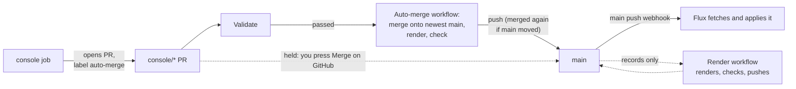

# Console

A web page at `https://console.<BASE_DOMAIN>` (`console.homelab.swhurl.com`) for looking at the platform and changing it without a terminal. Sign in with the same Google account as every other signed-in host. It changes the platform directly in only two ways: it reconciles, suspends and resumes a Flux unit, and it sets and clears [feature flag](apps.md#feature-flags) overrides in NATS. Besides that it keeps its own [job record](#jobs-and-restarts). Every other change is a **pull request** it opens against this repo, which follows the [review and auto-merge policy](#auto-merge). The one thing it creates directly is a new app's own repository (**New app**).

**It cannot change an instance today.** Every instance is [v2](v2-status.md)-owned, and the console writes v1's
records only: a v2 instance's page shows its cards with no change form, and names the command that does write it
(`swhurl-v2 edit <app>/<env> --set <field>=<value>`, `swhurl-v2 promote <app>`, `swhurl-v2 remove <app>/<env>`). The
forms below arrive when the console runs that binary ([deletion plan](v2-deletion-plan.md), phase 2). What it still
changes is what is not a record: a Flux unit's reconcile and suspension, and feature flag overrides in NATS.

App change jobs use the same [record files, renderer and validation rules](apps.md#operate-an-instance) as the CLI. If validation cannot run or fails, the job fails without opening a pull request; its temporary checkout is discarded.

## Use it

| Page | Shows | Buttons and what they do |
| --- | --- | --- |
| **Overview** (`/`) | One verdict (everything healthy, updating, or how many things need attention), what needs attention with links (failing checks, failing units, suspended units), what is updating now, jobs running now, pull requests the console opened that are still open, and recent jobs | — |
| **Deployments** (`/apps`) | One row per app, one fact per column: its **language** (the `stack` in the app repository's `swhurl.yaml`, as on Teams), its team (click it to filter), **Staging** and **Prod** (state, the running image tag, and an arrow that opens its web address), and **Promotion** as a label: **Staging only** (grey; not in production yet), **In sync** (green; both run the same image), **Prod behind** (amber; staging runs a newer build) or **Images differ** (amber; they differ and staging is not known to be the newer, for example after a rollback or with tags that are not `<run>-<sha>`). A tag opens that environment's page. **Click a row to open it**: each environment in full (image, web address, address inside the cluster and database; what it is connected to is on its own page and on **Map**), with links to the app's logs and repository. A row opens by itself when an environment is failing, unknown or suspended, and says why. Filter by **Team**, and **Show: not healthy** keeps only the rows that need a look. **Map** draws one environment as boxes, left to right in the direction requests and events travel: a solid line is a call, a dashed line an event; each box opens its app page. Read from what runs: each instance's Flux unit, HelmRelease and namespace label | In the row: **Review promotion** (a link) wherever staging is ahead of or differs from prod, or the app is not in production yet. In the opened row, per environment: a link to its page, and **Reconcile** (or **Resume** when suspended), which starts the job and shows it there without leaving the list; **Logs and traces ↗** (HyperDX, filtered to the app), **Dashboard ↗** (the app's `App: <app>` dashboard in HyperDX, [recorded by the dashboard job](#automatic-app-dashboards); it appears within about a minute of a new app's first deploy) and **Repository ↗** |
| An app (`/apps/<app>/<env>`) | The app named once with its language, an environment tab, and a summary with one fact per column: state (Healthy, Updating, Failing, Suspended, Unknown or Stopped, with the reason under it), team, image tag, replicas, database and promotion label; failing pods. Then one card per reader. **Use**: its web address, who can reach it and its TLS certificate; who can reach it is a [grant](apps.md#swhurlyaml), set here, not in the app's repository. **Connect**: its address inside the cluster, API description if it declares one, then its connections as a table, one per row (direction, kind, the other app, what happens over it, that app's team): what it declared first (the apps it calls, the events it receives and publishes, the [hosts outside the cluster](apps.md#reaching-outside-the-cluster) it may reach), then what other apps declared about it (who calls it, who receives its events); a call or a subscription is granted from the app that calls or receives, and hosts outside the cluster are read there and not offered: [v2 records no egress grant](v2-deletion-plan.md#21-commands). **Feature flags**: each [flag](apps.md#feature-flags) the image it runs declares (read from `offers/flags.json`), one row each: name and meaning, type, the declared value for this environment, the override if there is one (amber) with when it was set, marked once it is 14 days old, and the value in effect; then a row for each stored override of a flag the image no longer declares (**not declared**, **Clear** only); at the row's end a control of the declared type (a choice for a boolean or a list, a bounded number box) with **Set**, and **Clear** when overridden. Both write to NATS at once, with no pull request and no job, and each is a line in the audit log (`[AUDIT] <who> flag <app>/<env> <flag> = <value>` or `… cleared`); a value that does not fit the declaration is refused. Without its NATS key (`console-nats`) the buttons are disabled and the card says why. **Operate**: the running image and whether it matches Git, replicas, the applied Git revision, its Flux unit and Helm release, database (the SQLite file path), namespace, and links to its logs, dashboard and repository; **Environment** (collapsed): the variables the platform sets and each secret name with whether Git holds its value (**value missing**, set, or unused; the names of the Secret file's keys, never values), as `make app-status` shows. **Jobs** run on it, each opening to its output. Before a new app's pull request is merged and applied, the page says **Not created yet** with its pull request and New app job, and refreshes until the app exists | At the top right of its card, each opening a form inside the card (one at a time) whose own button opens the PR: **Change access** (Use) and **Connect to an app** (Connect; one checkbox per web app it could call and per event it could receive in that environment, leaving out itself and what it has already; one PR for everything ticked); **Remove** on each grant row the app declared, asking first (a connection another app declared is removed on that app's page). Publications have no platform editing controls: change the send operations in the app's [AsyncAPI document](apps.md#events). A connection PR also changes the apps or NATS users involved, **Scale** (Operate; its hint shows the minimum `resources` the running image's `swhurl.yaml` declares, read from GitHub at the commit in the image tag; less is refused). **Open ↗** on Use. In Operate, each beside what it does: **Reconcile** (or **Resume**), answered in place, and **Review promotion** (staging-only apps or a different digest), then **Promote to production** on the confirmation page. **Uninstall** (a PR, asks first) is a card of its own at the bottom |
| **Catalogue** (`/catalogue`) | What the apps of one environment (staging or production) offer each other, one card per app, as on Teams: each card's heading gives its team and what it uses in turn (the APIs it calls and events it receives, each a link to that row), and under it a table with one row for its API and one per event it publishes, with what its own repository says it is and the apps that use it; apps that only use are listed last, as offering nothing; filters for kind and team. A row opens to an API's routes (method, path, summary) or an event's payload as one row per field (type, required, meaning) beside an example, with the full JSON Schema one click further; who uses it, by name and team; a code sample for calling or receiving it; and its address, served description and the commit the description was read at. A link to a row (`/catalogue?env=staging#api-demo-orders`) opens it. An app that [describes nothing](apps.md#what-an-app-offers) is still listed, as not described. The facts come from the cluster; the descriptions from `apps/<app>/<env>/offers/` in Git, read once per commit (a failure is retried after five minutes and the page says why) | **Add an app**: choose one of that environment's apps that does not use it yet, then **Open connection PR**; it asks first, then opens the same connection PR as that app's **Connect to an app** |
| **Teams** (`/teams`) | One card per registered team, in alphabetical order (from `apps/teams.yaml` on `main`): its name and description, the last change made to it with its pull request, then its apps as a table (from each app's namespace label): the app, its **language** (the `stack` in the `swhurl.yaml` at the head of the app's own repository, read anonymously and kept for an hour; a dash when GitHub could not be read), and what runs in **Staging** and **Prod** (state and tag, linking to that environment), with links to each app's dashboard and logs in HyperDX and to the team's apps on the Deployments list and map. Apps that name an unregistered team, or none, are listed first with how to fix them | At the top right of each card: **Edit** (one form: the description, and the name, where changing it renames the team and relabels its apps in the same PR) and **Delete** (a team with apps must name the team they move to); no team is special, so any can be renamed or, once it owns no app, deleted. **New team** is above the cards. These buttons open a form in the card, one at a time; the form's own button, with the pull-request icon, opens a PR made by `make team-*` that waits for review ([teams](apps.md#teams-and-isolation)) The card also says whether the team has a [notification channel](services.md#notification-channels), and **Channel** gives it one, gives the one it has a new address, or removes it: a team has one channel, named after it, so there is no list of channels to manage. **Generate** makes a random ntfy topic in your browser and shows its subscribe link; the address is sent once, goes to the command's standard input and is stored encrypted, and no page, job output or pull request shows it afterwards |
| **Platform** | A verdict, then what needs attention; the `make verify-platform` checks that need only cluster reads (a group of one check is that check on one line; a longer group opens, and opens itself when something fails; an app's image automation and newest image are one line, with times as how long ago); and every Flux unit in one list, grouped by layer (cluster, infrastructure, platform services, apps), behind a summary line that says how many are healthy and the revision they have applied, and that opens when a unit is not Ready or is suspended. A unit's row shows its state and what it waits for (and its revision only when it differs from the rest); **click a row to open it** for the path it applies, its Git interval and what needs it. A failing or suspended unit is already open, with its message. The checks it cannot run are named, with `make verify-platform` for them | In a unit's opened row, each beside a line on what it does: **Reconcile now** and **Suspend** (asks first), or **Resume** on a suspended unit. The job starts there ("reconcile started · job #3", linking to its output) and the page reads itself again until the job ends, leaving open what you opened. None on `cluster-sources` and `cluster-stack` |
| **Egress** (`/egress`, linked from Platform) | How many instances are granted a host outside the cluster; then per environment one row per instance: its team, its port on the [egress proxy](services.md#egress-proxy), the hosts it is granted ([reaching outside the cluster](apps.md#reaching-outside-the-cluster)), and a link to its requests no grant covers in HyperDX (`granted=-`). Read from the cluster | None: [v2 records no egress grant](v2-deletion-plan.md#21-commands), so no command or page changes one; a grant in the profile is rendered with the rest of the proxy ([egress proxy](services.md#egress-proxy)) |
| A Flux unit (`/units/<unit>`) | State, the path it applies, its Git interval, what it waits for and what needs it (links), its app if it is one, and the jobs run on it | **Reconcile now**, **Suspend** / **Resume**, each explained. None on `cluster-sources` and `cluster-stack`, which `make flux-bootstrap` applies |
| **New app** (`/new`) | **Start a new app**, the only way the console adds one: a form for a new app, one card per step with a choice per row: first what you are building, its [type](apps.md#app-types) (Web app, API or Worker, each with the stacks it is built with and what it includes as pills; the type sets every template answer and the access it starts with), then name, stack (TypeScript or Kotlin, each with a line on what it costs to run; only the stacks the type is built with show), a one-line description, the **Owning team** (one tile per team, marked with whether it has a notification channel, which the app's messages will go to) (a label, from the names in `apps/teams.yaml` on `main`: it groups and filters apps and is on their telemetry, and grants nobody access; [teams](apps.md#teams-and-isolation)), who can reach it and the host (starting at the type's access, private for an API; replaced by a note for a worker, which is private), and **Connects to** (optional; **Connections** at the top right of its card opens it): the staging web apps it will [call](apps.md#calling-another-app), the staging [events](apps.md#events) it will receive (both as tick boxes of what runs now). Publications come only from the app's AsyncAPI document, not this form. A choice staging no longer has is refused before any repository is created. A new app that calls or subscribes changes the other apps too, so its pull request waits for review instead of merging itself. The last card, **What happens**, lists the four steps with the names filled in as you type, above the button | **Create repository and open pull request**: one job that renders the stack's template, creates the public repository `samclement/<name>`, pushes its first commit, waits for its first build (about a minute for TypeScript, about a minute and a half for Kotlin, from the shared dependency cache the templates publish) and opens the PR adding `<name>/staging` with `make app-new --from-repo` ([start a new app](apps.md#start-a-new-app) explains validation, merge, Flux deployment, certificates and dashboard timing). If the name exists on GitHub it stops before creating anything; if the first build fails or takes over 10 minutes, it stops with the run's link and the terminal command that finishes the job (the repository stays: fix the app and push; after it publishes an image, run `make app-new NAME=<name> ARGS="--from-repo samclement/<name> --env staging --image <image the run prints>"`, then commit and push, as in [start a new app](apps.md#start-a-new-app)). A refusal from GitHub (403) names the token permission to check ([tokens](#github-tokens)) |
| **Activity** | Every change started here as one row, under **In progress or waiting for you** or **Finished**: its state, what it did to what, when and who, then its [stages](#stages-of-a-change) as a labelled track that ends in a terminal stop (**Live in prod**, **Applied**, **Removed from staging**), and a sentence saying what happens next or how it ended. A row is a job ([kept across restarts](#jobs-and-restarts)) followed past its end: through its pull request's checks and merge to the instance running it. An open console pull request (`console/*` branch) whose job is no longer remembered has a row of its own. **Click a row** for its pull request, its checks and its job's output; a row whose open pull request waits for you, or failed its checks, is already open. While a job runs, the header shows **N running** | None: a row says how its pull request is merged (by the [merge gate](#auto-merge), or by you and why); you merge a held one on GitHub |

**States.** Every page uses the same six, each with its own mark so the meaning does not rest on colour: **Healthy** (✓), **Updating** (↻: waiting for a dependency, applying a change or rolling out a new image, with what it waits for), **Failing** (✕, with Flux's or Helm's message), **Suspended** (‖), **Stopped** (an app scaled to zero) and **Unknown** (something the verdict needs could not be read, with what). An app instance has one state wherever it is shown: the Deployments list, Teams, its own page, `make app-status` and the promotion gate judge the same facts (its Flux unit, its Helm release, whether the newest Git revision is applied, its image and its replicas) by one rule, [`state.py`](../tools/swhurl/apps/state.py) (the gate alone also asks GitHub [whether an unapplied commit is the app's own](apps.md#a-commit-elsewhere-does-not-hold-a-promotion)); a shared Flux unit's state is its own Ready condition. After every push Flux re-checks every unit and dependents wait a few seconds (`DependencyNotReady`); the console shows that as Updating, lists it under **Updating now**, and does not count it as something needing attention. Health checks are passing or not passing.

### Stages of a change

A job ends when its pull request is open; the change ends when the cluster runs it. Activity, an app page's **Changes** list and a job's own page show the whole path:

```text
Promote web/prod        ✓ Prepared ── ✓ Reviewed ── ✓ Merged ── ✓ Applied ── ↻ Running ── ◎ Live in prod
New app shop/staging    ↻ Prepared ── ○ Reviewed ── ○ Merged ── ○ Applied ── ○ Running ── ◎ Live in staging
Reconcile infra-base    ✓ Prepared ── ◉ Applied
```

| Stage | Evidence |
| --- | --- |
| **Prepared** | The job is running, failed, interrupted or succeeded. Success for a PR job means **PR opened**. Its output is one chronological log, streamed live. **Finish creating this app** reuses its recorded repository and choices. |
| **Reviewed** | The open PR's checks and merge rule: checks running or failed, automatic merge requested, or manual review needed. |
| **Merged** | GitHub reports the PR merged and names its merge commit. A closed, unmerged PR ends at **Closed without merging**; a new app's repository and image still exist. |
| **Applied** | The live HelmRelease has the target render hash and a Ready condition for its current generation. |
| **Running** | The instance is Healthy and every running pod matches the target release's digest. A scaled-to-zero instance ends with that explanation. |

The renderer adds `platform.swhurl.com/render` to each HelmRelease's metadata. It hashes the instance's rendered paths and objects, including its Flux unit, before adding the annotation itself. Map order and YAML formatting do not affect the hash. The annotation is outside the Helm spec and pod template, so adding it upgrades no release and restarts no app.

The target comes from the PR's **merged tree**: the gate renders it on the newest `main` before merging. Activity compares the merged target with the render on the newest `main` and the live hash. Unrelated commits do not hold a change. When `main` renders something else for the same instance:

| Why it differs | The row |
| --- | --- |
| Nothing it was rendered from: the instance's `release.yaml` and `instance.yaml` and the app's `app.yaml` on `main` are the merge commit's (ignoring the system-assigned egress port) | `main`'s render is this change's: a held PR merged on GitHub (records only) and rendered by the [Render workflow](#promotions) a minute later, or a render that changed only because of another app's records (who may call it). Until `main` renders a merged new app or first promotion, or renders a held later promotion's requested digest instead of the previous image, or applies a Settings-only change such as `replicas: 0`, it is **In progress**, waiting for the Render workflow ("main has not rendered it yet") |
| Only a newer release: the instance's `instance.yaml` and the app's `app.yaml` are as the change left them (a staging deploy) | Follows the change to that release: a new app whose seed is replaced by its own build 1, or a scale followed by a deploy, ends **Live in staging** once the newer release runs ("runs it, with a newer image"). A promotion chooses its release, so it is never followed |
| The change was seen at its end before | Stays at its end (**Live in prod**, scaled to zero, **Removed from …**), "from <time>; a newer configuration has since replaced it" |
| Otherwise | **Superseded**: a newer configuration replaced it before Activity saw it at its end, even before Flux applies the replacement |

A change is seen at its end when Activity or its job page is read while it is there; the time is kept in the job's record. A change replaced between two reads, unseen, shows **Superseded** although it may have run.

A removal ends at **Removed from …** only when the merged tree and current `main` omit the instance and both its Flux unit and HelmRelease are gone. An uninstalling release keeps it **In progress**. Removal keeps retained storage; it does not destroy data. A team or channel change ends at **On main** when merged.

One rule, `stages.progress` in [`stages.py`](../tools/swhurl/console/stages.py), decides how far a merged change has got; Activity, a job's page and an app page's **Changes** list draw its answer. It takes Git facts (each instance's records, settings, requested digest, its HelmRelease's render hash and rendered digest, and the expected hash from rendering that tree's complete inputs, read by `stages.render_targets`) and the live row. A matching render hash means the intended render reached the cluster; Ready at the current generation with the target digest running completes the rollout. The reader uses the existing model and renderer with every instance's records, public platform inputs and only the presence of encrypted files, never their values. Records with no HelmRelease, a different rendered digest, or a render hash that does not match those complete inputs are waiting for the Render workflow, which is not the same as an instance proven absent from a tree that was read. Progress is read again on each page request, never saved, apart from the time a change was first seen at its end. Immutable Git trees may be cached by commit; GitHub's current PR state, newest `main` and the cluster are read fresh. A failed read is **Unknown**, never absence or success. A merged historical job whose tree predates render hashes, or has no records for its instance, goes in **Finished** as **Merged (historical)**, with an explanation that its rollout cannot be tracked; old prepared-target hashes, progress marks and endings are ignored. A failure can recover, and a previously Healthy target can show a new failure.

**Renderer-version limitation.** Expected hashes use the running console's renderer, not the tooling from the Git tree being read. When those versions render differently, even correctly rendered historical or newer-main output can appear **In progress**, waiting for Render. A mismatch is therefore not definitive proof that Render has not run. This is conservative: it cannot mark an unapplied change complete or authorize a merge. Check the committed render and live state when diagnosing version-skewed progress; incompatible renderer changes need mixed-version regression coverage before relying on these fingerprints across versions.

The row begins with **In progress**, **Waiting for you**, **Failed**, **Interrupted**, **Closed**, **Unknown**, or its terminal stop. **Finished** holds completed or closed changes; an open PR with failed checks or a failing instance stays in **In progress or waiting for you**. Marks have text for screen readers: ✓ done, ↻ running, ‖ waiting, ✕ failed, ○ not reached, ◎ planned end, ◉ reached end.

A job page re-reads its track every 30 seconds, including after completion, so later renders and failures are visible.

**Reading a page.** Colour means one thing each: green healthy, amber needs a look (suspended, unknown, a warning), red failing or destructive, blue something you can click; an updating mark is neutral and turns. In lists a healthy row shows its mark alone, so the rows with a word next to them are the ones to read; Deployments lists anything not healthy first under a one-line count. Buttons have four weights: one filled **primary** per page, outlined for the rest, text-only for minor ones such as **Refresh**, and red-outlined for the ones that stop or remove something. Those ask first, in a dialog that says what will change (**Suspend**, **Open uninstall PR**, deleting a team); Cancel or Esc does nothing. A form behind a pull-request icon opens a PR; a dashed box with an info icon only explains. What a control will do shows before you press it: a **link** goes somewhere and changes nothing (an arrow icon means another site); a button with the **pull-request icon** opens a PR; a **plain button** changes something now (the cluster, or a label on a PR), and a red one asks first. A list keeps what a thing is on the left and what you can do to it at the right end of its row (on Teams, the top right of its card), in the same place every time; a row with more to it than fits one line (an app, a Flux unit, a job) has a › at its start and opens when clicked, and what you opened stays open while the page re-reads itself; a row that needs you is already open. Each list page starts right under its title, with the time it was read beside it; **About this page** opens what the page is for. On an app page **Use · Connect · Operate** stays at the top as you scroll (**Feature flags** is between Connect and Operate); on New app, step 4 **Connects to** is closed until you open it with **Connections**.

Overview, Deployments, Platform and Activity read the cluster again every 30 seconds while the tab is visible ("Read at 13:20, and again every 30 seconds"), except while you are typing or a dialog is open; sections you opened stay open. Other pages change only when you press **Refresh**. Team and view filters on Deployments swap the list without reloading the page. Without JavaScript every page still works: forms post normally and pages refresh when asked.

Long commit SHAs and image digests are shortened to 12 characters; hover for the full value.

Every page names an app instance `<app>/<env>` (for example `demo-shop/staging`), linking to its app page (on the Deployments list the app is named once and the tag under Staging or Prod is that link); the Flux unit's own name (`app-hello-ts-staging`) appears only on Platform and the unit's page. Pull requests that are easy to undo merge themselves once checks pass ([auto-merge](#auto-merge)). Each button starts a **job**. A button in a list (Reconcile, Suspend or Resume in an opened row on Deployments and Platform, Hold on Activity) answers in its row, with a link to the job, so you stay on the list; every other button goes to the job's page. That page shows the change's [stages](#stages-of-a-change), streams its chronological output live and re-reads itself in place when the job ends; without JavaScript it refreshes every 2 seconds. One job per unit or app instance can run at a time. Jobs and their event streams live in console memory, so a console restart ends them.

- **Cluster actions** make the changes `flux reconcile kustomization <unit> --with-source`, `flux suspend` and `flux resume` would, with `kubectl` (the image has no `flux` CLI): suspend and resume set the unit's `spec.suspend`; reconcile sets the `reconcile.fluxcd.io/requestedAt` annotation on the unit's Git source and then on the unit, and resume on the unit. Each waits (up to 10 minutes) until Flux reports the request handled, then shows the revision or the unit's error. A suspended unit is not reconciled: resume it. Suspending stops Git changes reaching the unit, as `make suspend` does ([lifecycle](operations.md#lifecycle)).
- **PR actions** download `main` through GitHub's API (Git writes use the API; `git` is present for Copier), run that tree's own `make` command (`app-new`, `app-promote`, `app-scale`, `app-expose`, `app-calls`, `app-events`, `app-remove`, `team-add`, `team-edit`, `team-remove` or `team-channel`; [apps](apps.md), [commands](commands.md)), so the change follows the rules CI will check, then commit the files it added, changed or deleted to a new `console/<change>-<app>-<env>-<commit>` branch (blobs, tree, commit and ref through the API; the job lists each file as `A`, `M` or `D`) and open a PR titled `[console] …` with a `Requested-by: <email>` line. If the command refuses (for example direct production creation), nothing is written to GitHub and the job shows why. After merging, the push webhook has Flux apply it within seconds ([how changes reach the cluster](architecture.md#how-changes-reach-the-cluster)); `make flux-reconcile` if you want to wait for it. Set any `REPLACE_ME` Secret values with `make app-secret` on the PR branch before merging.
- **Audit:** every job logs `[AUDIT] <email> <action> <target>: started|succeeded (job N)` (with the PR's URL), or `[ERROR] … failed`; search `[AUDIT]` in ClickStack. The job list [survives a restart](#jobs-and-restarts). Old addresses `/units` and `/jobs` redirect to Platform and Activity.

Every page reads the cluster when it is opened and keeps nothing for the next one: within one page each thing is read once and independent reads run at once, three at a time, and the deployed console asks the API server itself instead of starting `kubectl` for each read ([how](contributing.md#operator-tooling)). App pages return an error when a cluster read fails (for example access denied or Kubernetes unavailable); only a successfully read absent unit means no such app. **Unknown** means required release, revision, workload or running-image evidence is missing. **Stopped** means the app is deliberately scaled to zero; it is not eligible for promotion. A suspended HelmRelease is shown as suspended even when its Flux unit is active.

**Review promotion** opens a confirmation for the exact healthy staging image and configuration, reading production existence from GitHub's `main`. First promotion shows its destination, supported staging settings, independent empty storage and production Secret setup; public apps must enter a distinct production host. Later promotion shows both image pins and preserves production settings. Known older builds are identified as image rollbacks; database migrations are not reversed. Equal digests need no promotion, even if tags differ. [The full promotion timeline](apps.md#console-promotion-what-happens-and-when) explains PR validation and merge, first-production provisioning, certificate issuance and dashboard update.

**Promote to production** submits the image displayed in the review. Staging must be healthy, running that digest, and [have nothing of its own waiting in Git](apps.md#a-commit-elsewhere-does-not-hold-a-promotion). The job prepares the change in a scratch copy of `main`, then checks live staging once, immediately before its first GitHub write. Review-page checks are advisory: an unhealthy submission becomes a failed job, with no blobs, commit, branch or PR written. The scratch tool skips its own live check; direct `make app-promote` stays guarded. A changed staging image refuses before publication. The PR carries only production's records ([promotions](#promotions)). The completed job means the PR was opened, not that production is Ready. Its production link shows deployment pending until Flux applies it.

An open promotion is shown on the review page and Activity, with its checks and who merges it (the gate, or you and why). Repeated submissions reuse it; a different image requires explicitly closing the old PR before reviewing a replacement. These records come from GitHub and survive a console restart. This proves deployment readiness; try the staging app before promoting it.

## Jobs and restarts

A job (a reconcile, a pull request being opened, a new app) runs inside the console's pod. The pod is replaced whenever its image or its GitHub token changes, so:

- **A running job is finished first.** The pod being stopped takes no new job ("the console is restarting") and waits up to 14 minutes for its running ones; the pod has 15 (`terminationGracePeriodSeconds`), and the longest job waits 10 for an app's first build. The new pod serves pages meanwhile. A job page open at that moment reloads itself and then re-reads the job every few seconds until it ends.
- **Jobs are remembered.** Each job's record (who, what, state, chronological output, pull request and when its change was first seen at its end) is kept in the ConfigMap `console/console-jobs`, one key per job, written by the pod that runs it as it starts, as its output grows and as it ends. [Progress after the job](#stages-of-a-change) is read fresh; only that first-seen time is added to the record. The newest 30 are kept, each cut to 20 kB from the front; output is redacted as on the page. Activity shows them after a restart.
- **A job cut short is "interrupted".** If a pod goes away without finishing a job (a crash, a node restart, a job that outlasted the wait), the next pod marks it interrupted, with its output up to then and an `[ERROR] … interrupted` audit line. Nothing after that point happened.
- **A new app can be finished.** A new-app job that ended without its pull request (interrupted, or its first build failed or timed out) offers **Finish creating this app** on its page: a new job that uses the repository the first one created and the choices made then (team, access, connections; kept in the record, no secret among them), waits for the image its newest commit publishes and opens the platform pull request. It writes nothing to the app repository and creates no second one. If the repository was never created, it says so: start again from New app.

A local `make console-dev` keeps jobs in memory only and writes nothing to the cluster's record. `make verify-platform` fails if the ConfigMap is missing.

## Auto-merge

Some console pull requests merge themselves once **Validate** passes; the rest wait for you. Console publication and each newest-`main` merge attempt share one encrypted-input rule (`merge.encrypted_reason`): encrypted additions and modifications hold the PR, except a new app's newly added staging events key that passes the [strict seed checks](#the-gate). Deletion does not imply missing credential setup; removal still needs normal manual review.

| Change | Merges itself |
| --- | --- |
| New app, staging, no app Secret | yes, unless it calls or subscribes to another app; its generated events key does not hold it |
| Scale, schedule, connect, disconnect, reach a host outside, allow callers | in staging, when [the instance rule](#instance-changes) allows it: how staging runs, what it calls or receives, and taking access away merge themselves; granting access and anything in production wait for you |
| Promote to production | a later promotion of an image staging ran, unless **Hold for manual review** is selected or [promotion's rule](#promotions) holds it; a first promotion never |
| Uninstall, anything else adding or changing a `*.sops.yaml` | never; New app creates staging only |



The label `auto-merge` is the console asking for an automatic merge. **Hold for manual review**, on the promotion review page, opens the PR without it. Activity's **Merge** stage reads the current label, so it says whether the PR merges itself or waits for you, with the reason when known. A new app that calls or subscribes to another app changes that app's settings and needs a manual merge; the new-app choices make this known before its PR opens. Removing the label cannot stop a merge already accepted.

### New apps

A new-app PR carries only `apps/<app>/app.yaml`, `staging/release.yaml`, `staging/instance.yaml`, the generated `staging/events.sops.yaml` and `staging/offers/` documents (API, events, flags and their source). It leaves out `allocations.egressPort` and every rendered file. The gate merges those inputs onto the newest `main` and renders there: the app gets a free egress port, its unit and registration, and the shared NATS users, proxy and Reloader configuration. Two creations from the same base therefore need not conflict over a port or the unit registry. Neither the gate nor Render fetches the app's source declarations or runs `app-new` again.

A PR merged manually with GitHub's Merge button puts only those inputs on `main`; the [Render workflow](../.github/workflows/render.yml) then allocates the port, writes and registers the unit, checks and pushes the rendered files. Activity waits for that render and the live instance. The system-assigned port completes the same creation, rather than showing it Superseded; a later own build still carries the creation forward from its seed. The direct `make app-new` command continues to allocate and write rendered files immediately.

### Promotions

A promotion PR carries only the app's records: production's `release.yaml` and its `offers/` documents, and for a first promotion also production's `instance.yaml` and encrypted files (its events key, Secret placeholders). Nothing rendered travels in it, so GitHub's diff shows a few record lines (`tag: 34-… → 35-…`); the console's review page shows what `main` renders differently from them, against `main` as it is when you review. Main renders the rest when the PR is merged, whoever merges it.

**Promotion's rule** (`promotion.held`, used by the console to label the PR and state its merge plan, and by the gate before it pushes; `promotion.staged` compares complete Release snapshots read from `main`'s first-parent history, through GitHub for the console and Git for the gate): a promotion merges itself only when

- it changes nothing but production's `release.yaml` and `offers/` (a change to production's `instance.yaml`, such as a new database volume, is reviewed);
- production already exists (a first promotion creates its address, credentials and settings: you review it);
- the promoted Release matches a complete staging `release.yaml` selected on `main`'s first-parent history, including its image repository, tag and digest (a digest mentioned elsewhere is not evidence, and retagging an old image does not disguise a rollback);
- it is not a rollback (the promoted `<run>-<sha>` tag is not older than production's);
- what the app publishes, its port, database and secret names are the same as production's (set any new secret's production value first).

Anything else waits for you, with the reason as the PR's **Merge plan** or the gate's comment. A newer staging build, another app's call or a tooling commit on `main` since the PR opened does not hold it: the gate merges the records onto the newest `main` and renders there. Two promotions of the same app conflict in Git; GitHub says so on the second, and you close it and promote again.

**A held promotion is merged with GitHub's Merge button.** That puts the records on `main`; the [Render workflow](../.github/workflows/render.yml) renders them (a first promotion's unit is written and registered then), runs `make check-repo` and `make check-apps`, and pushes the rendered files as a second commit, usually within a minute. Until then the previous rendered files stay live. A first promotion's Secret values are set on the PR's branch before merging, with `make app-secret APP=<app> ENV=prod NAME=<name>` in your own terminal: on that branch it writes the encrypted file alone.

### Instance changes

Scale, schedule, who can reach it, connect, disconnect, reach a host outside and allow callers each open a PR carrying only the instance's `instance.yaml` (connecting may also add its generated events key, which holds it). Main renders the rest: the instance's files, the other app's allowed callers and NetworkPolicy, the NATS users and the egress proxy. For example, scaling `demo-shop/staging` to 2 replicas is one changed line, `replicas: 2`.

**The instance rule** (`merge.settings_held`, one function, used by the console to label the PR and by the gate before it pushes) compares the instance's Settings on `main` with the PR's. Each staging field's review is a row of `merge.STAGING_REVIEW`; a test fails when a Grants or Choices field has none, so a new field is never auto-merged unnoticed. Likewise every field is copied to [first production](apps.md#promote-to-production) or deliberately left as production's own, and every field but the allocated egress port identifies a change for [Activity](#stages-of-a-change):

| The PR changes | Merges itself |
| --- | --- |
| Production's Settings | never |
| Staging's `replicas`, `capacity` or `schedule` | yes |
| Staging's `calls` or `subscriptions` (added or removed) | yes: a call connects only once the callee allows it, and any app may receive a published event |
| Staging's `allows` or `egress`, entries removed | yes: it takes access away |
| Staging's `allows` or `egress`, entries added | never: it grants access |
| Staging's exposure, host or issuer | never: it changes who can reach it |
| `exceptions` or `allocations` | never |

On the app page, **Allow callers** (web apps only) adds to the instance's `allows`, and each allowed caller has a **Remove** button; the app page's connections table compares outgoing Git declarations with live observations using the shared [call/event semantics](apps.md#calling-another-app). It distinguishes waiting for the target instance, waiting for call consent, **connected in Git, not yet observed live**, and a removal in Git still observed live. Pending calls and subscriptions keep their Remove buttons. Missing, partial, unreadable or invalid Git records say **Git relation records unavailable; showing live connections only**; a missing live variable never proves that consent is absent. The Deployments list and map remain live views. A held instance change is merged with GitHub's Merge button and rendered by the [Render workflow](../.github/workflows/render.yml), as for a promotion. Two changes to the same instance conflict in Git; close the second and make it again.

### Removals, teams and channels

These PRs stay held for a person's review, and carry only inputs:

| Change | PR contents |
| --- | --- |
| Uninstall an instance | Deletions of its `release.yaml`, `instance.yaml`, offers and encrypted inputs; `app.yaml` only for its last environment |
| Change a team | `apps/teams.yaml`, affected apps' `app.yaml`, and `instance.yaml` wherever a renamed `team:<name>` grant changes |
| Change a notification channel | The team registry, encrypted channel files, notify resource list and its unit's decryption setting, where changed |

No generated instance manifests, app-unit registrations, Reloader list or notification routes travel in these PRs. Validate recognizes these team/channel inputs and renders them before checking; generated routes are not inputs. After GitHub's Merge button, the Render workflow reconciles them on the newest `main`, including [removal cleanup](apps.md#remove-an-app). Activity treats both instance records absent as the removal target even while old generated files remain, and waits for live absence before showing Removed. Direct CLI commands still write the complete planned tree.

### The gate

[The workflow](../.github/workflows/auto-merge.yml) uses trusted `main` tooling and verifies the current PR head passed Validate (the run the label starts waits up to two minutes for it, so the merge does not need a second runner start).

The console's table (`merge.ACTIONS`) owns each kind of console PR: its command builder, job and PR wording, the environments its branch may name, the input paths it may carry and its semantic merge rule. The console builds every `console/<action>-<name>[-<env>]-<sha>` branch from it and the gate and Activity parse branches with it, so a branch names a known action, a valid name and an allowed environment or is not a console change. Every action, including promotion, uses `proposal.open_action`: sequential scratch preparation and judgement, then a narrow REST publisher. Body text and merge reasons are ordinary values, not publication callbacks. The console reads the action's inputs before and after running the downloaded tooling, then applies the table's rule to the proposed input diff; a held change opens without the auto-merge label and says why. The gate reads those inputs again on each newest-`main` attempt and applies the same rule. Removals, teams and channels are in the table but never gated: a person merges them. The gate takes the rest (new app, promotion and the instance changes). For every kind, one path refuses files outside the action's input records, then: in a worktree at the newest `main`, `git merge` of the PR head; the action's rule; `make app-sync`; `make check-repo check-apps`; a recheck of the PR head and its label; one merge commit of the PR head, pushed to `main` without force. A confirmed Git conflict holds the PR. A push rejected because `main` moved is merged, rendered and checked again on the newer `main`, up to three times in the same run. Promotion uses [promotion's rule](#promotions), an instance change [the instance rule](#instance-changes).

For a **new app**, every PR file must be one of that new app's [inputs above](#new-apps), never another app's files, generated files or another encrypted Secret. The app and its instances must not already exist on `main`; all three records must parse strictly, with no preallocated egress port. Calls, subscriptions or any nonempty policy exceptions hold it for manual review even if someone adds `auto-merge`; a PR cannot grant itself a policy waiver. The reserved app name `notify` is held; the app policy requires the platform-owned image. Secret rendering refuses malformed, reserved or repeated secret names, and database rendering refuses worker/job databases, so manually merged records cannot bypass those existing creation restrictions. Its events key must be a new encrypted Secret containing only its NATS seed, encrypted to the recipients `.sops.yaml` names for it, paired with a NATS public key in `instance.yaml`'s `allocations.eventsKey`. Missing or malformed records or keys cannot merge. Workload rendering also validates a job's effective schedule with the shared cron validator and refuses explicit schedules on non-jobs, including when Render reads a manually merged record. The gate retains the encrypted key unchanged; it cannot decrypt it or prove that the encrypted seed matches the public key. Old new-app PRs carrying rendered files are held with a reason; close them and open a fresh PR rather than replaying them.

`check-repo` renders and schema-validates the registered units, and `check-apps` checks app policy; tooling tests read frozen fixtures, and template, collector and tooling inputs are unchanged by an eligible diff. Operator commits still require the full `make check` described in [contributing](contributing.md).

**When the gate does not merge:** a PR it holds (the rule or a confirmed Git content conflict) loses `auto-merge` and gets a comment with the reason (`Auto-merge refused: ...`); Activity shows that reason on the pull request's row, reading only the workflow's own comments. Any other failure (a `gh` or `git` command, rendering or checks failing, an unexpected error) keeps the label, so the next run tries again; the queue goes on to the next PR, and the run fails at the end so the failure is seen. A PR not yet validated, or whose label was removed, is skipped without a comment. Activity's **Validate** and **Merge** stages distinguish queued and running checks, failed validation, merge conflicts, the merge gate checking it and a merge that waits for you; if GitHub check reads fail, the stages stay unreached and link to GitHub. The pull request's checks link says the same fact (**Checks passed**, **Checks failed**, **Checks running**, **Checks pending**, **Merge conflict**, or **Checks on GitHub** when they could not be read), beside who merges it.

A merge made by the workflow's token starts no workflow on `main`; Flux's webhook still applies it. `main` has no branch protection, and direct operator pushes remain supported.

## Deploy a new console

The image is built from this repo ([`images/console/Dockerfile`](../images/console/Dockerfile)) and published to `ghcr.io/samclement/swhurl-console` (public) by the Validate run of each push to `main`, alongside its checks, tagged `src-<hash of its inputs>`. Once every check in that run has passed, its **Deploy the console** job deploys it: it runs `swhurl console-image --expect src-<hash> --commit`, which pins the tag and digest on the newest `main` in `platform/console/helmrelease.yaml` and, on the lines marked `# image: console`, in the [notify service](services.md#notify-service)'s `platform/notify/helmrelease.yaml`, renders any records Render has not rendered yet (as the merge gate does, so the commit may carry those files too), checks it (`make check-repo check-apps`) and pushes a `deploy: console image src-<hash> (Validate)` commit as `github-actions[bot]`, the way every bot pushes ([`bots.push_main`](../tools/swhurl/bots.py): never forced; a push lost to another writer pins again on the newer `main`, and a failed check pushes nothing); the [push webhook](services.md#push-webhook) has Flux apply it at once ([the full chain](architecture.md#how-changes-reach-the-cluster)). So a push that changes `tools/`, `images/console/`, `pyproject.toml` or `uv.lock` is running in the console a few minutes later, with nothing to do (measured 17 October 2026, before the pin was checked: 79 s from push to the pin commit, 20 s more to the new pod, ready 6 s after that; the check's setup and run add to the first figure):

```text
push → Validate: checks (≈1 min) and, alongside them, build and push the image
     → every check passed → bot commits the pin → webhook → console rolls out (≈20 s)
```

- **Pull before your next push** (`git pull --rebase`): the bot's commit is on `main`.
- **Skipped on purpose** when `main` has moved on to other image inputs by the time the run pins (that commit's own run pins its image), and when the pin is already current (docs-only commits). Each run's summary says which.
- **The console restarts** when its pin changes; a job running at that moment [is finished first](#jobs-and-restarts).
- **Pushes made with the workflow's token start no workflows**, so the pin commit starts no Validate run.
- **Built before it is checked:** a commit whose checks fail still publishes its `src-<hash>` image (nothing pins it); the deploy job needs every check to pass.
- **By hand** (the run failed, or to pin an older image): `make console-image`, commit, push. `make verify-platform` warns while the running image is older than your checkout's tooling.

**Check that it deployed:** `make verify-platform` checks the console's desired image against this checkout and its running workload; Platform shows `platform-console` health. A green Validate run proves the image was published and pinned, not that the new pod is Ready. The current [notification coverage and gaps](services.md#alerts) explain which console failures produce a push; the console uses the same deployment, rollback and prolonged-health notifications as apps.

A commit that changes none of the image's inputs has the same hash: nothing to deploy. How the image and workflow are built: [contributing](contributing.md#operator-tooling).

## Read performance

An app-details request owns one GitHub client for its platform-file reads and closes it after rendering the HTML. Its first file read resolves `main` once; settings, Release minimums, secret key names, related apps' records and any uncached offer documents then use that commit. Each path is fetched at most once per request, including missing files and failed reads. Independent reads run concurrently, with at most four file reads in flight per page. Local development and injected document readers use the same request deduplication without a GitHub lookup. Existing offer-document caching remains in place.

Missing files and unavailable evidence are different: a failed file or commit lookup never becomes absence, consent or a successful rollout, and never falls back to moving `main`. File answers are discarded after the page, so file-read failures are retried on the next request, except offer descriptions: their existing cache keeps failures for five minutes. This pins platform-file evidence, not an atomic snapshot of Git, cluster and feature flags. PR checks, promotion checks and Activity's archive reads retain their own readers.

The `swhurl.console.timing` logger emits diagnostic counts and milliseconds, never credentials or file contents:

- `page files`: unique `files`, duplicate `hits`, failed read operations (`failed`, including commit resolution), `resolve_ms`, cumulative file-read time `file_ms`, and whole app-handler/render lifetime `elapsed_ms`. Concurrent file durations overlap, so `file_ms` is not page wall time. A file read that cannot start because commit resolution failed has no file-read duration.
- `render targets cache`: `hit` or `miss` for an immutable commit's in-memory render-target cache. Concurrent misses can still duplicate work; failures are not retained across requests.
- `render targets`: commit prefix, archive `bytes`, rendered `instances`, `download_ms`, `extract_ms`, `render_ms` and `total_ms`. `phase=done` means successful evidence acquisition, not a completed rollout. On failure, `phase=download`, `extract` or `render` identifies the unfinished phase; its duration includes the failed attempt. Render time includes model loading and temporary-tree cleanup.
- `activity`: the complete Activity handler/render `elapsed_ms`.

Activity and an app's Changes list still wait for their required historical evidence. The immutable render cache lives in the process and is lost on restart; there is no persistent cache or deferred rollout section. Use these diagnostics to distinguish routine file-read latency from cold historical-evidence work before choosing the next optimisation.

## GitHub tokens

Two fine-grained tokens in [`platform/console/secret.sops.yaml`](../platform/console/secret.sops.yaml), both owned by you, so everything they do appears as you, and one value that is not a GitHub credential:

| Key | Covers | Permissions | Used for |
| --- | --- | --- | --- |
| `GITHUB_TOKEN` | `samclement/swhurl-platform` only | Contents, Pull requests: read and write | Every PR the console opens here |
| `APP_REPOS_TOKEN` | All repositories (GitHub lets a token create repositories only then) | Administration, Contents, Workflows, Webhooks: read and write; Actions: read | **Start a new app** only; without it that form is off |
| `IMAGE_WEBHOOK_TOKEN` | Flux's `app-images` receiver | None on GitHub: it signs [image webhook](services.md#image-webhook) calls | The webhook **Start a new app** adds to the new repository. Without it, or without the Webhooks permission above, the job warns and carries on; `make app-hooks` adds the webhook later |

`make verify-platform` checks GitHub accepts each and warns 14 days before one expires (a missing `APP_REPOS_TOKEN` is a warning). Replace one: [operations](operations.md#secrets); Reloader restarts the console.

## How it is protected

Application, Uvicorn access and action audit logs are one-line JSON. Audits retain the signed-in identity, action, unit, state, job ID and result link; access logs expose method, path and status as fields. Their collection and ClickStack searches are described in [structured logs](services.md#structured-logs).

- **Who:** oauth2-proxy returns the signed-in email as `X-Auth-Request-Email` (it needs `set-xauthrequest`) and Traefik copies it to the request; without it the console answers 401 (except `/healthz`). A NetworkPolicy admits only Traefik's pods, so no other pod can send a forged header. A POST must carry an `Origin` naming the console's own host (403 otherwise), so another website cannot use your sign-in cookie to start an action.
- **What it may do in the cluster:** its ServiceAccount `console/console` may read Flux units, HelmReleases, the Git source, Flux alerts and providers, image automation objects, pods, workloads, CronJobs, Ingresses, Certificates and namespaces (for an app's team label). It may patch only Kustomizations and GitRepositories in `flux-system` and its own job record, the ConfigMap `console/console-jobs` ([`rbac.yaml`](../platform/console/rbac.yaml), [`jobs-state.yaml`](../platform/console/jobs-state.yaml)). No Secrets, no `pods/exec`, nothing else writable. RBAC cannot limit which fields a patch changes; the console's code does, and refuses the root units.
- **The repository token** could change or delete any of your repositories, so only one class uses it ([`repos.py`](../tools/swhurl/console/repos.py)), and it can only check whether a repository exists, create a new public one, write the first commit and add the image webhook to a repository it created in the same job, and read that repository's workflow runs. It has no delete call and refuses any other write (tested). Rendering uses Copier and `git` in the image, which only read the public template. The Teams page reads each app's public `swhurl.yaml` from `raw.githubusercontent.com` without any token.
- **The tokens:** used only in the `Authorization` header of the console's GitHub API requests (download `main`, create a `console/*` branch and its commit, open the PR; create a new app repository and its first commit); never in a command line and redacted from all output. `main` is not protected, so the limit to `console/*` branches is the console's code (tested).
- **State:** only the [job record](#jobs-and-restarts) in `console/console-jobs`. `/tmp` is a 1 GiB `emptyDir` for downloaded trees.

## Run it locally

`make console-dev` serves the same pages from your checkout on `http://127.0.0.1:8080` as a fixed identity (`operator@localhost (dev)`), refusing any address but loopback. It reads the cluster **with your kubeconfig**, so its buttons act with your admin rights, and it opens real PRs if `GITHUB_TOKEN` is set in your environment. Code layout: [contributing](contributing.md#operator-tooling).


### Automatic app dashboards

The console HelmRelease also runs the minute-by-minute dashboard reconciler described in [app dashboards](apps.md#dashboards), which creates, updates and deletes app dashboards and each app's [default alerts](apps.md#alerts), and first creates or repairs the two [platform-owned webhooks](services.md#clickstack-and-otel). It shares the published operator image through a YAML anchor, but uses a separate `dashboard-sync` ServiceAccount and receives no GitHub tokens. It may list HelmReleases, read the two existing ClickStack input/connection Secrets plus exact `get` access to `console/notification-ntfy` and `notify/notify-alerts` (no Secret list/write), execute API/MongoDB scripts in observability pods, and patch one ConfigMap, `console/app-dashboards`, where it records which dashboard belongs to which app (`{"<app>": "<dashboard id>"}`, written only when it changes). The web console's account still cannot read Secrets or exec into pods. Dashboards remain in the backed-up ClickStack MongoDB; the record is rebuilt by the next run, so it needs no backup (Flux owns the ConfigMap's metadata and never its data, as for [notification state](services.md#current-notification-behavior)). Besides its own job record, the console's account may read only this ConfigMap in its namespace: it is how the **Dashboard ↗** links know where to go without the console holding a HyperDX key. Only an entry that is an app name and a dashboard id becomes a link; if the record cannot be read, the links are left out. A run that cannot write the record fails, which `make verify-platform` reports under App dashboards. Jobs retain one success and one failure, stop after 50 seconds, and their stdout is collected by the node log agent. Credentials are reread each run, so rotation needs no restart. Image updates follow the existing console publication workflow.
