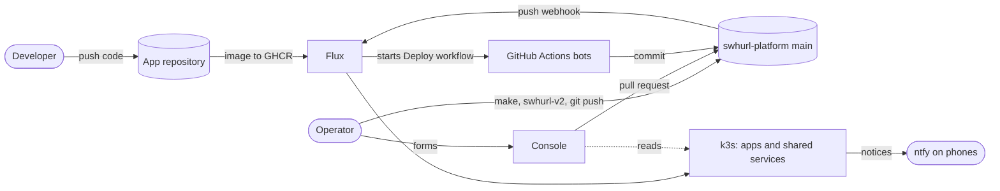
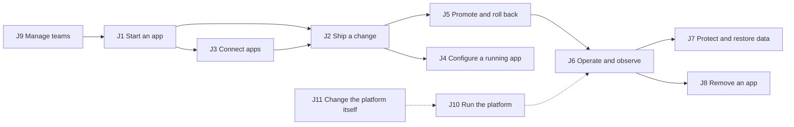
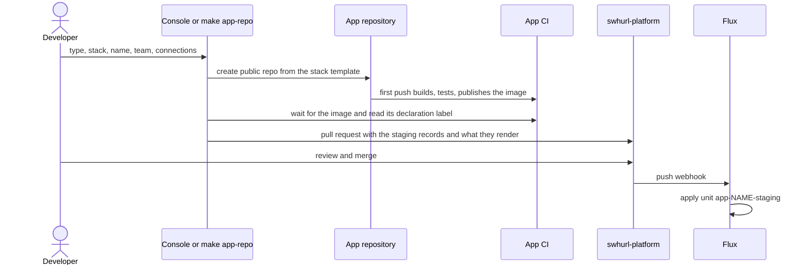
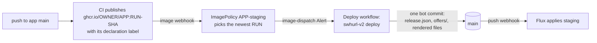
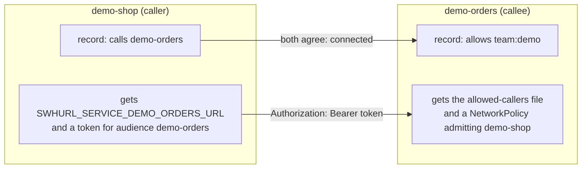
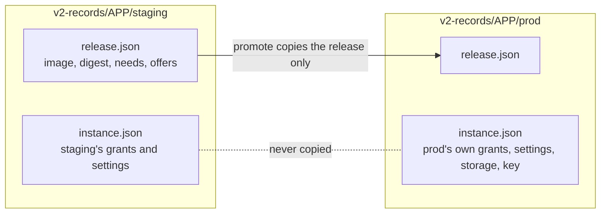
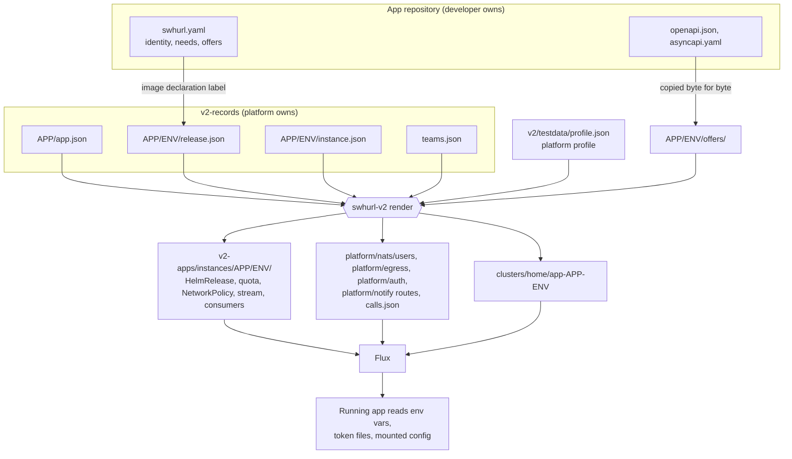

# Goal, user journeys and primitives

A map of what this repository is for, what people do with it, and the APIs and primitives that make each of those things work. Each section links to the page that owns the detail; this page owns only the map.

- [1. Goal](#1-goal)
- [2. Who uses it](#2-who-uses-it)
- [3. User journeys](#3-user-journeys)
- [4. APIs and primitives](#4-apis-and-primitives)
- [5. Contracts that hold across journeys](#5-contracts-that-hold-across-journeys)

## 1. Goal

**A small, self-service app platform on one k3s node, driven entirely from Git.** A team starts an app from a template, connects it to other apps, ships it to staging by pushing code, and promotes the same image to production. The platform supplies sign-in, app-to-app identity, events, feature flags, telemetry, notifications, storage and backups, so app code only names what it uses.

The design rests on a few rules ([architecture principles](architecture.md#principles)):

| Rule | What it means in practice |
| --- | --- |
| **Git is the deployment path** | Flux applies `main`. The console, bots and `make` targets all change the cluster by writing commits; only a short, named list of operator commands acts on the cluster directly ([outside Git](architecture.md#how-changes-reach-the-cluster)). |
| **One declaration, many effects** | An app writes down what it is, needs and offers (`swhurl.yaml`). The platform holds what it is allowed (grants). Everything else, such as namespaces, policies, tokens, NATS users and proxy ports, is rendered from those, and `make check` fails if a rendered file has drifted. |
| **The app repository cannot widen its own access** | Grants (team, exposure, calls, allows, subscriptions, egress) live only in this repository. A push to an app can change what the app *needs*, never what it is *allowed*. |
| **Failures stay local** | Each capability and each app instance is its own Flux unit and waits only for what it uses. |
| **Destruction is explicit** | Nothing deletes data implicitly. Removing an app keeps its volume, and only `make destroy-data` deletes one. |

**Limits by design** ([apps limits](apps.md#limits), [capability catalogue](platform-capability-catalogue.md)): one node; a team is a label, not an access boundary; app repositories and images are public; only apps made from a stack template are supported; production is reached only by promotion.

## 2. Who uses it

| Actor | Wants to | Mainly uses |
| --- | --- | --- |
| **App developer** (a team member) | Build, ship, connect and observe an app without touching Kubernetes | The app's repository, the console, the stack template's helpers |
| **Operator** (owns the platform and merges every pull request) | Keep the platform healthy, review changes, manage teams, recover data | `make` targets, `swhurl-v2`, the console, GitHub |
| **The running app** | Find and call other apps, publish and receive events, read flags, send notices, export telemetry | The [runtime interface](#43-the-runtime-interface-what-a-running-app-gets): environment variables, token files, helpers |
| **Bots** (Deploy, Render, Validate, Renovate) | Keep `main` rendered, deploy staging images, pin the console image, propose chart updates | [`host/push-main.sh`](../host/push-main.sh), pull requests |

On this homelab one person holds both human roles. The journeys keep the roles apart because the platform does: a developer's push cannot do what an operator's review does.

## 3. User journeys

Each journey lists its sub-journeys, where each one starts (console or terminal), the primitives it touches ([section 4](#4-apis-and-primitives)) and the page that owns the detail.

### J1. Start an app

*"I want a working repository, a pipeline and a running staging instance in minutes."*

| Sub-journey | Console | Terminal | Primitives | Detail |
| --- | --- | --- | --- | --- |
| 1a. Choose what to build | **New app**: type, stack, name, team | `make app-repo TYPE= STACK= TEAM=` | App type, stack, team registry | [app types](apps.md#app-types), [stacks](apps.md#stacks-and-features) |
| 1b. Create the repository from a template | same form | `swhurl-v2 app-repo` | Copier template, image webhook | [start a new app](apps.md#start-a-new-app) |
| 1c. Wait for the first image | the job's page | the command waits; `RESUME=true` after a failed build | Image declaration label | [what happens, and when](apps.md#what-happens-and-when) |
| 1d. Admit it to staging | the held pull request: `create`, an `edit` per connection, `render` | `swhurl-v2 create`, `edit`, `make v2-render` | Records, render, Flux unit | [what create writes](apps.md#what-create-writes) |
| 1e. Merge and watch it come up | **Activity**: Prepared → Reviewed → Merged → Applied → Running | `make app-status` | Stages of a change, instance state | [stages of a change](console.md#stages-of-a-change) |
| 1f. Keep the template current | — | Copier update pull requests in the app repository | Template revision pin | [template updates](apps.md#template-updates) |

A new app has no production yet. v2 promotes into an existing production and creates none ([deferred](v2-status.md#deferred-features)).

### J2. Ship a change

*"I push to `main` in my app and staging runs it, with whatever it now needs and offers."*

| Sub-journey | Entry point | Primitives | Detail |
| --- | --- | --- | --- |
| 2a. Push and have staging follow | push to the app's `main` | Image webhook, ImagePolicy, Deploy workflow, `swhurl-v2 deploy` | [deploy a new image](apps.md#deploy-a-new-image) |
| 2b. Change what the image needs (port, database, memory, telemetry) | edit `swhurl.yaml` in the same commit as the code | Declaration (needs), release record | [swhurl.yaml](apps.md#swhurlyaml) |
| 2c. Change what the app offers (API, events, flags) | edit `openapi.json`, `asyncapi.yaml`, `flags` | Offers, `offers/` documents | [what an app offers](apps.md#what-an-app-offers) |
| 2d. Get told why an image was held | the Deploy run fails naming the reason; the app keeps its image | Refusals (kind change, quota, uid on a volume, data loss, a subscriber still listening) | [a refused image is held](apps.md#deploy-a-new-image) |
| 2e. Keep dependencies current | Renovate pull requests in the app repository | — | [dependency updates](apps.md#dependency-updates-in-app-repositories) |

### J3. Connect apps

*"My app calls an API, reacts to another app's events, or reaches a host on the internet, and I never handle a credential."*

| Sub-journey | Console | Terminal | Primitives | Detail |
| --- | --- | --- | --- | --- |
| 3a. Discover what exists | **Catalogue**, **Deployments → Map** | `swhurl-v2 status --all` | Offers, inventory | [what an app offers](apps.md#what-an-app-offers) |
| 3b. Call another app | **Connect to an app** on the caller, **Allow** on the callee | `edit --set calls=…`, `edit --set allows=…` | `calls` + `allows`, audience-bound token, NetworkPolicy | [calling another app](apps.md#calling-another-app) |
| 3c. Call on behalf of a signed-in person | — (code) | `service("x").fetch(path, { onBehalfOf })` | `x-auth-request-email`, `x-swhurl-user` | [a browser calling an API](apps.md#calling-another-app) |
| 3d. Publish an event | add a send operation to `asyncapi.yaml` and push | — | AsyncAPI document, NATS stream and user | [events](apps.md#events) |
| 3e. Receive an event | Catalogue **Add an app** | `edit --set subscriptions=APP.EVENT` | Subscription grant, durable consumer | [events](apps.md#events) |
| 3f. Reach a host outside the cluster | shown on **Connect** and **Egress** | `edit --set egress=HOST`, then `make v2-render` | Egress grant, proxy port | [reaching outside](apps.md#reaching-outside-the-cluster) |

A call connects only when both sides agree. Until then it is *pending*, which is not an error:

### J4. Configure a running app

*"I change how my app behaves or who can reach it without building a new image."*

| Sub-journey | Console (app page) | Terminal | Takes effect | Detail |
| --- | --- | --- | --- | --- |
| 4a. Override a feature flag for one environment | **Feature flags** card | `swhurl-v2 flags --set FLAG=VALUE` | at once (NATS key-value) | [feature flags](apps.md#feature-flags) |
| 4b. Change who can reach it | **Change access** | `edit --set exposure=…` | after merge | [who can reach it](apps.md#who-can-reach-it) |
| 4c. Scale or resize | **Scale** | `edit --set replicas=…`, memory | after merge | [operate an instance](apps.md#operate-an-instance) |
| 4d. Move it to another team | **Change team** | `edit --set team=…` | after merge, in every environment | [teams and isolation](apps.md#teams-and-isolation) |
| 4e. Give it a secret | — | not modelled by v2 yet | — | [secrets](apps.md#secrets) |

Flag overrides and the Flux actions (reconcile, suspend, resume) are the console's only immediate effects. Every other button opens a pull request that a person merges.

### J5. Promote and roll back

*"Production runs exactly the image I tried in staging, with its own settings and its own data."*

| Sub-journey | Console | Terminal | Primitives | Detail |
| --- | --- | --- | --- | --- |
| 5a. Review a promotion | **Review promotion** | `make app-status APP= ENV=staging` | Promotion readiness, reviewed digest | [console promotion](apps.md#console-promotion-what-happens-and-when) |
| 5b. Promote | **Promote to production** opens a held pull request | `swhurl-v2 promote --expect REVISION` | Release (copied); instance (kept) | [promote to production](apps.md#promote-to-production) |
| 5c. Roll production back | promote an older release | `select-release` on staging, then `promote` | A rollback is a promotion | [roll back](apps.md#roll-back-to-an-older-release) |
| 5d. Roll staging back | — | revert the pin; fix forward in the app | Deploy workflow re-pins the newest | [deploy a new image](apps.md#deploy-a-new-image) |

### J6. Operate and observe

*"I can tell at a glance whether my app is fine, and I hear about it when it is not."*

| Sub-journey | Console | Terminal | Primitives | Detail |
| --- | --- | --- | --- | --- |
| 6a. See one verdict | **Overview**, **Deployments**, app page | `make app-status`, `make verify-platform` | Instance state, platform checks | [console](console.md#use-it), [check health](operations.md#check-health) |
| 6b. Follow a change to the cluster | **Activity**, a job's page | `make flux-reconcile` | Stages of a change, jobs | [stages of a change](console.md#stages-of-a-change) |
| 6c. Read logs, traces and metrics | links to HyperDX | `make app-logs` | OTLP, `swhurl.team`, per-app dashboard | [telemetry](apps.md#telemetry), [dashboards](apps.md#dashboards) |
| 6d. Be alerted | — | — | Default alerts, notification checker, team channel | [alerts](apps.md#alerts), [notification expectations](services.md#notification-expectations) |
| 6e. Send a notice from app code | — | `notify("title", {…})` | Notify service, notify token | [notifications](apps.md#notifications) |
| 6f. Nudge or pause Flux | **Reconcile**, **Suspend**, **Resume** | `make app-reconcile`, `make suspend` | Flux unit, `swhurl-v2 unit` | [lifecycle](operations.md#lifecycle) |

### J7. Protect and restore data

*"My app's SQLite database survives pod restarts, is backed up nightly, and can be restored."*

| Sub-journey | Entry point | Primitives | Detail |
| --- | --- | --- | --- |
| 7a. Get a database | `database: sqlite` in `swhurl.yaml` | Retained volume, one writer, `DATABASE_PATH` | [stacks and features](apps.md#stacks-and-features) |
| 7b. Have it backed up | automatic, nightly | Backup CronJob, encrypted archive, upload-only key, S3 | [backups and recovery](operations.md#backups-and-recovery) |
| 7c. Check protection | `make app-status`, `swhurl-v2 status --archive` | Backup age against `--max-age` | [backups and recovery](operations.md#backups-and-recovery) |
| 7d. Restore | `make restore-sqlite DRY_RUN=true`, then `CONFIRM=APP/ENV` | `swhurl-v2 restore`: plan, suspend, restore job, resume | [backups and recovery](operations.md#backups-and-recovery) |
| 7e. Delete data on purpose | `make destroy-data` | Guarded, the only deleting command | [lifecycle](operations.md#lifecycle) |

### J8. Remove an app

| Sub-journey | Console | Terminal | Detail |
| --- | --- | --- | --- |
| 8a. Free it of dependants | remove callers' `calls` and subscribers' `subscriptions` first | `edit` | [remove an app](apps.md#remove-an-app) |
| 8b. Uninstall one environment | **Uninstall** (held pull request) | `swhurl-v2 remove` | [remove an app](apps.md#remove-an-app) |
| 8c. Clean up a throwaway | — | delete its repository and package with the cleanup tokens | [AGENTS.md](../AGENTS.md) |

Removal keeps the volume, and the app record goes only with its last environment.

### J9. Manage teams

| Sub-journey | Console | Terminal | Detail |
| --- | --- | --- | --- |
| 9a. Create, rename, describe, remove a team | **Teams** | `make team-add`, `team-edit`, `team-remove` | [teams and isolation](apps.md#teams-and-isolation) |
| 9b. Give a team a notification channel | **Teams** | `make team-channel NAME=` | [notification channels](services.md#notification-channels) |

A team change never relabels an app or rewrites a grant. It is refused while anything still names the team.

### J10. Run the platform (operator)

| Sub-journey | Entry point | Detail |
| --- | --- | --- |
| 10a. Build from a bare host | `docs/bootstrap.md`: k3s, DNS, SOPS, `make flux-install`, `make flux-bootstrap` | [bootstrap](bootstrap.md) |
| 10b. Make a platform change | edit, `make check`, push, `make flux-reconcile`, `make verify-platform` | [README](../README.md#make-a-change) |
| 10c. Review a chart update | Renovate pull request | [chart updates](operations.md#chart-updates) |
| 10d. Rotate a Secret or signing key | SOPS edit, `swhurl-v2 mint --rotate` | [secrets](operations.md#secrets) |
| 10e. Keep the host alive | `make host-dns`, `make host-heartbeat` | [commands: host](commands.md#host) |
| 10f. Prove a path end to end | `make live-test-*` with throwaway namespaces | [commands: live tests](commands.md#live-tests) |
| 10g. Troubleshoot | `make verify-platform`, `flux get kustomizations` | [troubleshooting](operations.md#troubleshooting) |

### J11. Change the platform itself

| Sub-journey | Entry point | Detail |
| --- | --- | --- |
| 11a. Validate a change | `make check` (+ `make check-templates`, `make check-v2`) | [contributing](contributing.md#validation) |
| 11b. Run a bounded change with a coding agent | the task record and stages | [software change workflow](software-change-workflow.md) |
| 11c. Know where work stands | the workstream registry, checked by `make check-docs` | [workstreams](workstreams.md) |
| 11d. Move v1 Python to v2 Go | one slice per `swhurl-v2` subcommand | [v2 status](v2-status.md) |

## 4. APIs and primitives

The primitives are layered. The app writes a declaration and the platform holds grants. v2 renders both into manifests, Flux applies them, and the running app reads the result through a fixed interface.

### 4.1 Domain vocabulary

One meaning each. The [glossary](../GLOSSARY.md) is canonical.

| Term | Means |
| --- | --- |
| **App** | One repository, one image, one name (a DNS label of at most 40 characters) |
| **Environment** | `staging` or `prod` |
| **Instance** | One app in one environment: namespace `APP-ENV`, unit `app-APP-ENV`, records `v2-records/APP/ENV/` |
| **Unit** | One Flux `Kustomization`, the reconciliation and deletion boundary |
| **Team** | An owner name in `teams.json`, used for labels, grants and notification routing |
| **App type** | `web-app`, `api` or `worker`, chosen at creation; it sets every template answer |
| **Stack** | A Copier template: `typescript` or `kotlin` |
| **Declaration** | `swhurl.yaml`: **identity** (what it is), **needs** (what the image needs), **offers** (what it gives others) |
| **Grant** | What the platform allows: team, exposure, egress, calls, allows, subscriptions |
| **Release** | One image and everything it declares, identified by a content hash (`rel-sha256:…`) |
| **State** | An instance's one verdict: Healthy, Updating, Failing, Suspended, Stopped or Unknown, with the reason |
| **Notice** | One message for a person: title, message, priority, link |
| **Job / change** | A console action. A job ends when its pull request opens; the change ends when the cluster runs it |

### 4.2 Records: the source of truth

Only v2 writes them, and Flux never applies one: Flux applies what they render. Each fact has one writer.

| Record | Holds | Written by |
| --- | --- | --- |
| `v2-records/APP/app.json` | App identity hash, owning team | `create`; `edit --set team=` |
| `v2-records/APP/ENV/release.json` | Source repo and commit; image digest; runtime (`kind`, `port`, `healthPath`, `uid`); database; telemetry; published events; description; API path; document roles; `releaseId` | `deploy` (staging), `promote` (prod), `create` |
| `v2-records/APP/ENV/instance.json` | Selected `release`; configuration (`replicas`, `memoryMiB`); grants (`exposure`, `egress`); `calls`; `allows`; events (`key`, `subscriptions`); storage claim | `edit`, `promote`, `create`, `remove`, `mint` |
| `v2-records/APP/ENV/offers/` | `openapi.json`, `asyncapi.yaml`, `flags.json` as the app's repository had them | `deploy`, `promote`, `create` |
| `v2-records/APP/ENV/events.sops.yaml` | The NATS seed (encrypted); its public half is `instance.json`'s `events.key` | `create`, `mint` |
| `v2-records/teams.json` | Teams, descriptions, one channel each | `swhurl-v2 team` |
| `v2-records/calls.json` | Resolved call pairs and subscriptions, plus waiting and refused ones | `render` (derived) |
| `v2/testdata/profile.json` | Platform facts: signing keys, chart, routing and DNS, telemetry endpoint, NATS, egress, quota, backup location | by hand (reviewed) |
| `platform/egress/allocation.json` | Each instance's proxy port and granted hosts | `render` |

Two identifiers guard concurrent writers. A **release ID** is the content hash of a release. An **instance revision** (`swhurl-v2 instance-revision`) is what `--expect` names, so `promote` and `select-release` refuse a record that moved since it was reviewed.

### 4.3 The runtime interface: what a running app gets

The canonical table is [platform-provided interface](apps.md#platform-provided-interface), generated from [`v2/contract/names.json`](../v2/contract/names.json) and checked against the compiled tree and the templates. In summary:

| Capability | Environment and files | Template helper (TypeScript; Kotlin has an equivalent) |
| --- | --- | --- |
| Identity | `SWHURL_APP`, `SWHURL_ENV`, `SWHURL_DESCRIPTION` | — |
| Call an app | `SWHURL_SERVICE_<APP>_URL`, `/var/run/swhurl/tokens/<callee>/token` | `service("demo-orders").fetch(path, { onBehalfOf })` |
| Be called | `SWHURL_AUTH_KEYS_FILE`, `SWHURL_AUTH_ISSUER_FILE`, `SWHURL_ALLOWED_CALLERS_FILE` | Built-in middleware: 401 for a bad token, caller and user on the request |
| Events | `SWHURL_EVENTS_URL`, `_NKEY`, `_SEED`, `_PUBLISH`, `_SUBSCRIBE` | `events.publish("created", data)`, `events.subscribe("demo-orders.created", handler)` |
| Feature flags | the same NATS identity; bucket `flags-ENV` | Generated typed accessors: `flags.newCheckout` |
| Notifications | `SWHURL_NOTIFY_URL`, `/var/run/swhurl/tokens/notify/token` | `notify("title", { message, priority })` |
| Telemetry | `HOST_IP`, `OTEL_EXPORTER_OTLP_ENDPOINT`, `_PROTOCOL`, `OTEL_SERVICE_NAME` | OpenTelemetry SDK, JSON logs with `trace_id` |
| Outside hosts | `HTTP_PROXY`, `HTTPS_PROXY`, `NO_PROXY` (plus Node and JVM switches) | The language's own proxy support |
| Data | `DATABASE_PATH=/data/app.db`, volume at `/data` | Migrations run at startup |

Names starting `SWHURL_`, `OTEL_` or `KUBERNETES_`, plus `HOST_IP` and `DATABASE_PATH`, are reserved. Tokens are short-lived, bound to one audience, and refreshed in place by the kubelet. The Kubernetes API refuses them.

### 4.4 Wire contracts

| Contract | Shape | Owner page |
| --- | --- | --- |
| **App-to-app call** | `Authorization: Bearer <token for audience CALLEE>`; optional `x-swhurl-user: <email>` for the person. The callee checks signature, issuer, audience `SWHURL_APP`, expiry and that the subject is `system:serviceaccount:CALLER-ENV:CALLER` for an allowed caller | [calling another app](apps.md#calling-another-app) |
| **Signed-in browser request** | Traefik → oauth2-proxy ForwardAuth → app with `X-Auth-Request-Email` | [sign-in](services.md#sign-in) |
| **Event** | Subject `ENV.APP.EVENT` on stream `ENV-APP`; durable consumer `SUBSCRIBER_EVENT`; CloudEvents JSON envelope with trace context; redelivered up to five times | [events](apps.md#events), [NATS](services.md#nats) |
| **Flag override** | Key `ENV.APP.FLAG` in bucket `flags-ENV`, a JSON value of the declared type | [feature flags](apps.md#feature-flags) |
| **Notify** | `POST /v1/notify` with a `notify`-audience token: `{title, message, priority, click, key}` → `202 {channels}`, `401`, `403`, `429`, `503`; ClickStack alerts use `POST /v1/alert` | [notify service](services.md#notify-service) |
| **Offered documents** | OpenAPI 3 (`provides.apiFile`), AsyncAPI 3 send operations (`provides.eventsFile`) | [what an app offers](apps.md#what-an-app-offers) |
| **Image declaration** | An OCI config label written by `swhurl-v2 image-declaration` plus `org.opencontainers.image.revision`; the tag is `RUN-SHA` | [deploy a new image](apps.md#deploy-a-new-image) |
| **Egress** | HTTP(S) through the instance's proxy port; an ungranted host gets `403` and is logged `granted=-` | [egress proxy](services.md#egress-proxy) |

### 4.5 Operator interfaces

**`swhurl-v2`** (Go, [`v2/cmd/swhurl-v2`](../v2/cmd/swhurl-v2)) is the one implementation. `make` targets and the console call it. Grouped by what each command touches:

| Group | Commands | Touches |
| --- | --- | --- |
| Write records | `create`, `edit --set`, `promote`, `select-release`, `remove`, `team`, `mint` | Files only; commit and push afterwards |
| Render and deliver | `render [--check]`, `compile`, `deploy`, `proxy`, `release-id`, `instance-revision` | Files only |
| Read the cluster | `status [--all]`, `verify --scope cluster or platform`, `flags` (read) | API server, read only |
| Act on the cluster | `unit --action reconcile, suspend or resume`, `flags --set or --clear`, `restore --confirm` | API server, NATS |
| Console and GitHub | `console`, `change --kind …` (one pull request per change), `app-repo` | GitHub, cluster reads |
| Platform services | `notify-serve`, `notifications-check`, `notifications-heartbeat`, `clickstack-dashboards`, `clickstack-bootstrap` | Run as jobs or services |
| Checks | `check-repo`, `policy`, `names`, `declaration`, `image-declaration`, `workstreams`, `chart` | Offline |

**`make` targets** are named for what they touch: `check*` never touches the cluster, `verify-*` only reads it, and `live-test-*` acts on it with resources the test removes. Every target is listed once in [commands](commands.md), and a `##` line at the top of the [Makefile](../Makefile) declares each.

**Console routes** (served by `swhurl-v2 console`, behind sign-in): `/` Overview, `/apps` (list and `?view=map`), `/apps/APP/ENV`, `/apps/APP/staging/promotion`, `/catalogue`, `/teams`, `/platform`, `/egress`, `/units/UNIT`, `/activity`, `/jobs/ID` (with `/events` streamed), `/new`, `/healthz`. See [console](console.md#use-it).

### 4.6 Delivery primitives

| Primitive | Role |
| --- | --- |
| `GitRepository swhurl-platform` | Flux's source: `main`, fetched on the push webhook or every minute |
| Flux units | `cluster-*`, `infra-*`, `platform-*`, and one `app-APP-ENV` per instance, each waiting only on what it uses ([Flux units](architecture.md#flux-units)) |
| Receivers | GitHub push → reconcile; app image → registry scan ([push webhook](services.md#push-webhook), [image webhook](services.md#image-webhook)) |
| `ImageRepository` and `ImagePolicy` per staging instance | Picks the newest `RUN-SHA` and fires the `image-dispatch` Alert |
| Workflows | **Validate** (checks, deploys the console image), **Deploy** (staging images), **Render** (re-renders a records-only commit) |
| [`host/push-main.sh`](../host/push-main.sh) | How every bot writes `main`: fresh worktree, change, `make check-repo check-apps` (a deploy: `make check-v2`), one commit, never a forced push |
| Console pull requests | `console/*` branches, merged by a person ([review and merge](console.md#review-and-merge)) |

### 4.7 Platform primitives an instance is built from

| Primitive | Gives | Built on |
| --- | --- | --- |
| Namespace with `platform.swhurl.com/*` labels | Team, app, environment, exposure on every signal | Kubernetes |
| ResourceQuota | A fixed ceiling per instance | Kubernetes |
| NetworkPolicy (app pods only) | Admits Traefik when routed, connected callers, the collector, DNS and the proxy | Kubernetes |
| Route and certificate | Signed-in or public HTTPS host | Traefik, oauth2-proxy, cert-manager |
| Audience-bound service-account token | App-to-app and app-to-notify identity | Kubernetes projected tokens |
| `swhurl-auth` ConfigMap, `APP-callers` | Verification keys and allowed callers, refreshed without restart | v2 render |
| NATS user, stream, consumers | Scoped publish and subscribe | NATS JetStream and its controller |
| Proxy port and grants | Logged, enforced egress | Egress proxy |
| Retained volume and backup CronJob | Data that outlives pods, nightly archives | local-path-retain, S3 |
| Reloader watch | Restart on a Secret change | Reloader |
| Dashboard and default alerts | One HyperDX dashboard per app | `console-dashboards` CronJob |

## 5. Contracts that hold across journeys

Each is enforced by code or a check, not by convention.

| Contract | Enforced by |
| --- | --- |
| Rendered files are exactly what the records render | `make check-apps` / `make check-v2` (`render --check`) |
| A grant cannot come from an app repository: `swhurl.yaml` grant fields are refused | Declaration reader, Deploy workflow, console |
| A call connects only when the caller calls and the callee allows | v2 resolver; pending is not an error |
| A promotion copies the release only; production keeps its grants, settings, storage and key | `swhurl-v2 promote` |
| A stale review is refused rather than overwritten | `--expect` instance revision, the reviewed digest |
| A push never deletes data or breaks a subscriber; such an image is held | Deploy refusals |
| A team change never relabels an app or rewrites a grant | `swhurl-v2 team` refusals |
| Every console change except flags and Flux actions is a pull request a person merges | `console/merge.ACTIONS`, no auto-merge of v2 kinds |
| Nothing deletes data implicitly | Retain volumes, prune annotations, `make destroy-data` guards |
| Secret values are never printed; comparisons are by bytes or hashes | `make check-secrets`, `make verify-platform` |
