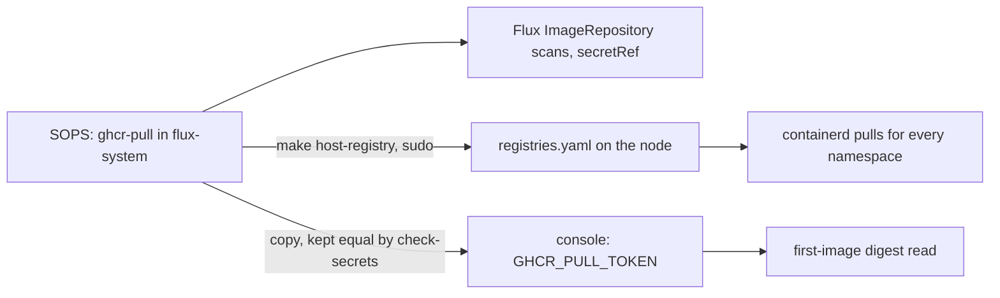
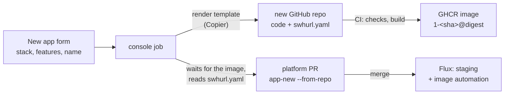
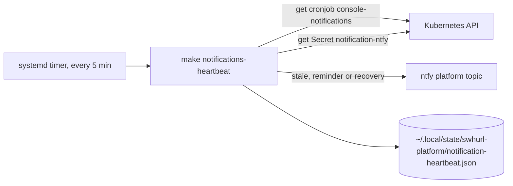
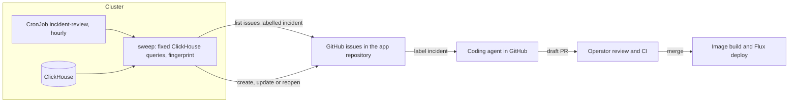
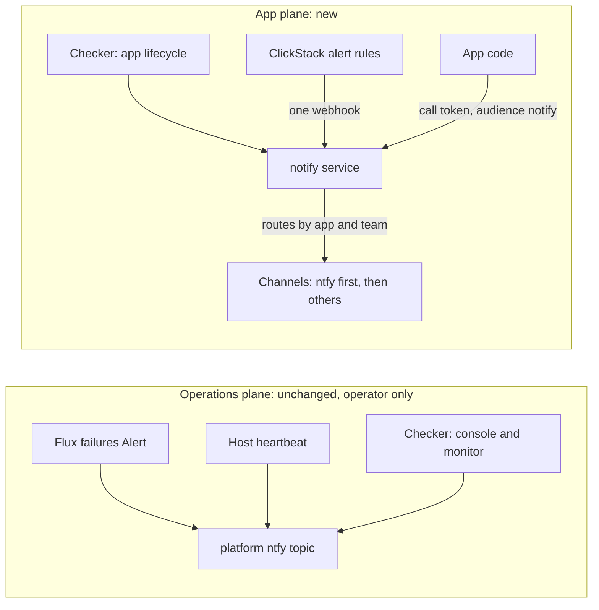
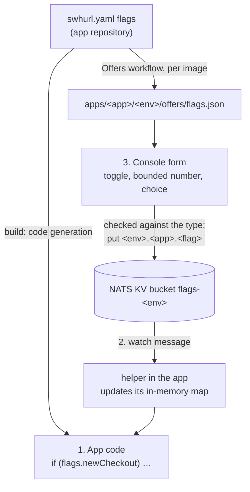
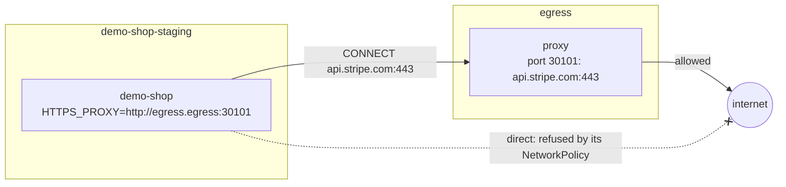
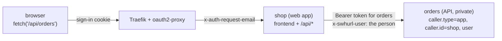
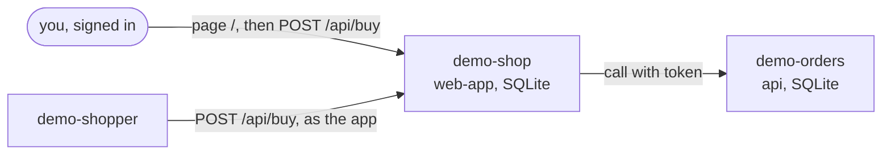

# Swhurl Platform — plan

Started 27 September 2026 · last tidied 5 October 2026. Older work is summarised with its decisions and commits; what was run live is in [current state](current-state.md), and the earlier full text of this file is in Git history (for example `d4566c9`). Recent work (sections 9, 11, 12 and 14) keeps its full contract.

## 0. Where this paused and what is left

The platform is live. Every deliverable in section 3 is done except PR06's remainder, PR08a's gate and the final operator exercise. Before resuming, pull `main` and run `make check-repo`, `make test` and `make verify-platform`, and re-read the "Not exercised" notes in `docs/current-state.md`.

### Open work

**Record-based validation — done 19 October 2026:** `d28e8ce6` removes rendered `env-drift` and its `per_environment.py` allowlist. Strict records and records-to-manifests checks own validation; kind and start command agree across an app's Release records. Explicit `check-apps <path>` checks selected manifests too. Production-specific Settings and first/later promotion behaviour are unchanged. `make check` (826 tests), template checks and Validate passed; reconciled console `src-3ebf2bae0e67bb0c`, platform verification passed, all 15 live instances Healthy ([evidence](current-state.md#record-based-app-validation-19-october-2026)). Production Python is 212 lines smaller. Making Settings travel with promotion was not approved; B3 is a separate change, completed below.

**Code simplification — stages 0–4 done 18 October 2026:** [section 24](#24-code-simplification--design-contracts-18-october-2026). App, Release and Settings records render every instance; commands and the merge gate use them, and Activity derives progress from the job, PR, current Git target and live render hash. The signed-in deployed console showed a promotion live in production, a worker's seed superseded by its own build, a scale live in staging and removal completed ([evidence](current-state.md#activity-from-render-hashes-18-october-2026)). **Gate review 19 October 2026** ([findings](#gate-review-19-october-2026)): rollbacks no longer merge themselves. **Decided:** console PRs carry only input records ([decision B, stages B0 to B5](#records-only-prs-decision-b-operator-19-october-2026-stages-started-19-october-2026)); B0–B2 are done, including the live first promotion, automatic later promotion and manually merged rollback ([evidence](current-state.md#records-only-promotion-prs-19-october-2026)). **B3 done 20 October 2026:** records-only new-app PRs, reviewed and deployed as `32e03170`; two concurrent console creations from the same base automatically merged with unique ports, became Healthy and showed Live in staging after their own builds ([live evidence](current-state.md#records-only-new-app-prs-live-20-october-2026)). **Next in decision B: B4a**, the [grant model](#grants-recorded-by-the-callee-operator-20-october-2026) and records-only instance operations (B4 split into B4a to B4c, 20 October). **Grant model done 20 October 2026** ([evidence](current-state.md#grants-recorded-by-the-callee-20-october-2026)); **Records-only instance PRs and the gate's table done 20 October 2026** (`merge.ACTIONS`, `merge.settings_held`; [console](console.md#instance-changes)); **B4a done 20 October 2026:** Allow callers and the waiting state on the app page (`7eef4a14`); live, a staging scale merged itself twice and a held egress grant merged with GitHub's button was rendered by Render, then its removal merged itself ([evidence](current-state.md#records-only-instance-prs-and-the-gates-table-20-october-2026)). **Next: B4b** (records-only remove; its live proof removes an approved throwaway and needs the operator's confirmation). The approved throwaways `swhurl-try-31` and `swhurl-try-32` remain installed; removal needs confirmation. **Next: stage 5**, section 25's backup jobs (H0–H5 code done 19 October; left: the fresh-machine restore). Section 21's remaining held needs (port, secret names, database) and section 22's event check are parked until an app with production needs one (operator, 18 October). **Still unexercised live for B3:** a new-app manual GitHub merge followed by Render and a rejected-push retry (offline coverage exists); the real Google-signed-in browser path. **Done-when tests:** all present except rollback with retained data, which is not an operation yet (rollback is promoting an older staging image). The 8080→9090 test covers the promotion only: a staging deploy still holds a changed need while the app has production (section 21 stage 4). Seed images stay.

**New app creation speed — delivered 14 October 2026:** Kotlin `v0.2.5` (`03872aa`, template PR #27) and catalogue `89a666e` are deployed. New-app merge verification uses the same schema and app-policy checks as promotions (`4a87c7c`); the Kotlin runtime stage, dependency caches and smoke-test polling are described in [the canonical guide](apps.md#first-builds-of-new-apps). All seven template CI combinations passed on PR and main, and `make check` passed 749 tests and 32 policy combinations. Equivalent fresh console creations became Available in 312 s before and 247 s after; merge verification fell from 71 to 21 s, while the complete image workflow did not improve in this pair. [Dated evidence](current-state.md#new-app-creation-speed-14-october-2026) records each stage and measurement limits. Platform health and HTTP/HTTPS/handler checks passed. Both timing apps, `swhurl-try-16` and `swhurl-try-17`, are removed (`swhurl-try-17` on 18 October 2026). The signed-in browser path remains unexercised. [Cleanup evidence](current-state.md#timing-app-cleanup-14-october-2026) records the live removal. The next proposed optimisation is separating Kotlin app identity from compiled build inputs, so fresh apps with matching code can reuse compiled layers; current default renders differ in build inputs only at `src/main/resources/application.properties`, and the compile/test/package step took 44–52 s. Preserve local and deployed identity, prove cache hits and invalidation, and retain normal builds for personalised API/events or changed code. This is a proposal, not authorised implementation.

**App build optimisations — delivered 14 October 2026:** the repaired TypeScript `v0.2.5` (`ce4745d`) and Kotlin `v0.2.4` (`ac45c53`) releases and catalogue `37c7e7e` are deployed. All eight Copier apps adopted them through reviewed PRs; every matching main merge published the exact tested PR image with its provenance. TypeScript builds compile/test once. All eight staging apps and matching console/checker jobs are healthy. The helper pins an immutable Skopeo 1.22.3 image (`bd20f00`) after the rolling upstream digest disappeared. All 747 tests, 32 policy combinations and both seven-job template matrices passed. The [canonical guide](apps.md#compiling-typescript-once) explains benefits, adoption and trade-offs; [dated evidence and timings](current-state.md#skopeo-dependency-repair-and-remaining-template-adoption-14-october-2026) records the rollout. The component checklist is covered in [apps](apps.md#reusing-a-tested-pr-image): one-day artifacts, existing job token, GitHub logs, existing live health checks and no backup or cluster service. Production remains explicit promotion. The earlier intermittent package-webhook delivery gap remains a follow-up; this rollout scanned and pinned all publications without manual pings, and a concurrent Git push rejection recovered automatically.

**Conditional readability — implementation completed 13 October 2026:** [section 19](#19-conditional-readability--approved-13-october-2026). Stages 1–5b are committed, published and live verified ([evidence](current-state.md#conditional-readability-13-october-2026)); the final scan found no chained production ternaries. The signed-in browser check for stage 3d is still pending. No further refactor is authorized by the original outline; reviewed candidates and their boundaries are recorded in section 19.

1. **PR06 — private app repositories and images** ([section 4](#private-app-repositories-and-images--planned-9-october-2026-not-started)). **On hold while the incident reviewer is rolled back.** No private-repository or image change was implemented. The 9 October design in section 4 remains a record for reconsideration, not the next execution task.
2. **PR08a gate** (section 5; drill plan in [section 13](#13-recovery-drill-pr08a-gate-and-fresh-bootstrap--designed-3-october-2026-not-started)): restore on a separate machine from S3 using only the docs. Follow-ups: replace the backup use of IAM user `sam` with scoped credentials; the per-database CronJobs in [section 25](#25-per-database-backups--designed-18-october-2026-started-18-october-2026), deferred until after section 24's cutover. A public pinned backup image does not depend on the deferred private-image work in PR06.
3. **Final operator exercise** (section 6), using only the docs.
4. **Operator browser checks:** a real Google-signed-in session for (a) reviewing and submitting a promotion (automated UI proof used the local dev identity) and (b) the live job-output stream, including that Traefik and ForwardAuth do not buffer it ([section 12](#12-live-job-output-on-the-console-deployed-3-october-2026)). Also confirm the console's `GITHUB_TOKEN` is limited to this repository.
5. **Notification gaps** ([contract](services.md#notification-expectations)): live fixture uninstall/rollback and timed unhealthy/recovery delivery exercises; alerts for failed or stale backups, external availability, certificate expiry or renewal failure and disk pressure.
6. **Decision needed — ClickHouse CPU** (delivered item 17): merge write amplification sets the load, not data volume. The lever is `async_insert` or bigger batches in the ClickStack HelmRelease, which trades a few seconds of data on a crash. Unexplained: since HyperDX restarted at 21:44 on 2 October the histogram table merges every new part on its own (about +100 s of merge time an hour). Revert `008c5d5` and `6cdfe3f` (coarser metric intervals, no CPU gain) if the graphs bother you.
7. **App page stack panel** (section 8, phase 8): show the stack, its features and each capability's health (last SQLite backup, later roles).
8. **Optional cleanup** (deleting needs confirmation; repository and package deletion is yours): `samclement/swhurl-try-6` (repository, package, staging and prod instances, retained volumes; restoring those volumes is unexercised, though the same SQLite restore shape has live evidence); migrating `hello-ts`; the seed-image test apps `samclement/swhurl-try-19` and `swhurl-try-20` (repositories and packages; their staging instances are removed).
9. **Incident reviewer follow-up.** The GitHub-issue redesign in [section 14](#14-incident-issues-and-agent-fixes--redesigned-9-october-2026-design-b-not-started) remains unimplemented and on hold. The collect-only reviewer was suspended (`82b9a8f`), then its resources and tooling were removed (`77f3b3b`). Its empty Flux unit and namespace are removed. Decide separately whether to revoke the unused OpenAI key, and delete the worker GHCR package and ntfy subscription. Shared notification storage and console behavior stay in place.
10. **Platform-generated apps only: done 9 October 2026** (`13c761c`, `2cbdd9f`, `131818a`). Every app comes from a stack template through `make app-repo` or the console; `make app-new` and the app policy rule `platform-image` refuse anything else; `hello` is retired. Rules: [apps](apps.md#start-a-new-app); evidence: [current state](current-state.md). Console creation after the change was exercised by the two [14 October timing apps](current-state.md#new-app-creation-speed-14-october-2026). Left unexercised: a new app from `make app-repo` after the policy change, and real browser sign-in.
11. **Team platform: delivered 11 October 2026; operator actions left** ([section 15](#15-team-platform--delivered-10-to-11-october-2026)): signed-in browser checks of the console (restructured the same day: one Apps list with a map, and Use, Connect and Operate on each app page), and removing the four throwaway apps (`swhurl-try-10` to `-13`) and their repositories when they are no longer wanted. Not built, and where it would start: tokens for callers outside the cluster; a signed sign-in identity inside the cluster.
12. **App notification service: N1 to N4 delivered 11 October 2026** ([section 16](#16-app-notification-service--designed-11-october-2026)). Goals and order revised on 11 October ([end goal](#end-goal-and-revised-order-11-october-2026)). The end goal is met and the follow-ups are done; left is N5 (a second provider). The `swhurl-try-14` instance is removed; its GitHub repository and package are yours to delete. Operator: confirm that the platform topic keeps every app's lifecycle messages as well, and try the Teams page's channel forms in a signed-in browser (not exercised live).
13. **Connections and contracts: delivered 12 October 2026** ([section 17](#17-connections-and-contracts--designed-12-october-2026)): all five stages, with the five existing apps on the features and `hello-ts` promoted with its API description. Operator: delete the throwaway `samclement/swhurl-try-15` GitHub repository and its `swhurl-try-15` container package (its instance was removed on 12 October); look at the catalogue in a signed-in browser. Not exercised: a described app's promotion merging itself; a document refused on a real app; a promotion that changes what an app publishes. Later, if wanted: live state per connection, typed clients from the documents, a breaking-change check in the app's CI, private app repositories.
14. **Demo team and apps: delivered 12 October 2026** ([section 18](#18-demo-team-and-apps--decided-12-october-2026)). Operator's to do: delete the GitHub repositories, and the container package of the same name for each, that no instance uses any more: `hello-ts`, `test-2`, `test-3`, `test-4`, `swhurl-try-7`, `swhurl-try-8`, `swhurl-try-9`, `swhurl-try-14`, `swhurl-try-15`. Decided by the operator on 12 October: `swhurl-try-10` to `-13` and the `payments` and `insights` teams stay, to show what several teams look like.
15. **Architecture review of the tooling (12 October 2026): all ten candidates done.** A review of `tools/swhurl` named ten places where one concept is restated in several modules. Done: (1) the Instance has one module ([`instance.py`](../tools/swhurl/apps/instance.py), [glossary](../GLOSSARY.md)); (2) an instance's live state has one definition ([`state.py`](../tools/swhurl/apps/state.py)) for the console's list and page, `make app-status` and the promotion gate; the notification checker keeps its own rule (`evaluate.health`: a rollback counts as healthy and a repository-wide revision change is ignored), sharing only the image comparison; (3) what may differ between staging and production, and what a first and a later promotion do with each setting, is one table (`per_environment.py` at `d4e176e`; superseded by [record-based validation](apps.md#the-app-policy)) read by the `env-drift` rule, promotion and the auto-merge gate; `edit.carry_offers` still writes what moves with an image's offers itself; (4) the Flux units and declared namespaces have one reader (`platform.units()`, `platform.namespaces()`): the tests that parsed unit files by hand use it, a test fails when the tooling names a unit or namespace Git does not define, and `make check-repo` compares the architecture page's units table with Git (it found `platform-otel` listed as taking settings); namespace and workload names typed into `kubectl` calls (`flux-system`, `console`) are left as they are, to move with their checks in candidate 8; the stale statements the review listed are corrected; (5) a change the console proposes is one value ([`changes.py`](../tools/swhurl/console/changes.py)): `Change` holds its commands, pull request wording, job and merge rule, built from a form by `Change.to_instance`, `to_team`, `to_channel` or `NewApp.change`, and a route handler only submits it; what a form connects an app to is a `Connections` value, so nothing parses a flag back and whether a new app's pull request merges itself is read from that value, not from its arguments; a promotion keeps its own path (`console/promotion.py`), without the command, title and make line the handler built and never used; the wording for setting a new app's secret values went with it, since the form has no secret keys; (6) a backup set is one module ([`backupset.py`](../tools/swhurl/backupset.py)): the stamp, the archive and metadata file names, which archive is newest, its age, retention, the checksum and the S3 upload, for MongoDB and app SQLite databases alike; `recovery.py`, `sqlite_backup.py` and `sqlite_restore.py` only fill and read archives, `retention.py` is gone, and `make verify-platform` judges both kinds with one rule. The MongoDB restore test picked the newest archive by file time (copy order after `aws s3 cp`); it now goes by the stamp in the name. A `restore-mongodb` command (the restore is still a runbook) was not added; (7) a message for a person is one value ([`notice.py`](../tools/swhurl/notifications/notice.py), [glossary](../GLOSSARY.md)): `Notice` holds the title, message, priority and link and writes itself for ntfy, for an outbox entry and for the notify service, so priority is a name or a number in one place only; the checker, the notify service and the host heartbeat send through one sender (`Ntfy`, or `Recorded` in tests, which no longer patch `httpx.post`), and the platform topic has one reader (`platform_topic`) with one address rule (`channels.address_problem`), where the ClickStack webhook command had its own; a test fills each HyperDX webhook template the way HyperDX does and hands the result to its reader. The Flux Alert and the two HyperDX webhooks keep their own templates, and an outbox entry is stored as before; (8) each live check is a function beside what it checks (`flux.py`, `clickstack.py`, [`apps/checks.py`](../tools/swhurl/apps/checks.py), [`notifications/checks.py`](../tools/swhurl/notifications/checks.py), [`console/checks.py`](../tools/swhurl/console/checks.py), `dashboards.py` and the backup modules) and [`verify.py`](../tools/swhurl/verify.py) is the list of them with what runs them; each entry says what passing means, and the [operations table](operations.md#check-health) is that list (a test fails when they differ), so the commands page, the Makefile help and the command summary no longer restate it; `ready_condition` and the one way a CronJob's last success is read are in [`kube.py`](../tools/swhurl/kube.py), which ends the import cycle that kept the checks from using the notification modules' own names; `check-config` moved to `validate.py`, with the other offline checks; the tests' fake cluster has one part per area ([`fakecluster.py`](../tests/fakecluster.py)). Left as they are: the Traefik redirect check stays in `verify.py` (Traefik has no module), `check-config` is still a command (the review would delete it, but `make check-repo` does not check that a decrypting unit has a Secret file: candidate 9's to settle), the test classes are still in `tests/test_verify.py`, and the fake `kubectl` script of the command-safety test is unchanged; (9) each command is stated once ([`commands.py`](../tools/swhurl/commands.py), [glossary](../GLOSSARY.md)): its name, the make variables that become its arguments, its help line, what it touches and what `DRY_RUN=true` does. `make help`, the usage line for a missing variable (the Makefile's 22 guards are gone) and `python3 -m swhurl`'s list come from it; the Makefile keeps one rule for the 58 commands with a function and recipes for sequencing and the host timers; tests fail when the Makefile's targets or a row of the [commands page](commands.md) (name, variables, the † mark, the start of Touches) differ from it, and when a `check*` command is not local or a `verify-*` one not read-only; `make test` runs every dry run that only plans, so CI's hand-kept list is gone. `check-config` is gone: `make check-repo` checks the required Secret files and settings, and `install` is `flux-reconcile` then `verify-platform`. Left as they are: the long description of a command is still written on the commands page beside its one-line help; every command keeps its own `CommandError` handling and wording (the dispatch only turns one that escapes into a single `[ERROR]` line); `notifications-check` keeps its name though it reads the cluster (the CronJob runs the same command); (10) `swhurl.yaml` is a declaration with two lifetimes, marked per field ([`declaration.py`](../tools/swhurl/apps/declaration.py), [glossary](../GLOSSARY.md), [apps](apps.md#swhurlyaml)): `provides`, `stack` and `version` are read again, every other field is read once at creation and names the command that changes the instance afterwards; the page's table is tested against the module. `app-new`, `make app-offers` and the console's language lookup read the file through one fetcher and one validation, so `app-offers` now refuses a file `app-new` would refuse (all 12 instances' files pass, at their image's commit and at the default branch), and the console reads the stack through the GitHub API instead of the raw file host, no longer giving up on the other apps when one repository has no file. `offers/source.yaml` has one reader and writer (`offers.Source`). Chosen over the alternative of reporting drift on read-once fields, which stays undone: nothing says when an app's repository and its instance differ in a read-once field. Left, each a refactor with no change on the cluster:
    - **Left from 1:** `'staging'`/`'prod'` literals in `apps/promotion.py`, `apps/edit.py` and the console's `merge.py`, `promotion.py` and `server.py`; unit names built by hand in `livetests/app_template.py` and in test fixtures.
    - **Words with more than one meaning,** for the glossary when their module is touched: alert, retention, lifecycle, recovery, event, capability, channel, offers/provides/describes, web/worker, contract/policy. `Job.unit` also holds `app/env`, `team:name` and `PR #n`, so "one job per unit" does not stop a reconcile and a pull request on the same instance running together (not verified).
16. **Feature flags: delivered 15 October 2026** ([section 20](#20-feature-flags--proposed-14-october-2026-not-started), [evidence](current-state.md#feature-flags-stage-4-15-october-2026)): typed flags in `swhurl.yaml`; every instance has its own NATS key; apps on templates `v0.2.7` watch their overrides; the app page's **Feature flags** card sets and clears them, shows when each was set, and marks overrides older than 14 days or for a flag the image no longer declares, proven live on the throwaway `swhurl-try-18`. Left: a signed-in browser check of the card (operator). Follow-ups: the Kotlin template's smoke test stops a worker 4 s after start, before a slow JVM has migrated SQLite (one failed `main` run of `v0.2.7`, passed on re-run): wait for migrations instead; reinstall the host backup unit (`make host-backup`, operator) so it runs `make backup-sqlite` again. `swhurl-try-18` is removed (18 October 2026).
17. **Needs and grants in `swhurl.yaml`, then egress: decided 15 October 2026, not started** ([section 21](#21-needs-and-grants-in-swhurlyaml-then-egress--decided-15-october-2026-not-started)). `swhurl.yaml` keeps the app's identity, what the image needs and what it offers, read again with each image; grants (access, calls, subscriptions, team, alerts, and new egress rules) live only in this repository. This replaces candidate 10's two lifetimes. **Stage 1 done 15 October 2026** ([evidence](current-state.md#needs-and-grants-stage-1-15-october-2026)): the four kinds in `declaration.py`, the glossary, `apps.md` and the console's captions; `autoDeploy` accepted and ignored; templates `v0.2.8` (`swhurl.yaml` by kind, no `autoDeploy`) pinned. Existing apps keep `autoDeploy: true` until their Renovate template update. **Stage 2 done 15 October 2026** ([evidence](current-state.md#needs-and-grants-stage-2-15-october-2026)): grant fields are refused in `swhurl.yaml`, and no app repository holds one. **Stage 3a done 16 October 2026** ([evidence](current-state.md#needs-and-grants-stage-3a-16-october-2026)): Flux dispatches the Deploy workflow, which writes each staging image and its offers in one commit; the workflow adds about 10 s between the image and its commit (18 s from dispatch to commit; 2 s before). **Stage 3b done 16 October 2026** ([evidence](current-state.md#needs-and-grants-stage-3b-16-october-2026)): `make app-deploy` writes port, health path, uid, telemetry and the resources floor with each staging image; a refused need holds the image; `app-scale` refuses less than the minimum. **Stage 3c done 16 October 2026** ([evidence](current-state.md#needs-and-grants-stage-3c-16-october-2026)): databases and secret names follow the image; `make app-secret` sets values; templates `v0.2.10` have `secret()`. **Stage 4, narrow version, built 19 October 2026** (section 26 F4): every need moves with the image, and a promotion that changes production's port, database or secret names is merged by a person. **Stage 5 E1 deployed 16 October 2026** ([evidence](current-state.md#egress-stage-e1-16-october-2026)): every instance sends through the egress proxy, which allows everything and logs each request with the instance. **E2 deployed 17 October 2026** ([evidence](current-state.md#egress-stage-e2-17-october-2026)): `make app-egress`, **Reach a host outside** on the app page, rule `egress-grants`, and the proxy logs `granted=yes` or `-`; E1's day of logs held no app request, so nothing was seeded. Next, not before 20 October 2026: E3a (direct connections refused, every host still allowed through the proxy), after a few days of the node's connection table shows which clients ignore the proxy; then E3b (ungranted hosts refused), after the `granted=-` lines (ClickStack, service `egress`) are each granted or explained. The image-automation-controller and its write deploy key are removed. The repository blueprint needs a rebuild.
18. **Event compatibility check: decided 17 October 2026; parked 18 October 2026 (operator: event changes to apps with production are unlikely). Build it when one is planned; until then a promotion that changes what an app publishes waits for a person** ([section 22](#22-event-compatibility-check--decided-17-october-2026-not-started)). A new image, or a promotion, whose `asyncapi.yaml` changes an event's payload in a way an app that receives it could not read is held, as a dropped event is today. Events only, in Python, no new tool. APIs are not checked until callers record the routes they use.
19. **Seed images for new apps: default answers delivered 17 October 2026; every combination assessed, not started** ([evidence](current-state.md#seed-images-and-new-app-auto-merge-17-october-2026)). Templates `v0.2.12` (TypeScript `c268ac5`, Kotlin `0548683`) publish their tested default image as `swhurl-app-template-<stack>:seed-<commit>`; a new app's first run copies it to `0-<sha>` and the console opens the staging PR with it. New-app PRs with the generated events key and derived shared files auto-merge again (`6ae2a3b`). A Kotlin app was reachable over HTTPS 210 s after submission with no operator step (was 260 s, plus a manual merge since 15 October). Assessment of seeds for every combination:
    - **Cheap part:** the Template workflow already builds and smoke-tests 8 of each stack's 32 combinations on every `main` commit; pushing each as `seed-<commit>-<answers>` costs a push per job, and the seed job would look for its own answers instead of the defaults. The other 24 combinations would need 24 more builds per stack per commit (Kotlin about 2 minutes each) for apps that choose them.
    - **What blocks it:** with `api=openapi` or `events=asyncapi` the app's name and description are compiled into the documents the image serves (`/openapi.json`, Micronaut's OpenAPI title), so a seed would serve the template's placeholder until the app's own image lands. Making those read the name at runtime needs the description at runtime too (a new platform variable), in both templates.
    - **Also needed:** seed retention (one image per template `main` commit; the template's own workflow can delete old versions of its package with `GITHUB_TOKEN`).
    - **Gain:** about 2 minutes per new Kotlin app, about 25 s per TypeScript app (its build is fast); once per app.
    - **Recommendation:** publish seeds for the tested combinations without `api` or `events` (defaults, worker, SQLite, flags) when apps start using them; leave the rest until the runtime-name change is wanted for other reasons.
20. **App types for new apps: decided 17 October 2026; stage 1 done 17 October 2026** ([evidence](current-state.md#calls-carrying-the-signed-in-person-17-october-2026)): templates `v0.2.13` carry the signed-in person on calls (`onBehalfOf`), proven both ways between a TypeScript and a Kotlin app; **stage 2 done 17 October 2026** ([evidence](current-state.md#an-image-serves-the-name-and-description-the-platform-gives-it-17-october-2026)): `swhurl.yaml`'s `description` becomes `SWHURL_DESCRIPTION`, and templates `v0.2.14` serve it and `SWHURL_APP` in their API description ([section 23](#23-app-types-for-new-apps--decided-17-october-2026)). New apps are created by type (web app, API, worker, scheduled job) instead of by feature; each type sets its stack choices and template answers. Decided by the operator: calls carry the signed-in person; Web app has SQLite; each type has its own seed. The proposed decisions were accepted the same day: types defined in the platform, scheduled job as a fourth type, APIs private by default, `ANSWERS=` kept for the operator. **Stage 3 deployed 17 October 2026** (`cb2256c7`, console image `src-6266cd19c909db7a`): `APP_TYPES`, the type-first New app form, `make app-repo TYPE=`, and `make check-templates` checking each type against the pinned templates; left for it: creating an API and a worker from the deployed console. Until stage 6 a new app of a type gets no seed image (only the templates' default answers have one), so its first image is its own build: about 2 minutes more for Kotlin, 25 s for TypeScript. **Stage 6 done 17 October 2026** ([evidence](current-state.md#a-seed-image-for-every-app-type-17-october-2026)): templates `v0.2.15` publish a seed per tested set of answers, every type among them; a Kotlin API created from the console was Available on its seed in 213 s. That also closes stage 3's live check (an API and a worker from the deployed console). Two New app jobs at once now both merge: the gate makes the shared files on the newest `main` ([evidence](current-state.md#two-new-apps-at-once-removal-notices-17-october-2026)). **Stage 4 done 18 October 2026** ([evidence](current-state.md#a-web-app-with-a-browser-frontend-18-october-2026)): templates `v0.2.16` give the Web app type a Vite+ page at `/` and its API under `/api/*`, not listed in the Catalogue. Next: stage 5 (scheduled job). Operator: delete the GitHub repositories and packages `swhurl-try-21` to `swhurl-try-27` (instances removed).
21. **Fixed features per app type: done 19 October 2026** ([section 26](#26-fixed-features-per-app-type--decided-18-october-2026-done-19-october-2026)). Templates TypeScript `v0.2.18` (`5215350`) and Kotlin `v0.2.17` (`04752d7`) accept only the types' answers, always render `asyncapi.yaml` and the example flag, and build and seed the 7 types. Each type's render is byte-identical to the previous release's with `events=asyncapi flags=example`, apart from comments and the AsyncAPI tests (which now accept a file with no events, tested locally for a worker on both stacks). **F2 done 19 October 2026** ([evidence](current-state.md#fixed-answers-per-app-type-19-october-2026)): pinned, `ANSWERS=` gone, `check-templates` renders the types in 16 s, a worker keeps no database; a web app and a worker from the deployed console started on their seeds in 204 and 206 s. Both throwaways are removed. **F3 done 19 October 2026** ([evidence](current-state.md#existing-apps-onto-their-types-19-october-2026)): `demo-orders`, `demo-shopper`, `demo-notifier`, `swhurl-try-10` and `-13` are on the pinned releases with their types' answers and healthy in staging; workers that publish nothing keep `asyncapi.yaml` with no channels. **F4 done 19 October 2026:** a new port, database or secret name reaches staging while the app has production (held `SETTINGS` rows instead of the staging hold); a promotion carries them with the image (`edit.take_release`, shared with staging's deploy: production gets its own volume and one replica; no rollback across a database or uid change); the merge gate leaves such a promotion to a person. Exercised live by F5. **F5 done 19 October 2026** ([evidence](current-state.md#demo-shop-is-a-web-app-19-october-2026)): demo-shop is a web app in staging and production, with its page, its API under `/api/*`, its own SQLite (purchases) and backups in S3; `demo-shopper` calls `/api/*`. Section 26 is complete; `swhurl-try-11` and `-12` stay on their old answers.
22. **One rule for what `swhurl.yaml` declares: done 19 October 2026** ([section 27](#27-one-rule-for-what-swhurlyaml-declares--decided-19-october-2026-done-19-october-2026), [evidence](current-state.md#one-rule-for-declarations-and-protected-streams-19-october-2026)). S1–S6 are deployed; AsyncAPI send operations alone declare publications, subscriptions remain grants, and all nine live app Streams have observed `preventDelete: true`. Demo-shop's stale API metadata is cleared in both environments; all 13 instances are Healthy. Real signed-in browser checks remain unexercised; no destructive retention test was performed.
23. **Review fixes for scale, schedules and creation: decided 19 October 2026, done 19 October 2026** ([section 28](#28-review-fixes-scale-schedules-and-creation--decided-19-october-2026); evidence: [R1](current-state.md#schedules-within-each-cron-fields-range-19-october-2026), [R2](current-state.md#app-scale-changes-only-settings-19-october-2026), [R3](current-state.md#app-new-reads-swhurlyaml-once-at-the-images-commit-19-october-2026)). From the 19 October API review: cron ranges (R1), `app-scale` writes only Settings (R2), `app-new` reads `swhurl.yaml` once at the image's commit (R3; proven live with `swhurl-try-33`).
24. **Model review follow-ups: started 20 October 2026; M0–M1 done** ([section 29](#29-model-review-follow-ups--started-20-october-2026), [review](model-review.html), [M0 evidence](current-state.md#model-review-follow-ups-m0-20-october-2026)). A read-only review found that the records → render → exact check → write pipeline is sound and that most of the remaining complexity comes from code that goes around it. Ten findings, ordered so that the steps that change no behaviour come first, each with a list of what it deletes and a net-negative line budget. M0's contract and check fixes are deployed (`6bf05b87`); M1's record-backed readers and approved refusal while any other same-environment caller names the app (granted or waiting) are deployed (`26d8135d`, [M1 evidence](current-state.md#model-review-follow-ups-m1-20-october-2026)). Next is M2, finishing B4b/B4c. M5 and M7 also need decisions.

### Delivered

Numbers are kept because other docs and code comments cite them. Evidence for each is in `docs/current-state.md`.

| # | Done | What, and where documented |
| --- | --- | --- |
| — | 9 Oct | An app's dashboard is deleted by the scheduled sync when its last release is gone (`6f49dfe`; [apps](apps.md#dashboards)). Not exercised: a real app removal |
| 20 | 3 Oct | Live job output over SSE ([section 12](#12-live-job-output-on-the-console-deployed-3-october-2026)) |
| 19 | 3 Oct | Notification refactors R1–R4 and the host heartbeat H1–H4 ([section 11](#11-notification-boundary-refactors-and-heartbeat-3-october-2026)) |
| 18 | 3 Oct | Predictable deployment and promotion ([section 9](#9-predictable-app-deployment-and-promotion)). Web promotion #34 and private SQLite worker promotions #35–36 passed; duplicate submissions reused PRs; failed gates wrote and merged nothing; both worker databases kept independent claims through an image update |
| 16 | 2 Oct | Automatic app dashboards (`d5c0f87`; [apps](apps.md#dashboards)) |
| 15 | 2 Oct | Structured logs across the cluster (`cf3df0c`, `498310b`; [formats](services.md#structured-logs)); existing streams only, original lines and schema preserved |
| — | 2 Oct | Console correctness (`b3dd939`) and app validation / YAML editing (`6bac215`): validation fails when tools fail; scale, expose and promote keep handwritten YAML ([boundaries](apps.md#operate-an-instance)) |
| 17 | 2 Oct | ClickHouse load and telemetry noise: log noise filtered (`1fa822d`, 26,352 → 8,780 lines/h); HyperDX self-traces sampled at 10% (`4074d6a`, 12,866 → 1,362 spans/h); metric intervals raised (`008c5d5`, `6cdfe3f`; 752,944 → 420,234 rows/h). ClickStack's own scrape of ClickHouse (half the rows) cannot change from Git: the chart's `customConfig` loses to the config HyperDX pushes over OpAMP (`cc8e497`, `e8140d8` reverted). Server CPU did not drop (0.21–0.22 cores); see open work 6 |
| 14 | 2 Oct | Console follow-ups: new-app links wait for the PR (`8e77604`); reserved Secret names (`HOST_IP`, `DATABASE_PATH`, `OTEL_*`, `SWHURL_*`, `KUBERNETES_*`, because `envFrom` loses to the platform's `env`); New app page by scenario; auto-merge of console PRs ([policy](console.md#auto-merge)); `make check-templates`; `make clickstack-dashboards` |
| 13 | 2 Oct | Observability fixes: logs carry `trace_id`/`span_id`, kube-probe spans dropped (34,507 of `hello-ts`'s daily traces), TypeScript resource detectors limited to local ones |
| 12 | 2–3 Oct | New app from a catalogue ([section 8](#8-new-app-from-a-catalogue)), phases 1–7 |
| 11 | 1 Oct | Console redesign: Overview · Apps · Platform · Activity; one state vocabulary (Healthy ✓, Updating ↻, Failing ✕, Suspended ‖); instances named `<app>/<env>`; hashes shortened to 12 characters with the full value on hover; breadcrumbs; "Updated … ↻ Refresh" |
| 10 | 30 Sep | `app-new` presets, the TypeScript template repository, Flux image automation deploying template apps to staging on every push (production through a promote); first app `hello-ts` |
| 9 | 30 Sep | App code starts from a GitHub template repository per language, outside this repo; this repo keeps the cluster wiring (`app-new`, `contract.py`). The manifest injects every cluster-specific value, so app code only follows conventions (OpenTelemetry SDK reading `OTEL_*`, a readiness path, port 8080, non-root user, a publish workflow printing the image digest). Copier was added later (item 12) |
| 8 | 29 Sep | Faster delivery: parallel checks and CI (`4bd61a4`), `cluster-stack` without `wait` plus `swhurl flux-wait` (`9bce4a7`), `flux-install` with a 5 s dependency retry (`33fb42e`), GitHub push webhook (`cfb5daf`), publish run deploying the console (`0503987`). A push reaches Flux in about 2 s, a full `make flux-reconcile` takes about 17 s, a console tooling change deploys about 90 s after the push |
| 7 | 28 Sep | Foundation cleanup in four steps (section 3) |
| 6 | 28 Sep | Operator logic moved from bash to the tested `tools/swhurl` package; short glue and host scripts stay bash ([rule](contributing.md#operator-tooling)) |
| 5 | 28 Sep | Documentation restructure: one canonical page per topic ([map](contributing.md#documentation)); the `document-repo` skill is in `.claude/skills/` |
| 4 | 29 Sep | Console, phases 1–7 ([section 7](#7-console)) |

### Known issues, deliberately not fixed

- **OTel deprecations:** collector 0.161.0 warns that `hostmetrics`, `kubeletstats`, `k8sobjects` and the inline `service.telemetry.resource` map are deprecated. The chart's presets generate all three names, so renaming only ours could duplicate receivers; rename each with a chart version whose preset uses the new name (chart issue #2183). `make check-otel` lists deprecated names on every chart update and fails if a rename leaves a pipeline naming a missing component. The telemetry format warning goes with chart PR #2343.
- **Kotlin telemetry:** the agent's `jvm.memory.*` and `jvm.thread.*` metrics do not reach ClickStack (only `jvm.gc.duration`), so those dashboard panels wait. Log severity is guessed from text (a request log mentioning `traceId` reads as "trace").
- **Not covered by observability:** no backup of telemetry, no alerts on app behaviour (error rates, latency, a stuck worker), and a collector that trusts every pod.
- **Staging and production `hello`** differ only in namespace and host; `make check-apps` fails if they drift further. Each instance has a quota and a NetworkPolicy ([teams and isolation](apps.md#teams-and-isolation)); there is no per-team RBAC.
- **Shared sign-in cookie:** everything under `homelab.swhurl.com` shares it, so public or untrusted apps must use another parent domain (none exist).

### Not yet exercised live

- A fresh bootstrap on a real new host (DNS, router forwarding, Let's Encrypt; the in-cluster sequence was rehearsed on k3d).
- A real credential rotation through Reloader (only dummy-key and disposable rotations ran), and Reloader restarting a generated app.
- A `public` app on a domain outside `homelab.swhurl.com`.
- A rejected sign-in reaching oauth2-proxy's email list (Google refused the test account first).
- Open question: avoiding Let's Encrypt rate limits when rebuilding (back up and restore certificate Secrets, or use `letsencrypt-staging` while iterating); relevant to the fresh bootstrap above.

**Kept out of scope:** a second cluster (EC2), tailnet-only private routes, DNS-01 and wildcard certificates, directory renaming, and Hermes (a separate project needing model-network design and stronger command isolation than a namespace).

## 1. Goal and scope

Make an app instance a small, reviewable definition: image digest, resources, probes, exposure, configuration, secrets and persistence. A generator supplies the namespace, Flux Kustomization, HelmRelease and optional encrypted Secret. Git review and Flux remain the deployment path.

Keep k3s, Flux, packaged Traefik, cert-manager and SOPS/age. Work on `clusters/home/` only, preserving capability boundaries for a possible `clusters/aws/` without building it.

### Completion criteria

- Onboard a second app from an existing image in under 15 minutes (excluding DNS and certificate delays) without hand-written Deployment, Service or Ingress.
- Each app instance has its own namespace and Flux unit; staging and production reconcile independently.
- Image and chart updates are reviewable and pinned. Promote and roll back the same image digest.
- A ClickStack failure does not block an unrelated app update.
- Exposure modes enforce their route and cookie boundaries; only approved identities sign in.
- Secret rotation restarts only the referencing workload without printing the value.
- Suspend, uninstall and data destruction have distinct effects. Restore one stateful workload and the age key from an independent backup.
- One documented command shows desired revision, running image, readiness, address and failure reason.

## 2. Design decisions

| Concern | Home decision | Future extension |
| --- | --- | --- |
| Cluster | `clusters/home/` is the sole entrypoint; independent capability units. | A later `clusters/aws/` may share bases with separate settings and age key. |
| Host | host/, dynamic DNS, NodePorts and router mapping stay home-specific. | Design EC2 bootstrap and Route 53 ownership when that move is committed. |
| App chart | Pinned bjw-s app-template (started at 5.2.1) from a shared HTTP HelmRepository; version pinned per HelmRelease. | A custom chart only if the values and policy model prove inadequate. |
| App isolation | One namespace and one Flux unit per instance, with SOPS decryption on that unit when needed. | Reuse the generator and policy for another cluster. |
| Browser exposure | `private` has no Ingress; `authenticated-web` is for trusted apps under the shared-cookie domain; `public` uses a domain outside that scope. | Private browser routes need a proven tailnet or internal entrypoint; a public IP allowlist is not the default private boundary. |
| TLS | HTTP-01 for public home routes. | Route 53 DNS-01 for private-host certificates; wildcard TLS has a larger key blast radius. |
| Updates | Renovate for chart PRs; Flux image automation for template apps in staging. | No custom cross-repository PR machinery. |
| Data | Retain irreplaceable state on uninstall; destruction is explicit and separate. | Prove a Retain StorageClass and restore before stateful migration. |

A public app on `public.homelab.swhurl.com` is still in the `.homelab.swhurl.com` cookie scope: use a sibling domain such as `public.swhurl.com`. HttpOnly does not stop the destination server receiving the cookie. Browser sign-in establishes identity; each app owns authorization. Machine APIs use token auth, not browser redirects.

## 3. Delivery order and gates

Rule kept: prove restore before deletion, ownership handover or stateful migration. Evidence for each row is in `docs/current-state.md`.

| Order | Deliverable | Outcome |
| --- | --- | --- |
| PR01 | Inventory, validator, CI, documentation | Complete (`2bae8d0`) |
| P0a | Guard destructive teardown/reinstall; correct operator docs | Complete |
| P0b | Age key backed up off-host | Complete: an encrypted USB copy decrypted all three Secrets |
| P0c | Fix verifier and the double-encoded ingestion Secret; restart collectors | Complete 27 Sep: no 401s, fresh logs and metrics in ClickHouse |
| P0d | Restrict sign-in to approved identities | Complete 27 Sep: `sam@swhurl.com` only; a non-approved account was refused |
| PR08a | Independent backup and tested restore | Partial: data classified; encrypted backup and disposable restore proven 27 Sep; live restore, S3 copies and daily timer 29 Sep; **restore on a separate machine pending** |
| PR02a | Retention: telemetry 30d, ClickHouse system logs 7d, backup pruning 7 daily + 4 weekly, MongoDB PV Retain + PVC keep, `local-path-retain` class | Complete 27 Sep |
| PR02b | Lifecycle commands (suspend/resume/destroy-data), `Orphan` shared units, prune protection | Complete 27 Sep; `make live-test-lifecycle` |
| PR03 | Capability split; cert-manager/issuer ordering | Complete 27 Sep: 10 units, 22 resources handed over with no recreation |
| PR07a | Scoped opt-in Reloader for oauth2-proxy and OTel | Complete 28 Sep; manual refresh kept as fallback |
| PR04 | App-template contract, generator, rendered policy | Complete 28 Sep: `make check-apps`, `make live-test-app-template` |
| PR05 | Split and migrate example staging/production | Complete 28 Sep: `hello-staging`/`hello-prod`; routes cut over with seconds of default-cert gap |
| PR07b | App Secret conventions and shared settings | Complete 28 Sep: `make check-secrets` |
| PR06 | GHCR publishing and Renovate | **Open** (section 4) |
| Final | Operator exercise | **Open** (section 6) |

### Foundation cleanup (28 September 2026)

A review of boundaries, technology choices and responsibilities, executed in four steps. Numbers follow the review and are cited by evidence in `current-state.md`.

- **Tooling only:** one contract module, `apps/contract.py` (#2); `platform.py` holds shared paths, names and queries, and `check-config` derives required Secrets from each unit's `decryption` (#3); `check-repo` and the app policy take an injected runner and report every failure (#6); fake-executable tests cover only the `make` interface (#8); `make check-apps` fails when environments differ beyond namespace, hosts, image, replicas, resources and issuer (#9); `help` is generated from `## ` comments, defaults live in Python, `config.env` is deleted (#13); `apps/{contract,new,ops,policy}.py` and `retention.py`, tests split by subject (#19). #4 (split `verify.py` by service) was skipped on purpose: revisit past about 400 lines or with a second cluster.
- **Stale records:** `todo.md` was reviewed and deleted; `current-state.md` starts with current cluster facts.
- **Decisions that change what runs:** `BASE_DOMAIN` in `platform-settings` is the one source of platform hostnames, cookie domain and redirect allowlist (#1; `make test` fails on a literal platform hostname; the ACME email and approved sign-in addresses stay literal on purpose). MinIO was removed (#12; it held no buckets): an emptied unit let Flux uninstall the release and delete its volume, then the unit and references went. Foundation means cluster primitives with no user-facing endpoint; shared services are what apps use or people visit (#5).
- **Names and layout:** verbs `check-*` (offline; `check` runs what CI runs), `test`, `verify-*` (live), `live-test-*` (throwaway cluster) and `backup-mongodb` (#18); this file is `docs/plan.md` and the evidence file `docs/current-state.md` (#20); units are `<area>-<component>` named after their directory, one directory per unit under `infra/`, `platform/`, `apps/`, files `<kind>.yaml` (#14–17): `infra-base`, `infra-cert-manager`, `infra-issuers`, `infra-traefik`, `platform-oauth2-proxy`, `platform-clickstack`, `platform-otel`, `app-<app>-<env>`, with roots `cluster-sources` and `cluster-stack`. Namespaces, HelmReleases, Secrets and hostnames kept their names, so no workload changed. Each rename was a handover: make the old unit `Orphan`, create the replacement, after proving offline that it renders byte-identical objects and live that Helm revisions and pod and volume UIDs are unchanged. **Lesson:** suspending a unit through Git blocked `homelab-flux-stack` for its 20-minute health-check timeout (the suspend commit is a new revision and the unit froze as not Ready), so later stages used `Orphan` instead.
- **Simplification:** Mermaid replaced D2 (no render step); component READMEs folded into `services.md` and `operations.md`; ADRs retired; `make reconcile UNIT=<name>` replaced the four OTel refresh targets; old aliases, `verify`, `teardown` and `reinstall` removed.
- **Judged sound, left alone:** `Runner` and `Report`; the `Orphan`/`MirrorPrune` deletion split and its tests; explicit repetition in Flux unit definitions (guarded by `make test`); host scripts as bash; explicit per-environment app copies.

## 4. PR06 — registry and reviewable updates

First-party images go to GHCR. Each app repo tests, builds, publishes a source-revision-tagged image and prints its digest; package-write credentials are used only when publishing. One digest is promoted between staging and production, and deployed digests are retained for rollback. Build x86-64 for home; add ARM64 when a consumer needs it.

**Decided:** chart updates come from Renovate (live; [operations](operations.md#chart-updates); the first, ClickStack 1.1.2, merged 28 September, and ClickStack 3.x was installed fresh on 29 September). The console image is public on GHCR and pinned by `make console-image` (its tags never move, so Renovate digest PRs were dropped). Template apps deploy to staging by Flux image automation (30 September): one policy per app, staging only, one write key for this repo. Chosen over Renovate digest PRs (Renovate cannot read the HelmRelease's separate `digest` field and would bump both environments at once, so digest updates stay disabled in `renovate.json`) and a cross-repository credential in each app repo. Production stays behind **Promote to production**.

### Private app repositories and images — planned 9 October 2026, not started

**Goal.** App repositories and their images are private, so incident issues ([section 14](#14-incident-issues-and-agent-fixes--redesigned-9-october-2026-design-b-not-started)) can carry stack traces, log messages and request paths. Stage A makes the pilot repository private with no cluster change. Stage B gives the cluster a pull credential and makes private the default for new apps. Section 14 stage B1 starts after the stage B gate.

**Status:** on hold during the incident reviewer rollback. None of P0–P9 has started.

**Decisions (operator, 9 October 2026).**

| # | Decision |
| --- | --- |
| 1 | Private app repositories instead of minimal public evidence. Order: stage A, stage B, then section 14 |
| 2 | The node pulls with a host file, `/etc/rancher/k3s/registries.yaml`, installed by `make host-registry` (operator, `sudo`). Rejected: a pull Secret in each app namespace, because app units have no SOPS decryption or substitution and adding substitution would consume every `${...}` in app manifests |
| 3 | Flux image scanning uses one Secret, `ghcr-pull` in `flux-system`, owned by the `platform-image-automation` unit. It is the one source of the token; the host file and the console's copy are made from it |
| 4 | The credential is a classic GitHub token with only `read:packages`, owned by the operator (task P2 confirms GHCR still refuses fine-grained tokens before the operator creates it) |
| 5 | Existing public apps (`hello`, `test-2` to `test-4`) stay public. `hello-ts` moves: repository in stage A, package in task P8 |
| 6 | `swhurl-platform`, the stack templates and the console image stay public |

**What stays true.** An authenticated read works for public packages too, so the tooling sends the credential for every `ghcr.io/samclement/*` image and needs no public-or-private switch.



#### Rules for whoever executes this

- Do the tasks in order, one commit per task, each with its documentation. Before each commit: `make check`; for script, Makefile or workflow changes also the shell syntax loop and `DRY_RUN=true` variants in `AGENTS.md`. Then `git pull --rebase`, push, `make flux-reconcile`, `make verify-platform`, and add dated evidence to `docs/current-state.md`.
- Make no design choices. If a task's assumption turns out false, or a "done when" cannot be met, stop and report what you found; do not work around it.
- Tasks marked **Operator** need the operator: give the exact command, labelled "run with `!`" or "run in your own terminal", say what you will check afterwards, and wait.
- Tasks marked **Confirm first** change something hard to reverse or under `flux-system`: state exactly what will change and wait for a yes.
- Never print the token, the Secret, or `registries.yaml`. Pass credentials on stdin or in a mode-0600 file, never in a command line; register them with `runner.add_secret`. Compare by hash.
- New Python goes through `Runner` and is tested with `FakeRunner` or an injected opener; write the failing test first.
- Throwaway repositories are `swhurl-try-<n>`, starting at `swhurl-try-10`. List each for the operator to delete (repository and package) at the end.
- After each stage, use the `phase-handoff` skill. Use `new-component-checklist` in task P3 (a new credential).

#### Stage A — the pilot repository goes private

| # | Task | Done when |
| --- | --- | --- |
| P0 | **Operator.** Open `https://github.com/settings/billing` and report the plan (Free or Pro). On Free, branch protection is not available on private repositories, which section 14 decision 8 needs: the operator either upgrades to Pro or accepts an unprotected `main` and says so. Record the answer here | The plan and the choice are written in this table |
| P1 | **Operator, confirm first.** Make `samclement/hello-ts` private. Steps below | Every check in "P1 checks" passes and the evidence is recorded |

**P1 steps.**

1. Before: record that the anonymous read works. `python -c "from swhurl.apps import repo; print(repo.image_digest('ghcr.io/samclement/hello-ts', '<current tag>'))"` with `PYTHONPATH=tools`; the current tag is the `tag:` line in `apps/hello-ts/staging/helmrelease.yaml`. Expect a `sha256:` digest.
2. Tell the operator what changes: the repository's stars and watchers are removed, public links to it stop working, and making it public again later would expose every issue written in between. Then ask them to run with `!`: `gh repo edit samclement/hello-ts --visibility private --accept-visibility-change-consequences`.
3. P1 checks, all read-only:
   - `gh api repos/samclement/hello-ts -q .visibility` prints `private`.
   - Step 1's command still prints the same digest (the package stayed public). **If it now fails with 401 or 403, stop:** running pods keep their cached image, but the next deploy would fail. Ask the operator to set the package back to public in GitHub (the package's settings, Change visibility) and report.
   - `kubectl -n flux-system get imagerepository hello-ts` is Ready with a scan in the last two minutes.
   - `make app-status` shows `hello-ts/staging` healthy; `make verify-platform` passes.
   - `gh api repos/samclement/hello-ts/actions/permissions -q .enabled` prints `true`.
4. Docs in the same commit: `docs/apps.md` (current instances: `hello-ts` repository is private, image public until P8) and `docs/current-state.md`. Not exercised until P8: a workflow run in the now-private repository.

**Gate (A):** `hello-ts` is private, its instance is healthy and its image is still pulled anonymously.

#### Stage B — pull credential, private by default

| # | Task | Files | Done when |
| --- | --- | --- | --- |
| P2 | Check two facts against the vendors' current documentation and record the result in this section: (a) GHCR accepts a classic token with `read:packages` and refuses fine-grained tokens; (b) for k3s `v1.34`, `registries.yaml` with `configs."ghcr.io".auth.username/password` is read at start, so a change needs `systemctl restart k3s`. If (a) is false, stop: decision 4 changes. Then **Operator** (own browser): create a classic token named `swhurl-ghcr-pull`, scope `read:packages` only, with an expiry of the operator's choice | this file | Both facts recorded with their source; the operator says the token exists |
| P3 | **Confirm first** (adds a Secret to `flux-system`). The `ghcr-pull` Secret, its console copy and their checks. Detail below | `platform/image-automation/secret-ghcr-pull.sops.yaml`, its `kustomization.yaml`, `platform/console/secret.sops.yaml`, `tools/swhurl/platform.py`, `secrets_check.py`, `verify.py`, tests, `docs/operations.md`, `docs/services.md` | `make check-secrets` passes and fails when the copies differ (test); `make verify-platform` reports the pull token accepted and its expiry, without printing it |
| P4 | **Operator, confirm first** (restarts k3s). `make host-registry`. Detail below | `host/install-registry.sh`, `Makefile`, `.github/workflows/validate.yml`, `docs/commands.md`, `docs/bootstrap.md`, `docs/operations.md`, `AGENTS.md` | The file exists with mode 0600 and owner root; the node is Ready; every Flux unit is Ready; `make verify-platform` passes |
| P5 | Authenticated reads in the tooling. Detail below | `tools/swhurl/apps/repo.py`, `apps/ops.py`, `console/repos.py`, `console/server.py` or `console/changes.py`, tests | Tests show: with a credential the token request carries Basic auth and never appears in output; without one the request is anonymous as today; the console reads `swhurl.yaml` from a private repository |
| P6 | Flux scans with the credential. Detail below | `tools/swhurl/apps/contract.py`, `apps/new.py`, `apps/policy.py`, the four `apps/*/staging/image-automation.yaml`, `tests/fixtures/apps`, tests, `docs/apps.md` | `make check-apps` fails on an owner image scanned without the credential (test); all five `ImageRepository` objects in the cluster are Ready after the reconcile |
| P7 | New repositories are private. Detail below | `tools/swhurl/apps/repo.py`, `console/repos.py`, tests, `docs/apps.md`, `docs/console.md`, `docs/commands.md` | The live proof below passes from `make app-repo` and from the console |
| P8 | **Operator.** `hello-ts`'s package goes private. Detail below | `docs/apps.md`, `docs/current-state.md` | An anonymous read is refused and a new `hello-ts` image deploys to staging |
| P9 | Close out: sweep the docs for statements that app repositories or images must be public (`grep -rn -i 'public' docs/apps.md docs/console.md docs/commands.md README.md`, and `docs/apps.md` "Limits"); mark PR06 complete in section 3 and section 0; list the throwaway repositories and packages for the operator to delete | docs | No doc says an app image must be public; section 0 points at section 14 as next |

**P3 detail.**

1. Add to `tools/swhurl/platform.py`: `GHCR_PULL_SECRET = 'ghcr-pull'`, `GHCR_PULL_FILE = 'platform/image-automation/secret-ghcr-pull.sops.yaml'`, `GHCR_PULL_TOKEN_KEY = 'GHCR_PULL_TOKEN'`.
2. `make check-secrets` fails on a `REPLACE_ME` value, so the Secret is committed only with its real value, and only the operator handles that value. Give the operator this plaintext shape and ask them to run, in their own terminal, `sops platform/image-automation/secret-ghcr-pull.sops.yaml` (a new file encrypted to the recipients in `.sops.yaml`), paste it and replace `TOKEN`:

   ```yaml
   apiVersion: v1
   kind: Secret
   metadata:
     name: ghcr-pull
     namespace: flux-system
   type: kubernetes.io/dockerconfigjson
   stringData:
     .dockerconfigjson: '{"auths":{"ghcr.io":{"username":"samclement","password":"TOKEN"}}}'
   ```

   Then, also in their terminal, `sops platform/console/secret.sops.yaml` and add the key `GHCR_PULL_TOKEN` with the same token under `stringData`. The console reads its Secret with `envFrom`, so no HelmRelease change is needed.
3. Add the new file to `platform/image-automation/kustomization.yaml`.
4. `secrets_check.py`: a `GHCR_COPIES` check shaped like `CLICKHOUSE_COPIES`. The source value is `auths["ghcr.io"].password` parsed from `.dockerconfigjson`; the copy is the console's `GHCR_PULL_TOKEN`; compare fingerprints. Tests: equal, different, and source present with the copy missing (a failure).
5. `verify.py`: `check_ghcr_token`, called beside `check_console_token`. Read `flux-system/ghcr-pull` with `kubectl ... -o json` and `secret_output=True`, decode `.dockerconfigjson`, `add_secret` the token, then (a) reuse `check_github_token` for acceptance and expiry, and (b) request `https://ghcr.io/token?service=ghcr.io&scope=repository:samclement/hello-ts:pull` with curl `--config -` carrying `user = "samclement:<token>"` on stdin: HTTP 200 is `ok`, anything else is `bad`. A missing Secret is `bad`. Tests with `FakeRunner` for each outcome.
6. Docs: `docs/operations.md` (Secrets: the token, where its three copies live, and rotation: new token, `sops` both files, commit, push, reconcile, `make host-registry`); `docs/services.md` (keys table).
7. After the push and reconcile: `kubectl -n flux-system get secret ghcr-pull -o jsonpath='{.type}'` prints `kubernetes.io/dockerconfigjson`. Nothing uses it yet.

**P4 detail.** `host/install-registry.sh [--dry-run] [--delete]`, in the style of `host/install-timer.sh` (`set -Eeuo pipefail`, the same `info`, `die`, `as_root` helpers), plus `make host-registry` and `make host-registry-delete`.

- Install: read `flux-system/ghcr-pull` with `kubectl` (`KUBECONFIG=$HOME/.kube/config`), extract the username and password with `python3` reading the JSON on stdin, and write this to a `mktemp` file with `umask 077`:

  ```yaml
  # Managed by swhurl-platform host/install-registry.sh
  configs:
    "ghcr.io":
      auth:
        username: samclement
        password: <token>
  ```

  If `/etc/rancher/k3s/registries.yaml` exists without that first line, `die` (never overwrite a file this script did not write; on 9 October 2026 the file did not exist). Otherwise `as_root install -m 0600 -o root -g root`, remove the temporary file in a `trap`, and if the content changed (compare with `as_root cmp`) run `as_root systemctl restart k3s` and wait up to 120 seconds for `kubectl get nodes` to show Ready.
- `--delete` removes the file only if it carries the marker, then restarts k3s.
- `--dry-run` prints the steps and reads neither the Secret nor the file's contents. Add `./host/install-registry.sh --dry-run` to the dry-run list in `.github/workflows/validate.yml`.
- The script echoes no value and does not use `set -x`.
- Tell the operator before they run it: k3s restarts, running pods keep running, and the Kubernetes API is unavailable for some seconds. They run `make host-registry` in their own terminal.
- Docs: `docs/commands.md`; `docs/bootstrap.md` (a step after Flux is up: until it runs, private app images fail with `ImagePullBackOff`); `docs/operations.md` (rotation and troubleshooting); `AGENTS.md` (add `host-registry` to the `host-*` bullet).

**P5 detail.**

1. `repo.image_digest(image, tag, opener=_open, credentials=None)`: `credentials` is `(username, token)`. When given, the `https://ghcr.io/token` request carries `Authorization: Basic base64(username:token)` and `service=ghcr.io`. Replace the 401/403 hint with: with credentials, "the pull token cannot read this package (make verify-platform checks it)"; without, "the package is private: set GHCR_PULL_TOKEN".
2. A helper `repo.pull_credentials(runner, env=os.environ)`: `GHCR_PULL_TOKEN` from the environment if set (the console), else the password parsed from `flux-system/ghcr-pull` read through `runner` with `secret_output=True` (an operator's machine), else `None`. Always `runner.add_secret`. Use it in `repo.create` and in `console/repos.py` where `image_digest` is called.
3. `apps/ops.py` near line 196: the hint for a failed pull becomes "check the tag and digest exist and that the node has the pull credential (`make host-registry`; `make verify-platform` checks the token)".
4. Console and private `swhurl.yaml`: `app-new --from-repo` reads `GITHUB_TOKEN` from its environment, and the console's `GITHUB_TOKEN` covers only this repository, so a private app repository returns 404. In the console only, run `app-new` with `GITHUB_TOKEN` set to the repository token (`APP_REPOS_TOKEN`, which has Contents on all repositories) for the two `--from-repo` paths: the new-repository job in `console/server.py` and the from-repo form built in `console/changes.py`. Pass it through `run_tool`'s `env`; add a test that the subprocess environment carries it and that no job line contains it. Without a repository token the behaviour is unchanged.
5. Operators: `make app-repo` prints its next step as `GITHUB_TOKEN=$(gh auth token) make app-new ...`; document the same in `docs/apps.md` ("Add an existing image").

**P6 detail.** Land this only after P3 is live, or scans fail.

1. `contract.py`: `IMAGE_SCAN_SECRET = 'ghcr-pull'` and `def needs_scan_credentials(image) -> bool`, true when the repository starts with `ghcr.io/{APP_OWNER.lower()}/`.
2. `new.py`: when it is true, the generated `ImageRepository` spec gains `secretRef: {name: IMAGE_SCAN_SECRET}`.
3. `policy.py`: a rule `scan-credentials`: an `ImageRepository` whose image needs credentials must carry that `secretRef`. Add it to the rule list in the module docstring and in `docs/apps.md` ("The app policy").
4. Add the `secretRef` line by hand to `apps/hello-ts`, `test-2`, `test-3` and `test-4` `staging/image-automation.yaml`, and regenerate or edit the fixtures under `tests/fixtures/apps`.
5. After the reconcile: `kubectl -n flux-system get imagerepository` shows every row Ready with a fresh scan.

**P7 detail.**

1. `repo.py`: `gh repo create ... --private`; the dry-run text and module docstring say private; `template_questions` stays anonymous (templates are public).
2. `console/repos.py`: `'private': True`; docstrings and the tested refusal messages updated.
3. Docs: `docs/apps.md` ("Start a new app", the sequence diagram's "Create public repo" line, "Limits"), `docs/console.md` (token table and protection notes), `docs/commands.md` (`app-repo`). Add: private repositories use the account's metered Actions minutes.
4. Live proof from the command line: `make app-repo NAME=swhurl-try-10`, then the printed `app-new` line, commit, push, reconcile. Check: `gh api repos/samclement/swhurl-try-10 -q .visibility` is `private`; `image_digest` without credentials is refused and with credentials returns the digest; the pod is Running (an image the node never held, so this is the uncached pull through `registries.yaml`); its `ImageRepository` is Ready. Then push a one-line README change to `swhurl-try-10` and see staging move to the new tag.
5. Live proof from the console, after the publish run has deployed the new console image (`git pull --rebase` first; `make verify-platform` stops warning about the image): **Start a new app** named `swhurl-try-11`; the job finishes, the PR merges, and the instance is healthy.
6. Remove both instances with `make app-remove` (a Git edit; they have no database, so no data is deleted), and list the two repositories and packages for the operator to delete.

**P8 detail.** Ask the operator to set the `hello-ts` package to private in GitHub (the package's settings, Change visibility; there is no API for it). Then check: the anonymous `image_digest` is refused; the `ImageRepository` stays Ready; push a one-line README change to `hello-ts`, its workflow publishes (this is also the first workflow run in the private repository), and staging runs the new tag. Record in `docs/apps.md` and `docs/current-state.md`.

**Gate (B):** a new private app deploys from both entry points with no manual visibility step; `hello-ts` runs from a private package; an anonymous read of either image is refused; `make verify-platform` reports the pull token and its expiry; rotation is documented.

**Undo.** `make host-registry-delete` and removing the `secretRef` lines return the cluster to anonymous pulls; private packages then need to be made public again by the operator. Nothing here deletes data.

**Not covered:** making `swhurl-platform`, the templates or the console image private; migrating `hello` and `test-2` to `test-4`; a bot identity instead of the operator's token.

## 5. PR08a — independent recovery gate

Data is classified as reconstructible, expendable telemetry or irreplaceable. The k3s datastore is SQLite and reconstructible from Git; MongoDB and app SQLite databases are irreplaceable and backed up daily to S3 (since 29 September; [operations](operations.md#backups-and-recovery)). The age key backup (P0b) is part of the recovery sequence. **Left:** rebuild a clean scope on a separate machine, restore an encrypted Secret and one persistent workload from S3 using only the docs, verify app behaviour, and record dated evidence before any stateful migration.

## 6. Final operator exercise

Using only current docs: onboard a web app and a worker; publish, promote and roll back a digest; diagnose a bad image and probe; rotate a Secret without exposing it; deploy during a ClickStack failure; suspend and resume; uninstall a disposable persistent app with retained state; restore a workload and the age key. Afterwards consider tailnet private browser access, DNS-01, wildcard certificates, a second cluster or directory renaming.

## 7. Console

A web console at `console.homelab.swhurl.com`, behind the shared sign-in, showing app instances, Flux units and cluster health, running reconcile and suspend/resume, and making every other change by opening a PR against this repo. Flux still applies only what is merged. Done 29 September 2026; behaviour is in [console](console.md).

**Decisions** (29 September 2026)

- **Code lives in this repo** (`tools/swhurl/console/`), so tooling and the console that uses it are tested together; the image is published from here.
- **Reads use the image's own code; writes use the clone's CLI.** Status, units and health import `swhurl` from the image and read the cluster. A write downloads `main` through GitHub's API, runs `python -m swhurl app-new …` and `check-apps` inside that tree, commits to a new `console/*` branch through the API and opens a PR, so every change is generated by the rules CI checks it with. The only cross-version interface is `app-new`'s flags.
- **A platform unit, not an app:** `platform-console` needs a service-account token and RBAC, which the app policy forbids. Read access excludes Secrets and `pods/exec`; the only cluster writes are the reconcile annotation and `spec.suspend` (RBAC grants `patch`; the code limits the fields and refuses `cluster-sources`, `cluster-stack` and `destroy-data`). A NetworkPolicy admits only Traefik, so the sign-in header cannot be forged from inside the cluster.
- **GitHub access: a fine-grained personal token** (this repo; Contents and Pull requests read/write) in SOPS, sent only in the `Authorization` header and redacted. Chosen over a GitHub App for simplicity. PRs appear as the operator, marked by the `console/` branch, a `[console]` title and a `Requested-by:` trailer. `verify-platform` warns 14 days before expiry. `main` stays unprotected (the commit-to-`main` loop is unchanged); a test ensures the console creates only `console/*` branches.
- **Image: public on GHCR**, pinned by `src-<hash of inputs>` tag and digest.
- `verify-platform` checks are labelled by what they need (`cluster`, `secret`, `exec`, `host`); the console runs only the `cluster` ones and links to HyperDX for host timer logs.

**Phases** (commits): 1 tooling split and `Runner.stream()` (`e180ff2`); 2 read-only local console, `make console-dev` (`884f050`); 3 image and GHCR publishing (`b63d2af`); 4 deployed read-only, with a forged header from a throwaway pod blocked and `kubectl auth can-i` denying Secrets, exec and patch (`79c07f3`, fix `edd4f44`); 5 reconcile and suspend/resume with audit lines (`bf63344`); 6 new-app PRs (`9364c77`; Reloader for `console` was added here, when it first had a Secret); 7 promote, scale and uninstall PRs and `make console-image` (`0acb567`, `af2b11d`).

**Out of scope:** `destroy-data`, Secret values, credential rotation, `flux-system` root units, host timers, triggering live tests, users other than the operator.

## 8. New app from a catalogue

Agreed 2 October 2026; phases 1–7 done by 3 October. On the console's **New app** page you choose a language and framework, tick features and give a name. The console creates the app's GitHub repository with working code, waits for the first image and opens the platform PR. After you merge it the app runs in staging, and every push to its `main` deploys there.

Example: *TypeScript · features: SQLite* named `notes` produces the repository `samclement/notes`, the image `ghcr.io/samclement/notes:1-<sha>` and a PR `[console] new app notes/staging`, serving `staging-notes.homelab.swhurl.com` once merged.



**Concepts.** A *stack* is one template repository per language and framework (`swhurl-app-template-typescript`, `swhurl-app-template-kotlin`) holding the conventions every app follows (port 8080, `/healthz`, UID 65532, writes only to `/tmp`, OpenTelemetry SDK, the shared publish workflow). A *feature* is optional code in a stack (SQLite with migrations, a worker loop instead of an HTTP server), rendered only when ticked; a feature the cluster must also provide declares it in `swhurl.yaml`. `swhurl.yaml` is the app's contract with the platform (`kind`, `database`, `secrets`, `telemetry`, resource defaults, `stack`, optional `startupSeconds`), read by `app-new --from-repo`, so a stack's needs live in the stack, not the console. A *capability* is the platform side of a feature; `sqlite` is the first, and splitting each into its own module waits for one that needs more than generator defaults.

**Decisions** (2 October 2026)

1. **Copier renders a stack's features**: one template repository per stack, features as questions, and each app commits `.copier-answers.yml` so `copier update` brings later template changes. Rejected: a repository per combination (they multiply), GitHub's **Use this template** plus our own patches (a second template system), a generator in `tools/swhurl` (language-specific code here, ruled out by delivered item 9). Cost: the console image gains `copier` and `git`, and each template's CI renders every feature combination.
2. **A second token creates repositories** (`APP_REPOS_TOKEN`): fine-grained, all repositories, Administration, Contents and Workflows read/write plus Actions read. Held only by the console, separate from the first token. Such a token could delete any repository, so the code may only create a new repository, push its first commit to one it just created, and read runs (tested like the `console/*` rule). `verify-platform` warns before expiry. Rejected: a GitHub organisation with a GitHub App (images, Renovate and the template would all move) and creating the repository by hand (New app would not be complete).
3. **The second stack is Kotlin on Micronaut on the JVM** with a small image: a `jlink` runtime on `distroless/cc`, size reported in CI, no GraalVM native image.

**Deferred:** sign-in roles in apps and shared libraries. Traefik already passes `X-Auth-Request-Email` (`platform/oauth2-proxy/middleware.yaml`), but an app can trust it only once its namespace has a NetworkPolicy admitting just Traefik.

**Phases**

1. SQLite capability finished: `make restore-sqlite`, `make live-test-restore-sqlite`; backups record plaintext size and SHA-256.
2. `swhurl.yaml` contract (version 1, `contract.py`) and `app-new --from-repo OWNER/REPO[@REF]` / `--manifest PATH`; `hello-ts` regenerates byte-identical from it.
3. TypeScript stack on Copier; `make app-repo NAME= STACK=` (Python, through `Runner`, using your `gh` login) renders, creates the public repository, pushes, waits for the first publish run and prints the image and digest.
4. New app creates the repository: the **New app and repository** tab renders with Copier, creates the repository through the API (writes only to one created in the same job), waits for the first build and opens the PR. The preset tabs for existing images were removed on 9 October 2026 (open work 10); a retry after a failed first build is `make app-new --from-repo`.
5. Features: Copier questions `kind` (web, worker) and `database` (none, sqlite on `node:sqlite` with migrations at startup); the console and `make app-repo ANSWERS=` read the questions from the template's `copier.yml`, so a stack's features need no platform code.
6. Kotlin Micronaut stack with the same questions; Java 25, about 150 MB, the OpenTelemetry agent. `-XX:TieredStopAtLevel=1` cut start-up from 50 s to 16 s on half a CPU, and `startupSeconds` writes a startup probe so liveness waits for a slow starter. The first Kotlin build takes about 6.5 of the job's 10 minutes.
7. Template updates (3 October): native Renovate Copier PRs from versioned releases; independent app edits are preserved, overlapping edits give conflict markers, app checks pass before main publication; workflow versions are pinned ([template updates](apps.md#template-updates)).
8. **Open:** the app page shows the stack, its features and each capability's health.

**Out of scope:** private repositories and images (PR06), databases other than SQLite, roles and shared libraries, an app's own OIDC login, deleting or archiving the repository on **Uninstall** (you delete it on GitHub), direct production creation (section 9), a `kind: App` operator, a third stack, users other than you.

## 9. Predictable app deployment and promotion

Approved 3 October 2026 and implemented (phases 1–5) with live proof; evidence: [current state](current-state.md#successful-reviewed-promotion-and-fixed-template-checks-3-october-2026).

### Operator experience

For example, `weather-api` deploys automatically to staging. Open its staging page, try the app, then press **Promote to production**. The confirmation shows the exact image, the production address and whether this creates production or updates it. The platform opens a PR, merges it when checks pass, and shows production becoming Ready. The next staging image uses the same button.

**Start a new app** creates staging only: `app-new --env prod` is refused, and `app-promote` always means staging → production. Existing production instances remain supported; production-only apps need staging before promotion. Since 9 October 2026 every app comes from a stack template (open work 10): there is no existing-image route, and the app policy fails a hand-committed instance that is not such an app. Promotion provenance is not enforced against manual commits.

```mermaid
flowchart LR
  source["New app"] --> staging["Staging deployed and reviewed"]
  staging --> button["Promote to production"]
  button --> pr["PR: create production or update its image"]
  pr --> checks["Validate current PR commit"]
  checks --> merge["Eligible PR merges automatically"]
  merge --> git["Platform main"]
  git --> flux["Flux applies production"]
  flux --> ready["Console shows production Ready"]
```



### Design choice

The deployment generator and app policy serve standard web apps and workers made from a stack template (as first designed they took an image of any origin; that route was removed on 9 October 2026, open work 10); shared infrastructure keeps its Flux units. Assumed: a single operator, public app images, existing GitHub credentials. No new controller, credential or cluster service.

| Approach | Predictability | Cost |
| --- | --- | --- |
| Fetch the app repository's latest `swhurl.yaml` for first promotion | Familiar, but defaults can differ from reviewed staging and some images have no source manifest | Small; needs source discovery, pinning and a second route for existing images |
| **Derive first production from validated staging files (chosen)** | Uses the settings actually reviewed; works for every staging instance, whatever made it | An environment-conversion layer with clear refusals for unsupported shapes |
| Store an app definition and regenerate both environments | One source for creation, editing and promotion | Larger migration; must resolve manual edits and per-environment overrides |

Git deployment files stay authoritative, with no second stored definition. Revisit a stored definition if repeated read/edit/generate conversions become the main maintenance cost.

### Operating rules

- **Supported shape:** one main controller and container; standard generator web or private worker deployments; compatible handwritten resources, probes, security, command and telemetry; platform routing and persistence; app Secret references. Extra controllers, sidecars, resources, external volume bindings and ambiguous YAML anchors are refused with an explanation. Later image-only promotions need only an unambiguous main image field and passing policy.
- **Configuration:** first promotion keeps reviewed staging runtime settings and resources and generates production routing and independent storage. Later promotions change only the image; other production changes are explicit Git edits. Conversion maps namespace and environment labels, generated hosts and environment-specific references by meaning, not by text replacement, and removes staging image automation from production.
- **Setup:** a distinct production public host and production Secret setup are collected on first promotion; those PRs stay manual. Staging credentials, data and PV bindings are never copied. First production gets its own retained volume and empty database (migrations run at normal startup); secret stubs are encrypted for the destination and need manual review, including Reloader registration; private workers need no route; a custom public hostname must be given explicitly.
- **Pending PR:** its reviewed image is frozen, so new staging builds do not invalidate it. Relevant destination or configuration changes need fresh review; first-production source changes beyond the image need regeneration. Unrelated `main` changes continue after validating the updated merge result. Relevant generator, policy, chart or platform setting changes require regeneration or revalidation before eligibility returns.
- **Merge control:** eligible promotions merge automatically after Validate passes on the current head (eligibility is checked from the actual diff) unless **Hold for manual review** was chosen before submission. **Hold PR** removes `auto-merge`; resuming rechecks eligibility. A merge already accepted cannot be stopped by removing the label. The merge workflow's branch, repository, file and head checks stay, and it is not widened to infrastructure. Encrypted-file changes or required setup keep a PR manual.
- **Rollback:** an older staging image may be promoted and is labelled a rollback when ordering is known. It does not reverse database migrations.
- **State recovery:** duplicate clicks, an open PR, a merge conflict and a console restart recover from GitHub and Flux, not in-memory jobs. Target existence is decided from the downloaded Git tree, and a refusal writes no partial instance and opens no PR.

### Behaviour by scenario

| Situation | Console action and result |
| --- | --- |
| Healthy, digest-pinned staging; no production | **Promote to production** creates production from reviewed staging settings |
| Healthy staging; production has a different digest | The same button updates production's image, preserving its settings |
| Both environments have the same digest | **Same image in both**; no promotion needed |
| Staging tag changes but the digest stays the same | Same deployed image; no redundant rollout |
| Production has a newer build number, or tags cannot be ordered | Same promotion when digests differ; the confirmation says rollback when ordering is known, otherwise shows both images |
| Staging unhealthy, suspended, unpinned or still applying Git | Shows why promotion is unavailable and what to do |
| Production still reconciling a previous promotion | Shows deployment progress; no second promotion of the same image |
| A promotion PR is already open | Links to it; repeated clicks reuse it; a different reviewed image needs an explicit replacement |
| Production in Git but absent from the cluster | Treated as pending or failed; never regenerated from live absence |
| Production without staging | Shown normally; promotion explains it needs staging |
| First production needs secrets or a custom host | Collects or links the setup, keeps the reviewed image, explains why auto-merge waits |

The per-click auto-merge opt-in checkbox was removed. A created PR is never reported as a completed deployment; CI failure, conflict or missing setup leaves the PR visible with its reason, and Activity and app pages distinguish creating PR, checks running, awaiting setup or review, merging, deploying, Ready and failed.

### Delivered phases

1. **Shared model:** `tools/swhurl/apps/` modules for reading instance configuration, deciding the promotion outcome and preparing Git edits, shared by the CLI and console, whose templates render a view model. Table-driven tests cover legacy nginx, template web and worker apps, SQLite, secret references and unsupported YAML.
2. **First promotion and image updates** (`3455292`, console pin `6aa39a6`): `app-new` creates staging only; `app-promote` creates or updates production.
3. **One button and auto-merge:** production selection removed from creation forms and forged submissions refused; live promotions #34–36.
4. **Reproducible checks and bounded test cost:** catalogue templates pinned to explicit revisions used for questions, rendering and contract checks (changing a pin is reviewable); platform checks free of language builds; exhaustive platform rendering (`make check-templates`) while cheap; template CI runs defaults, each non-default choice alone and all enabled, with targeted interactions; SQLite tests show writes, migrations and persistence; a passing sample does not claim every combination was tested. A third stack needs catalogue entries, its own template and build checks and conformance evidence, with no language build dependencies in platform tooling.
5. **Template updates** (section 8, phase 7). `hello`, the existing-image example, was retired on 9 October 2026 (`131818a`); nginx and BusyBox images remain only in test fixtures and the throwaway live tests. `hello-ts` is not migrated merely because it predates Copier.

**Proof conventions:** browser proof needs a real signed-in session (hand-set identity headers do not prove sign-in); throwaway repositories are named `swhurl-try-<n>` and listed for the operator to delete; the confirm-first actions in `AGENTS.md` apply. `swhurl-try-6` (a TypeScript private worker with SQLite, one event a minute with no TTL, a separate retained 1Gi claim per environment) proved first production, an image update and independent databases; its removal is open work 8.

**Not prerequisites:** a new language, a general app controller, new databases, cluster infrastructure through the app generator, deleting live apps.

## 10. References

- [Flux pruning and deletion](https://fluxcd.io/flux/components/kustomize/kustomizations/)
- [Flux HelmChart reconcile strategies](https://fluxcd.io/flux/components/source/helmcharts/)
- [bjw-s app-template values reference](https://bjw-s-labs.github.io/helm-charts/docs/app-template/reference/)
- [Renovate Flux manager](https://docs.renovatebot.com/modules/manager/flux/)
- [Stakater Reloader](https://github.com/stakater/Reloader/blob/master/README.md)
- [oauth2-proxy provider configuration](https://oauth2-proxy.github.io/oauth2-proxy/7.6.x/configuration/providers/)
- [Cookie Domain scope, RFC 6265](https://www.rfc-editor.org/rfc/rfc6265)
- [cert-manager Route53 DNS-01](https://cert-manager.io/docs/configuration/acme/dns01/route53/)

## 11. Notification boundary refactors and heartbeat (3 October 2026)

Follow-ups from the review of the notification commits (`10d8bac`..`3810e4c`). All tasks are done; behaviour is in [services](services.md#alerts) and [operations](operations.md#notification-checker-heartbeat), evidence in [current state](current-state.md#notification-boundaries-and-heartbeat-3-october-2026).

### Decisions (approved by the operator, 3 October 2026)

| Topic | Decision | Reason |
| --- | --- | --- |
| Who notifies about what | The checker owns app and console lifecycle and health. Flux's `failures` Alert owns infrastructure units and sources. ClickStack rules own app-specific signals. No event is sent by two of them. | Duplicate incident messages were the reason the app Alerts were removed. |
| Failure Alert sources | Selected by label `platform.swhurl.com/alert: failures` on each infrastructure/platform Flux unit, not by a list in `alerts.yaml`. App units and `platform-console` are never labelled. | A new unit is covered where it is defined; new apps are excluded by default. |
| Checker placement | Stays in the `platform-console` HelmRelease and shares the console image. | Moving it would not remove the image coupling and risks losing incident state. |
| Checker self-monitoring | An independent host timer, the **heartbeat**, watches the CronJob and sends to the platform ntfy topic. | It still runs when the console image, the publish pipeline or the in-cluster scheduler is broken. |
| ntfy destination | One platform topic, in two Secrets (Flux provider, checker), kept equal by `make check-secrets`. The heartbeat reads the checker's Secret at run time and keeps no copy. | Merging the Secrets is a separate decision; a third copy is avoided. |

### Delivered tasks

- **R1** docs record the console-image coupling and the two ntfy Secrets.
- **R2** (`c695daa`) split `notifications.py` into a package: `state.py`, `evaluate.py` and `delivery.py`, with `__init__.py` keeping `check` and `main`. Code was moved, not rewritten, and every test stayed unchanged.
- **R3** (`61346e6`) drives the ntfy destination checks in `secrets_check.py` from one `NTFY_DESTINATIONS` table and a `destination_hash` helper (query and fragment removed before hashing).
- **R4** (`953bfcd`, evidence `cb0afea`) replaced the 14 explicit `kind: Kustomization` Alert sources with one `matchLabels` selector and labelled the units in `infra.yaml`, `platform.yaml` and the root `flux-system/kustomizations.yaml` (applied with `make flux-bootstrap`); a wiring test fails if `platform-console` or any app unit carries the label.
- **H1–H4** (`862b360`, `d809189`, `700e065`, evidence `d6b8075`): the command, the host timer, installation and exercise, and the `verify-platform` host check. Lesson from H3: the service first failed because systemd's fixed PATH omitted this host's `~/.local/bin/uv`; the template was fixed and `make host-heartbeat` reinstalled. The operator confirmed receipt of both the stale and recovery notifications.

### Heartbeat design



- **Stale** means the CronJob is missing, suspended, or `status.lastSuccessfulTime` is older than 10 minutes (`verify-platform` uses 5; the longer limit avoids two messages for one blip). The pure function `heartbeat_action(cronjob, state, now, max_age)` returns `none`, `alert`, `remind` (hourly while stale) or `recover`; recovery is sent only if an alert was sent.
- **Messages:** `notification checker stale` (high priority) with the reason and `make verify-platform`; `notification checker recovered` (normal). No Secret values.
- **State:** `{"alerting_since": <epoch or null>, "last_alert": <epoch or null>}`; losing the file repeats at most one alert.
- **Cluster unreachable:** log `cannot read notification checker`, leave state unchanged, exit 1; no alert is possible.
- **Credentials:** `NTFY_PLATFORM_URL` is read from `console/notification-ntfy` as JSON, decoded in memory, registered with `runner.add_secret` and never logged; sending reuses the checker's validated `delivery.publish`.
- **Schedule:** timer `OnBootSec=5min`, `OnUnitActiveSec=5min`, `AccuracySec=1s`; the log is `/var/log/swhurl-platform/swhurl-notification-heartbeat.log` (5 MiB rotation, read by the OTel DaemonSet). `verify-platform` requires the timer active and a successful service run within 15 minutes.
- **Limits** (also in services.md): it cannot report when the node or the Kubernetes API is down; a checker failure silences the console's own lifecycle messages for up to 10 minutes plus one five-minute timer interval and one second.

One commit per boundary for future notification work: checker code, alert wiring, app-tooling cleanup, docs. Write the contract before implementing; record live evidence only for what is deployed.

## 12. Live job output on the console (deployed 3 October 2026)

The job page (`/jobs/<id>`) streams output with Server-Sent Events (SSE) while a job runs; without JavaScript it reloads every 2 seconds. Scope is the job page only: the pending-app page (10 s meta refresh) and the cluster pages are unchanged. User-facing behaviour is in [console](console.md); this section keeps the design and contract.

### Decisions

| Topic | Decision | Reason |
| --- | --- | --- |
| Transport | SSE (`EventSource`) over a plain GET | Data flows one way; the browser reconnects and resumes by itself; no new dependency; passes oauth2-proxy ForwardAuth as an ordinary GET. WebSocket (two-way channel nobody needs), htmx (new dependency) and `fetch` polling (still a poll) were not chosen |
| Producer side | `actions.py` is unchanged; the stream reads `job.lines` and `job.finished` every `STREAM_POLL` with `asyncio.sleep` | `job.lines.append` is called from `actions.py`, `changes.py`, `repos.py` and `server.py`, so a notify hook would touch all of them; an async sleep holds no thread per open page |
| End of stream | `job.finished is not None`, read before the lines | `Jobs._run` sets it after the final state and lines, so nothing is missed |
| After the end | The client updates the state mark, finish time and PR link from `done`, then closes the stream | Keeps scroll and text selection without duplicating page rendering |
| Line rendering | The server escapes each line with `short_hashes` and sends HTML; the client uses `insertAdjacentHTML` | Same output as the first render; safe because `short_hashes` escapes first |

### Contract: `GET /jobs/{id:int}/events`

- Auth is the `RequireIdentity` middleware (a GET needs no Origin check). An unknown job gets `404` as `text/plain`, so `EventSource` fails instead of retrying forever.
- Success is `200` with `Content-Type: text/event-stream; charset=utf-8`, `Cache-Control: no-cache` and `X-Accel-Buffering: no`.
- **Start position** is the number of lines the client already has: `Last-Event-ID` if present (a non-negative integer, else `0`), otherwise the `after` query parameter (invalid or absent means `0`), clamped to `len(job.lines)`.
- **Events** end with a blank line; `data` is one line of JSON so a line containing `\n` cannot break the framing:

```
id: 3
event: line
data: {"html": "[INFO] reconciling <span class=\"hash\" title=\"…\">1edf37052ebd…</span>"}

event: done
data: {"state": "succeeded", "finished": "12:34:56", "link": ""}

: keep-alive
```

- `id` is the number of lines delivered so far, so `Last-Event-ID: 3` resumes at line 4. `done` is last and carries `state` (`succeeded` or `failed`), the `finished` time and the optional final PR `link`; the stream then ends. `: keep-alive` is sent after `KEEPALIVE` seconds with nothing to send.
- `STREAM_POLL = 0.25` and `KEEPALIVE = 15.0` are module constants in `server.py`; tests patch them.
- Each loop reads `finished` before `job.lines[sent:]`; do not reorder them. Starlette cancels the generator on disconnect, so `CancelledError` is not caught.
- The page ([`job.html`](../tools/swhurl/console/templates/job.html)) opens `EventSource('/jobs/<id>/events?after=<lines rendered>')` only for a running job and removes the `waiting for output…` placeholder on the first line. On `done` it updates the status mark, state, finish time and optional PR link in place and closes the stream without reloading. EventSource reconnects automatically after a transient error. A `<noscript>` meta refresh keeps the old behaviour.

### Status

Route, page, tests (`06f552a`, final-state update `62fd518`) and docs are done; deployment and cluster evidence are in [current-state.md](current-state.md). **Open:** confirm in a signed-in browser that lines arrive one by one (a burst at the end would point at Traefik or ForwardAuth response buffering), scroll and selection are kept, the final status and finish time update without a reload, a finished job opens without a stream, and a mid-job reload resumes without duplicate lines. Then append the result to `current-state.md`.

Out of scope: live updates on cluster pages (needs a Kubernetes watch), the pending-app page, streaming across console replicas or restarts, and a notify hook in `actions.py`.

## 13. Recovery drill (PR08a gate and fresh bootstrap) — designed 3 October 2026, not started

**Goal.** Prove that a stranger holding only the repository, the age key's off-host copy and read access to the S3 bucket can rebuild the platform on a **different machine** from the docs, and get the data back. This closes PR08a, the "fresh bootstrap on a real new host" item and the Let's Encrypt rebuild question in section 0. Success is a dated record in `current-state.md` plus docs fixed wherever the drill stumbled.

**Why it is risky, and the rule that follows.** A cluster built from `main` is a second copy of the live platform. Left alone it would: push commits to `main` (`platform-image-automation` holds the write key), open PRs and post to the real ntfy topic (`platform-console`, `platform-alerts`), and start the console's dashboard and notification jobs with real tokens. **The drill cluster must therefore never follow `main`.** It follows a branch `drill/recovery` in which those units are removed (the 28 September k3d rehearsal did the same with `rehearsal/bootstrap`; [evidence](current-state.md#bootstrap-rehearsal)). The host timers (`make host-dns`, `host-backup`, `host-heartbeat`) are never installed on the drill machine; DNS and the router are never touched.

### Decisions to take first (operator; ask, do not assume)

| Question | Options | Recommendation |
| --- | --- | --- |
| Where does the drill run? | (a) a throwaway cloud VM; (b) a VM or spare machine on the LAN; (c) another k3d on this host (already done, and not a separate machine, so it cannot count) | (a) or (b), whichever you can delete afterwards; a fresh OS install is what makes "using only the docs" honest |
| How does it read S3? | A read-only IAM user limited to `s3://swhurl-platform-backups-110927251694/` for the drill, deleted after; or copy two backup files by hand | A temporary read-only user; never copy the `sam` credentials to another machine |
| Which certificates? | `selfsigned` only. Let's Encrypt needs public DNS pointing at the drill machine, which would disturb live routing | `selfsigned`; the Let's Encrypt rate-limit question is answered on paper (task D1), not by issuing |

Record the answers at the top of the evidence entry. Stop and ask if any is unanswered.

### Tasks (run in order; one commit per task; D2 and D4 involve the operator)

**D1. Walk the docs as a stranger (offline).**
1. Read `docs/bootstrap.md` and `docs/operations.md` (Backups and recovery). List every command, tool, version, file and credential a reader needs, in order. Check each exists: `make` targets (`grep -n '^name:' Makefile`), scripts, file paths, tools named without an install line (`aws`, `age`, `sops`, `flux`, `helm`, `uv`, `kubectl`), and the Python version.
2. Check what a new machine lacks: the bucket name and region (hard-coded in operations.md), where the age key's off-host copy lives (the docs say "location kept outside Git"; say how to ask yourself for it, not where it is), `age.agekey` placement, and the `sops-age` Secret step.
3. Check the SQLite path: a fresh cluster creates empty claims, so `make restore-sqlite` needs the app running first and the backup files copied to `BACKUP_DIR/sqlite/<app>-<env>/`. Confirm the docs say so in order and that `restore-sqlite --dry-run` works against a copied file.
4. Answer the Let's Encrypt rebuild question in `operations.md`: the limits that matter (duplicate certificate: 5 per week for the same hostnames; 50 certificates per registered domain per week), what a rebuild issues (the four platform and app hostnames), and the rule: use `selfsigned` or `letsencrypt-staging` while iterating, and switch to `letsencrypt-prod` once. Check the numbers against Let's Encrypt's current rate-limit page before writing them.
5. Fix every gap in the canonical page (bootstrap.md for building, operations.md for data), not in a new page. Keep a list of what you could not verify offline.
6. Validate: `make check`. Commit: `Close recovery documentation gaps found by a dry read`.

**D2. Prepare the drill branch and machine (operator + model).**
1. Model: create `drill/recovery` from `main`. In it, remove from `clusters/home/kustomization.yaml` and the unit files: `platform-image-automation`, `platform-console`, `platform-alerts`, `platform-flux-webhook`, and every `app-*` unit except one SQLite app chosen for the data check. Set the Git source in `clusters/home/flux-system/sources/` to the branch. Set every certificate to `selfsigned` (`make platform-certs-*` edits files only) and remove the Let's Encrypt issuers if they would be requested. Run `make check-repo` on the branch; fix only what the removals break. **Push only the branch, never `main`.**
2. Operator (own terminal): provision the machine, install k3s per `docs/bootstrap.md` step 1, create the temporary read-only IAM user, bring the age key from its off-host copy, and install the tools the docs list. Note anything the docs did not tell you.
3. Hand the operator the list of what to copy over (nothing else): the repository clone URL and branch, the age key, and the temporary AWS profile.

**D3. Rebuild from the docs (operator, model watching and noting).** Follow `bootstrap.md` literally on the drill machine, steps 1, 3 (no new Secrets), 4, 5 and 6, with these differences: no DNS step, no router step, `drill/recovery` as the source. Time each step. At every stumble, write down the exact command and message, then fix the docs afterwards (D5). Expected: units Ready in dependency order within about 10 minutes of the first image pulls; `make install` fails on the ingestion key until the restore (as documented).

**D4. Restore the data (operator + model).**
1. MongoDB: copy the newest `clickstack-mongodb/` archive and its `.json` from S3, then follow the restore commands in `operations.md`. The restored document count must equal the metadata's. Run `make clickstack-bootstrap` and `make verify-platform`.
2. SQLite: copy one app's newest backup from `app-sqlite/<app>-<env>/`, run `make restore-sqlite APP= ENV= DRY_RUN=true`, then with `CONFIRM=<app>/<env>`. Check the row counts against the backup's metadata; the app must start on the restored data.
3. Pass criteria: MongoDB count and ingestion key match; SQLite checksum, table count and `integrity_check` pass; `verify-platform` passes except checks that need public DNS or the units removed from the branch (list which ones failed and why); Traefik answers on the drill machine with the self-signed certificate; HyperDX shows current logs after the collectors reconnect.
4. Stop conditions: any step wants a real token, the live `main`, the live DNS or the live ntfy topic; any command would delete data on the live cluster. Stop and report. The drill never uses the live `KUBECONFIG`: check `kubectl config current-context` before every command.

**D5. Record, fix, tear down.**
1. Fix every doc gap D3 and D4 found, again in the canonical page. Commit: `Fix recovery documentation after the drill`.
2. Record dated evidence in `current-state.md`: the decisions above, timings per step, the pass-criteria results, and what was **not** exercised (Let's Encrypt issuance, public DNS and router forwarding, a first login without a backup, the Google OAuth redirect on a new hostname).
3. Update section 0: mark PR08a and the fresh-bootstrap item done or partial exactly as proven, and update the delivery table in section 3. If something failed, leave the item open and list what is left.
4. Operator: delete the drill machine, the IAM user and the `drill/recovery` branch. List them in the evidence entry so nothing is left running.
5. Commit: `Record the recovery drill`.

### Track A: what can be proven on this host (do this before the separate machine)

A throwaway k3d cluster on this host, built by following the docs from a clean shell, proves the docs and the data restore. It does **not** prove a bare-host install, independent credentials or the public side (DNS, router, Let's Encrypt), so when Track A passes, mark PR08a **partial** in section 0 and keep D2 to D5 above as the remaining separate-machine gate. D1 is shared by both tracks and runs first.

**Guardrails (check at the start of every task and before every `kubectl`/`flux`/`helm` command).**
- The drill uses its own kubeconfig, `export KUBECONFIG=$DRILL/kubeconfig` where `DRILL=$CLAUDE_JOB_DIR/tmp/drill` (create it). `kubectl config current-context` must print `k3d-drill`, never the live k3s context. If it does not, stop.
- Never run `make flux-bootstrap`, `make flux-install`, `make host-*`, `make backup-*`, `make destroy-data` or any `make` target that reads `$HOME/.kube/config` unless `KUBECONFIG` is exported to the drill file in the same command. `git push` only the `drill/recovery` branch; never `main`.
- The drill must not follow `main` (see the rule above): confirm in the drill Git source that the branch is `drill/recovery`.
- Read S3 only with `aws s3 cp` (and `ls`); never `rm`, `sync --delete` or `mv`. Copy backups to `$DRILL/backups/`, never into `~/.local/state/swhurl-platform/backups`.
- The age key is read from the repo copy (`age.agekey`, git-ignored). Never print it or any Secret value; compare by counts and checksums.
- Resources first: the live stack already uses about 11 GiB of 31 GiB RAM and the drill adds ClickStack. Run `free -g` and `df -h /`; stop if available memory is under 12 GiB or free disk under 40 GiB.

**A1. D1 (shared).** Do D1 as written. Commit as described.

**A2. Drill branch (offline).** Do D2 step 1 on `drill/recovery`, keeping one SQLite app (pick from `ls apps/`; prefer the one with the most recent backup in S3: `aws s3 ls s3://swhurl-platform-backups-110927251694/app-sqlite/ --recursive | tail`). Verify before pushing the branch: `grep -rn "platform-image-automation\|platform-console\|platform-alerts\|platform-flux-webhook" clusters/` shows nothing on the branch; `make check-repo` passes; `git diff main --stat` lists only deletions and the source/issuer edits. Push with `git push -u origin drill/recovery`.

**A3. Build the cluster (operator terminal for `sudo`).** Follow `docs/bootstrap.md` step 1 and 4 with k3d in place of the k3s installer, as the 28 September rehearsal did ([evidence](current-state.md#bootstrap-rehearsal)): rootful Podman, API bound to `127.0.0.1`, cluster name `drill`, k3s image at the live version (`kubectl version` on the live cluster shows it; do not guess). Hand the operator the exact commands, labelled "run in your own terminal" where they need `sudo`. Then, in the drill kubeconfig only: `make flux-install`, create the `sops-age` Secret from `age.agekey`, `make flux-bootstrap`, `make install`. Expected: all remaining units Ready in dependency order (about 3 minutes in the rehearsal, longer for cold image pulls); `make install` ends with the documented failures on the ingestion key and the MongoDB volume's reclaim policy. Record any other failure verbatim.

**A4. Restore MongoDB.** `aws s3 cp` the newest archive and its `.json` metadata from `clickstack-mongodb/` into `$DRILL/backups/`. Follow the restore commands in `operations.md` against the drill cluster. Pass: `mongorestore`'s document count equals the metadata's; `make clickstack-bootstrap` succeeds; `make verify-platform` passes except for checks the branch cannot satisfy (list each failed check with the reason: removed units, no public DNS, no S3 backup timer on the drill host, host-only checks).

**A5. Restore one SQLite app.** Copy that app's newest backup and metadata from `app-sqlite/<app>-<env>/` to `$DRILL/backups/sqlite/<app>-<env>/` and run with `BACKUP_DIR=$DRILL/backups`: `make restore-sqlite APP=<app> ENV=<env> DRY_RUN=true`, then with `CONFIRM=<app>/<env>`. Pass: checksum, table count and `integrity_check` match the metadata, and the app's pod is Ready on the restored data (compare a row count with the metadata).

**A6. Record and tear down.**
1. `k3d cluster delete drill` (names the drill cluster only; check the name first with `k3d cluster list`), delete `$DRILL`, and delete the remote branch (`git push origin --delete drill/recovery`) after confirming with the operator.
2. Evidence in `current-state.md`: date, k3s and Flux versions, per-step timings, pass results from A3 to A5, the failed `verify-platform` checks with reasons, the doc fixes made, and the **not exercised** list (bare-host install, independent credentials, Let's Encrypt, DNS and router, first login without a backup, Google OAuth redirect on a new host).
3. Section 0: PR08a stays **partial** (docs and data restore proven on this host; separate-machine gate open); update the delivery row in section 3 and the "not yet exercised" list to match. Commit: `Record the recovery drill on this host`.

**Verification the cheaper model must run before reporting:** `kubectl --kubeconfig $DRILL/kubeconfig config current-context` is `k3d-drill`; the live cluster still shows all Flux units Ready (`KUBECONFIG=$HOME/.kube/config flux get kustomizations`) and `git log origin/main` has no commit from this work except the documentation commits; `aws s3 ls` of the bucket shows no new or removed objects; `k3d cluster list` shows no leftover drill cluster.

### Out of scope

Issuing real Let's Encrypt certificates, DNS and router cut-over, restoring the live cluster, a write-only backup IAM user (separate follow-up in section 0), automating the drill, and a second permanent cluster.

## 14. Incident issues and agent fixes — redesigned 9 October 2026 (design B), not started

**Goal.** Find application failures in telemetry, record each distinct failure once as a GitHub issue in the app's repository, and let a coding agent that works from issues propose the fix as a draft pull request. The reviewer never calls a model, merges or deploys. GitHub review, CI and the existing GitOps path remain the gates to production.

**Order.** Stage B1 starts after the stage B gate of [section 4](#private-app-repositories-and-images--planned-9-october-2026-not-started): issues carry private evidence, so the app's repository must be private first.

**Decision (9 October 2026, operator).** This replaces the earlier design (A): a three-container pod that sent a redacted bundle to the Codex CLI, validated the diagnosis, kept its own state and was to grow a patch worker, a verifier and a PR broker. Design B keeps the detector and gives the record, the deduplication and the fix path to GitHub. Reasons: about a third of the code, no model credential in the cluster, and fixes arrive through the review path already trusted. The design A contract, which some code comments still cite by heading ("Handoff files", "State"), is this file at `47ff348`.

**What is deployed.** Nothing: no reviewer workload, Secret, state ConfigMap, Flux unit or namespace remains.

**Rollback status (9 October 2026):** the GitHub-issue design below is an archived proposal, not an approved rollout sequence while the replacement design is reconsidered. The issue writer was never implemented.

### Flow



Example: `hello-ts` staging throws `RangeError` seven times in an hour. The next sweep opens one issue; the sweep after finds it by fingerprint and only updates its "last seen" block. Closing it as *not planned* silences that failure for good; closing it as *completed* and seeing the failure again after the grace period reopens it.

### Decisions

Taken:

| # | Decision | Taken |
| --- | --- | --- |
| 1 | Design B over design A | 9 October 2026 |
| 2 | **Evidence is private, not minimal.** App repositories are made private (section 4), so an issue carries the stack trace, log message and request path listed in [Issue contract](#issue-contract). The reviewer refuses to write to a repository that is not private. Readers are the operator, GitHub and the coding agent's provider. This replaces the same day's first version (minimal evidence in public repositories) and the 8 October privacy sign-off. Making a repository public later would publish its issues: delete the incident issues first | 9 October 2026 |
| 3 | The scheduled sweep stays the trigger (5 October reasoning unchanged: an alert exists only for failures someone predicted, and a broken alert path is silent). ClickStack alerts may be added later as an accelerator | 5 October 2026 |
| 4 | The collector reuses the ClickHouse `app` account, copied into `incident-review-clickhouse` and kept equal by `make check-secrets` | 6 October 2026 |
| 5 | Pilot failure: `GET /repeat?times=-1` in `hello-ts` staging (caught `RangeError`, 500, no restart), merged in [hello-ts#11](https://github.com/samclement/hello-ts/pull/11) | 7 October 2026 |

Open (operator; ask, do not assume):

| # | Decision | Proposed | Needed by |
| --- | --- | --- | --- |
| 6 | Identity that writes issues | A fine-grained token on your account, limited to the allowlisted app repositories with Issues: read and write (Metadata: read comes with it and is what the private check uses), as the console does for PRs. Consequence: issues are authored by you, and GitHub does not notify you of your own issues, so the first notice is the agent's reply. A GitHub App gives a bot author and notifications but adds token-minting code | Task 5 |
| 7 | Which coding agent, and how it is triggered | Decide with a `decision-brief` at the start of stage B2; the issue and its `incident` label are the whole interface, so the choice can change later without touching the reviewer | Stage B2 |
| 8 | Protect `main` in app repositories | Require a pull request on `main` before any agent gets write access: `hello-ts` `main` is unprotected today (checked 9 October) and a push to it deploys to staging. On a private repository this needs GitHub Pro (section 4, task P0) | Stage B2 |
| 9 | Signals dropped from design A (`missing-telemetry`, `unexpected-service`) | Not rebuilt here: a code agent cannot fix them. Candidates for the notification checker under open work 5 | Not blocking |

### Signals

Two signals per allowlisted app and environment, each a fixed, parameterised ClickHouse query over the previous full UTC hour, scoped by namespace, with the existing row and byte limits.

| Signal | Source | Fires when | Fingerprint key |
| --- | --- | --- | --- |
| `error-logs` | `default.otel_logs`, severity `error` or `fatal` or number 17 and above (the existing query) | count is at least `error_min_count` | `ServiceName` plus exception type (`exception.type`, else pino's `err.type`); with neither, the first 80 characters of the body with digits and hex runs replaced by `#` |
| `restarts` | Container restart telemetry already collected by the cluster OTel collector (`clusterMetrics` and `kubernetesEvents` presets in `platform/otel/helmrelease-cluster.yaml`). **Unverified:** the table, columns and whether the termination reason arrives; task 3 starts by reading the live schema | restarts in the window are at least `restart_min_count` | container name plus termination reason (`OOMKilled`, `Error`) when telemetry carries it, else container name |

`error-spans` is dropped: for a caught exception it reported the same failure a second time under a different fingerprint. There is no baseline, rate rule or cooldown: a failure either has an issue or it does not.

**Fingerprint.** Unchanged: the first 24 hex characters of SHA-256 over the compact, key-sorted JSON of `{repository, app, env, signal, key}`. The body-prefix fallback is hashed, never published.

### Issue contract

GitHub is the only record. The reviewer keeps no state of its own.

| Field | Value |
| --- | --- |
| Title | `[incident <first 12 of fingerprint>] <exception type or "container restart"> in <service> (<env>)` |
| Labels | `incident` and the environment name; the reviewer creates the labels if missing |
| Body, written once | app, environment, signal, exception type, first seen, image tag, a HyperDX search link, the marker `<!-- swhurl-incident: <fingerprint> -->`, and an **Evidence** section from the newest matching log record: the log message (cut to 2,000 characters), the stack as logged (up to 30 lines, each cut to 300 characters), the request path without its query string (cut to 300 characters) and the trace identifier |
| Body, rewritten each sweep that sees the failure | last seen, count in that hour, number of sweeps seen |
| Never written | query strings, headers, cookies, request or response bodies, more than one log record per issue, anything from another namespace |

- **The Evidence section is untrusted text.** The message, the stack's first line and the path can hold whatever a caller sent. Write the section under the fixed heading `## Evidence (untrusted text from telemetry)`, each value inside a fenced code block whose fence is longer than any run of backticks in the value, so nothing in it renders as Markdown, a mention or a link. Title, labels and every field outside that section come only from the allowlist and from values the reviewer computed.
- **Sources already exist:** `LOG_FIELDS` in `collect.py` selects `message`, `exception_type`, `stack` and `path`, and `approved_log` strips the query string; add `TraceId`. Task 2 reuses them.
- **Private check.** Before any write to a repository the reviewer reads `GET /repos/{owner}/{repo}` and requires `private: true`; otherwise it writes nothing there and the run fails with the reason `not-private`.
- **The HyperDX link** is useful to the operator only: HyperDX is behind sign-in, so the agent cannot follow it. The link template is still unrecorded (a real search URL must be captured in task 2).
- **Lookup** lists issues labelled `incident` in the repository, open and closed, and matches the marker; it does not use the search API, which lags behind writes.

What the reviewer does for each fired fingerprint:

| Issue for that fingerprint | Action |
| --- | --- |
| None | Create it, then lock the conversation so only collaborators can comment. At most `max_new_issues_per_sweep`; the rest are logged as `deferred` and recreated as findings next sweep |
| Open | Rewrite the "last seen" block. No comment, so no notification noise; rerunning the same hour changes nothing |
| Closed as not planned | Nothing. This is how the operator suppresses a failure |
| Closed as completed | Reopen with one comment naming the image tag, but only when the window starts at least `reopen_grace_hours` after the close, so errors between merge and deploy do not reopen it |

If the repository already has `max_open_issues` open incident issues, no new one is created and the run logs `capped`.

**What the agent must be protected from.** The repository is private, so only the operator and the token can write issues, comments and labels: no stranger can open or steer one directly. But the Evidence section holds text a caller of the app chose, and the agent reads it, so it is a prompt-injection path. The defences are in stage B2, not in redaction: the agent is told that section is data, never instructions; it can only open a draft pull request; `main` is protected (decision 8); its environment holds no secret beyond its own repository token; and the operator reviews every diff before merge.

### Allowlist

`tools/swhurl/incident_review/allowlist.yaml`, still a reviewed commit that nothing at run time can extend, with the loader still refusing unknown keys:

```yaml
version: 2
defaults:
  error_min_count: 1          # error logs in one hour before an issue is opened
  restart_min_count: 1        # container restarts in one hour before an issue is opened
  max_new_issues_per_sweep: 3 # across all apps; the rest wait for the next sweep
  max_open_issues: 10         # per repository; at this many, create none
  reopen_grace_hours: 2       # a completed issue reopens only for failures this long after the close
apps:
  - app: hello-ts
    repository: samclement/hello-ts
    environments: [staging]   # the namespace is <app>-<env>
    signals: [error-logs, restarts]
```

### Runtime layout

| Name | Value |
| --- | --- |
| Flux unit, namespace, workload | Unchanged: `platform-incident-review`, `incident-review`, CronJob `incident-review` at minute 17, `Forbid`, `backoffLimit: 0`, one successful and one failed Job kept |
| Container | One, the console operator image: `timeout 120 python -m swhurl incident-review-sweep`. Non-root, read-only root, no capabilities, requests and a memory limit |
| Secrets (SOPS, `stringData`) | `incident-review-clickhouse` (kept); `incident-review-github` (`GITHUB_TOKEN`, new, decision 6). Removed: `incident-review-openai`, `incident-review-ntfy` |
| RBAC | `list` on HelmReleases only (the image tag). The state Role and ConfigMap are removed |
| NetworkPolicy | Unchanged: DNS, ClickHouse 8123, the Kubernetes API, TCP 443 outside the cluster (now GitHub). No ingress |
| Switch | `INCIDENT_REVIEW_MODE=collect-only` makes the sweep log what it would write and call GitHub for reads only |
| Failure | Any ClickHouse or GitHub failure exits non-zero with one reason word on stdout. The host heartbeat (stale after 130 minutes) and `make verify-platform` already report it; the reviewer sends no messages of its own |

GitHub calls go through the console's `GitHubAPI` client (`tools/swhurl/console/changes.py`) behind a small protocol with a fake, as the ClickHouse adapter is.

### Stage B1 — the detector writes issues

One commit per task, each with its documentation and `make check`. Tasks 1 to 4 are offline.

| # | Task | Files | Done when |
| --- | --- | --- | --- |
| 1 | Issue store: the private check, list, match by marker, create and lock, rewrite the "last seen" block, reopen; the action table above as one decision function | new `incident_review/issues.py`, tests | A table-driven test maps every issue state and close reason to one action; a fake GitHub proves a second run of the same hour writes nothing and that a public repository gets no write and fails the run with `not-private` |
| 2 | Evidence renderer: title and body from a finding, the Evidence section, link template | `incident_review/evidence.py` (from the bundle code in `collect.py`), tests | Fixtures show: message, stack, path and trace identifier appear inside fences; a value containing backticks, `@name`, `#1`, a URL or an HTML comment cannot close its fence or forge the marker; a path's query string is dropped; each length limit holds; a record with no stack or path still renders |
| 3 | `restarts` signal, after reading the live schema and recording the table and columns here | `collect.py`, fixtures, tests | Fake-backed tests for a restart with and without a reason; the query was run once against the cluster |
| 4 | `incident-review-sweep` command and allowlist version 2; `make incident-review-dry-run` runs it over fixtures with the fake GitHub; `make incident-review-status` lists open incident issues instead of reading state | `__main__.py`, `allowlist.py`, `allowlist.yaml`, `inspect.py`, `Makefile`, `docs/commands.md` | The dry run prints the issues it would create and makes no network call |
| 5 | Operator creates the token (decision 6); add `incident-review-github` and its expiry check | SOPS Secret, `verify.py`, `docs/operations.md` | `make check-secrets` passes; `make verify-platform` reports the token accepted, without printing it |
| 6 | Cut over and remove design A. **Confirm first: Flux prunes the two Secrets and the state ConfigMap.** One container in collect-only mode; delete `decide.py`, `adapters.py`, `dryrun.py`, `state.py`, `diagnosis.schema.json`, the baseline, cooldown and spend code, `images/incident-review-worker/`, its publish workflow, the `worker-image` CI job and command, `WORKER` in `images.py`, and their tests and fixtures. Keep `statestore.py`, the heartbeat table and the console half of `images.py`: the notification checker and console use them | manifests, `tools/`, `.github/workflows/`, `docs/services.md`, `docs/operations.md`, `docs/architecture.md` | A scheduled sweep logs the issue it would create for the induced pilot failure; `make verify-platform` is green |
| 7 | Go live: remove the switch and exercise every row of the action table on `hello-ts` | manifest, `docs/current-state.md` | See the gate |

**Gate (B1):** the induced failure opens exactly one issue; the next sweep updates it and creates no duplicate; an issue closed as not planned stays closed while the failure continues; one closed as completed reopens after the grace period; the operator reads a real issue and confirms it holds only the approved fields and that the Evidence section renders as plain text; pointing the allowlist at a public repository in a dry run fails with `not-private`; a wrong ClickHouse password or a revoked token fails the Job and the heartbeat reports it.

Operator clean-up after task 6 (yours to delete): the public GHCR package `swhurl-incident-review-worker`, the OpenAI project and key, and the `swhurl-diagnoses-…` ntfy subscription.

### Stage B2 — an agent proposes the fix

Starts after the B1 gate. Decisions 7 and 8 first, then a task list written here.

- The agent runs in GitHub against the app repository, where the source already is; nothing in the cluster holds a model key or repository write access.
- It acts on the `incident` label only, opens a **draft** PR that references the issue, and never pushes `main`, merges or enables auto-merge.
- Its instructions say the issue's Evidence section is untrusted data, and the `decision-brief` for decision 7 compares the candidates on that: what the agent can reach (network, secrets, other repositories) if the text does steer it.
- If app repositories need a workflow file for it, the stack templates (`swhurl-app-template-*`) gain it too, so new apps start covered.

**Gate (B2):** for the pilot failure, the agent's draft PR passes the repository's CI, the operator reviews and merges it, the fix deploys to staging, and the issue stays closed through the grace period and the sweeps after it.

### Stage B3 — widen by evidence

Add apps and environments one allowlist entry at a time, production last. Revisit only with evidence from B1 and B2: a shorter sweep interval if an hour is too slow, a ClickStack alert as an accelerator, the dropped signals (decision 9), and whether issue volume needs a rate rule.

### Stop conditions

Write nothing to GitHub and fail the run if: a query fails or exceeds its limits; a finding cannot be reduced to the contract's fields; the repository is not private; the issue list cannot be read in full; the token is refused. A quiet hour is not a failure: the run ends normally and writes nothing.

## 15. Team platform — delivered 10 to 11 October 2026

Teams, app-to-app calls with service discovery, and events, as a proof of the contract on one node. What it is and how it fits together: [architecture](architecture.md#how-apps-work-together). How to use each part: [teams and isolation](apps.md#teams-and-isolation), [calling another app](apps.md#calling-another-app), [events](apps.md#events), [NATS](services.md#nats), the console's [Services](console.md#use-it) page. The design brief this was built from is in Git history (`docs/design-team-platform.md`, last at `cf61a4e`).

### Decisions

Confirmed by the operator on 10 October: service-account tokens for identity; Google sign-in stays and a team is a name, not a set of people; teams are simulated in this one repository; NATS JetStream for events; SQLite only. On 11 October: the NATS stream controller creates streams from manifests.

Taken during the work, each because the plan's first choice did not hold or a simpler one appeared:

| Decision | Why |
| --- | --- |
| The cluster's signing keys are kept in Git and given to apps as a variable | The API server refuses anonymous requests, so an app with no API token cannot fetch them (proven in T0) |
| The caller's declaration is the only truth; the callee's side is derived | One function (`edit.sync_env`) then serves every command, and a check can compare both sides |
| A request without a token is a person, signed in or anonymous | A public app must answer strangers, and an app cannot tell Traefik from an allowed caller |
| Calls and events are per environment; events do not follow a promotion | Like replicas; production gets its own key |
| One NATS account, environments kept apart by subject name and permission | Two accounts needed a second controller credential for no extra isolation here |
| Apps sign in to NATS with nkeys | The user list holds public keys only, so it is plain YAML, and the console (which can only encrypt) can create an app's key |
| No template question for calls or events | The helpers are in every app and cost nothing unused; no template combination was added |
| The Services page reads the cluster, not Git | The console image has no checkout, and what runs is what a caller needs |

### Delivered

| Task | Commits | Evidence |
| --- | --- | --- |
| T0 proofs: call identity, NetworkPolicy | `8ee3fca`, `12a86b5` | [current state](current-state.md#team-platform-t0-call-identity-and-network-policy-proofs-10-october-2026) |
| T1 teams and isolation | `e351e2c`, `57f2a96`, `eaca531`, `42c9478`, `3daf729` | [current state](current-state.md#team-platform-t1-teams-and-isolation-11-october-2026) |
| T2 calls and discovery | `19f6ac3`, `16204c2`, `73d2a82`, `a2867b7`; templates `ea294aa`, `e7dd18e` | [current state](current-state.md#team-platform-t2-calls-and-discovery-11-october-2026) |
| T3 Services page | `db1c886`, `4d8baaf` | [current state](current-state.md#team-platform-t3-services-page-11-october-2026) |
| T4 events | `1e714ac`, `d339703`, `977dbbe`, `9ee6750`, `cf1ccc4`; templates `086161f`, `81f7d8b` | [current state](current-state.md#team-platform-t4-events-11-october-2026) |
| T5 scenario check and documentation | `1d00cf3` | [current state](current-state.md#team-platform-t5-scenario-and-documentation-11-october-2026) |

### Not built

Listed as [limits](apps.md#limits) where a user would meet them: tokens for callers outside the cluster (Dex was the candidate); a signed sign-in identity inside the cluster, so a declared caller can pose as a person; egress rules; admission-time policy; per-team repositories, merges and secret values; Postgres (excluded by the operator); backups of event streams (on purpose).

### Left for the operator

1. **Browser checks, signed in:** the Team select on **New app**; the **Apps** list, its team filter and **Map**; an app page's Use, Connect and Operate parts, its **Change calls** and **Change events** forms, and whether **Logs and traces** lands on that app in HyperDX (the link's search parameters are untested); the scenario's trace in HyperDX (the trace id is printed by `make live-test-team-scenario`).
2. **Throwaway apps.** `swhurl-try-10`, `-11`, `-12` and `-13` are the only apps that exercise calls and events, and `make live-test-team-scenario` needs three such apps. When they are no longer wanted, remove them in this order (subscribers and callers before what they depend on), then delete the repositories and packages on GitHub, which only the operator can:

   ```
   make app-remove APP=swhurl-try-13 ENV=staging
   make app-remove APP=swhurl-try-11 ENV=staging
   make app-remove APP=swhurl-try-12 ENV=staging
   make app-remove APP=swhurl-try-10 ENV=staging     # keeps its SQLite volume: make destroy-data to delete it
   ```

   `swhurl-try-7`, `-8` and `-9` are older leftovers with no instance here.

## 16. App notification service — designed 11 October 2026

**Goal.** Keep cluster-operations alerts for the operator, and give apps a platform service that sends their notifications to destinations chosen per team or app: lifecycle messages, ClickStack alerts and messages the app sends itself. Start with ntfy; adding a provider must not change any app.

**What is deployed.** N1 and N2: [notification channels](services.md#notification-channels) and the [notify service](services.md#notify-service), which delivers the checker's messages about a team's apps to the team's channels. Every platform alert uses one ntfy destination ([alerts](services.md#alerts)).

### End goal and revised order (11 October 2026)

Stated by the operator: a new app comes with sensible default alerts, as it comes with a dashboard; they and the app's own messages go through the notify service to the app's channel; and a generated app sends to that channel with one call, pre-configured the way SQLite is.

Decided by the operator: **one channel per team**, to keep management small (it may change later). An app's channel is therefore its team's: choosing the team at creation chooses the channel, and a team without one is given one on the Teams page. Per-app channels (`notify.channels` on an app) are dropped from the contract below. The console follows: a team's card has one **Channel** action (set, new address, remove) and the channel is named after the team, so there is no list of channels to name, pick or manage; `make team-channel` is the same in a terminal.

| Step | Delivers | Checkable by |
| --- | --- | --- |
| N1, N2 | Done: channels, team routing and the notify service | [current state](current-state.md) |
| N3 (done 11 October: `21996f6`, templates `565d892` and `0604668`, pinned in `e011762`) | Apps send: the service accepts an app's own token (it can only send as itself), admits app namespaces, limits each app's rate; every instance gets the service address and token file; a `notify()` helper in both stack templates (pin the new revision in `STACK_REVISIONS`) | A throwaway app sends one message to its team's channel; it cannot send as another app; a flood is limited |
| N4 (done 11 October: `f1a7278`) | Default alerts: preset ClickStack rules created and removed with each app, like its dashboard, on by default; one HyperDX webhook to the service. First a spike: can the HyperDX API create alert rules, and can a webhook carry a fixed secret header (ClickStack cannot present a rotating service-account token)? | An induced error rate on a throwaway app fires and recovers on the team's channel |
| N5 | A second adapter | The same message on two providers from one request |

Assumed, not yet confirmed by the operator: `notify()` works for every app whose team has a channel, with nothing to ask for at creation.

### Taken during N3 and N4, and what is left

| Decision | Why |
| --- | --- |
| Every instance gets the notify address and token, whether or not its team has a channel | One rule with nothing to keep in step when a team gains or loses a channel; a team without one accepts and delivers nothing |
| An app's title is prefixed `<app>/<env>:` by the service | A team's channel carries many apps; the sender is taken from the token, so the prefix cannot be forged |
| 30 messages an hour per instance, counted in memory | Enough for events worth a notification, small enough that a loop cannot flood a phone; a restart forgets the count, which only ever allows more |
| ClickStack proves itself with a shared secret in the webhook's body | Spike: the HyperDX API creates alert rules on dashboard tiles, but its webhooks store no headers and cannot present a rotating token |
| The app comes from the alert's name (`swhurl:<app>:<preset>`) and the environment from the group it fired for | Spike: a fired alert carries its name as the title and a `Group:` line with the namespace; the webhook's body is one template for every alert |
| Two presets, both ">= 5 in 5 minutes": error logs and failed requests or runs | Signals every app has without tuning; latency and traffic thresholds differ per app |

Follow-ups, done on 11 October 2026 except the last:

- `make verify-platform` warns about each team that owns apps and has no channel.
- An app can set its own alert thresholds or switch alerts off: `make app-alerts`, or `alerts:` in `swhurl.yaml` ([apps](apps.md#alerts)). The setting is a namespace annotation, so a promotion carries it; the word is `none`, because YAML reads `off` as false.
- A missing `swhurl notify` webhook now fails the dashboard job, so its existing check in `make verify-platform` and on the console's Platform page shows it.
- Not started: N5, a second provider; end-user notifications remain out of scope.

### Two planes



The operations plane posts to ntfy directly and never through the notify service, so it does not depend on what it would have to report as broken.

### Decisions

Confirmed by the operator on 11 October 2026:

| Decision | Why |
| --- | --- |
| Operations and app notifications are separate planes | Different audiences; the operator's alerts must not depend on an app-facing service |
| Platform alerts share one ntfy topic named `platform` | The two former destinations already held the same topic; priority travels in each message |
| Our own notify service in `tools/swhurl` (option B), not the stock Apprise API server (option C) | It can verify the caller's identity, retry from a durable outbox, pass a link and priority per message and serve one ClickStack webhook for every app. Apprise API has no caller identity (any admitted pod can post to any key), no retry, takes ntfy's link and priority only from the configured URL, and needs one HyperDX webhook per key |
| ntfy is a hand-written adapter | Apprise's ntfy plugin cannot set the link per message |

Proposed, to confirm when the step that needs them starts:

| Decision | Proposal | Why |
| --- | --- | --- |
| Channel and transport are different things | A **transport** is how a message is delivered (ntfy, later Slack, email); a **channel** is a named destination in Git that uses one transport with a fixed address | Sending to an app's end users later is a transport with the recipient in the request, not a redesign |
| Where routing lives | `notify:` on a team in `apps/teams.yaml`: one channel per team (operator, 11 October) | A team is already the owner label; no app needs a setting |
| Where channel credentials live | One SOPS Secret per channel, written by `make channel-add` or the console | The address is the credential (an ntfy topic, a webhook URL); apps never hold it. One file per channel because the console can only encrypt: adding a channel must not need an existing file decrypted |
| How a creator learns a channel's address | They never do: channels are write-only. Whoever creates a channel supplies its address (their ntfy topic, their Slack webhook) and the platform only stores it. A new app in an existing team inherits the team's channel, so nothing secret changes hands. For ntfy the console form offers **Generate**: a random topic made in the browser and shown with a subscribe link before submitting, never again afterwards | A console that could show addresses would need to read channel credentials, and a team is a name, not a set of people, so any signed-in user could read any team's. Provider webhooks are issued to the person setting them up anyway. A lost address is replaced, like a rotation; the operator can still decrypt with the age key |
| Who also gets app lifecycle messages | The operator's platform topic keeps receiving every app's; a team's channel gets a copy | Assumed, not yet confirmed by the operator: nothing the operator sees today goes away, and a broken team channel cannot hide a failure |
| App identity | The service is like a callee named `notify`: every app gets `SWHURL_NOTIFY_URL` and a token for the audience `notify`, as for [calls between apps](apps.md#calling-another-app) | No new credential kind; an app cannot send as another. `notify` becomes a reserved app name |
| Where it runs | Its own Flux unit `platform-notify` and namespace, from the published console image | A platform service like NATS; the image is already built, pinned and deployed by the publish workflow. Cost: a broken console image stops app notifications, so the heartbeat watches it |
| More providers | Add the Apprise Python library behind the adapter interface when a third provider is wanted | Breadth without giving up identity, routing and retries |
| End-user notifications (email to an app's users) | Not built until an app needs it | The platform would own the provider credential, sender domain, rate limit and address-safe logs; the app owns recipients, preferences and unsubscribe |

### Consumer contract (draft)

```yaml
# apps/teams.yaml
payments:
  notify: [payments-phone]        # the team's one channel
```

Nothing is set per app: its channel is its team's, lifecycle messages and default alerts are on, and `notify()` is in every generated app.

```
POST $SWHURL_NOTIFY_URL/v1/notify      Authorization: Bearer <token for audience notify>
{"title": "Order backlog", "message": "412 orders waiting", "priority": "high", "click": "https://..."}
```

The console and the tooling show a channel's name and transport, never its address; a submitted address must not reach job output, logs or a pull request description, only the encrypted file.

The service takes the app and environment from the token, never from the body. `202` means accepted into the outbox; delivery is at least once, as for the [checker](services.md#current-notification-behavior). `401` is a missing or bad token, `403` an app without `notify.send`.

### Steps as first planned

Superseded from N3 on by the [revised order](#end-goal-and-revised-order-11-october-2026); N1 and N2 were delivered as written. Each step ends in `make check`, a reconcile and a live check recorded in [current state](current-state.md). N2 onwards goes through the `new-component-checklist` skill.

| Step | Delivers | Checkable by |
| --- | --- | --- |
| N1 (done 11 October: `cd95356`, console forms in the commit after) | Channels and team routing in Git (`make channel-add`, `make team-edit`, the console's channel forms with **Generate**); the checker sends each app's lifecycle messages to its team's channel (ntfy only, no new service). `make check-apps` refuses an unknown channel. App-level `notify.channels` and `notify.lifecycle` wait for N2 | A throwaway app's `deployed` message arrives on a second topic |
| N2 (done 11 October: `3bff453` and the commit after) | The notify service: one `POST /v1/notify`, the ntfy adapter, the outbox reused from `notifications/delivery.py`, its Flux unit, NetworkPolicy, `verify-platform` check and heartbeat row. The checker's app messages move onto it | The same message, now through the service; a request with another app's token is refused |
| N3 | One ClickStack webhook to the service and preset alert rules synced per app like dashboards. First a spike: confirm the HyperDX API can create alert rules (the repo uses only its dashboards and webhooks endpoints) | An induced error rate on a throwaway app fires and recovers on the team's channel |
| N4 | `notify.send`: the derived variable and token, and a `notify()` helper in the stack templates (pin the new template revision in `STACK_REVISIONS`) | A throwaway app sends one message; an app without `send` gets 403 |
| N5 | A second adapter | The same message on two providers from one request |

### Taken during N1

| Decision | Why |
| --- | --- |
| Channels live in their own namespace, `notify`, in a new unit `platform-notify` | The checker must read channel addresses, and RBAC cannot select Secrets by label: a namespace that holds nothing else is the narrowest grant. N2's service will run there |
| The unit is in its own file and decrypts only while a channel exists | `make check-config` requires decryption to match the encrypted files in a unit's path, and the channel commands can edit a one-document file |
| Routes are per team, generated from `apps/teams.yaml`; the checker reads each app's team from its namespace label | Adding, moving or removing an app then changes no generated file |
| A channel's copy that cannot be sent is retried for two hours, then dropped | A team's broken channel must not delay or repeat the platform topic's messages |
| No QR code beside **Generate** | It needs a QR library in the console's static files; the subscribe link is shown instead. Add it if typing a topic on a phone proves awkward |

New-component checklist for `platform-notify`: no data stored (Secrets and one ConfigMap from Git); no default credential (each address is supplied by the channel's creator, once, in `stringData`); nothing runs there, so no logs, restarts or upgrades; health is `make verify-platform` check `channels`; no backup needed (Git holds the encrypted addresses); docs in [services](services.md#notification-channels).

### Taken during N2

| Decision | Why |
| --- | --- |
| The caller is identified by a `TokenReview`, not by checking the token's signature in the service | Kubernetes already answers "whose token is this, for this audience"; no signing keys to keep in step and no JWT library in the image |
| The service runs in `notify` as its own HelmRelease, pinned by the console's publish run through `# image: console` markers | A failing notify pod then cannot hold back a console upgrade, and one pin still moves both |
| The checker posts to the platform topic itself and gives the service only the copy for the team | The operator's messages do not depend on the service |
| The checker does not know routes: it offers every message about an app, and the service answers with the channels it queued | One place decides who is notified; the checker lost its access to the `notify` namespace and to namespaces |
| No heartbeat row; the checker reports `notify service unreachable` and `verify-platform` checks the Deployment | The heartbeat watches CronJobs by their last success, which a Deployment does not have |
| Apps get 403 until N4 | `notify.send` and the per-app rules are that step; the token check and NetworkPolicy are already the ones it will use |

New-component checklist for the notify service: it stores only the outbox (one ConfigMap key, 500 entries and 700 KB at most, delivered keys forgotten after two hours); no default credential (its ServiceAccount token, and channel addresses read at use); logs reach ClickStack through the node collector; health is `make verify-platform` check `notify-service` and the checker's `notify service unreachable` message; no backup (losing the outbox loses undelivered copies, which the checker re-offers for two hours); a channel or route change needs no restart (read at use); the image is the console's, pinned by the same run; docs in [services](services.md#notify-service).

### Out of scope

The operations gaps in [open work](#open-work) item 5 (backups, certificates, disk, external availability) stay on the operations plane and can go ahead independently. End-user notifications, a console page for editing channels, and per-user preferences are not planned.

## 17. Connections and contracts — designed 12 October 2026

Goal: an app creator can see what other apps offer (an API, events), choose it at creation or later, and know what they will receive. Today's use is in [calling another app](apps.md#calling-another-app) and [events](apps.md#events).

### Decisions (operator, 12 October)

| Decision | Why |
| --- | --- |
| A connection is one row with one shape wherever it is shown or changed | Calls and events were listed and edited three different ways |
| APIs are described with OpenAPI, generated from code and committed in the app repository: `micronaut-openapi` (Kotlin, `src/main/resources/openapi.yaml`), Hono with `@hono/zod-openapi` (TypeScript, `openapi.json`; every web app moves off `node:http`). A test in the app fails while file and routes disagree | The document cannot drift from the routes, an API change shows in a pull request, and the platform can read a file instead of building the app |
| Events are described with AsyncAPI 3, a hand-written `asyncapi.yaml` in the app repository; the template helpers validate each payload against it on publish (`ajv`; a JSON Schema validator in Kotlin) | No mature generate-from-code AsyncAPI library for NATS in either stack |
| The AsyncAPI document is the declaration of what an app publishes: the platform reads it, with the OpenAPI document, from the app repository at the image's commit and keeps both per environment beside the instance (`apps/<app>/<env>/contract/`); promotion copies them with the image | One place to edit, beside the code; offline checks; workers included. Needs a token once app repositories are private |
| NATS lets an app publish anything under its own name (`<env>.<app>.>`) instead of an exact list; the helper refuses an event its `asyncapi.yaml` does not have. Ticking **Publishes events** at creation creates the key and stream at once | The image arrives before the platform has read its contract: an exact list would refuse a new event for some minutes, and an app with no key drops events silently (`publish()` returns `null`) |
| Consumers stay platform-side: a call or subscription is `app-calls` / `app-events`, picked from a catalogue | The other app's files change, so it stays a reviewed pull request |

### Stages

| # | Stage | Ends in | State |
| --- | --- | --- | --- |
| 0 | Spike the libraries and the sync trigger | Findings below | Done 12 Oct |
| 1 | Connection rows; `app-events --add-*`/`--remove-*`; **Connect to an app**, **Publish an event** and per-row **Remove** on the app page; the same rows in the Apps list and the same picker in New app | Console deployed and verified | Done 12 Oct ([current state](current-state.md)) |
| 2 | Templates `v0.2.0`: `api` (`none`, `openapi`; web only) and `events` (`none`, `asyncapi`) questions; the libraries; an example route and event; a test in each app holds the documents to the code; `swhurl.yaml` gains `provides.apiFile` and `provides.eventsFile`; the Template workflows run seven sets of answers; pinned in `STACK_REVISIONS` | `make check-templates` green on all 32 combinations | Done 12 Oct ([current state](current-state.md)) |
| 3 | Intake: `make app-offers` reads `provides.apiFile` and `provides.eventsFile` at the image's commit into `apps/<app>/<env>/offers/`; what an instance publishes is derived from its AsyncAPI document; NATS lets a publisher publish under its whole prefix; rule `offers`; `app-new` reads them at creation and `app-promote` carries them (the auto-merge gate allows the documents, holds a change to what is published); the Offers workflow runs on each staging image commit; the console drops **Publish an event** for an app that describes its events | A push to an app changes what the platform keeps for it with no manual step | Done 12 Oct ([what an app offers](apps.md#what-an-app-offers); live with `swhurl-try-15`) |
| 4 | **Catalogue** page (`/catalogue`): one row per API and event with what its app says about it, its routes or payload and example, who uses it, and **Use it from an app** (one button per app that could, opening that app's connection PR); the Connect picker says what each choice is | Live: a subscription made from the catalogue | Done 12 Oct ([current state](current-state.md)) |
| 5 | Move `swhurl-try-10` to `-13` and `hello-ts` onto template `v0.2.1` and the features | Each app's pull request reviewed by the operator | Done 12 Oct: all five merged by the operator and described in the catalogue; `hello-ts` promoted with its documents ([current state](current-state.md)) |
| Later | Live state per connection (NATS consumer lag, redeliveries; call counts and 401s from `caller.type` spans); typed clients generated from the documents; a check in the app's CI that refuses a breaking change before merge | | |

### Spike findings (stage 0, 12 October; nothing deployed)

- **Sync trigger:** Flux's image-bump commit (`3a39e57`, `fluxcdbot`) started the `Validate` workflow as a `push` event, so a workflow on `main` can run the contract sync.
- **TypeScript:** the rendered template with `hono`, `@hono/node-server`, `@hono/zod-openapi`, `zod`, `ajv` and `yaml` added type-checks under the template's TypeScript 7 and Node 24, serves an OpenAPI 3.1 document at `/openapi.json` from one route definition, and validates a payload against the message schema in an AsyncAPI 3.0 file.
- **Kotlin:** adding `ksp("io.micronaut.openapi:micronaut-openapi")` and `compileOnly("io.micronaut.openapi:micronaut-openapi-annotations")` to the rendered template generates `META-INF/swagger/<app>-<version>.yml` (OpenAPI 3.0.1) from the existing controllers at build, with no other change.
- **AsyncAPI validation in CI:** `npx @asyncapi/cli validate` works but took 1 min 45 s cold; use `@asyncapi/parser` as a dev dependency or cache the CLI.
- Not tried: serving the Kotlin document at `/openapi.json`; a Kotlin JSON Schema validator; the two libraries together with the OpenTelemetry instrumentation.

### What stage 2 settled

- **Feature answers are choices, not booleans** (`api: openapi`, `events: asyncapi`), like `database: sqlite`: the console and `check-templates` read choice questions only, and a second description format later is another choice.
- **A worker's `api` answer is ignored** by the templates (the console hides the row), so no `when:` rule is needed.
- **Kotlin uses the JSON Schema validator and Jackson 3 YAML the Micronaut platform manages** (`com.networknt:json-schema-validator` 3.x, `tools.jackson`): a pinned 1.x was overridden by the platform and did not compile.
- **Only the TypeScript template checks the file against the AsyncAPI specification** (`@asyncapi/specs` with `ajv`); the Kotlin test checks what the helper needs (description, schema, fitting example). Stage 3's intake validates both.
- **Until stage 3**, an app with the `events` feature also lists its example event under `events.publish` in `swhurl.yaml`, so creation grants it as today.

### What stage 3 settled

- **The directory, command and rule are called `offers`**, not `contract` as first written: "contract" already means the app policy and `swhurl.yaml` (`contract.py`).
- **`SWHURL_EVENTS_PUBLISH` stays the one list everything else derives from** (stream, subscriptions, the console); the AsyncAPI document sets it. A document that drops a subscribed event is refused by the same rule that refuses `make app-events --remove-publish`.
- **The release carries the commit as an annotation, not a variable**: a variable would restart the app a second time after every deploy.
- **The workflow commits to `main` itself** (as the console pin does) after checking the app policy; a pull request per image would put a person in every deploy. It fails, and leaves that app unchanged, when a document cannot be used.
- **Not done:** the key and stream for an app whose document sends no event yet; a private app repository (needs a token in the workflow); a notification when the workflow fails (GitHub's own email only).

## 18. Demo team and apps — decided 12 October 2026

The `platform` team was the built-in default for an app created without a team, so it could not be removed, and its description claimed "the platform itself" although a team owns only apps (the shared services are Flux units and carry no team). Decided by the operator: no default team; a `demo` team whose apps show how to use the platform; the four apps of `platform` (`hello-ts`, `test-2`, `test-3`, `test-4`) are removed and `platform` with them.

| App | Stack | Shows |
| --- | --- | --- |
| `demo-orders` | TypeScript, web, SQLite | A described API (OpenAPI), a described event `created` (AsyncAPI), a database with backups |
| `demo-shop` | TypeScript, web, signed-in | Calling `demo-orders` with a platform-issued token; who the caller is |
| `demo-notifier` | Kotlin, worker | Receiving `demo-orders.created`; a team notification; the second stack |
| `demo-shopper` | TypeScript, worker | One app calling another as itself: every half minute it buys one to three of something from `demo-shop` and looks at the shop, so the demo always has traffic (about four requests and two events a minute) |

| # | Step | State |
| --- | --- | --- |
| 1 | No default team: `--team` (or `team:` in `swhurl.yaml`) is required, New app preselects none, every team can be renamed or removed; team `demo` registered, notifying the `platform` channel; test fixtures belong to `demo` | Done 12 Oct |
| 2 | Create the apps in `demo`, connect them, promote `demo-orders`, verify each feature live. A fourth app, `demo-shopper`, was added at the operator's request for light automated traffic | Done 12 Oct ([current state](current-state.md)) |
| 3 | The docs' examples use the demo apps instead of `hello-ts`, `orders`, `reports` and `notifier`; [the demo apps](apps.md#the-demo-apps) is the walkthrough | Done 12 Oct |
| 4 | Remove `hello-ts`, `test-2`, `test-3`, `test-4`, both environments; delete `test-3`'s two SQLite volumes (the operator's word) | Done 12 Oct ([current state](current-state.md)). The empty namespaces `test-3-staging` and `test-3-prod` remain (Flux keeps a namespace that held a retained volume) |
| 5 | Remove the empty `platform` team (`make team-remove NAME=platform`); the `platform` notification channel stays, and `demo` notifies it | Done 12 Oct |
| 6 | List the repositories and packages for the operator to delete | Done 12 Oct: the list is in section 0, item 14 |

`swhurl-try-10` to `-13` and the `payments` and `insights` teams stay (the operator, 12 October): they show what several teams look like on the Apps list, the map and the Teams page.

## 19. Conditional readability — approved 13 October 2026

### Goal and starting evidence

Make dense decision code readable as a sequence of named responsibilities, with the existing behavior protected at each commit. The first example is [`logs.check_records`](../tools/swhurl/logs.py): indexing, cardinality, decoded expected values, preserved fields and the original line currently share one loop. Its public function should become indexing plus case validation; case validation should use early returns for cardinality and named comparison helpers.

A read-only AST scan of `effea13` found 80 tooling Python files and 862 functions: 28 functions contain at least ten conditional nodes and six expressions contain chained ternaries. Tests contain three chained ternaries. These numbers identify review candidates; they are not a complexity quota or a requirement to rewrite every candidate. Three sub-agents reviewed the log comparator, app validation/editing, and notification/console decisions independently to establish the sequence and behavior risks below.

### Approach

- Name helpers for a responsibility: expected-field comparison, ingress validation, host resolution, event eligibility or notice construction. Keep them beside the code they serve; use early returns for refusals and terminal outcomes.
- Keep different missing-value defaults explicit. Add a parsed value or type annotation where it makes a shared boundary clearer; retain the fixture and stored-state formats. Extracting a helper must not turn an absent field into a different value.
- Preserve diagnostic text and ordering, first-error precedence, generated file bytes, command order, dry-run behavior, state transition timing and persisted records. A semantic change discovered during this work becomes a separate proposal.
- Use an explicit decision table or dispatch mapping only where several interchangeable choices share one contract. Existing validation and lifecycle stages get named functions first. Do not replace nesting with dense comprehensions or a generic rules framework.
- Add tests at the public behavior boundary for a concrete missing guarantee. Existing tests follow the refactor; new helpers do not acquire tests that merely repeat their implementation.

### Stages and acceptance

Each row is independently reviewable. Stage 3 has four separate commits; stage 5 has two. Tests that characterize a missing behavior belong in the same commit as its refactor.

| Stage | Work and commit boundary | What proves completion |
| --- | --- | --- |
| 1 | **Log comparator pilot.** Extract one-case validation and expected/preserved/original comparison responsibilities from `logs.check_records`. Keep OTLP decoding in `unpack`; share attribute decoding only if it improves both comparator and completion checking. | `tests.test_logs` checks exact diagnostics and their order for combined failures, missing fields, attribute subsets, overrides and original-line cases; sensitive sentinel values never enter diagnostics. All 76 existing synthetic cases remain accepted by the real collector through `make check-otel`. |
| 2 | **Small expressions.** Review the five remaining chained ternaries in `apps/edit.py` (`set_alerts`), `apps/hooks.py`, `console/changes.py` (file status), `console/promotion.py` (addresses) and `console/server.py` (document reader). Expand each into an ordinary named decision or clear local branches. | Relevant existing alert, webhook, promotion and console tests preserve exact outputs, request selection and precedence. The six production chained ternaries from the starting scan are resolved or individually justified; no unrelated branch cleanup. |
| 3a | **App policy.** Extract pod/container security, single-writer storage and ingress checks from `apps/policy.check`. | `tests.test_app_contract` adds one representative full ordered `(rule, message)` comparison; checks retain the existing pass order. The standalone offline policy still imports without `ruamel` or editing modules. |
| 3b | **Declaration parsing.** Extract coherent resources, events, provides and calls parsing from `apps/declaration.of`, retaining its shared field validator. | `tests.test_app_manifest` protects defaults, source-prefixed errors, first-error order for multiple invalid fields, and the distinction between Python booleans and integers. Parsed declarations and generated fixture files remain equivalent. |
| 3c | **Heartbeat decision.** Separate CronJob freshness observation from the alert/recovery/reminder transition in `heartbeat_action`, using one small observation helper. | `tests.test_notification_heartbeat` protects invalid timestamps, exactly-at-limit and future times, reminder boundary, recovery after an existing alert, and input-state immutability. Keep reason text and state shape identical. |
| 3d | **Console PR progress.** Extract one PR's progress determination from `console_prs`; retain resource cleanup and listing orchestration. | `tests.test_console_changes` protects workflow/head-SHA matching, review-label precedence, merge-conflict override, checks-link fallback, request paths, error fallback and newest-first output. Shallow `Change.to_instance`/`to_team` dispatch is reconsidered only if this review finds a separate responsibility. |
| 4 | **Exposure edits.** Separate main-route validation, host resolution, route mutation and dependency mutation in `apps/edit.expose`. | `tests.test_app_edit` and differential runs on scratch fixture copies compare every touched file by bytes, including comments, quotes, custom middleware and dependencies. Refusals leave all files unchanged. Keep ruamel nodes in place and render all candidate files before writing any. |
| 5a | **Notification observation.** Extract active-instance observation and retired-instance pruning from `notifications.evaluate.evaluate`. | `tests.test_notifications` and old/new runs over synthetic snapshots produce identical full state and outbox entries; protect UID reset, incident timing, suspended/unknown behavior, expiry boundary and input-state immutability. |
| 5b | **Notification events.** Extract event eligibility, notice construction and state updates, followed by inferred-removal handling. One owner works through these extractions sequentially. | The same differential comparison covers chronological failure/rollback sequences, duplicates, old UIDs/controllers/events, readiness evidence, retained storage and late uninstall events. Notice keys/order, `about` copies, failure-history cap and monitor recovery remain identical. |
| 6 | **Review the remaining candidates.** Rescan and manually review long functions such as `promotion.first_args`, `derive.event_edits`, `dashboards.sync` and `clickstack.bootstrap`. | The final scan is 80 files, 887 functions, 25 functions with at least ten decision nodes and zero chained production ternaries (baseline: 80, 862, 28 and six). Split `promotion.first_args`, `derive.event_edits` and `console.merge.check_promotion` only around the boundaries recorded below; retain `dashboards.sync` and `clickstack.bootstrap` as lifecycle sequences. Further implementation requires a new outline; the metric does not trigger a sweep. |

### Delegation and integration

The coordinator owns the pilot, shared conventions, plan updates, integration, commits and live verification. During planning, agents review read-only. During approved implementation, assign disjoint modules and their tests to agents in separate worktrees or explicit non-overlapping file ownership.

Finish stages 1 and 2 before concurrent editing. Stage 3a, 3b, 3c and 3d are independent: run up to three agent tasks together, then integrate their changes one at a time, checking against the latest `main`. `apps/edit.py` belongs to one owner at a time. Keep all of `notifications/evaluate.py` with one owner across stages 5a and 5b; its shared state and operation order make concurrent edits unsuitable. A second agent may review tests and invariants read-only.

### Validation and live handoff

Use the repository's [validation and operator tooling contract](contributing.md#operator-tooling). Before a stage, record its starting commit and confirm its relevant tests pass; for a behavior with weak coverage, first observe it through the existing public function. Differential comparisons use synthetic data or scratch copies of committed fixtures and compare ordered diagnostics, complete state and file bytes; they do not execute live mutations or print Secret values.

For each implementation commit, run the targeted tests and `make check`. Follow the [everyday GitOps loop](../README.md#make-a-change): commit to `main`, push, wait for the console publish/pin run when tooling changes, pull its bot commit before the next push, `make flux-reconcile`, `make verify-platform` and `make app-status`. Confirm the scheduled checker runs on the new image. Record dated, bounded evidence in [current state](current-state.md), and update section 0 with done, left and next after each stage. Revert a failing stage through Git; diagnose from its own diff before starting another.

Live verification should match what the stage touches. Stage 1's proof is the real collector with synthetic fixtures; declaration and exposure edits use scratch fixtures for their mutations. Console progress changes need both HTTP/HTTPS entry points and signed-in/out behavior checked. Notification stages read and compare safely before relying on the normal scheduled checker; duplicate delivery, stale/failed messages, storage deletion and new throwaway public repositories are not created merely for this cleanup.

**Operator actions:** this outline was approved on 13 October 2026 under [phase-handoff](../.claude/skills/phase-handoff/SKILL.md); a real signed-in browser session remains for the console stage. No login, `sudo`, credential rotation, backup destination change or Flux-system edit is part of this plan. Any operator command handed off during execution will be labelled "run with `!`" or "run in your own terminal" and state what is checked afterwards.

**Scope boundary:** this plan improves current Python decision code. Language migration, Kubernetes API transport changes, image optimization, schema changes, new dependencies and altered policy or notification behavior require their own decision. Record a newly found defect separately so its fix has its own expected behavior and review.

### Final candidate review

The AST scan triages functions; it is not a complexity target. The remaining candidates that have a clear future boundary are:

- `apps/promotion.first_args` (29 decision nodes): separate release/chart shape, route/exposure, persistence/Secret boundary and generator arguments in later changes. Preserve first-refusal order, custom-configuration refusals, no Secret decryption, production hostname selection and preview hostname behavior.
- `apps/derive.event_edits` (20): separate activation from cleanup. Preserve unrelated `envFrom` and Reloader entries, app Secret handling, matching dependency removal, no filesystem writes, and returned/deletion order.
- `console/merge.check_promotion` (15): separate shared review checks from first-production regeneration. Preserve Git comparisons as authority, image/offer commit consistency and current refusals.

Keep `dashboards.sync` (13) and `clickstack.bootstrap` (13) as they are: each reads clearly as ordered lifecycle work, and splitting it would obscure the required phase order. `promotion.create` already names its preparation, policy, race, publish and rollback phases. No code changes were made for this final review.

## 20. Feature flags — proposed 14 October 2026, not started

### Goal

An app reads typed feature flags whose values differ per environment, and the operator changes a value from the console without a new image or a restart. A flag is temporary: it ends by being removed from the code, not left on.

Example: `demo-shop` declares `new-checkout` (boolean, default `false`). Its code reads `if (flags.newCheckout)`. The operator turns it on in production from the app page; within a second the next request takes the new branch. Once the new behaviour is settled, the developer deletes the flag from the code and from `swhurl.yaml`; when that image runs, the app page marks the leftover override as no longer declared and offers **Clear**.

### One declaration, three uses

The `flags` field of [`swhurl.yaml`](apps.md#swhurlyaml) (lifetime: read again, with each image) is the only place a flag is described:

```yaml
flags:
  new-checkout:
    type: boolean            # boolean, integer, number or string
    description: Use the new checkout flow
    default: false
    prod: false              # optional value per environment; otherwise the default
  max-basket-items:
    type: number
    min: 1
    max: 100
    default: 20
  banner:
    type: string
    enum: [none, sale, outage]
    default: none
```



| Use | Derived from the declaration as | Type enforced by |
| --- | --- | --- |
| 1. App code | A generated typed accessor per flag (`flags.newCheckout: boolean`), a getter so a changed value is seen on the next read | The compiler; the template's CI checks the declaration's values against their types |
| 2. The message | Key `<env>.<app>.<flag>` in the bucket `flags-<env>`; value as JSON (`true`, `42`, `"sale"`) | The console before writing; the helper ignores and logs a value of the wrong type |
| 3. Console form | The schema of the image each environment runs, kept beside the API and event documents by the [Offers workflow](apps.md#what-an-app-offers) | The form's controls and the console's check; `declaration.py` refuses a bad declaration |

### How a value reaches the code

The value of a flag is the first of: the override in NATS, the declared value for `SWHURL_ENV`, the declared default.

- **Start.** The generated code carries the declared values (stage 1), then the helper watches its own keys on the connection the events helper already opens. A NATS KV watch first delivers every stored value, then each change, so **a restarted pod gets its overrides back**; only clearing the key (or losing NATS data) returns it to the declared value. The app reports not ready until the stored values have arrived, with a timeout of a few seconds so it still starts on its declared values when NATS is down.
- **Change.** The console writes a key; the watch's loop sets the map entry (or deletes it, for a cleared key); the next accessor read returns the new value. A request already past the `if` keeps its branch.
- **Local development.** No `SWHURL_ENV` or NATS: the declared defaults.

Sketch of the TypeScript helper (Kotlin has the same shape with jnats's `KeyValueWatcher` and a `ConcurrentHashMap`; check the calls against the client version the template pins):

```ts
const declared = loadDeclaredValues();            // from the code generated from swhurl.yaml, for SWHURL_ENV
const overrides = new Map<string, unknown>();

export const store = {
  get<T>(name: string, type: string, fallback: T): T {
    const value = overrides.has(name) ? overrides.get(name) : declared[name];
    return typeof value === type ? (value as T) : fallback;
  },
};

export async function watchFlags() {
  const prefix = `${process.env.SWHURL_ENV}.${process.env.SWHURL_APP}.`;
  const kv = await new Kvm(await connection()).open(`flags-${process.env.SWHURL_ENV}`);
  for await (const entry of await kv.watch({ key: `${prefix}>` })) {
    const name = entry.key.slice(prefix.length);
    if (entry.operation === "PUT") overrides.set(name, entry.json());
    else overrides.delete(name);
  }
}
```

### Proposed decisions (not yet approved)

| Decision | Why |
| --- | --- |
| Flags are declared in `swhurl.yaml`, with values per environment | The declaration sits beside the code that reads it; a changed declared value travels with the image, so production gets it only by promotion |
| NATS key-value storage, not plain events, carries overrides | A flag is state: a watch delivers the stored value to a starting pod, where an event would be missed and the pod would revert |
| The console writes overrides to NATS directly; they are not in Git | Takes effect in under a second. Losing them is safe (apps fall back to `swhurl.yaml`); every change is in the console's audit log in ClickStack and the bucket keeps a short history per key. This is the one runtime value kept outside Git |
| One bucket per environment; an app may only watch `<env>.<app>.>`, only the console may write | Staging and production stay apart, as events do; an app cannot read or change another's flags |
| Removing a flag is the developer's change in the app repository: delete the declaration and the code that reads it. The platform never edits an app repository for flags | Only the developer knows which branch to keep and what goes with it. Deleting the declaration removes the generated accessor, so the compiler lists every use left behind; the console needs no access to app repositories |
| Overrides survive a new image; the console marks an override whose flag the running image no longer declares, and one older than 14 days, each with **Clear** | Stale overrides are visible without being removed behind the operator's back |

### Stages

| # | Stage | Ends in |
| --- | --- | --- |
| 1 | `flags` in `declaration.py` (types `boolean`, `integer` (32 bits), `number`, `string`; bounds, `enum`, per-environment values); each template generates typed accessors from `swhurl.yaml` at build (`scripts/flags.mjs`, `gradle/flags.gradle.kts`) with the same checks, and a `flags` question (`none`, `example`) adds an example flag; pinned in `STACK_REVISIONS` | `make check-templates` green on 64 combinations; each template's CI builds an app with a flag. **Done 14 Oct** (templates `v0.2.6`) |
| 2 | Buckets `flags-staging` and `flags-prod` (NACK `KeyValue`); app permissions on their own keys from `make app-sync`; a console NATS user that may write; the helper's watch and readiness wait | A live throwaway app changes behaviour from a `nats kv put`, and keeps it across a pod restart. **Done 14 Oct** (templates `v0.2.7`; every instance has a NATS key) |
| 3 | Offers workflow keeps `offers/flags.json`; console **Adjust** and **Clear** on the app page, typed from the schema, audited | A flip from the signed-in console reaches a live app without a restart. **Done 14 Oct** (through the deployed console; the signed-in browser check is the operator's) |
| 4 | Console marks overrides older than 14 days and ones the running image no longer declares | Deleting a flag from a throwaway app's code shows its override as undeclared, and **Clear** removes it. **Done 15 Oct** |

### Spike findings (14 October 2026; local podman, nothing deployed)

Run against the versions in use: server `nats:2.15.0-alpine`, `nats@2.29.3` (TypeScript template) and `jnats 2.26.4` (Kotlin template), with an app user allowed only what is listed below.

- **An app can be limited to its own keys.** These publish permissions (plus `subscribe: _INBOX.>`) let `demo-shop` watch `prod.demo-shop.>` and nothing else:
  ```
  $JS.API.INFO
  $JS.API.STREAM.INFO.KV_flags-prod
  $JS.API.CONSUMER.CREATE.KV_flags-prod.*.$KV.flags-prod.prod.demo-shop.>
  $JS.API.CONSUMER.DELETE.KV_flags-prod.*
  $JS.API.CONSUMER.INFO.KV_flags-prod.*      # jnats only: it reads its own consumer after creating it
  ```
  Both clients put the filter in the create subject, so watching `prod.demo-orders.>`, `prod.>` or `>` is refused, as are reading another app's key (`STREAM.MSG.GET`) and writing any key. A hand-made request on the allowed subject with a wider filter in its body, or with several filters, is refused by the server. As with events, jnats reports a refusal only as a timeout plus `Permissions Violation` in the log.
- **Both clients say when the stored values have arrived:** `initializedFn` in `nats.js`'s `kv.watch` and `KeyValueWatcher.endOfData()` in jnats, each after delivering the stored values and before later changes. A deleted key arrives as `DEL` (TypeScript) or `DELETE` (Kotlin).
- **The console needs no access to app repositories:** removing a flag is the developer's change (decision above). `GITHUB_TOKEN` is limited to this repository and `APP_REPOS_TOKEN` writes only to a repository created in the same job ([tokens](console.md#github-tokens)), and neither changes.

## 21. Needs and grants in `swhurl.yaml`, then egress — decided 15 October 2026, not started

### Decision (operator, 15 October 2026)

Today each `swhurl.yaml` field is read once (at creation) or read again (with each image), and most are read once: an edit in the app's repository afterwards changes nothing and nothing says so ([apps](apps.md#swhurlyaml)). Replaced by one rule, chosen over reporting drift on read-once fields and over reading every field again:

- **A need** is what the image requires to run. It lives in `swhurl.yaml`, next to the code that requires it, and every need is read again with each staging image; a promotion carries it to production with the image.
- **A grant** is what the platform allows the app: who can reach it, what it may reach, who owns it. It lives only in this repository and changes only through a `make app-*` command or the console. It is never in `swhurl.yaml`, so a push to an app's repository cannot widen what the app may do.

Example, after this section is done: `demo-shop` moves to port 9090. The developer changes the code and `port: 9090` in one commit; staging runs the new image with port 9090, and production gets both with the next promotion. Letting `demo-shop` call `demo-orders`, or reach `api.stripe.com`, is not in that file: it is **Connect to an app** or `make app-calls` / `make app-egress` on the platform.

| Field | Kind | After a change in the app's repository |
| --- | --- | --- |
| `version`, `stack` | identity | As today |
| `kind` | identity | Refused: web or worker cannot change |
| `port`, `healthPath`, `uid`, `telemetry` | need | Written to the instance with the image |
| `database`, `databaseSize` | need | Adding one creates the volume; removing one is refused while the volume exists (data is never deleted by a push) |
| `resources` | need: the image's minimum | `make app-scale` may set more, never less; a minimum above the quota is refused |
| `secrets` | need: the variable names | A new name adds an empty key, shown as "value missing" until the operator sets it; a removed name keeps its value, shown as unused |
| `provides`, `flags`, `events.publish` | offer | As today: read with each image; the auto-merge gate holds a change to what the app publishes |
| `team`, `exposure`, `alerts`, `calls`, `events.subscribe` | grant | Refused in `swhurl.yaml`; the error names the command. Chosen at creation on the console's New app form or as `app-new` flags |
| `egress` (new) | grant | Never in `swhurl.yaml`; `make app-egress` or the console, per environment |
| `autoDeploy` | dropped | Always true; accepted and ignored until every repository has dropped it, then refused |

Operator answers on the same day: `resources` is the image's minimum; `secrets` names are needs; existing grant fields are removed from app repositories and then refused; egress is per environment and enforced by a proxy.

### Docs and console wording (subtle)

**Four kinds of setting (operator, 15 October 2026).** Each kind follows one rule when the app's repository changes, which is the only reason to tell them apart:

| Kind | Fields | After a change in the app's repository |
| --- | --- | --- |
| **Identity** | `version`, `stack`, `kind` (the name is the repository's) | Refused (`version` changes only by a schema migration) |
| **Need**: what the image needs to run | `port`, `healthPath`, `uid`, `telemetry`, `resources`, `database`, `secrets` | Applied with the image; the promotion gate holds a new database or secret name |
| **Offer**: what other apps can use | `provides`, `flags`, `events.publish` | Read with the image ([what an app offers](apps.md#what-an-app-offers)); the auto-merge gate holds a change to what the app publishes |
| **Grant**: what the platform allows | `team`, `exposure`, `alerts`, `calls`, `events.subscribe`, `egress` | Never in `swhurl.yaml`; `make app-*` or the console |

`swhurl.yaml` holds identity, needs and offers, and stays flat: the templates order fields by kind under a comment header for each (with a last comment that grants are set on the platform), and the platform knows each field's kind. Nesting them (`needs:`, `offers:`) was rejected: a schema version, a migration in every app repository and both templates, and two parsers meanwhile, for nothing the platform needs.

"Identity", "need", "offer" and "grant" become glossary terms (replacing the two lifetimes in **Declaration**), and the [`swhurl.yaml`](apps.md#swhurlyaml) section is ordered by them. The console says it in captions, not new sections: **Connect** and **Use** say they are granted here; **Operate**'s Scale form shows the image's minimum; the "Call this from my app" box stops pointing at `swhurl.yaml`. The templates' READMEs change the same way.

### Stages

| # | Stage | Ends in |
| --- | --- | --- |
| 1 (done 15 October) | Glossary, `apps.md` and console captions use identity, need, offer and grant; templates' `swhurl.yaml` ordered by kind with a header per kind; templates' README and `platform.ts`/Kotlin helper messages point grants at the platform; template release without `autoDeploy` | Docs and captions only; `make check` green |
| 2 (done 15 October) | Remove grant fields from app repositories by PR: `calls` in `demo-shop` and `demo-shopper`, `events.subscribe` in `demo-notifier` (the instances already hold them); then `declaration.py` refuses grant fields and `app-new` takes them only as flags or form choices | Every instance's file passes at its image's commit and at the default branch (as for candidate 10) |
| 3a (done 16 October) | One commit per image: dispatch token (confirm first), `Alert` with a `githubdispatch` Provider on the staging `ImagePolicy` objects, a workflow that writes tag, digest and offers in one commit (taking over from the Offers workflow), hourly scheduled run; then the staging `ImageUpdateAutomation` objects removed | A push to a throwaway app reaches staging in one bot commit; push-to-serving time measured against today's |
| 3b (done 16 October) | Needs applied with each staging image: the workflow writes the instance's `helmrelease.yaml` (port, probes, uid, telemetry, resources floor); a refused need holds the image | A throwaway app changes its port in code and staging serves on it without a platform edit; a minimum above the quota keeps the old image |
| 3c (done 16 October) | Databases and secret names follow the image: a new database creates the volume (removing one is refused while it exists); a new secret name is added `optional: true` and shown as "value missing"; `make app-secret` accepts a name the image does not declare yet | A throwaway app adds a secret name and deploys without its value; setting the value first leaves nothing missing |
| 4 (deferred 16 October, [below](#stage-4-deferred-operator-16-october-2026)) | Promotion carries needs (a row in `SETTINGS` for each); the auto-merge gate holds a promotion that adds a database or a secret name | A promotion of the stage 3 change merges itself; one adding a secret name waits until production has its value |
| 5 | Egress, below | |

**Stage 3 decisions (operator, 15 October 2026).** Chosen to keep staging deploys fast with one writer per image:

1. **One commit per image.** Flux's `ImagePolicy` still picks the tag (the image webhook is unchanged), and an `Alert` on it with a `githubdispatch` Provider starts a workflow here. That workflow takes over from the Offers workflow: it reads `swhurl.yaml` at the image's commit and writes the tag, digest, needs and offers in one commit. The staging `ImageUpdateAutomation` objects and fluxcdbot's commits go away. An hourly scheduled run and `workflow_dispatch` catch a lost dispatch. The new image reaches staging about 25 s later than today (the run takes 20 to 30 s), but staging is settled sooner: one commit and one reconcile instead of two. Caching the run's tool setup wins some of that back. The Provider needs a GitHub token that can dispatch to this repository, in `flux-system`: confirm with the operator before adding it. Rejected: keeping two commits (a port change stalls the rollout until the 3-minute Helm timeout), holding the tag with an approved-tags filter (B with more parts), and dispatching from each app's CI (a token in every app repository).
2. **A refused need holds the image.** The run commits nothing for that app, fails and names the need; staging keeps its previous image and the other apps still deploy. This matches what a refused offers document does today.
3. **A new secret name deploys with the key absent** (`optional: true`, not an empty value), shown as "value missing" in the console and by `verify-platform`. `make app-secret` may set a name the image does not declare yet, so the value can be set before the push. The template helpers fail with a message that names the secret and the command. Production never runs without the value: the stage 4 gate holds a promotion until production has it.

### What stage 3a settled (16 October 2026)

For stages 3b to 4, which build on it ([evidence](current-state.md#needs-and-grants-stage-3a-16-october-2026)):

- **Where needs go next:** `edit.deploy_staging` (`make app-deploy`) is the one writer of a staging image. It reads the newest tag from GHCR with the ImagePolicy's own filter (`apps/images.py`; the dispatch is only a trigger, so the hourly and manual runs take the same path), writes tag and digest, then reads offers; on a refusal it restores the release, which holds the image. Stage 3b adds the needs to that function, before the offers read, under the same restore.
- **It skips an unchanged image** whose offers were read at its commit (the annotation `platform.swhurl.com/offers`). Stage 3b must decide what re-applies needs when the platform's mapping changes but the image does not (today `make app-offers --all staging` is the only way to force offers).
- **Workflow:** one job, no concurrency group (a waiting run must not be replaced by one that ends early), five push attempts that re-read `main`, no `push` trigger (a reverted pin holds until the next run, the hourly one at the latest). Every ImagePolicy repeats its report at each reconcile; the first step ends a dispatch for an image staging already runs.
- **Token:** the console's `GITHUB_TOKEN` in `platform/image-automation/dispatch-secret.sops.yaml`; `make check-secrets` compares the copies (`SHARED` in `secrets_check.py`).
- **Timing:** about 10 s from image to commit (2 s before). Most of what is left is GitHub Actions queueing and setup.

### What stage 3b settled (16 October 2026)

For stages 3c and 4 ([evidence](current-state.md#needs-and-grants-stage-3b-16-october-2026)):

- **Where:** `edit.apply_needs` writes the needs into the release in memory; `edit.deploy_staging` reads `swhurl.yaml` once (`image_declaration`) and passes it to `set_offers`, saves, then runs `sync_env` when the port moved (callers' addresses, the NetworkPolicy). Stage 3c adds databases and secret names to `apply_needs` and `Needs`.
- **Refused, holding the image:** a kind change; a minimum above the quota (`contract.over_quota`, shared with the policy's quota rule) or a memory request above the limit; a uid change on an instance with a `data` volume (its files keep the old owner); and any need that makes staging differ from production under the env-drift rule. That last one is the stand-in for stage 4: once `SETTINGS` has a row for each need and a promotion carries them, the check stops firing by itself. Since 18 October only a new port, secret name or database of an app with production is held.
- **Re-applying without a new image:** `make app-deploy ARGS=--refresh`, or the workflow's `refresh` input (`gh workflow run deploy.yml -f refresh=true`). An app with no offers has no `offers` annotation, so it is read again on every run anyway; harmless, since applying needs is idempotent.
- **The floor in `app-scale`:** read from GitHub at the running image's commit (`image_minimum`); unreachable GitHub is a warning, not a refusal, since the next image raises anything below the minimum. A promotion raises production to the image's minimum (since 18 October).
- **Before deploying it,** `app-deploy --refresh` on a scratch copy changed no staging instance: every live `swhurl.yaml` matched its instance.

### What stage 3c settled (16 October 2026)

For stage 4 ([evidence](current-state.md#needs-and-grants-stage-3c-16-october-2026)):

- **Secret names live on the release** (annotation `platform.swhurl.com/secrets`, `contract.declared_secrets`); values in `secret.sops.yaml`, whose key names SOPS leaves readable (`contract.stored_secrets`), so "value missing" needs no decryption: `make app-status`, the console's Environment section and the `secrets` check of `verify-platform` compare the two. The app's Secret reference is `optional: true`.
- **CI cannot write a value**: it has only the public age recipient, and adding a key to a SOPS file needs the private key. So the Deploy run records names only; `make app-secret` (operator's terminal) writes values, through `sops set --value-stdin` or `sops --encrypt --filename-override` on stdin.
- **`app-new` records names without placeholders**; a first production still gets `REPLACE_ME` for every name (declared or stored), so `make check-secrets` holds it. Stage 4's gate can lean on the same rule for later promotions: a promotion that adds a name to production must come with production's value.
- **Databases**: added with the image (volume, `DATABASE_PATH`, one replica, `Recreate`, namespace kept on prune); removal and resizing are refused. Backups find a new database from the live Deployment, so nothing else changes.
- **Still held for apps with production:** a changed need trips env-drift and holds the image.

### Stage 4 deferred (operator, 16 October 2026)

**Built 19 October 2026, narrow version (section 26 F4):** the three points below are done; the full version is not.

**Narrowed 18 October 2026 (operator):** the health path, uid, telemetry and resource minimum have `SETTINGS` rows and move with the image, and a promotion raises production to the image's minimum (refused when production's quota cannot hold it at its replicas). The hold below stays for a new port, secret name or database, which the operator does not expect to change between promotions; a promotion already copies a port (test `test_a_promotion_carries_a_new_port_to_production_and_its_callers`).

Stage 4 is not built now; the hold above stays. Reasons: only `demo-orders` and `demo-shop` (and throwaways) have production, no demo app's need has changed since 1 September, and the full design's cost falls on the auto-merge gate, the one place a bot merges into production. Changing needs by hand was rejected: production must take a new port in the same commit as the image.

**Build when a production app first needs a changed need, or before the final operator exercise if it changes one.** Build the narrow version then:

- **Staging's release already holds the image's whole needs** (section 24's `release.yaml`, resources minimum included), so promotion and gate need no GitHub read.
- **`edit.promote` copies staging's Release whole** and renders it with production's Settings, so a changed port, database or secret name reaches production in the same commit as the image. Still to build: lifting the hold, the same refusals `edit.with_needs` makes for staging, and refusing a rollback across a database or uid change.
- **The gate does not auto-merge a promotion whose needs differ** from production's (`console/merge.py`, `replay_promotion`); the operator merges it after setting any missing production secret value. Auto-merge then applies only when the needs match, as today.

The full version (auto-merging a change of needs) would also let a secret value set after review keep the review valid; the gate already replays the promotion on `main`. Build it only if the operator wants needs promoted without a review.

### Stage 5: egress grants

Every app may reach any address today: the generated NetworkPolicy has `policyTypes: [Ingress]` only ([teams and isolation](apps.md#teams-and-isolation)), and k3s's kube-router enforces IPs and ports, not names. The design keeps the CNI and adds a proxy:



- **One port per instance** on a shared proxy in an `egress` namespace. The proxy's own NetworkPolicy admits each port only from its instance's namespace, so the port says which app is asking, and the proxy only checks that port's list of hosts.
- **The grant:** `make app-egress APP=demo-shop ENV=staging ARGS="--add api.stripe.com"` (port 443 by default; `*.example.com` allowed), and an **Egress** list in the app page's **Connect** section. Per environment: staging may use a sandbox host; a promotion shows the difference and never widens production by itself (a `SETTINGS` row).
- **Generated:** the instance's NetworkPolicy gains `Egress` and allows only CoreDNS on 53, the node IP on 4317 and 4318 (OTLP), declared callees, NATS when the app has a key, the notify service and its proxy port; and the proxy configuration with every instance's port and list.
- **Apps use it** through the template: `HTTPS_PROXY`, `HTTP_PROXY` and `NO_PROXY` (cluster addresses, the node IP) from the platform, `NODE_USE_ENV_PROXY=1` for TypeScript, `-Dhttps.proxyHost`/`-Dhttps.proxyPort` in `JAVA_TOOL_OPTIONS` for Kotlin; a client that ignores them is refused rather than leaking.
- **Hosts and ports only.** Paths inside HTTPS are not checked: that needs a proxy that decrypts and a CA every app trusts.

| # | Step | Ends in |
| --- | --- | --- |
| E1 (deployed 16 October, [evidence](current-state.md#egress-stage-e1-16-october-2026)) | Proxy (Squid, two replicas) deployed allowing everything, every app sending through it; its access log in ClickStack; `new-component-checklist` | A day of logs showing which hosts each app reaches |
| E2 (built 17 October) | `make app-egress`, console form, `make check-apps` rule, generated proxy configuration, seeded from E1's log | Grants in Git for every instance that reaches outside: none did in E1's first day, so none were seeded |
| E3a | Each instance's NetworkPolicy gains `Egress`: CoreDNS on 53, its own proxy port, the node IP on 4317 and 4318, declared callees, NATS when it has a key, notify; nothing else. The proxy still allows every host. Before: a few days of `sudo conntrack -L -s 10.42.0.0/16` on the node (operator's terminal) for pod connections to addresses outside the cluster, which name the clients that ignore the proxy settings | From a debug container in a throwaway app: a direct connection times out, the proxy still answers for any host; DNS, OTLP, calls, events and notify still work; no app restarts or logs new connection errors for a day |
| E3b | The proxy refuses what no grant covers (`http_access` per instance, port and host list, then `deny all`), and refusals alert the app's team (at most once per host per hour). Before: every `granted=-` line in ClickStack granted or explained | A granted host answers, an ungranted one gets 403 and is logged `TCP_DENIED`; the team's channel gets one alert |

**E3 split in two (operator, 17 October 2026):** the two ways an app can lose outbound traffic fail separately, so each failure has one cause. E3a breaks only clients that ignore the proxy settings, which the proxy log cannot show (their traffic never reaches it); E3b breaks only hosts without a grant, which the `granted=-` lines show in advance. Not covered by either: other pods of an app's namespace (the SQLite backup pod, cert-manager's solver: the policy selects the app's pods only; a default-deny for the rest needs the backup pod's needs first), DNS lookups (any name resolves), and non-HTTP traffic (refused, until a `--cidr` grant exists).

**Stage 5 decisions (operator, 15 October 2026):**

1. **Squid with two replicas.** Every grant changes the configuration, and Reloader restarts the proxy on each change. With one replica, every app's outbound traffic would stop for a few seconds on every grant; two replicas rolling one at a time avoid that for about 30 MB. On one node they protect against restarts and crashes, not node loss. `verify-platform` checks the proxy. Envoy would reload without a restart and has JSON logs and metrics, but it is only worth choosing for a single replica (the generated configuration makes its verbosity irrelevant).
2. **No `--cidr` grant until a need exists.** No traffic other than HTTP(S) is known. Adding it later is one flag and one generated NetworkPolicy rule.
3. **Stable port numbers per instance** are kept in the instance's files (`apps/<app>/<env>/egress.yaml`), so a regeneration never moves them.
4. **Refusals alert the app's team by default**, through the existing app alerts (`app-alerts`), at most once per host per hour. They go to the team's channel, not the operator. A refusal usually means a new dependency without a grant.

**What E1 settled (16 October 2026):**

- **The port lives in the instance's `HTTPS_PROXY`**, not a separate `egress.yaml`: one fact, read by the generator, never moved by regeneration. E2's host list can still go in `apps/<app>/<env>/egress.yaml`.
- **The platform sets the client settings**, not the templates: `NODE_USE_ENV_PROXY=1` and `JAVA_TOOL_OPTIONS` (the templates' images set no options there) reach every existing app at once, with no template release.
- **Image:** Canonical's `ubuntu/squid:6.6-24.04_edge`, run as its `proxy` user (13) with a read-only root. The 26.04 image is a chiselled rock with another layout; a single-maintainer Alpine build was rejected for a component that sees every app's outbound traffic.
- **Restart on change:** the chart's `checksum/configMaps`, since Reloader ignores ConfigMaps here.
- **Generated in one file**, `platform/egress/proxy.yaml`: the HelmRelease's values (Squid configuration, Service ports) through `valuesFrom`, and the NetworkPolicy.

**What E2 settled (17 October 2026):**

- **A grant is the release's annotation** `platform.swhurl.com/egress` (`host:port`, comma-separated), not `egress.yaml`: the console reads it from the cluster as it reads calls, and changing it does not restart the app. A `SETTINGS` row strips it from a first production; later promotions leave production's alone and `app-promote` names what staging has more.
- **Granted before enforced:** the proxy marks each request `granted=yes` or `-` and still allows all, so E3's refusals can be read from the log before they happen.
- **Nothing seeded:** from E1's deploy (16 October, 16:00) to 17 October no app sent a request through the proxy, only the E1 tests. Clients that ignore the proxy settings would not show there; E3's direct-connection refusal is what finds them.

## 22. Event compatibility check — decided 17 October 2026, not started

**Why.** The platform checks event names, not payloads. Renaming `placedBy` in `demo-orders.created` passes the Deploy run today; `demo-notifier`'s handler then fails, the event is retried five times and dropped, and only the logs show it. The promotion that follows changes only documents, so it merges itself ([auto-merge](console.md#auto-merge)), and production breaks the same way.

**Decision (operator, 17 October 2026),** from a decision brief that compared four options:

| Option | Outcome |
| --- | --- |
| A. Names only (today) | Rejected: a breaking payload change can reach production with nobody involved |
| **B. Event payloads, in Python** | **Chosen:** the platform knows exactly who receives each event (a subscription names it), the documents are already in Git, and the check adds milliseconds and no tool |
| C. B plus an API diff with `oasdiff` | Later, if callers record which routes they use: today a call names only the app, so every API change with callers would be held. It would also add a pinned binary to CI, the console image and `make check` |
| D. Pact contract tests | Rejected for now: consumer tests in every app repository, a broker to run and back up, minutes on every build. Revisit if other teams own apps |

A schema registry was rejected as a second store that can disagree with Git.

**The rule.** For each event that an app of the same environment receives, every payload valid under the new schema must be valid under the old one, ignoring `additionalProperties` (the templates close every payload schema; the subscriber helper does not validate, so a new field reaches a subscriber harmlessly).

| Change to a received event's payload | Verdict |
| --- | --- |
| Add a property, required or optional | Compatible |
| Remove or rename a property | Breaking |
| Change a property's type or `format` | Breaking |
| Make a required property optional | Breaking: a subscriber may rely on it |
| Loosen a constraint: lower `minimum`, raise `maximum`, add an `enum` value, drop a `pattern` | Breaking: an old subscriber may not handle the new values |
| Tighten a constraint | Compatible |
| Anything in an event nobody receives | Not checked |

A schema construct the comparator does not understand (for example `oneOf`) counts as breaking, naming the construct, so the check never passes what it cannot read.

**What a breaking change costs.** Expand and contract: add the new property beside the old one, move each subscriber to it, then drop the old one: three deploys instead of one. This is today's rule for a dropped event ("remove the subscription first, or keep the event") applied to properties.

### Stages

| # | Stage | Ends in |
| --- | --- | --- |
| 1 | `offers.compatible(old, new, received)`: a pure function over two payload schemas, returning each breaking difference with its path (`created.placedBy: removed`); tests for every row of the rule above, including `$ref` and nested objects | `make test` passes; nothing calls it yet |
| 2 | Deploy: `edit.deploy_staging` compares the instance's kept `offers/asyncapi.yaml` with the new image's (`release.read_offers`), against the staging subscribers; a breaking change holds that app's image as a refused offer does now (the run fails naming the property and the subscribers; the others deploy). Production: `edit.promote` refuses a promotion whose documents (`edit.staging_offers`) break a production subscriber. The console's review page shows the reason | `make check`; a throwaway live test on `swhurl-try-*`: rename a received property and see the image held, then add one and see it deploy |
| 3 | Docs: the rule in [what an app offers](apps.md#what-an-app-offers), the hold in [deploy a new image](apps.md#deploy-a-new-image) and [promote](apps.md#promote-to-production), expand and contract in the template READMEs; dated evidence in `current-state.md` | Docs match behaviour |
| Later (operator decides) | Let the auto-merge gate merge a promotion that adds an event or a property, holding only breaking ones; today any change to what an app publishes waits for review | A decision, not part of B |

**Cost.** CI time is negligible: two documents under 25 KB compared in process, about nine staging images a day, Deploy runs of 33 to 45 s and Validate of about 116 s (17 October). The cost is the module, its tests, two call sites, the console message and docs.

**Not covered.** API compatibility (option C), payload meaning (a field that keeps its type but changes units), and subscribers in other environments: staging and production are checked separately, each against its own subscribers.

## 23. App types for new apps — decided 17 October 2026

**Why.** A new app today is a stack plus five template questions (`kind`, `database`, `api`, `events`, `flags`): 32 combinations per stack, of which template CI builds 7 and seeds 1. Teams think in what they are building, not in features. A type picks the answers.

**Types and their defaults.** A type sets every template answer and the platform's creation settings; nobody picks features. Exposure, replicas and connections can still be changed afterwards with the existing commands.

| Default | Web app | API | Worker | Scheduled job |
| --- | --- | --- | --- | --- |
| For | A site people use in a browser | Data and operations other apps call | Reacting to events, or work in a steady loop | Work at a time of day, then exit |
| Stacks | TypeScript, with a Vite+ frontend | TypeScript or Kotlin | TypeScript or Kotlin | TypeScript or Kotlin |
| `kind` | `web` | `web` | `worker` | `job` (new) |
| `database` | `sqlite` | `sqlite` | `none` | `none` |
| `api` | `openapi` (its own `/api/*`) | `openapi` | `none` | `none` |
| `events` | `asyncapi` | `asyncapi` | `asyncapi` | `asyncapi` |
| `flags` | `example` | `example` | `example` | `example` |
| Exposure | signed-in | private | private (no Service) | private (no Service) |
| Replicas | 1 (SQLite) | 1 (SQLite) | 1 | one run at a time (`Forbid`) |
| Runs as | Deployment, Service and route: the built frontend and its `/api/*` from one image, one host | Deployment and Service | Deployment, looping every `WORK_INTERVAL_MS` or waiting for events | CronJob, `schedule: "17 3 * * *"` (daily 03:17) until changed |
| In the Catalogue | events only (its API serves its own frontend) | API and events | events | events |
| Seed image | its own | its own, per stack | its own, per stack | its own, per stack |

A worker is not a scheduled job: a loop loses its time of day on restart, holds its memory between runs, runs twice with two replicas and has no last success to check. Data shared between apps belongs in an API; a web app's own SQLite holds what only it uses (sessions, preferences, drafts).

**Decisions.**

| Decision | Outcome |
| --- | --- |
| On-behalf-of for calls | **Chosen (operator, 17 October 2026):** a call made while serving a signed-in person carries that person to the callee (below) |
| Where the types live | **Chosen (operator, 17 October 2026):** in the platform (`APP_TYPES` beside `STACKS` in `apps/contract.py`), expanded into today's Copier answers, so `.copier-answers.yml` records every answer and a later change to a type does not alter existing apps on their Renovate update. Rejected: a `type` question in each `copier.yml` deriving the others (a changed default would reach existing apps), one template repository per type (four to seven repositories) |
| Scheduled job as a fourth type | **Chosen (operator, 17 October 2026):** yes. bjw-s `app-template` 5.2.1 renders `type: cronjob`; `kube.py` already reads a CronJob's last success |
| API exposure default | **Chosen (operator, 17 October 2026):** private; a browser reaches it through a web app (below) |
| Web app database | **Chosen (operator, 17 October 2026):** SQLite on, like an API |
| Seed images | **Chosen (operator, 17 October 2026):** every type has its own seed image, per stack (seven), so every type gets the seed's start-up time |
| `ANSWERS=` on `make app-repo` | **Chosen (operator, 17 October 2026):** kept for the operator, marked untested; the console offers types only |
| Web app's API in the Catalogue | **Chosen (operator, 17 October 2026):** not listed (no `provides.api`): it serves its own frontend; openapi stays for typed `fetch` calls |
| Scheduled job's default schedule | **Chosen (operator, 17 October 2026):** daily at 03:17, changed with a command like `app-scale` (a grant), not in `swhurl.yaml`'s read-again fields |

**A web app calling a signed-in API.** The browser calls only its own host; the web app's server calls the API as an app. Same origin, so no CORS, and the API stays private. Rejected: the browser calling the API's own signed-in host (ForwardAuth answers the credential-less CORS preflight with a 302, and an expired session turns `fetch` into an unreadable redirect), and Traefik routing a path of the web app's host to the API (two instances on one host, and the call is no longer declared).



**On-behalf-of.** A call names the caller it is made for (`service("orders").fetch(path, { onBehalfOf: caller })`, `platform.call("orders", path, onBehalfOf = caller)`): explicit in both stacks, because a Kotlin worker has no HTTP runtime to find the current request in, and a call without it carries no person. The helper sends that person's email as `x-swhurl-user` beside the token: a signed-in caller's own, or the person an app caller carried. The callee reads it only on a request with a valid app token from an allowed caller, and gives it to the route as the person (logs and spans: `caller.type=app`, `caller.id=<caller>`, `user.email`). Without a token the header is ignored. This states the trust [apps](apps.md#limits) already places in a declared caller; it adds none. Work: both templates' platform helpers and tests, and the [calling another app](apps.md#calling-another-app) section.

**Seeds.** Every type has its own seed image, per stack: `swhurl-app-template-<stack>:seed-<commit>-<type>`, built and smoke-tested by the template's CI from that type's answers, so the template matrix is the type list. Today seeds exist only for each stack's default answers, and with `api` or `events` on, the app's name and description are compiled into the image (section 0, item 19). Every type turns `events` on, so stage 2 makes the image read its name and description at runtime first; stage 6 then publishes the seven seeds and the console picks the one for the chosen type.

### Stages

| # | Stage | Ends in |
| --- | --- | --- |
| 1 (done 17 October 2026) | On-behalf-of in both templates (`x-swhurl-user` sent by `service()`, read only with a valid app token), template tests, new releases pinned in `STACK_REVISIONS`; apps docs | A throwaway caller and callee show `user.email` on the callee's span |
| 2 (done 17 October 2026) | Name and description read at runtime in both templates (`swhurl.yaml`'s `description` as `SWHURL_DESCRIPTION`, written by `make app-new` and with each staging image, carried by a promotion), so one image serves any app name | A seed with `api` and `events` on serves the new app's own name |
| 3 (done 17 October 2026; the template CI matrices kept their coverage and gained the types in stage 6) | `APP_TYPES` in the platform; console New app form: Type, then Stack (filtered), then name, team, description, with Connections near the top for a web app; `make app-repo TYPE=<type> [STACK=]`; template CI matrices reduced to the types; `docs/apps.md` stacks section and `GLOSSARY.md` (type versus `kind`). Web app maps to the TypeScript web kind until stage 4 | An API and a worker created from the console in staging (throwaway `swhurl-try-<n>`) |
| 4 (done 18 October 2026) | Web app frontend in the TypeScript template: `web/` built with Vite+ (checked for a stable release first; plain Vite otherwise) in a Docker stage, served by the Node server beside `/api/*` and `/healthz`; flags reach the browser through `/api/flags` | A web app calling an API from the browser, signed in and out, over HTTP and HTTPS |
| 5 | Scheduled job, in five parts below (outline 18 October 2026) | A throwaway job runs on schedule, its dashboard shows its runs, and a forced failure notifies the team |
| 6 (done 17 October 2026) | One seed image per type and stack (seven), from the template matrix, with retention; the console and `make app-repo` copy the chosen type's seed | A new app of each type and stack opens its staging PR from its seed |

**Stage 5, scheduled job (outline 18 October 2026).** A job runs as a CronJob (bjw-s `app-template` controller `type: cronjob`): one pod per run, which does its work, flushes its telemetry and exits; `concurrencyPolicy: Forbid`, `backoffLimit: 0`, one successful and one failed Job kept. Its schedule is a grant, default `17 3 * * *` (daily 03:17 UTC), changed with `make app-schedule` or the app page.

| Part | What | Checkpoint |
| --- | --- | --- |
| 5a | Templates: `kind=job` in both (one run of example work that publishes `worked`, reads the example flag, exits 0, or 1 on failure); `swhurl.yaml` `kind: job` with no port or health path; `database` refused for a job (the SQLite backup runs inside a running pod, and a job has none between runs); the smoke test runs the image to a successful exit within 120 s; the Scheduled job type's answers in the Template matrix, so it has a seed | Template PRs green |
| 5b | Platform: `kind: job` in `declaration.py`; `make app-new --kind job` writes the CronJob controller (no Service, probes or route; private); `make app-schedule APP ENV ARGS="--schedule '…'"` and a Schedule form on the app page; a `per_environment` row (declared, carried by the first promotion); app policy rules for a job; promotion, `apply_needs` and the New app form's Scheduled job type | `make check`, console deployed |
| 5c | Live state and health: `state.py` judges a job by its last run (Healthy after a success, Failing after a failed run, Updating while one runs, Suspended); `make app-status` and the app page show the schedule, the last run and the last success; the notification checker sends `<app>/<env> run failed` to the team; `make verify-platform` covers it | unit tests; a throwaway job |
| 5d (done 18 October 2026) | Dashboard and alerts: a job's `App: <app>` dashboard shows **Runs**, **Failed runs** and **Run duration p95 (s)**, a **Last runs** table (time, environment, status, seconds, reason), error logs and the latest log lines. It has no `errors` alert (changed from the outline: the notification checker already sends `run failed` once per failed run, and the alert would send a second message for the same run); the `error-logs` alert stays | the throwaway job's dashboard |
| 5e | Live: a throwaway job every five minutes; a run succeeds, then a forced failure (a feature flag in the example) shows Failing and reaches the team; removed with its repository | evidence in `current-state.md` |

Checklist: data retention (Kubernetes keeps one successful and one failed Job; logs and traces as any app); no credentials; logs reach ClickStack from the run's pod like any pod's (checked live in 5e); health in 5c; backups not applicable (no database); no Reloader (each run starts fresh); failure is the run's exit status, tested in both templates; the chart is unchanged; docs in `apps.md` (types, `swhurl.yaml`, dashboards and alerts) and `commands.md` (`app-schedule`).

**Not covered.** A Kotlin web app; databases other than SQLite; **Run now** for a scheduled job; moving existing apps between types (their answers stay as they are).

## 24. Code simplification — design contracts, 18 October 2026

**Status:** stages 0–4 delivered on 18 October 2026 ([Activity evidence](current-state.md#activity-from-render-hashes-18-october-2026)); stage 5 remains. The cutover reads the record files for all 13 instances; the manifest reader is gone. The operator's direction: strong primitives and contracts first, and existing features (automatic merge, the console's progress view) reimplemented on them rather than removed or kept in their current form. Seed images stay. The operating pages describe what runs today until each stage ships. Backups are [section 25](#25-per-database-backups--designed-18-october-2026-started-18-october-2026).

### Goal and boundaries

Every app operation is a composition of a few primitives with one owner each, so a new app, a deploy and a promotion give predictable results, merge under one rule and report progress the same way, and the code for one capability lives, and is tested, in one place. Measure success by what disappears: manifests read back as inputs, the second promotion implementation, command-line reconstruction, the per-operation merge checks and the persisted progress guesses.

Unchanged: GitOps through Flux, Flux paths and resource names, the access model, the supported app types (section 23), seed images and creation speed. No framework, plugin engine, generic Helm pass-through or new cluster service.

Checked in source on 18 October: grants are read back from generated manifests (`derive.py`, `edit.py`); later promotion is in both `apps/edit.py` (1,279 lines) and `apps/per_environment.py`; first promotion rebuilds arguments for `new.parse_args`; `new` and `edit` import each other; the auto-merge gate has a bespoke check per operation (`console/merge.py`: `check_new_app`, and `check_promotion`, which rebuilds the expected result from fingerprints, `per_environment.after_promotion` and a replay of `promotion.create`); `console/stages.py` asks GitHub whether Flux has applied a merge and persists the answer on the job. There are 13 instances after the 18 October pruning.

### Primitives

| Primitive | Owns | Never |
| --- | --- | --- |
| **Instance** (`apps/instance.py`) | app name, environment, path | — |
| **App** (`apps/<app>/app.yaml`) | team and alerts: facts about the app, the same in every environment | holds anything that differs by environment |
| **Release** (`release.yaml`) | image digest, source commit, needs, offers' hashes, seed provenance. Immutable; written only by trusted intake (creation, the Deploy workflow) and copied whole by promotion | grants anything |
| **Settings** (`instance.yaml`) | exposure, calls, subscriptions, egress, capacity and allocations, per environment | describes the image |
| **render**(release, settings, platform) → files | every app manifest, the instance's contribution to shared files, and the render hash (below) | reads the network, chooses an allocation, reads generated files back |
| **check**(tree) → problems | app policy on Helm-rendered objects, and committed output equals `render` | repairs anything |
| **operation**(snapshot, request) → change | reads inputs, applies one request (choosing any new allocation), renders, checks; returns the changed files and its merge rule | writes anything, parses flags |
| **publish**(change) | a direct commit, a PR, or writing the checkout | computes anything |
| **gate**(PR) | replays the PR's request on the newest `main` and merges the result when its merge rule allows | trusts the PR's files |

Encrypted `*.sops.yaml` files keep their existing owners; render reads only their names.

### Use cases as compositions

| Use case | Composition | Merge rule |
| --- | --- | --- |
| New app | create repo → Release(seed) + default Settings → render → check → PR | automatic; review if it must change another app's grants |
| Staging deploy | new Release → render → check | Deploy workflow commits directly, as today |
| Later promotion | staging's Release + existing prod Settings → render → check → PR | automatic when the release has run Healthy in staging and publishes no new events; otherwise review |
| First promotion | staging's Release + new prod Settings (team and capacity copied; host derived; egress and subscriptions empty; staging's calls listed) → render → check → PR | review |
| Rollback | an earlier Release from Git history → render → check → PR | review; refused if it does not fit retained storage |
| Scale | edit Settings → render → check → PR | automatic in staging, review in production |
| Exposure, calls, events, egress, remove | edit Settings (or delete both inputs) → render shared files → check → PR | review |
| Team, alerts | edit App → render every environment → check → PR | review |

**Example:** release B listens on 9090, A on 8080. Staging selects B and renders its Service, probes and callers' addresses for 9090; production keeps rendering A. Promotion copies B's `release.yaml` into production and renders from production's own Settings. Nothing is inferred and nothing differs by code path.

### Capabilities: the unit of co-location

Code is grouped by capability, not by layer. Each capability module owns its part of the Release and Settings schemas, its rendered manifests, its contribution to shared files, its policy rules and its tests:

| Capability | Code today | Shared output |
| --- | --- | --- |
| workload (by app type: web, API, worker, scheduled job) | `contract.py`, `helmrelease.py`, `new.py` | units, Reloader namespaces |
| exposure | `new.py`, `ops.py`, `edit.py` | — |
| calls | `calling.py`, `connections.py` | signing keys |
| events | `events.py`, `keys.py`, `nkeys.py` | NATS users |
| egress | `egress.py` | proxy ports |
| sqlite | `contract.py`, `new.py`, `edit.py` | the backup job ([section 25](#25-per-database-backups--designed-18-october-2026-started-18-october-2026)) |
| secrets, telemetry, flags, alerts, offers | spread across `new.py`, `edit.py`, `derive.py`, `offers.py` | — |

`render` is the workload plus each capability's contribution; shared files are each capability's contribution over every instance; `check` is every capability's rules. Adding or changing a capability touches one module and its test. `policy.py` (613 lines) splits along the same lines. Operations live with the command registry: each is one plan function and one merge rule, used by the CLI, the console and the gate alike. Offline policy imports stay free of `ruamel.yaml` and I/O.

### Rules

1. **One writer per field.** Release fields come from the image; Settings fields from the platform. A release requests capabilities; it never grants exposure, callers, subscriptions or destinations.
2. **Release is trusted.** Only intake writes it, after resolving the digest and source commit and reading the image's `swhurl.yaml` at that commit; CI refuses a `release.yaml` that intake did not write. Production's `release.yaml` must equal one staging has had. Render never calls GitHub or GHCR.
3. **Generated means generated.** `make check-apps` fails when committed output differs from `render`; `make app-sync` regenerates. Nothing reads grants back from output.
4. **A change carries its inputs.** A records-only PR changes only the records and input files its operation owns. The gate merges them onto the newest `main`, applies the operation's merge rule, renders with `app-sync`, checks and pushes; it never replays the PR's request (decision B).
5. **Unavailable is not absent.** A failed read fails the operation; it is never an empty grant set, a missing database or no minimum.
6. **Allocations persist.** Storage size and class and the egress proxy port are chosen once by an operation and survive every render; a new app never renumbers another's port.
7. **Capacity is a floor-respecting choice.** Effective resources are the larger of the Settings value and the release's minimum.
8. **Environments share nothing but the release.** No credential, claim or grant crosses from staging to production; first promotion lists staging's calls for review.
9. **No pass-through.** Unknown fields and versions are errors. A real instance with a setting the schema cannot express stops the migration and is reported, never approximated.
10. **Deterministic.** Same inputs, same bytes: no timestamps, random values or environment-dependent defaults.

### Inputs

~~~yaml
# apps/orders/staging/release.yaml
version: 1
image: {repository: ghcr.io/samclement/orders, tag: 12-abcdef0, digest: 'sha256:<digest>'}
kind: web
uid: 65532
stack: typescript             # added by the cutover's importer, from swhurl.yaml
port: 8080
healthPath: /healthz
telemetry: true
resources: {cpu: 100m, memory: 192Mi, memoryLimit: 384Mi}   # the image's minimum
database: sqlite
secrets: [API_TOKEN]
description: Records orders   # optional; no deployed image declares one yet
apiPath: /openapi.json
publishes: [created]
offers: abcdef0               # the commit its offers/ documents were read at
~~~

~~~yaml
# apps/orders/app.yaml
version: 1
team: payments
alerts: error-logs=20,errors=none   # app_alerts' spec; absent is the defaults
~~~

~~~yaml
# apps/orders/staging/instance.yaml
version: 1
exposure: authenticated-web   # host and issuer appear only when they differ from the platform's
calls: [inventory]
subscriptions: [shop.visited]
egress: [api.example.com:443]
replicas: 1
capacity: {memory: 256Mi, memoryLimit: 512Mi}
schedule: '17 3 * * *'        # a job's
exceptions: no-escalation=needs raw sockets   # a reviewed app-policy exception
allocations:
  database: {size: 1Gi, storageClass: local-path-retain}
  egressPort: 30101
  eventsKey: UDFZ...   # the NATS public key; its seed stays in events.sops.yaml
~~~

These are the field names in `apps/model/records.py` (stage 1). The image's `source` (repository and full commit) joins the release with the cutover's importer, which reads `swhurl.yaml`; offline, stage 1 knows only the tag's short commit. None of the three files is listed in an instance's `kustomization.yaml`. A seed release records `0-<app-commit>`, its digest and the template revision and answers; the app's first own build replaces it through the same intake.

### Operations and publishing

An operation is a pure function of a snapshot and a request. Requests are small validated records (`{operation: promote, app: orders, release: <digest>}`) built by the CLI from flags, by the console from a form and by workflows from an image; no domain function sees `argparse`, environment variables or exit codes. External effects happen before planning and become inputs: a created repository's identity, a new NATS key encrypted through `Runner`. They are recorded and reused on retry, never undone.

`publish` writes the files (CLI, only after the check passes; a failed write stops and lists what was written, for `git restore`), commits directly (trusted workflows), or opens a PR whose body carries the request and whose files carry its prepared inputs (console). `DRY_RUN=true` prints the change and runs nothing that mutates, including repository creation and key minting.

### The gate: one merge path for every console PR

Decision B's merge path takes records, not a request to replay. New apps, promotions and B4a's instance changes use it; removal, teams and channels still await B4b/B4c below.

1. Check that the PR changes only the records and input files its action owns (encrypted Secret shape without values where allowed).
2. Merge the PR head onto the newest `main`. A same-record conflict is held: close the PR and reopen the change from the console.
3. Apply the action's merge rule to the records before and after the merge. A promotion must use a digest staging has run; a first promotion, rollback or changed held need waits for a person. A held PR loses its `auto-merge` label and gets a comment explaining why.
4. Render with `make app-sync`, allocating a new app's egress port on this `main`, then run `check-repo` and `check-apps` on the resulting tree.
5. Commit the rendered tree as a merge of the PR head and push without force; GitHub shows the PR merged. A lost push race repeats the merge, rule, render and checks on the newer `main`.

Two concurrent creations and a promotion behind a newer `main` use the same merge/render/check/push path, without request replay or fingerprints. A person merges a held records-only PR with GitHub's **Merge** button; the Render workflow then runs `app-sync` and the same checks on the newest `main` and pushes the rendered result (retrying a lost race). Records are not Flux resources: until that render commit, the previous generated resources remain desired. CLI commands keep writing records and their rendered files together.

### Activity: progress derived from the primitives

Every change knows its target from its request: the instance and the render hash its operation produced. `render` writes that hash, of the instance's rendered files, as the annotation `platform.swhurl.com/render` on the HelmRelease's metadata (not the pod template, so it never restarts a pod).

A change's progress is a pure function of five facts, read fresh and never persisted:

| Stage | Fact |
| --- | --- |
| Prepared | the console job: running, failed, interrupted, succeeded |
| Reviewed | the PR: open, approved, closed (GitHub) |
| Merged | the PR's merge commit on `main` |
| Applied | the live HelmRelease carries the target render hash and is Ready at its current generation |
| Running | `apps/state.py`: Healthy with the release's digest, or absent after a remove |

A later change to the same instance makes an earlier one **superseded** when it was never seen at its end, or **replaced** (it stays at its end, "then replaced") when it was: the job store records the first time Activity saw the change Live, scaled to zero or removed (decided by the operator, 18 October 2026). A newer release with the instance's settings unchanged (a staging deploy) does not replace a change other than a promotion: Activity follows it to that release. The job store keeps only the job, its actor, its log, the PR number, the target hash and that first-seen time; the per-job marks and `ending` go, and `console/stages.py` becomes the table above. A PR job's own result is "PR opened"; the change's row shows the rest. "Finish creating this app" stays, reusing the recorded repository. The notification checker keeps its own rules and may later read the same render hash.

### Sequencing

| Stage | Work | Exit |
| --- | --- | --- |
| 0 | **Done 18 October 2026.** Throwaways pruned (`swhurl-try-17` and `-18` removed; `swhurl-try-10` to `-13` stay to show several teams' deployments); every field inventoried ([below](#stage-0-inventory-18-october-2026)) | Every field has an owner; none is unsupported |
| 1 | **Shadow model, built 18 October 2026** ([what it settled](#what-stage-1-settled-18-october-2026)): schemas, capability modules, `render`, and a reader that builds the records from today's manifests. `make check-apps` and `make check-templates` assert read-then-render reproduces every instance | **Met 18 October 2026:** zero held for a new app, its staging deploy and its first promotion (throwaway `swhurl-try-29`, since removed) |
| 2 | **Operations and gate:** move operations onto the model one at a time, still writing today's files: calls, events, egress, scale and expose, deploy, then promotion and new app. The replay gate arrives with the first PR-producing operation and takes over each operation's merges as it moves; `check_promotion` and `check_new_app` go when theirs do. Each move deletes the old mutation code and adds golden tests. **Started 18 October 2026:** `make app-sync` and every edit command's derivation render from the model (`apps/model/sync.py`); `derive.py`'s inference is gone. `app-calls`, `app-egress`, `app-events`, `app-scale`, `app-schedule`, `app-expose`, `app-team` and `app-alerts` change the records and render (`sync.change`, which refuses an instance whose files are not what its records render), with no manifest edit or restore code of their own. The staging deploy builds the new Release from the image's `swhurl.yaml` (`edit.with_needs`: refused needs; resources render as the larger of the instance's capacity and the image's minimum), renders it (`sync.prepare`), holds it on env-drift against the rendered files, and only then writes them and the offers documents; `apply_needs`, `apply_description`, `secret_reference` and `derive.isolation_edits` are gone. Promotion is one function (`edit.promote`): a later one copies staging's Release whole (keeping production's resources) and renders it with production's Settings; a first one builds production's records from staging's (`promotion.first_production`), makes its own NATS key and Secret placeholders first, and adds the instance (`sync.prepare` with `Create` writes and registers its unit). The gate replays a later promotion for the reviewed image on a copy of `main` and merges only exactly that; a first promotion is always merged by a person. `first_args`, `promotion.create`, `for_production`, `after_promotion`, `carry_image_variables` and `carry_offers` are gone. `make app-new` builds its records from the request (`new.records`), makes the instance's NATS key (and a production's Secret placeholders) and reads a self-describing app's offers before one render; `build_values`, `isolation_files`, the follow-up calls and events edits and `--persistence` (a volume without a database, which the model does not express and no instance used) are gone, and writing records to the checkout and image intake are one module (`apps/release.py`), so `new` and `edit` no longer import each other | `edit.py`'s inference, `per_environment.py`'s drift rows, `parse_args` reconstruction, the `new`↔`edit` cycle and the bespoke gate checks are gone |
| 3 | **Done 18 October 2026** ([evidence](current-state.md#app-model-stage-1-exit-and-first-stage-2-steps-18-october-2026)). **Cutover, one commit:** add `release.yaml` and `instance.yaml` for every instance, switch the reader from manifests to them, delete the manifest reader. Deploy retries reset to newest `main` and check the rendered records; the gate replays with `main`'s tooling. No pause was needed. Checker jobs succeeded on the new console image | `render` is a no-op on every instance (no rollout); `make verify-platform` and `make app-status` pass |
| 4 | **Done 18 October 2026** ([signed-in evidence](current-state.md#activity-from-render-hashes-18-october-2026)). **Activity:** add the render hash to HelmRelease metadata (a metadata-only change, no Helm upgrade or restart), then rebuild the progress view on the five facts and drop the persisted marks | A deploy, a promotion, a superseded change and a remove each show the right stage, signed in, from the deployed console |
| 5 | Build on the model: section 21's deferred needs for apps with production (promotion carries a release; checks decide), section 22's event check as a comparison of two releases, section 25's SQLite backup job as the sqlite capability | Each is one capability change with its tests |

Section 23's stage 5 and section 21's egress stages E3a and E3b continue meanwhile; their changes move with stage 2. Stage 4 needs only stage 1's `render` and can run in parallel with stages 2 and 3 if wanted; it is placed after the cutover so the annotation is not added twice.

### Stage 0 inventory (18 October 2026)

Every file of the 13 instances was flattened into its field paths (305 distinct paths, app and environment names normalised), and each deployed image's `swhurl.yaml` was read at its own commit. **No field is unsupported:** there are no policy exceptions, handwritten Helm values, extra containers or mounts. Every field has one of these owners:

| Owner | Fields today, and where they land |
| --- | --- |
| **Release** | image tag and digest; the `platform.swhurl.com/offers` annotation, `offers/` documents and `offers/source.yaml`; the `platform.swhurl.com/api-description` annotation; port (Service, probes, NetworkPolicy port, callers' URLs); health path (three probes); uid (pod security context); resource minimum; `database: sqlite` (claim, `DATABASE_PATH`, one replica, `Recreate`, namespace not pruned); kind (web gets Service, probes and the signing keys; worker none); published events (`SWHURL_EVENTS_PUBLISH`, the Stream) |
| **Settings** | team (namespace label); exposure (namespace label, Ingress, hosts, the Traefik NetworkPolicy rule); calls (`SWHURL_SERVICE_*`, token audiences); subscriptions (`SWHURL_EVENTS_SUBSCRIBE`, Consumers); egress grants, alerts, capacity and schedule (none set today) |
| **Allocations** | egress proxy port (`HTTP_PROXY`, `HTTPS_PROXY`, `JAVA_TOOL_OPTIONS`, `platform/egress/proxy.yaml`; 13 ports between 30101 and 30115; 30109 and 30110 are free since their instances were removed); storage class and size (4 claims, all `local-path-retain`, 1Gi); NATS public key (`SWHURL_EVENTS_NKEY`, `platform/nats/users.yaml`; 13 keys) |
| **Encrypted, existing owners** | `events.sops.yaml` (the NATS seed, all 13); `secret.sops.yaml` (none live) |
| **Derived across instances** | `SWHURL_ALLOWED_CALLERS` and the callee's NetworkPolicy rules (from callers' calls), NATS permissions, Reloader namespaces, unit registration |
| **Platform** | chart and version, intervals, timeout, remediation; container and pod security; quota; OTel, notify, NATS and auth-issuer variables and the signing keys; `NO_PROXY`, `NODE_USE_ENV_PROXY`; the issuer (`letsencrypt-prod` everywhere); `/tmp` and token volumes; stream limits and consumer settings; staging's ImageRepository and ImagePolicy; the Kustomization resource list |

**Findings that change the design:**

- **The NATS public key is an allocation.** Render needs it and cannot decrypt the seed, so key preparation records it in `instance.yaml` (`allocations.eventsKey`, above).
- **A release records `stack` and `kind`, not `type`.** All 13 images declare `version: 1`, `stack`, `kind` and `uid`. Web images also declare `port` and `healthPath`, and some declare `database`, `provides` and (Kotlin only) a resource minimum. App types are a creation choice (section 23) that no image declares. None declares a description, so `SWHURL_DESCRIPTION` is set nowhere, and all still carry the ignored `autoDeploy: true`.
- **Capacity starts empty everywhere.** Resources equal the image's minimum (3 Kotlin instances) or the platform default (10 TypeScript), and `replicas` is written only for SQLite instances, as 1. No instance has been scaled.
- **Production runs older images:** for example, `demo-orders` runs run 3 in production and run 34 in staging. The importer reads each instance's `swhurl.yaml` at that instance's own commit; all 13 were readable.
- **Team and alerts are per app, not per environment.** Each app's team label is the same in both environments, and `make app-alerts` changes every environment at once (stored as a namespace annotation; none set). **Decided (operator, 18 October 2026):** they live in an app-level `apps/<app>/app.yaml`, the App primitive above.
- **Compare objects, not bytes.** Formatting differs between instances, for example `platform.swhurl.com/offers: 'bb7a44b'` in one and unquoted in another. Stage 1's shadow check compares parsed objects; the cutover commit may reformat bytes, which changes nothing on the cluster.

**Supported but not live:** each needs a fixture in the golden set, because no real instance exercises it: a scheduled job, a Web app with a frontend, a private web app, public exposure, egress grants, alert overrides, app secrets, capacity above the minimum, a declared description, and an app subscribing in production.

**In use today:** three teams (`demo` 6 instances, `insights` 4, `payments` 3); 10 web instances behind sign-in and 3 private workers; calls from 5 instances; staging-only subscriptions on 2; events published by 6; 4 SQLite databases; 13 egress ports and NATS keys.

### What stage 1 settled (18 October 2026)

- **Code:** `tools/swhurl/apps/model/`: `records.py` (App, Release, Settings; strict parsing, no `ruamel.yaml`), `draft.py`, `render.py`, one module per capability (`workload`, `exposure`, `secrets`, `calls`, `events`, `egress`, `sqlite`, `telemetry`, `offers`, `alerts`), `legacy.py` (the reader of today's manifests, deleted at the cutover) and `shadow.py`. `new.py` and `edit.py` now use the model's route and image-automation builders, so each has one implementation.
- **Proof:** all 13 instances (94 files), the 3 generated fixtures (18 files) and the shared files (NATS users, egress proxy, Reloader namespaces, unit registry) render as committed; so do the staging and production instances of all 127 template combinations (every app type and stack, SQLite, events, flags, the Web app frontend, descriptions). A golden test renders what today's commands write: public exposure, egress grants, alert overrides, scaling and a reviewed policy exception.
- **Added to the model by the proof:** host and issuer only when they differ from the platform's; replicas apart from capacity; a job's schedule; reviewed policy exceptions (`exceptions`, a documented feature the first draft missed); a container command (the fixtures); the fixtures' staging does not follow images.
- **Not proven offline:** a subscription in production (it needs a NATS key in a test tree; it renders through the same code as the two live staging subscriptions), and the split between an image's minimum and an explicit capacity, which the cutover's importer settles from `swhurl.yaml`.
- **Image automation follows a rule, not a root:** a staging instance follows new images exactly when it runs the platform's own image for the app (`ghcr.io/samclement/<app>`, rule `platform-image`); the test fixtures run other images.
- **Blocking by design:** `make check-apps` runs in Validate and in the Deploy workflow before it pushes, so a shadow difference holds staging deploys. The fix is in the model, not a hand patch of the manifest.

### Cutover: single, behind a shadow period

| | Single cutover after shadow (chosen) | Per-group migration |
| --- | --- | --- |
| Code | One reader at a time; no format dispatch | Both formats readable and writable until the last group, plus a list saying which is which |
| Speed | Stage 3 is one commit and one reconcile | One commit, reconcile and verification per group |
| Blast radius | All instances at once, but the shadow check has already proven the render is a no-op for each of them, continuously, on real changes | One group at a time |
| Writers | Paused once, for minutes | Console, Deploy workflow, gate and tests must handle mixed formats for days |
| Rollback | Revert one commit, while no new-format edits have been accepted | Per group, but a mixed tree is harder to reason about |

The risk per-group migration guards against, an unexpected rendering difference, is caught offline by stage 1's shadow check before anything changes on the cluster. What remains is a writer racing the cutover, which the pause covers. At 13 instances, per-group's cost is larger than its benefit. Moving operations in stage 2 while the format stays the same gives the incremental, reversible steps that per-group would otherwise provide.

### Gate review (19 October 2026)

A read-only review of `console/merge.py` against stage 2's exit found the gate safe (it merges only a tree it replayed, with a compare-and-swap push) but not one function. **Fixed:** a rollback promotion merged itself; the console now opens it unlabelled and the gate holds it. **Open, for the move of promotion onto a request and one merge rule:** (1) the staging fingerprint hashes `release.yaml` whole, so any newer staging build holds an open promotion (now tested as such; the patch-and-restore in `replay_promotion` changes nothing that matters); (2) the production fingerprint covers values other apps derive (allowed callers) and `inputs_hash` holds on any tooling commit but misses `apps/model/`, and each hold sends the operator to GitHub's merge button, which skips the replay; (3) failures are sorted by exception type, so a transient `gh` failure holds for good while `GenerationError` aborts the whole queue; (4) a lost race waits for an unrelated trigger, because `GITHUB_TOKEN` pushes start no Validate run; (5) `scope` compares the PR with a replay on the newest `main`, so a render change on `main` holds a correct PR (replay on the PR's base to prove it, on `main` to build the merge); (6) the new-app replay goes through `argparse` (`allow_abbrev` lets `--no-reg` past `GATE_FLAGS`) and reports the last stderr line; (7) merge rules live in about eight places, and what a promotion leaves to a person is stated three times (`per_environment` `HELD` rows, read by nothing else; `replay_promotion`; `edit.take_release`). Order proposed: promotion first (request `{app, digest}`, a rule over two Release records, deleting fingerprints, `inputs_hash`, review metadata and hold/resume), then new app, then scale and the other operations. Decisions to take first: whether a reviewed PR is merged by the gate after a GitHub approval; whether `SETTINGS` shrinks to env-drift's facts; which app proves it live.

### Decision brief: how a console change reaches `main` (19 October 2026, decided: B)

**Decision.** How a console change (new app, promotion, scale, ...) gets from the console to `main`, now that the gate review found the gate's complexity has one cause: a console PR carries **generated files** (`helmrelease.yaml`, NetworkPolicy, NATS users, egress ports) made from the `main` of when it opened, so before merging someone must make them again on the newest `main` and prove the PR still matches (replay, `scope`, fingerprints, review metadata). GitHub approval is not available as a review signal: the console opens PRs with the operator's token, and GitHub does not let a PR's author approve it.

**Assumptions** (checked 19 October unless marked):

- Since the cutover every instance has three input records (`release.yaml`, `instance.yaml`, `app.yaml`); every other app file and the shared files are rendered from them (`make app-sync`).
- Pushes made with `GITHUB_TOKEN` start no workflows (`deploy.yml`, GitHub docs); a merge made with the GitHub button by the operator does start `on: push` workflows.
- `main` has no branch protection (`console.md`). GitHub's own auto-merge only waits on a blocking rule, so it would need a ruleset requiring Validate, which direct pushes would then have to bypass.
- Activity's stages follow the PR: Validate checks, merged, then the live render hash (`console/stages.py`).
- The console image has `helm` and `kubectl` but not `flux-schema`; its container is limited to 256 Mi of memory with a 10m CPU request (`platform/console/helmrelease.yaml`).

**Timings today** (observed): a promotion PR opened to merged in 36 s (#77, #79), a new app's in 71 to 121 s (#73 to #85); Validate on a console PR 54 to 57 s; an Auto-merge run 18 to 27 s, its merge step 41 s (2 October) to 77 s (worst seen); `check-repo` + `check-apps` 16 s locally on 4 cores; a Deploy run 19 to 28 s; Flux fetches a push in about 2 s and Helm finishes about 20 s later. For a new app the first image build (1 to 2 minutes) dominates whichever option is chosen.

**Options.**

- **A. Keep the gate, simplified.** Delete the fingerprints and `inputs_hash`, write each operation's merge rule once, catch failures per PR, retry a lost race in the same run, and add a **Merge after checks** button that sets a `merge-reviewed` label the gate accepts for held changes. PRs still carry generated files and the gate still replays and compares.
- **B. PRs carry only the input records; merging renders on the newest `main`.** A PR changes only the app's records (and its encrypted events key). Merging is `git merge` of the PR onto the newest `main`, then `app-sync`, the checks and one push: done by the gate for automatic changes, and by a *Render* workflow on `push` after the operator presses GitHub's **Merge** on a held one. Egress ports are chosen when `main` renders, not in the PR, so two new apps cannot take the same port. A PR for two changes to the same app conflicts in Git and GitHub says so.
- **C. The console commits to `main` itself; PRs only for review.** For an automatic change the console job reads the newest `main`, runs the operation and the checks, and updates `main` with a compare-and-swap, retrying on a lost race (the Deploy workflow's pattern). A held change opens a PR to read; the console's **Merge** redoes it on the newest `main` and closes the PR. The Auto-merge workflow and `merge.py` go.
- *Rejected:* GitHub's own auto-merge with a ruleset requiring Validate. It needs a ruleset that the Deploy bot and operator pushes must bypass, and still merges generated files made from an old `main`.

| | A. Simplified gate | B. Records-only PRs | C. Console commits |
| --- | --- | --- | --- |
| **What you do: automatic change** | Unchanged: click, PR merges itself | Unchanged | Click; no PR, a `[console]` commit |
| **What you do: held change** | Press **Merge after checks** in the console (never GitHub's Merge) | Press **Merge** on GitHub, as for any PR | Press **Merge** in the console (never GitHub's) |
| **What the PR shows** | All generated files | A few record lines (`tag: 34-… → 35-…`); the rendered diff only on the console's review page or a Validate comment | Held changes only |
| **False holds** (newer staging build, tooling commit, another app's call) | Gone | Gone | Gone |
| **Same-app conflicts** | Gate holds one | Git conflict on GitHub; close and reopen from the console | Console retries |
| **Click to `main`, promotion** | About 36 s, as today | About 36 s automatic; held: when you merge, plus a Render run (about 20 to 30 s, estimated from Deploy) before Flux sees it | Validate-on-PR (about 55 s) and the gate go; the console's own checks take their place: 16 s on 4 local cores, likely slower at a 10m CPU request (not measured) |
| **Commits per change** | 1 | 1 automatic; 2 after a held merge (merge, then render) | 1 |
| **Checked before reaching `main`** | Yes (Validate on PR, gate) | Yes (Validate on PR renders the records; gate or Render checks before pushing) | Only by the console; Validate runs after |
| **Stale generated files ever on `main`** | Only via GitHub's Merge button | No (the gap after a held merge leaves `main`'s previous files live, unchanged) | Only via GitHub's Merge button |
| **Code** | Smallest change; replay, `scope` and labels stay | Removes replay, `scope`, `same_file`, fingerprints, metadata, `GATE_FLAGS`, hold/resume; adds Render workflow and render-time port choice; Validate and `check-apps` read records on PRs; Activity reads the target render hash from the merge commit | Removes `merge.py` and its workflow; Activity tracks commits instead of PRs; console image gains `flux-schema` and more CPU and memory |
| **Matches plan section 24** | Partly (rules once) | Yes: inputs are records, everything else is rendered on `main` | Partly (operations in one place) |
| **Reversible** | Yes | Yes (code and workflows only) | Yes |

**Recommendation: B.** It removes the cause instead of checking around it: nothing generated travels in a PR, so GitHub's Merge button is safe, held changes need no special button, and a newer staging build or another app's change can no longer hold a PR. It keeps PRs as the record of every change and Activity's PR-based stages. Cost: the most work (every console operation, Validate, `check-apps`, a Render workflow, port allocation and Activity's target), a second commit and about 20 to 30 s more after you merge a held change, and a PR diff that shows records rather than manifests. Build it promotion first: its PR becomes `prod/release.yaml` and its offers documents.

**What would change it.** Prefer **C** if automatic changes need no PR trail and the 55 s Validate wait matters more than checking before `main` (the console would also need more CPU and memory). Prefer **A** if the aim is only to stop false holds soon, or if a second commit after a held merge is unacceptable. Neither A nor C makes GitHub's Merge button safe.

### Records-only PRs (decision B, operator, 19 October 2026): stages, started 19 October 2026

**Goal.** A console PR changes only an app's input records (and its encrypted events key); merging applies them to the newest `main`, renders with `app-sync`, checks and pushes one commit. Checked: a merge with GitHub's button starts `push` workflows (PR #82's merge commit `c7e6f2f` started Validate 8 s later).

| Stage | Work | Exit |
| --- | --- | --- |
| B0 | **Done 19 October 2026.** Outline approved by the operator; open questions settled below | Answers recorded here |
| B1 | **Done 19 October 2026** ([evidence](current-state.md#render-workflow-for-records-only-commits-19-october-2026)). **Render workflow** on `push` to `main`: when the records and rendered files differ, `make app-sync`, `make check-repo check-apps`, push with `GITHUB_TOKEN` (retry on a lost race); a no-op otherwise. Validate on a console PR renders the records into its workspace before `check-apps` | A records-only commit pushed to `main` is rendered within a minute; a no-op push writes nothing |
| B2 | **Done 19 October 2026:** first and automatic later promotion proven live; rollback refused by the gate, merged by the operator in GitHub and rendered, Healthy and shown Live in prod ([evidence and unexercised paths](current-state.md#records-only-promotion-prs-19-october-2026)). **Promotion, records only:** the console's PR holds `prod/release.yaml` and `prod/offers/`. The gate merges the PR onto the newest `main`, renders, checks, applies promotion's one rule over the two Release records (review for a first promotion, a rollback, or a change to publishes, port, database or secret names; the staging-had-this-digest check from `git log`) and pushes. Delete the fingerprints, `inputs_hash`, review metadata, `replay_promotion`, patch-and-restore, hold/resume, `--expect-config`, the `promotion-review-required` label, and the `later` column of `per_environment.SETTINGS`. Activity reads the target render hash from the merge commit | Golden and gate tests: a newer staging deploy, another app's call and a tooling commit no longer hold; a rollback and a port change are held; GitHub's Merge on a held PR is rendered by B1. Live: a throwaway app, a later promotion merging itself and a rollback held, then merged with GitHub's button |
| B3 | **Done 20 October 2026** (`32e03170`, [live evidence](current-state.md#records-only-new-app-prs-live-20-october-2026)). **New app, records only:** the PR holds `app.yaml`, `staging/release.yaml`, `staging/instance.yaml` (without an egress port), `staging/offers/` input documents and the generated events key; `main` allocates the port during sync. Uses promotion's merge/render/check/retry loop with strict creation/key checks. Deletes `replay_new_app`, `GATE_FLAGS`, the `swhurl-request` marker and argv replay, `scope`/`same_file`, comparison helpers and the replay-only `--events-key` option. Activity ignores the system port allocation when identifying the creation's inputs. [Offline evidence](current-state.md#records-only-new-app-prs-offline-19-october-2026) | PRs #89 and #90 opened from the same base and automatically merged with ports 30117 and 30116; both workers Healthy on build 1 and Activity Live in staging. Throwaways remain installed |
| B4a | **Grants and instance operations, records only** (split from B4 by the operator, 20 October 2026). The [grant model](#grants-recorded-by-the-callee-operator-20-october-2026) first: `allows` in Settings, connections resolved at render, existing calls migrated. Then scale, schedule, expose, egress add/remove, connect and disconnect open PRs carrying only the instance's `instance.yaml` (plus a generated events key when subscribing adds one). The gate becomes one table of actions, each with the paths it owns, its precheck on `main` and its `held(before, after, files)` rule; the branch pattern comes from the table. Scale in staging is automatic only when Settings differ in `replicas` and `capacity` alone; a call already granted, or not granted yet, is automatic; anything else is held | The grant migration renders no file differently. Golden and gate tests: a staging scale merges itself; the same PR with an extra egress host is held; a prod scale is held; an ungranted call merges and connects nothing; an `allows` change is held. Live: a staging scale on a throwaway merges itself; a held expose merged with GitHub's button is rendered by Render |
| B4b | **Remove, records only.** `app-sync` gains the path for rendered files without records: it deletes them, the unit file and its registry line. Remove's refusal reads records, not rendered `helmrelease.yaml` (M1 deployed): any other same-environment caller, granted or waiting, blocks removal, as does a subscriber. M2 implements the records-only removal writer/sync cleanup offline; independent review and deployment remain | Sync tests for removal (last environment and one of two); live remove of an approved throwaway (needs the operator's confirmation) |
| B4c | **Teams and channels, records only.** `app-sync`'s shared-file plan owns notification routes, so Render writes them; team PRs carry `apps/teams.yaml`, relabelled `app.yaml` files and renamed team grants in `instance.yaml`; channel PRs stay held (encrypted), without generated routes. Implemented offline in M2; independent review and deployment remain | A team rename merged with GitHub's button is rendered, routes included, and `check-apps` passes |
| B5 | Remove what is left of `merge.py`'s comparison code; update `console.md`, `apps.md`, `architecture.md`; record the line counts (section 24 "Done when") | `make check`; docs describe the new flow |

**B0 answers (operator, 19 October 2026):** (1) the rendered diff of a records-only PR is shown on the console's review page, rendered against the current `main`; (2) `make app-promote` and the other CLI commands keep writing rendered files on a direct push (they render on the current `main` and push at once; Render then finds nothing to do); (3) the live proofs use a new throwaway, `swhurl-try-30` (a public repository, confirmed), and B1's records-only push may scale `swhurl-try-10` staging and back. **Settled with the outline:** the records files are in no Kustomization's resources, so Flux does nothing with a records-only commit until it is rendered; Validate renders the records in its workspace before checking, so a records-only commit on `main` is not red while Render runs; a first promotion's unit is registered when `main` renders (an instance whose records exist but whose unit file does not counts as added).

**B2 decisions (operator, 19 October 2026):** (1) **Activity's target** gains a hash of the instance's records (`app.yaml`, `release.yaml`, `instance.yaml`): when the records on `main` are still the merge commit's, `main`'s render is this change's, so a held PR merged with GitHub's button (records only, old render hash) followed by Render's commit is not shown superseded, and a render change caused only by another app's records (allowed callers) does not replace it; a later promotion (a new `prod/release.yaml`) does. (2) **A first promotion is records only too:** its PR holds `prod/release.yaml`, `prod/instance.yaml`, `prod/offers/` and the encrypted files; `make app-secret` skips the rendered-files guard for an instance with records but no rendered files yet. (3) **Labels:** `auto-merge` means the console asks for an automatic merge; the **Hold for manual review** checkbox leaves it off; the Hold and Request auto-merge controls and the `promotion-review-required` label go. A held PR loses `auto-merge` and gets the gate's comment saying why; a transient failure keeps the label so the next run retries. (4) **Promotion's rule:** automatic only when the PR changes nothing but `prod/release.yaml` and `prod/offers/`, staging ran the digest (`git log` of `staging/release.yaml`), it is not a rollback, and publishes, port, database and secret names are unchanged; anything else (a first promotion, a change to production's `instance.yaml` such as a new database volume) is held. New-app PRs keep the replay gate until B3. **Unchanged:** the Deploy workflow, Flux paths, seeds, the operator's direct pushes. **Out of scope:** env-drift comparing records instead of rendered files (a separate decision).

**B3 contract:** offers are input documents too (the original B3 row omitted them); API, events and flags must survive filtering and merging. The console uses `open_pr`'s existing `keep` filter; direct CLI creation still writes its complete rendered tree. A new-app PR may add only that new app's three records, staging offers and events key, with no egress port; no app/instance overwrite. Calls/subscriptions and any nonempty policy exceptions still require review, and policy enforces platform-owned images. Workload rendering validates effective job schedules with `contract.schedule_problem` (an empty schedule keeps the default) and refuses explicit schedules on non-jobs, so a manual records-only merge cannot bypass this validation. The key contains only an encrypted seed to this repository's recipients; its public half is read from the instance record. The gate never replays CLI arguments or fetches source declarations. Missing/malformed inputs cannot merge; old generated-file PRs are held without compatibility replay. A GitHub records-only merge followed by Render's port allocation is the same creation in Activity, including seed-to-own-build following. B4 operations, workflows, templates and app types are unchanged. The operator approved creating public throwaways `swhurl-try-31` and `swhurl-try-32` for the live concurrency proof; removal is not approved.

**B3 review corrections (offline, 19 October 2026):** reviewer `01M5B2VE3QH2J86AP308MTFB8K` blocked self-granted policy exceptions and unchecked arbitrary-record schedules; both are corrected with regressions that failed before the fixes. Independent rereview passed after all corrections (213 tests); deployment and the live exit passed on 20 October 2026. Restored three source-audit findings as existing B3 creation restrictions, not new features: the gate holds reserved app name `notify` using the same constant as `new.py`; secret rendering uses `contract.secret_key_problem`; SQLite rendering refuses a database on worker/job kinds before allocation. Arbitrary-record render/sync regressions and gate no-push tests cover them. All these checks restore the CLI contract for records-only input; no further scope was added.

**B4a grant model (operator, 20 October 2026):** a grant changes through a new `make app-allows` (built like `app-calls`); a granted call to a worker still fails the render; `app-calls` and `app-new --calls` keep refusing an absent or worker callee and say when a call waits for its grant; first promotion keeps refusing a caller whose callee has no production. Shipped in two commits so the console parsed `allows` before any record held one. Operator's goals for the rest of B4: a simple model with expected derived behaviour, fast, and no low-value manual steps. **What merges itself (operator, 20 October 2026), replacing the B4a row's narrower rule:** in staging, changes to replicas, capacity or schedule, to calls or subscriptions, and removals from `allows` or `egress`; anything in production, an added `allows` or `egress` entry, a change to exposure, host, issuer, exceptions or allocations, and a new events key are held. Subscriptions are automatic because the events contract needs no grant (an agent's reading, not asked separately).

**B4 split (operator, 20 October 2026):** B4 became B4a to B4c above. Alerts and moving an app to another team are not console operations today and are out of B4 (adding them is a separate decision). `app-sync` owns the notification routes file (B4c).

### Grants recorded by the callee (operator, 20 October 2026)

**Why.** Today a callee's consent to a new caller exists only as the review of the caller's PR (`touches_others`): it is in no record, the PR changes another app's rendered files, and a call to a missing app fails the render on `main`. Recording the grant on the callee makes every console PR change one app's records and lets a missing connection be a state instead of a failure. Tokens, `apps/signing-keys.json`, `SWHURL_ALLOWED_CALLERS` and the NetworkPolicy keep their shape; only how the caller list is decided changes. With one operator this is structure, not access control.

```yaml
# apps/demo-orders/staging/instance.yaml   (callee, team demo)
allows:
- team:demo          # any demo app in staging
- reporting-api      # one named app
# apps/demo-shop/staging/instance.yaml     (caller; its app.yaml says team: demo)
calls: [demo-orders]
```

**Contract.**

| Topic | Rule |
| --- | --- |
| Entries | `<app>` or `team:<team>`; no wildcard (deferred until an app needs one) |
| Scope | Per environment, in that instance's `instance.yaml`; no grant crosses environments |
| Resolution | At render: connected when the caller's `calls` names the callee and the callee's `allows` names the caller or its current team (`app.yaml`). Only a connected pair renders the URL variable, token audience, allowed callers and NetworkPolicy rule |
| Own team | Never implicit: written as `team:<team>` |
| States | Connected; call without grant (console: waiting for the callee to allow it); grant without call (unused); call to an app absent from the environment. None fails the render |
| Checks | A `team:` entry names a registered team (`check-apps` rule `team`); an `<app>` entry may name an app not yet present |
| Team rename | Rewrites every `team:<old>` in the same change, as it relabels apps |
| Team removal | Refused while an `allows` names the team, listing the instances |
| First promotion | Production's `instance.yaml` starts with staging's `allows` as a proposal in the (always held) PR |
| Events | Unchanged: any app in the environment may subscribe to a published event |

**Merge rules.** A caller's call (granted or not) is automatic: it uses only access already granted. A change to `allows` is held. A new app or `app-team` naming a team that any `allows` references is held, and the review page lists the access it would gain; otherwise unchanged.

**Migration.** Write the grants today's calls imply: `team:<team>` on the callee when caller and callee share a team, the caller's name otherwise. Correct only if `make app-sync` then changes no rendered file.

**Cost.** Access through a team is not visible in the callee's file: the console's connections table names where each caller's access comes from (`demo-shop, through team:demo`). `app-team`, team rename and team removal gain a grant check each. Removing a callee is refused while any other caller in the same environment names it in Settings.calls, granted or waiting (operator-confirmed M1 rule).

**Not changed.** Serving the token-signing keys from the API server (anonymous access limited to `/openid/v1/jwks`) would replace `apps/signing-keys.json`; it is a separate check, not part of B4.

### Stop conditions

- **A no-op render is not a no-op:** any pod template, route, persistence or permission difference stops the stage until each difference is explained.
- **A grant, credential, claim or data crosses environments:** stop and fix the model.
- **An unsupported field on a real instance:** report it by instance and path, and stop; map it into the schema or defer the instance, never pass it through.
- **The gate merges something its rule should hold:** stop automatic merging (every rule to review) until a test covers the case.
- **Scope growth:** if finishing needs a framework, storage service or open-ended extension schema, stop for a separate decision.

### Done when

- Golden fixture tests cover new app (seed and normal build), staging deploy, first and later promotion, a port change from 8080 to 9090, a resource floor above and below the Settings value, rollback with retained data, and remove; gate tests cover two concurrent creations, a promotion behind a newer `main` and a PR whose files differ from its request.
- Promotion is one function; the gate is one function; adding a capability touches one module and its test; no code path reads a grant from a manifest; nothing persists a guess about progress.
- Net production lines and removed entry points are measured after each stage and recorded in `docs/current-state.md`.

## 25. Per-database backups — designed 18 October 2026, started 18 October 2026

**Status:** H0 to H5 done in code, 19 October 2026: the backup jobs are the only backup path and restores download from S3 ([operations](operations.md#backups-and-recovery)). Left: H5's fresh-machine restore, with the PR08a gate (section 0 item 2).

**H0 inventory (18 October 2026):** four SQLite databases (`demo-orders` and `swhurl-try-10`, staging and prod), each on a 1Gi `local-path-retain` claim, newest archives 17 to 217 KB; ClickStack MongoDB 532 KB, growing about 90 KB a day. The timer backs up all five in 33 to 50 s (84 MB peak). The bucket held 190 objects (5.5 MB), including the prefixes of eight removed instances. Job pods in app namespaces must reach S3 through the egress proxy once E3a lands (section 21), and need an S3 grant before E3b.

**Decisions (operator, 18 October 2026):** one upload-only IAM user for every job (`swhurl-backup-writer`: `s3:PutObject` on `app-sqlite/*` and `clickstack-mongodb/*`, TLS only; no read, list or delete; versioning makes an overwrite recoverable for 30 days), so creating an app needs no AWS step; its key is in the gitignored `secrets/backup-writer.sops.yaml`, and H2 decides how it reaches each namespace. The host's local archive cache is retired at H5: retention is the bucket's (`app-sqlite/` now expires like `clickstack-mongodb/`: 90 days, replaced versions 30), and restores download from S3. Both done 18 October; the key was checked to be refused listing, reading and other prefixes.

**H1 (18 October 2026):** `python -m swhurl backup-job-sqlite` and `backup-job-mongodb` ([`backup_job.py`](../tools/swhurl/backup_job.py), internal commands) run in a job pod: SQLite's online backup through Python's `sqlite3` into a private scratch directory, `integrity_check`, `age`, then `backupset.publish`, which uploads the archive and then its metadata with `aws s3api put-object`, giving S3 each file's SHA-256 to check and refusing to replace an object (`--if-none-match '*'`); MongoDB dumps into `age` with the login on stdin and reads the version and counts with `pymongo` (group `backup`). The archive names and metadata are the existing backup sets', so `restore-sqlite` and `live-test-restore-mongodb` read them unchanged. Image `ghcr.io/samclement/swhurl-backup` ([`images/backup/Dockerfile`](../images/backup/Dockerfile): Debian slim, `age` 1.3.2, MongoDB database tools 100.19.1, AWS CLI 2.37.9, each pinned by SHA-256), built by Validate's `backup-image` job like the console's, with `src-<content>` tags; nothing deploys it yet. Settings: `AGE_RECIPIENT`, `BACKUP_S3_URI` (this database's prefix), `BACKUP_SOURCE`, `BACKUP_DIR` (default `/scratch`), and `DATABASE_PATH` or `MONGODB_URI` and `MONGO_DATABASE`. The image is public on GHCR.

**H2 (18 October 2026, operator chose Flux substitution):** unit `platform-backup` (`platform/backup`, waits for `infra-base` only, so apps never wait for ClickStack) holds the key once in Git, as Secret `backup-writer` in `flux-system` and in `observability`, and the suspended `backup-mongodb` CronJob. The capability [`apps/model/backup.py`](../tools/swhurl/apps/model/backup.py) renders `backup.yaml` into each SQLite instance: Secret `<app>-backup` whose values are `${BACKUP_AWS_*}`, and the suspended CronJob; the instance's unit then substitutes from `backup-writer` and waits for `platform-backup`. `make check-repo` accepts that one substitution source and a Secret in `backup.yaml` whose values are only those references; the policy's call-tokens rule requires a backup job (label `platform.swhurl.com/backup`) to carry no token. `backup.RUNNING` (the instances whose job is not suspended) and `platform/backup/mongodb.yaml`'s `suspend` are what H3 and H4 change.

**H3 (18 October 2026, [evidence](current-state.md#backup-jobs-pilot-18-october-2026)):** `backup-mongodb` and `demo-orders-staging`'s job run on schedule beside the host timer (`148e1378`). One run of each, started by hand, published to S3 and restored. For H4: switch the freshness check (`make verify-platform`) from local plus remote to remote only, listing expected databases from the instances; give `make backup-sqlite` and `make backup-mongodb` the job form (create a Job from each CronJob and report it); then the operator runs `sudo systemctl disable --now swhurl-backup-mongodb.timer` (or `make host-backup-delete`) in their own terminal, and `backup.RUNNING` becomes every instance. Before E3b (section 21), grant the S3 host to backup traffic: the proxy logs it as the instance's, with `granted=-`.

**H4 (19 October 2026, [evidence](current-state.md#backup-jobs-cutover-19-october-2026)):** part one (`3d193d8c`) unsuspended every job and moved the freshness check to S3; all five ran on schedule overnight beside the timer. The operator removed the timer (`make host-backup-delete`); the cutover (`3883dbef`) makes `make backup-sqlite` and `make backup-mongodb` start a Job from each CronJob. Still unobserved: a missed-run retry.

**H5 (19 October 2026, [evidence](current-state.md#backup-host-code-removed-19-october-2026)):** the host backup, the Deployment-wide discovery and `kubectl exec` backup pipeline, local retention and upload, `prune-backups`, `make host-backup*` and its systemd templates are gone. `make restore-sqlite` and `make live-test-restore-mongodb` download the newest complete backup from S3 into a private temporary directory (or take `BACKUP_FILE`); the restore finds its database from the Deployment in the instance's namespace. `make live-test-restore-sqlite` backs up with the same job (`backup.manifests`) to `app-sqlite/sqlite-restore-test/` and deletes that prefix afterwards. Left: the fresh-machine restore.

**Design:** one CronJob per database. Each SQLite instance's job is rendered by the sqlite capability ([section 24](#24-code-simplification--design-contracts-18-october-2026)) from the instance's allocation: it mounts the existing claim as the allocated UID, takes an online copy with SQLite's backup API, runs `PRAGMA integrity_check`, encrypts to the public age recipient and uploads. ClickStack's MongoDB gets one CronJob beside it that dumps over its Service. A failed job affects only its database; no backup depends on the operator's checkout, kubeconfig or AWS profile.

~~~mermaid
flowchart LR
  alloc["Instance allocation"] --> render["sqlite capability render"]
  render --> sqlite["SQLite CronJob (app namespace)"]
  git["ClickStack manifests"] --> mongo["MongoDB CronJob (observability)"]
  sqlite --> pub["Encrypt, upload, metadata last"]
  mongo --> pub
  pub --> s3["Existing S3 prefixes"]
  s3 --> check["Freshness check / restore"]
~~~

**Contract:**

- Same bucket, prefixes (`clickstack-mongodb/`, `app-sqlite/<namespace>/`), archive names, age format and metadata; old archives stay restorable.
- A backup counts only when its archive is uploaded and verified and its metadata is published after it. Freshness (26 hours) is judged per expected database from these remote pairs, listing expected databases from the instance inputs, not from Job history or live Deployments.
- Job pods get no Kubernetes API token, kubeconfig or age private key. Each namespace gets a SOPS-encrypted copy of the one upload-only credential. `concurrencyPolicy: Forbid`, explicit deadlines, `timeZone: Etc/UTC`, schedules staggered from 03:30.
- One pinned public image (`images/backup/`) with the Python package, `age`, AWS CLI, SQLite and MongoDB tools; versions Renovate can see.
- `make backup-mongodb` and `make backup-sqlite` stay, creating Jobs from the CronJobs and reporting each result. Restore works from a fresh machine with S3 read access and the age key.


| Stage | Work | Exit |
| --- | --- | --- |
| H0 | Inventory databases, sizes, run times, tool versions, network routes; take the two decisions | Every database has one owner and destination |
| H1 | Direct producers and shared publication in `tools/swhurl`; build and publish the image | `FakeRunner` failure tests; old archives restore |
| H2 | Render CronJobs suspended (after section 24's cutover, or from today's format through the shadow reader) | Policy and fixtures pass; nothing else changes |
| H3 | Pilot one SQLite instance and MongoDB with the host timer still authoritative | New archives restore in an isolated target; logs reach ClickStack |
| H4 | Disable the host timer (operator, own terminal), unsuspend through Git, switch the freshness check | A daily run and a missed-run retry observed; no gap beyond 26 hours |
| H5 | Remove host scheduling, Deployment discovery and exec pipelines | No callers left; fresh-machine restore passes |

**Rollback:** after H5 there is no host path to go back to; suspend a broken job through Git and restore from S3. The old local archives (`~/.local/state/swhurl-platform/backups`, 5.2 MB, the last from 15 October) are the operator's to delete.

## 26. Fixed features per app type — decided 18 October 2026, done 19 October 2026

**Why.** New apps are created by type (section 23), but the templates still accept any combination of their questions, and the platform still handles every combination: `make check-templates` renders 144, the template CI builds 9 per stack, `make app-repo ANSWERS=` can create a combination no CI has built, and an app's `swhurl.yaml` can add a database to a worker. Fixing the answers per type cuts what is maintained and tested to 7 sets of answers.

**The types (operator, 18 October 2026).** Unchanged from `APP_TYPES`; web apps keep SQLite, workers and scheduled jobs never have one. AsyncAPI and the example flag stop being questions: every app has them.

| Type | Stacks | `kind` | SQLite | OpenAPI | Browser page | Access at first |
| --- | --- | --- | --- | --- | --- | --- |
| `web-app` | TypeScript | `web` | yes | its own `/api/*`, not offered | Vite+ | signed-in |
| `api` | TypeScript, Kotlin | `web` | yes | offered | — | private |
| `worker` | TypeScript, Kotlin | `worker` | — | — | — | private, no route |
| `scheduled-job` | TypeScript, Kotlin | `job` | — | — | — | private, no route |

**What it changes in testing.**

| | Today | After |
| --- | --- | --- |
| Template questions | TypeScript 6, Kotlin 5 | TypeScript 4 (`kind`, `database`, `api`, `frontend`), Kotlin 3 |
| Answers a template accepts | 120 of 144 (only a job with a database is refused) | 7: the types; anything else is refused by the template's validator |
| `make check-templates` | 144 renders, 64 distinct `swhurl.yaml`, cached between runs | 7 renders plus one refused combination per stack; no cache |
| Template CI builds per push | 9 per stack (18) | TypeScript 4, Kotlin 3 (7), each a seed |
| Adding a feature to a type | a question, plus matrix lines for defaults, each choice alone and all together | that type's answers in `APP_TYPES` and in the template's accepted list |

**Decisions.**

| Decision | Outcome |
| --- | --- |
| Database by type | **Chosen (operator, 18 October 2026):** `web-app` and `api` have SQLite; `worker` and `scheduled-job` never do. Cost accepted: every web app runs one replica with stop-first updates (rule `single-writer`), so `make app-scale` cannot add replicas to it and each deploy has a short gap. A worker that needs state keeps it through an API |
| How the template fixes the answers | **Chosen (18 October 2026):** keep section 23's choice (the platform expands a type into recorded answers; `.copier-answers.yml` keeps every answer), and give each template's last question a validator that accepts only the types' answer sets. Rejected again: a `type` question deriving the others (a changed type would alter existing apps on their Renovate update). Changing a type later adds its new answer set and keeps the old one accepted until no app records it. `database` and `api` default to the kind's (`sqlite` and `openapi` for `web`, else `none`), so the template's plain defaults are the API type and `--data kind=worker` alone is a worker |
| `events` and `flags` questions | **Chosen (18 October 2026):** removed; every app renders `asyncapi.yaml` and the example flag. Old answers files keep the two keys; Copier ignores answers to questions that no longer exist |
| `ANSWERS=` on `make app-repo` | **Chosen (18 October 2026):** removed, superseding section 23's decision to keep it; `TYPE` is required |
| Recording the type on the app | **Chosen (18 October 2026):** not recorded. `kind` is already recorded and fixed for life, and the only rule needed is on `kind`: a database only for `kind: web`. `declaration.py` and `app-new` already refuse one for a job; extend both to a worker |
| A web app without a database | **Chosen (18 October 2026):** still accepted by the platform (removing a database is already refused while its volume exists, and adding one with a new image works), so legacy apps keep running; the templates no longer produce one |

**Existing apps** (answers read from each repository on 18 October 2026; none records `flags`, older than the question):

| App | Template | Answers today | Type | Change |
| --- | --- | --- | --- | --- |
| `demo-orders` | TypeScript `v0.2.5` | web, sqlite, openapi, asyncapi | `api` | Template update only |
| `demo-shop` | TypeScript `v0.2.5` | web, no database, openapi, no events | `web-app` | Migration below |
| `demo-shopper` | TypeScript `v0.2.5` | worker, no events | `worker` | Template update; gains `asyncapi.yaml` |
| `demo-notifier` | Kotlin `v0.2.4` | worker, no events | `worker` | Template update; gains `asyncapi.yaml` |
| `swhurl-try-10` | TypeScript `v0.2.5` | web, sqlite, openapi, asyncapi | `api` | Template update only |
| `swhurl-try-11` | TypeScript `v0.2.5` | web, no database, openapi, no events | none | Stays on its old answers (decided 18 October 2026): it has production, so becoming an `api` waits for F4, and section 18 keeps it only to show several teams. The template refuses its answers, so it takes no template update; revisit after F4 |
| `swhurl-try-12` | Kotlin `v0.2.4` | web, no database, openapi, asyncapi | none | As `swhurl-try-11` |
| `swhurl-try-13` | TypeScript `v0.2.5` | worker, no events | `worker` | Template update; gains `asyncapi.yaml` |

A worker that publishes nothing deletes the example `worked` event from its `asyncapi.yaml`, leaving `channels: {}`: both stacks' helpers and tests accept that (checked in F1). Whether the platform's offers reading accepts it is F2's to check.

**demo-shop to a web app.** Today its JSON routes are at the root (`GET /`, `POST /buy`), it offers its API to other apps and calls `demo-orders`; it runs in staging and production, and `demo-shopper` (staging only) calls it as an app. After: a page at `/` with the items, the latest orders and a Buy button; the JSON routes under `/api/*`; its own SQLite keeps the purchases made through the shop (who bought what), shown on the page as recent purchases. Orders stay in `demo-orders`.



| Before | After |
| --- | --- |
| `GET /` returns the shop as JSON | `GET /` is the page; `GET /api/shop` returns the JSON |
| `POST /buy?item=tea&quantity=12` | `POST /api/buy?item=tea&quantity=12` |
| `provides: {api: /openapi.json}`, listed in the Catalogue | not offered; `openapi.json` still types the page's calls |
| no database | `database: sqlite`: a retained volume, nightly backup, one replica |

**demo-shop has production, so its new database is held** (section 21, [stage 4 deferred](#stage-4-deferred-operator-16-october-2026)): this is the trigger that section names. F4 builds its narrow version first. The other way, removing demo-shop's production instance and promoting again (a first promotion creates the empty database), deletes a production instance and needs the operator's confirmation; demo-shop keeps no data, so nothing would be lost.

### Stages

| # | Stage | Ends in |
| --- | --- | --- |
| F1 | **Done 18 October 2026** (TypeScript `v0.2.18`, PR #60; Kotlin `v0.2.17`, PR #46). Templates, both repositories: drop the `events` and `flags` questions (always on); a validator accepting only the types' answer sets; the Template workflow's matrix becomes the types (seeds keyed by the new answer sets); release tags. Check that a worker's `asyncapi.yaml` may declare no events | Template PRs green; a seed per type published |
| F2 | **Done 19 October 2026** (`01b38134`). Platform: pin the releases in `STACK_REVISIONS`; `APP_TYPES` without `events` and `flags`; `ANSWERS=` removed from `repo.py`, `commands.py` and the docs; `templates_check.py` renders `APP_TYPES` × stacks and checks one refused combination per stack, without the cache; `declaration.py` and `app-new` refuse a database for a worker. Docs: `apps.md` (app types and features as one table, how templates are tested), `commands.md` (`app-repo`), `AGENTS.md` (the Stack templates lesson on matrix lines) | `make check`, `make check-templates`; console deployed; a throwaway `web-app` and `worker` from the console start on their seeds, then removed |
| F3 | **Done 19 October 2026.** Existing apps onto their types: one reviewed Copier update per app to the pinned tag with its type's answers (table above); `swhurl-try-11` and `-12` as the operator decides | Each app's Container checks green and staging healthy |
| F4 | **Done 19 October 2026** (offline). Section 21 stage 4, narrow: a promotion copies staging's Release whole (database included), with `with_needs`'s refusals and no rollback across a database change; the gate does not auto-merge a promotion whose needs differ | Tests; `make check` |
| F5 | **Done 19 October 2026.** demo-shop: Copier update to a web app (`--data database=sqlite --data frontend=vite` with F1's answers), routes under `/api/*` with `/buy` and `/` kept as aliases for one release, the page and the purchases table; then `demo-shopper` to `/api/*`; then the aliases removed; then demo-shop promoted (merged by hand: it changes what the app offers and its needs). Docs: the demo apps section of `apps.md` | Staging and production pages work signed in; signed out redirects to sign-in over HTTP and HTTPS; `demo-shopper`'s traffic still reaches `demo-orders`; demo-shop's first backup in S3; evidence in `current-state.md` |

Checklist (F5 adds storage): retention is the backup bucket's (section 25); no new credential; logs as before; `make verify-platform` judges the new database's backup freshness from the instances; the volume is restorable with `make restore-sqlite`.

**Not covered.** A worker type with state; a Kotlin web app; recording the type on an app; moving other apps between types.

## 27. One rule for what `swhurl.yaml` declares — decided 19 October 2026, done 19 October 2026

**Why.** An image's `swhurl.yaml` is read on two paths at the same commit with different rules. Needs (`edit.with_needs`) replace the record: an absent `description` clears it, and a removal that loses data is refused. Offers (`release.offered`) merge: an absent `provides.api` keeps the old `apiPath`, so demo-shop still shows an API link after it stopped offering its API. `SWHURL_API_PATH` is the one pod variable no app reads (both templates and every app repository checked, 19 October 2026); only the console does, and changing it restarts the app. `--api-path` is a second writer for the same record field, and `release.yaml`'s `stack` is written at creation and never again.

**The rule.** With every new image the platform replaces its copy of what the file declares. An absent field means none, except where that would lose data or break another app (the image is held and the message says why). The file never grants. A value is a pod variable only when the app reads it; what only the platform reads is a HelmRelease annotation.

| # | Increment | Verification |
| --- | --- | --- |
| S1 | `offered()`: a web image whose `swhurl.yaml` has no `provides.api` clears `apiPath` | `test_app_edit` offers test asserts the path goes with the field; `make check` |
| S2 | `app-new --api-path` removed; `provides.api` (`--from-repo`, `--manifest`) is the only input | `test_app_contract`, `test_app_manifest`; `make check-templates` |
| S3 | `apiPath` renders as the annotation `platform.swhurl.com/api-description` on the HelmRelease (not the pod); the console reads it; the `SETTINGS` row moves to `where=ANNOTATION`; `make app-sync` re-renders every instance | `test_console`, `test_per_environment`, `test_app_model`; `make check`; live: no `SWHURL_API_PATH` in any instance, each web app with an API restarted once and Ready, console links unchanged once its new image runs |
| S4 | `with_needs` records the image's `stack` | `test_app_edit` |
| S5 | Docs: the rule and an "if removed" column in `apps.md#swhurlyaml`; `kind` is checked with every image; `job` in the example; the offers table names the annotation | `make check` |
| S6a | **Done 19 October 2026.** Protect generated app Streams with NACK's `spec.preventDelete: true`: removing the Stream resource stops managing it but does not delete the broker's retained messages. Existing seven-day/64 MiB retention still applies; cleanup requires an explicit operator decision | Render/policy assertions; inspect pinned NACK controller v0.24.0 deletion paths; re-render existing Streams; before any last-event removal live, verify its existing Stream has `preventDelete: true`. No destructive live test |
| S6b | **Done 19 October 2026.** AsyncAPI send operations are the only publishing input. Remove manual publishing from `swhurl.yaml`, app-new, app-events and console; obsolete inputs fail with directions to `provides.eventsFile`. Missing declaration means no publications; a named missing/invalid/unreachable document fails without writes. Subscriptions remain platform grants | Integration tests for document addition/removal/empty document, failure without writes, idempotency, obsolete input refusals, subscription independence and production subscriber guards; `make check`, `make check-templates`; independent review |
| S6c | **Done 19 October 2026.** Explain the publisher/consumer developer stories, absence vs failure and retained stream lifecycle in canonical docs. Validate, commit, push, reconcile, wait for console deployment, verify platform/apps and record dated evidence | No live removal of events, stored messages, credentials or namespaces; HTTP/sign-in entry points and console API links checked where access permits |

**Completed:** S1–S5 `951303aa`, S6 `c362b5d4`, console deploy `fb14e595` (`src-6d08295744e16f68`), and demo-shop's offers refresh `0a4fddfa` are pushed and reconciled. Independent re-review cleared the parser fixes with no remaining blockers. `make check` passed (816 tests plus lint, policy and render checks); `make check-templates` passed. Live Stream protection, platform/app health, HTTP/HTTPS sign-in redirects and deployed console links/controls are recorded in [current state](current-state.md#one-rule-for-declarations-and-protected-streams-19-october-2026). Real Google-signed-in browser checks remain unexercised. No events, Streams, retained messages, credentials or namespaces were removed; `todo.txt` stays unrelated and untouched.

**S6 lifecycle evidence:** chart `nack` 0.35.0 declares controller appVersion 0.24.0. Both its [legacy deletion path](https://github.com/nats-io/nack/blob/v0.24.0/controllers/jetstream/stream.go#L505-L526) and [finalizer deletion path](https://github.com/nats-io/nack/blob/v0.24.0/internal/controller/stream_controller.go#L134-L179) skip deleting the broker stream when `preventDelete` is true. This avoids a new lifecycle record or controller. Verify protection has reached an existing Stream before a later commit removes it; adding protection to a desired resource that is removed in the same change cannot protect the old live resource.

## 28. Review fixes: scale, schedules and creation — decided 19 October 2026

**Why.** A read-only review of the app API (19 October 2026) found three contract gaps. `make app-scale` writes `Release.resources` (the image's minimum) from a network read: a replicas-only scale empties it, and an unreachable GitHub lets resources go below the image's minimum. `schedule_problem` checks the shape of five cron fields but not their ranges (`99 99 * * *`, `*/0` pass). `app-new --from-repo` reads needs from the default branch but offers at the image's commit, so one creation can record two declarations and the merge gate's replay depends on GitHub at merge time.

**Each fix reuses a pattern that already works:** records are the source of truth and grant commands change only Settings; the declaration is read at the image's commit (`release.image_declaration`, as `deploy_staging` does); one rule function for every caller (`schedule_problem`); tests inject openers and `FakeRunner` instead of patching internals.

**Decided (operator, 19 October 2026):** emptied staging records are repaired with `make app-deploy APP=<app> ARGS=--refresh` as part of R2 (production follows with its next promotion); `--from-repo` refuses `@REF`, since the image's commit decides; a `make check-apps` schedule rule is added only if R1's check finds a committed schedule that fails the new rule.

| # | Increment | Verification |
| --- | --- | --- |
| R1 | `contract.schedule_problem` checks each field's range (minute 0–59, hour 0–23, day 1–31, month 1–12, weekday 0–6), ranges low to high and steps of at least 1, naming the field; its three callers are unchanged | Bad cases in `test_jobs`; every committed schedule passes; `make check` |
| R2 | `edit.scale` reads the minimum from `entry.release.resources` and writes only Settings; `main_scale` and the console's Scale form stop reading GitHub (`edit.image_minimum` and the console's cache go); staging records repaired with `app-deploy --refresh` | `test_app_edit`: replicas-only scale leaves `release.yaml` byte-identical; a value below the stored minimum is refused with an opener that raises; `test_console`; `make check` |
| R3 | `new.parse_args` reads `swhurl.yaml` at the commit the `--image` tag names and keeps that one `Declaration` for `generate`; `--from-repo` with `@REF`, or with a tag naming no commit, is refused; `--manifest` unchanged | `test_app_contract`: default branch and image commit differ, the commit's needs are recorded; `test_console_merge` uses an injected opener instead of patching `new.declared`; `make check`, `make check-templates` |

Each increment is one commit: validate, push, reconcile, wait for the console's image after R2 and R3, `make verify-platform`, then dated evidence in [current state](current-state.md). A live R3 check needs a throwaway `swhurl-try-<n>` (a real public repository): ask first.

## 29. Model review follow-ups — started 20 October 2026

**Why.** A read-only review of `tools/swhurl` at `fb553653` ([model-review.html](model-review.html): model, actors, primitives, contracts and component diagrams) found that the records → pure render → exact check → all-or-nothing write pipeline is sound. Most of the remaining complexity comes from code that goes around it. Section 24 already aims at F1, F3, F6 and F7, and its stage 4 (Activity) and B4a (`merge.ACTIONS`) are delivered. This section lists what no stage names yet and suggests an order.

**Goal: less code and fewer edge cases, not new layers.** Estimated net result if every step is done well: about 1,000 to 1,800 fewer production lines (5–9% of 20,144; 8–14% of `apps/`, `apps/model/` and `console/`), with tests shrinking by a similar share. Section 24 so far has probably added code overall (`edit.py` went from 1,279 to 1,011 lines while `apps/model/` grew to 1,354), so each step below is held to a deletion budget.

### Findings

| # | Finding | Evidence | Clearer primitive or contract |
| --- | --- | --- | --- |
| F1 | Rendered files read back as the truth, despite `store.py:7` and rule 3 | `derive.callers_of`/`subscribers_of`; `events.users_file`; `egress.proxy_file`/`ports`/`grants` (used by `checks.py:151,178` and policy); `edit.set_events`; `promotion.read`/`decide`; `main_offers --all`. A caller waiting for a grant is invisible to `remove` (inferred, not exercised) | Queries over the World (`callers`, `subscribers`, `entry.release.image`); live checks compare with `render.shared(world)` |
| F2 | Shared files have several writers, some add-only | `sync.apply` only adds units and Reloader namespaces (via `new.register`, `new.watch_namespace`); `edit.unwatch_namespace` removes with a regex; paths repeated in `sync.py:22`, `generated.py:22`, `edit.py:694,709`; routes written by `derive.sync` | `plan` writes every shared file whole from `render.shared`: one writer, text equality |
| F3 | Remove goes around `prepare`; variants are booleans | `edit.remove` (`edit.py:670-719`): rmtree, line filter, regex, then render; `prepare(adding)`, `change_release(adding, keyed)`, `apply(register)`, `set_alerts(changes, none, default)` | `prepare(root, {Instance: Create, Update or Remove})`; the alert choice as one value |
| F4 | `Settings` mixes grants, choices and allocations; allocation in five places | NATS key in `new.generate`, `change_release`, `set_events`, `nats_keys`; volume in `take_release`, `new.records`, `first_production`; port in `sync.allocate`; no nkey rotation | One `allocate(world, platform)` step inside `prepare`; Grants, Choices and Allocations as separate parsed parts (one file on disk); rotation = drop the allocation and sync |
| F5 | Calls, events and egress have different consent and missing-target rules | A call without a grant renders nothing; a missing publisher is a RenderError (`model/events.py:18-20`); `policy.check_calls`/`check_event_users` repeat what `generated` proves; Consumer `{publisher}-{event}` can collide (`events.py:201`) | One `Relation(kind, from, to, env)` with a consent table and states pending, connected or refused |
| F6 | "`main` is rendered from records" enforced by five writers; console and gate rules differ | Branch parsed in `merge.BRANCH`, `stages.BRANCH` (looser), `console/promotion.matching`, `changes.creates_instance`; encrypted-file rule in `changes.py:390-404` and `merge.py`; `held` gets the tree (`console/promotion.py:199`) or history (`merge.py:250`); Deploy runs only `check-apps` (`deploy.yml:150`); promotion bypasses `Change` | Every console operation an `ACTIONS` entry (owns, commands, rule, branch format/parse); the same rule inputs in console and gate; one push-rendered helper for bots |
| F7 | About six status models, two meanings of "applied" | `InstanceStatus.applied` (revisions, `ops.py:147`) against render hash (`stages.py:180`); `Target`, `Track`, 11 `Rollout` states, `pull_progress`, `AppRow`, `server.change_rows`; `source_problem` at six call sites per console promotion | One `Progress(git target, live status) → State`; the promotion precondition judged once per job |
| F8 | No single list of what the platform gives an app | `SWHURL_*` in `calling.py`, `events.py`; labels across `contract.py`, `app_alerts.py`, `backup_job.py`, `recovery.py`; `KINDS`, `EXPOSURES`, `DATABASES`, `NAME_RE` defined 14 times; S3 URI twice; host/cookie rule three times | A standard-library interface registry checked against a table in `apps.md`; vocabularies imported from `records.py` |
| F9 | Overloaded names and oversized modules | *sync*, *release*, *instance*, *derive* each mean several things; `EditError` in ruamel-importing `yaml_file.py`; `edit.py` 1,011, `server.py` 1,077, `changes.py` 881 lines | `apps/errors.py` (stdlib); `model/sync.py` → `model/write.py`; `derive.py` dissolved; `edit.py` split into CLI, pure transitions and operations |
| F10 | Five notification paths; ClickStack state set outside Flux | Flux Alert, checker, heartbeat, two HyperDX webhooks; ntfy topic in two SOPS files plus HyperDX; ingestion key by `make clickstack-bootstrap`; two backup suspend switches | A decision, not a refactor (see M7) |

### Suggested sequence

Each step: list the functions it deletes before writing anything, delete first and add only what tests show is missing, keep a net-negative production diff (except M4's moves and M6's registry), record the measured line delta in [current state](current-state.md), and have an independent read-only review ask "what old path still exists beside the new one?".

| Step | Work | Deletes (measured today) | Budget | Behaviour |
| --- | --- | --- | --- | --- |
| M0 | **Done 20 October 2026** (`6bf05b87`, [evidence](current-state.md#model-review-follow-ups-m0-20-october-2026)). Fix stated contracts: `AGENTS.md:64` and the `calling.py`, `egress.py` docstrings name `calls`/`allows` as the truth; `policy.py:64` points at `instance.yaml` exceptions; the `calls` rule's fix hint; `check-repo` in `deploy.yml`; `platform-backup` in the architecture units diagram; section 24 rule 4 and "The gate" rewritten for decision B (merge records and render, not replay) | — | docs, one workflow check line and its pinned flux-schema install step | none |
| M1 | **Done 20 October 2026** (`26d8135d`, [evidence](current-state.md#model-review-follow-ups-m1-20-october-2026)). F1 with B4b: Git semantic readers use records/World; refuse removal while any other same-environment `calls` names the app, granted or waiting | `derive.py` entirely (`instance_dir`, `load_release`, `values`, `controller`, `container`, `instances_in`, `sync_env`, `sync`, `callers_of`, `subscribers_of`); `events.users_file`; `egress.releases`/`ports`/`grants`/`proxy_file`; `promotion.read`/`decide`/`image_of`; `images.policy` (rendered ImagePolicy reader) | −100 to −150 | none, except the waiting-caller refusal |
| M2 | **Independent rereview cleared; final validation/deployment pending.** F2 + F3, finishing B4b/B4c: shared files written whole by `plan`; remove as an operation | `register`, `watch_namespace` (27), `unwatch_namespace` (11), most of `remove` (36), add-only branches of `apply` (29), duplicate paths and regexes | −60 to −100 | none |
| M3 | F6 and F7 in the console, with B5: branch grammar, encrypted-file rule and promotion as `ACTIONS` entries; one `staged` input; one Progress model; precondition once per job | Most of `Change` (140), `NewApp` (91), `open_pr` (104), half of `console/promotion.py` (224), `stages.py` 366 → ~150, `pull_progress` (34), part of `render_targets` (51) | −500 to −850 | none |
| M4 | F9: errors module, renames, split `edit.py` | — | 0 to +50 | none |
| M5 | F4: `allocate` step; Grants/Choices/Allocations parsed apart; nkey rotation | Allocation branches in `take_release` (40), `first_production` (41), `set_events` (37), `nats_keys` (7) | −20 to −60 | adds rotation; **needs the operator** |
| M6 | F8: interface registry and its check; vocabularies from `records.py` | 14 duplicate definitions | +50 to +100 | none |
| M7 | F5 and F10: the Relation primitive (a missing publisher becomes pending; Consumer naming), notification consolidation, ClickStack reconcile | `check_calls` (30), `check_event_users` (13), per-kind waiting code; webhook commands, duplicate topic Secrets | −200 to −450 | **decisions**; run `decision-brief` first |

**Done when:** no code reads a grant or shared-file content from rendered output; every edit, including remove, goes through `prepare`; each console operation is one `ACTIONS` entry whose rule runs with the same inputs in console and gate; one model answers "applied"; and the net production line count for the whole section is recorded and negative.

### M1 scope and acceptance (approved)

Delete the concrete APIs listed in M1 before replacing their necessary glue in existing owners. Git semantic readers use Release/Settings/App or World; shared checks use `store.world`, `store.platform` and `render.shared`, with no ruamel dependency in offline policy. Retain HelmRelease accessors used for live cluster observations or validating rendered output; status models and M7 policy redesign are out of scope. Shared output ordering stays unchanged. Promotion preserves wrong-repository, digest, same-image, rollback and malformed/partial-production refusal, while accepting merged record-only first promotions. Removal refuses other same-environment callers (including waiting calls) and subscribers before any writes; self and other environments do not block.

Acceptance: focused disagreement/error-path tests, zero-write removal regressions, then `make check`; production diff remains net-negative (target −100 to −150 lines; baseline `tools/swhurl` 20,149). B4b's records-only removal writer/sync cleanup remains M2; a live removal proof still needs separate operator confirmation. Deployment and verification are recorded in the [M1 evidence](current-state.md#model-review-follow-ups-m1-20-october-2026).

M1 nearby-reader assessment: Git dashboard inventory, live verifier image/secrets/isolation inventory, deploy selection, webhook repository inventory, notification ownership and SQLite backup inventory are F1 and move to records. `images.policy` is also a rendered semantic reader: registry selection uses the existing platform tag contract plus the recorded repository, rather than re-reading generated Flux YAML. Live `team_scenario`, console status/Activity render-target observations and policy output validators retain their HelmRelease readers; they examine live or generated output, not Git grants.

**M1 result (deployed):** dissolved `derive.py` without a facade; its remaining input-folder check lives in `release.py`, and the CLI sync/report glue in `edit.py` calls the existing model sync. The deleted semantic readers are listed in the M1 row above. Removal checks callers and subscriptions over one checked World before writes; its retained-data warning reads the storage allocation. Settings-only partial instances now fail World loading rather than disappearing. The existing M2 removal writer and M3 status models are unchanged.

**Validation (after independent-review corrections):** `PYTHONPATH=tools:tests uv run --frozen python -m unittest test_record_readers test_promotion test_egress test_teams test_app_edit test_app_model test_console_merge test_console_changes test_dashboards test_verify test_app_hooks` passed **305 tests**. `pi-durable-subagents hold machine -- make check` passed all **861 tests**, lint/shellcheck, all 38 repository/schema entrypoints and app policy for 20 instances. An earlier pre-review full run failed only on the isolation test's manifest-only fixture; it now supplies records. `git diff --check` and `for f in host/*.sh tests/fixtures/*.sh; do bash -n "$f"; done` passed. No template/app-type changes, so `check-templates` was not needed. Production Python (`649743a7..26d8135d`): +247/−340, **net −93**, from 20,149 to **20,056** lines. The review fixes add 17 necessary production lines to the pre-review −110 result: still net-negative, but 7 lines short of the original −100 to −150 target; no contract was weakened to meet the budget. Existing OTel component-name deprecation warnings remain outside M1. Independent review found and corrected an uncaught malformed-production YAML error and two remaining Git inventory readers (notification ownership and SQLite backups); independent rereview cleared both corrections and reran the 305-test focused suite successfully. Validate and Render passed for `26d8135d`; Validate pinned console/notify image `src-c9e2ba04b2e7227c` in `e3983f2f`. All 37 Flux units reconciled, platform verification passed without BAD/WARN lines, and all 17 app instances were Healthy at that revision ([dated evidence](current-state.md#model-review-follow-ups-m1-20-october-2026)). B4b's live removal proof remains unperformed and requires separate confirmation.

**Independent review corrections (validated and cleared by rereview):** P1 reproduced an uncaught parser error on an actual update promotion with valid records and malformed production output. `generated.instance_problems` now reports unreadable committed instance YAML as a validation problem; the existing guard raises `EditError`. The regression exercises `edit.promote`, its existing CLI error boundary and the console's `diff_problem`, with zero writes. P2 found two remaining F1 inventories: notification ownership now reads App records from a checked World, and SQLite backup inventory selects Release.database from the checked World, including record-only instances. Both report loading errors through their existing Report boundary before live reads. Stale namespace, record-only and malformed-record regressions reproduced the old failures before the fixes. No live removal was performed; the approved M1 rollout is recorded in the evidence above.


### M2 scope and acceptance (approved)

One model sync plan owns complete shared-file updates: unit registrations and Reloader namespaces preserve non-app entries, order and comments; NATS and egress use their existing renderers; notification routes are planned from the proposed team/channel inputs. `apply` only executes prepared writes/deletions, with no post-write validation or add-only registration branch. `Create`, `Update` and `Remove` are explicit operations through `prepare`, which validates every target before transitions and renders the complete result before writes. Alerts' boolean choices, allocation redesign (M5), console/action/status redesign (M3) and new console operations are excluded.

Removal checks other same-environment callers (waiting or granted) and subscribers over records before any write, keeps the retained-volume warning, and deletes `app.yaml` only with the last environment. Updates retain the generated-file guard; removal accepts stale managed output, since it deletes only managed files and preserves unrelated files/data. Sync treats both instance records absent as removed despite stale output; one missing or malformed remains an error. CLI writes the full plan; console removal PRs carry input deletions alone. Team PRs include both ownership App records and Settings team grants; channel PRs stay held and exclude generated routes. Team-channel's registry and encrypted-file changes are planned together, not applied as two independent edits.

Scratch-root contract is unchanged: a create emits its unit; sync without a registry keeps existing units but does not create missing ones. `--no-register` leaves the registry bytes untouched while still writing the new unit; a later full sync reconciles all app registrations. Planning failures write nothing; filesystem failures during apply are not a transactional rollback guarantee.

Acceptance: last-environment and one-of-two removals; record-only merge cleanup; malformed/partial records and failed shared/team/channel planning with zero writes; unrelated file/data and non-app shared-entry preservation; shared add/remove; team rename with grants/routes; held PR input filtering; byte-idempotent sync. Focused offline checks, independent read-only review, and parent-run `make check` precede deployment. Live removal still requires explicit operator confirmation; no live evidence is claimed here.

**M2 offline result (independent rereview cleared; deployment pending):** deleted `new.register`, `new.watch_namespace`, `edit.unwatch_namespace`, `edit.rename_team`, `edit.team_grants`, `teams.relabel`, `teams.write_routes`, `teams.apps_of`, `generated._reloader`, `sync.write` and `sync.render_all`; registration/watch updates and the parallel routes writer are no longer post-write paths. Team removal reads ownership and grants from one checked World instead of separate query/load helpers. Tests of the removed inventory helper now exercise the actual removal refusal over records, including disagreeing generated output.

**Independent-review corrections (cleared by rereview):** review `01M5DJ1K66QAGG84495QM8F4A1/review` blocked on four P1s. Validate's precise records-only classifier now recognizes the team registry and notification input paths emitted by the actual console filters, excluding generated routes. Explicit removal and orphan cleanup share one relationship check, run before planning deletions; candidates require stale managed instance output or a unit, not merely a waiting call to an absent app. Malformed notification route inputs become redacted `EditError` refusals at the planning boundary, so release intake's existing new-key cleanup also runs on these failures. Activity's Git target reader uses the both-records-absent contract, ignores stale HelmReleases for removed instances, and refuses partial records. Its merge → Render → live absence regression reaches Removed without changing the stage model. The parent's initial full `make check` ran **876 tests** and failed the generator's Reloader fixture: it supplied a values fragment without `spec.values`. That failure was reproduced, and the fixture now uses the actual field structure; production retains its malformed-structure refusal, with no compatibility fallback.

Validation after corrections: `pi-durable-subagents hold machine -- env PYTHONPATH=tools:tests uv run --frozen python -m unittest test_record_readers test_promotion test_egress test_teams test_app_edit test_app_model test_app_manifest test_app_contract test_ci_changes test_console_merge test_console_changes test_console_stages test_dashboards test_verify test_app_hooks` passed **402 tests**, including the previously failing generator test. Regressions reproduced all four review findings before the corrections; coverage includes waiting/granted callers with either a stale instance folder or only its unit, subscribers, arbitrary absent waiting targets, byte snapshots after attempted NATS key generation with malformed team/channel inputs through release intake and CLI sync, actual PR-filter paths through CI classification, and removal Activity through merge/render/live absence. `make check-apps` passed for **20 instances**, and `make check-lint` (Ruff and ShellCheck), shell syntax checks (`host/*.sh`, `tests/fixtures/*.sh`) and `git diff --check` passed, all under the same machine lease. Existing Starlette deprecation and HTTPError cleanup warnings appeared in the focused suite. The parent-run full `make check` then passed **883 tests**, lint and repository checks. Rereview cleared all four original findings, but found that explicit removal of an instance with only records (no generated files or unit yet) did not reach the deletion plan. The planner now includes validated on-disk record identities when finding removals; the regression failed for both last-environment and one-of-two removal before the one-line correction and passed afterwards, including encrypted/offers input cleanup, unrelated-file preservation and no resurrection on subsequent sync. Targeted independent rereview cleared this correction and passed all **22 ShadowTests**; all earlier findings remain cleared. The next full run executed **884 tests** but failed only the unchanged `test_runner.RunnerTests.test_started_command_stops_on_interrupt` timeout; three isolated reruns passed without edits. A final full-check retry remains pending. A read-only plan over the real checkout found **17 instances, zero writes and zero deletions**; no live verification is claimed.

Production Python against `24c3458a`: `tools/swhurl` **+299/−314, net −15**, from **20,056 to 20,041** lines. Including `tools/ci_changes.py`, all production tooling is **+304/−315, net −11** (20,098 → 20,087). Both are net-negative but miss the −60 to −100 target; the package is 45 lines short of its nearest edge. The necessary managed-only cleanup, relationship preflight, prospective multi-file team/channel planning, input filtering and failure handling remain rather than weakening contracts to meet the budget. No M3 or M5 redesign was added to obtain further deletions. No commit, push or live action has been performed.
